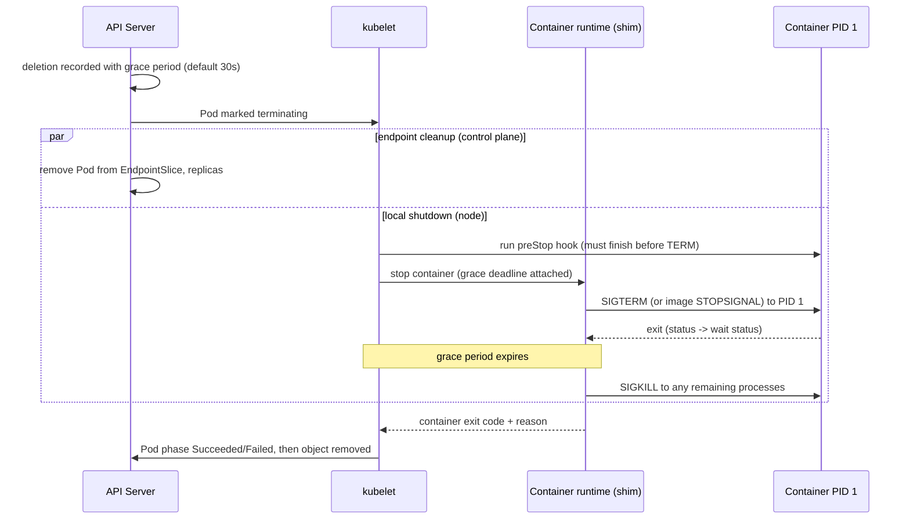

# Kubernetes: Termination, Restart Decisions, and Exit Reasoning

> Covers CT-006 (kubelet termination flow), CT-007 (restart policies, CrashLoopBackOff, container states/reasons), CT-008 (OOM vs eviction, termination messages, deletion mechanics, Job `backoffLimit`).

## Introduction

Kubernetes wraps the container-level semantics of [PID 1](pid1-signals.md) and [Docker](docker.md) in a policy layer: grace periods, lifecycle hooks, restart policies, exponential backoff, and eviction. Every one of these policies *consumes* exit codes and signals — so misreading a `137` or a `CrashLoopBackOff` usually means misreading which policy produced it. This chapter follows the documented kubelet behavior end to end, and marks where the published documentation stops and the kubelet implementation (which the docs describe only as "exponential backoff") begins.

## The kubelet termination flow (CT-006)

The [Pod lifecycle documentation](https://kubernetes.io/docs/concepts/workloads/pods/pod-lifecycle/) specifies the sequence when you request deletion of a Pod:

1. The cluster "records and tracks the intended grace period before the Pod is allowed to be forcefully killed" and the kubelet "attempts graceful shutdown". The grace period defaults to **30 seconds** (`terminationGracePeriodSeconds` "Defaults to 30 seconds" — [Pod API reference](https://kubernetes.io/docs/reference/kubernetes-api/workload-resources/pod-v1/)).
2. "Typically, with this graceful termination of the pod, kubelet makes requests to the container runtime to attempt to stop the containers in the pod by first sending a TERM (aka. SIGTERM) signal, with a grace period timeout, to the **main process in each container**." The stop requests are processed **asynchronously**, with "no guarantee to the order of processing".
3. Many runtimes honor the image's STOPSIGNAL instead of TERM: "Many container runtimes respect the STOPSIGNAL value defined in the container image and, if different, send the container image configured STOPSIGNAL instead of TERM. ... If no stop signal is defined in the image, the default signal of the container runtime (SIGTERM for both containerd and CRI-O) would be used." (A pod-level `lifecycle.stopSignal` override exists as an alpha feature since v1.33, behind the `ContainerStopSignals` gate.)
4. "Once the grace period has expired, the KILL signal is sent to any remaining processes, and the Pod is then deleted from the API Server." If the kubelet or runtime is restarted mid-termination, "the cluster retries from the start including the full original grace period".

The preStop hook slots in *before* the TERM signal — and its timing is charged to the same grace period ([Container lifecycle hooks](https://kubernetes.io/docs/concepts/containers/container-lifecycle-hooks/)):

> "A call to the PreStop hook fails if the container is already in a terminated or completed state and the hook must complete before the TERM signal to stop the container can be sent. The Pod's termination grace period countdown begins before the PreStop hook is executed, so regardless of the outcome of the handler, the container will eventually terminate within the Pod's termination grace period."

The hook page quantifies the trap: with `terminationGracePeriodSeconds: 60`, a preStop that takes 55 s and a container that then needs 10 s to stop means "the Container will be killed before it can stop normally, since terminationGracePeriodSeconds is less than the total time (55+10)". If the preStop is still running when the grace period expires, the kubelet grants "a small, one-off grace period extension of 2 seconds" (pod-lifecycle docs). Failed hooks surface as `FailedPostStartHook`/`FailedPreStopHook` events, and "the logs for a hook handler are not exposed in Pod events".



The kubelet records the end state as a normal container status, and `kubectl describe pod` during the window shows the pod as `Terminating`. A composite view of the documented timeline:

| Phase | What happens (documented) | Source |
|-------|---------------------------|--------|
| `t=0` | deletion requested; grace period recorded (default 30 s) | pod-lifecycle; Pod API (`Defaults to 30 seconds`) |
| endpoint cleanup | EndpointSlice/replica removal proceeds **in parallel** with local shutdown | pod-lifecycle |
| preStop (optional) | hook must finish before TERM can be sent; still-running hook gets a one-off 2 s extension at expiry | hooks; pod-lifecycle |
| TERM | runtime sends TERM (or image STOPSIGNAL) to PID 1 of each container, asynchronously, unordered | pod-lifecycle |
| grace expiry | SIGKILL to any remaining processes; pod deleted from API server | pod-lifecycle |
| terminal | container statuses finalized; pod phase `Failed`/`Succeeded`; object removed (finalizers permitting) | pod-lifecycle; API concepts |

On finalizers: when you delete an object that has finalizers, the API server "marks the object for deletion by populating `.metadata.deletionTimestamp`" and it "remains in a terminating state while the control plane, or other components, take the actions defined by the finalizers" ([API concepts — Finalizers](https://kubernetes.io/docs/concepts/overview/working-with-objects/finalizers/)). For pods this means the node-side shutdown proceeds, but the API object can linger in `Terminating` until the finalizer owner acts — a common confusion when reading `kubectl get pods` during an incident.

Also note the probe connection: PreStop runs "due to an API request or management event such as a liveness/startup probe failure, preemption, resource contention and others" ([hooks](https://kubernetes.io/docs/concepts/containers/container-lifecycle-hooks/)) — so a misconfigured liveness probe kills pods through this very flow. The Pod API adds a separate `probe-level terminationGracePeriodSeconds` (beta, behind the `ProbeTerminationGracePeriod` gate) that overrides the pod-level grace specifically for probe failures.

Two operational consequences follow directly from the documented flow:

- **SIGTERM goes to PID 1 only.** Whatever the image runs as PID 1 must forward or handle it (see [PID 1 and Entrypoints](pid1-signals.md)); a shell-PID-1 image turns every termination into a full-grace-period wait ending in SIGKILL.
- **Ordering is not guaranteed** across the containers of a pod ("the containers in the Pod receive the TERM signal at different times and in an arbitrary order. If the order of shutdowns matters, consider using a preStop hook to synchronize (or switch to using sidecar containers)" — pod-lifecycle docs; sidecar containers get special ordering).

Deletion mechanics interplay (brief): setting `--grace-period=0` with `kubectl delete` requires `--force` and removes the API object immediately; the pod-lifecycle docs caution that forced deletions "can be potentially disruptive". A Pod with **finalizers** cannot fully disappear: deletion only sets `metadata.deletionTimestamp` and the object lingers in `Terminating` until the finalizer owner completes and removes the finalizer — the kubelet's local shutdown still proceeds, but the API object's removal is what remains blocked. Treat per-finalizer behavior as controller-specific.

## What the kubelet records: states, reasons, exit codes (CT-007)

The pod-lifecycle page defines exactly three container states:

> "There are three possible container states: Waiting, Running, and Terminated."

and gives the pod-level phases that summarize them (paraphrased from the documented definitions):

| Pod phase | Documented meaning |
|-----------|---------------------|
| Pending | "accepted by the Kubernetes cluster, but one or more of the containers has not been set up and made ready to run" (includes scheduling and image download) |
| Running | "bound to a node, and all of the containers have been created. At least one container is still running, or is in the process of starting or restarting" |
| Succeeded | "All containers in the Pod have terminated in success, and will not be restarted" |
| Failed | "All containers in the Pod have terminated, and at least one container has terminated in failure ... not set for automatic restarting" |
| Unknown | "the state of the Pod could not be obtained", typically a node communication error |

Per-container state table:

| State | Meaning (documented) | What `kubectl describe pod` shows |
|-------|----------------------|------------------------------------|
| Waiting | "not in either the Running or Terminated state ... still running the operations it requires in order to complete start up" (image pull, secrets) | a `Reason` field, e.g. `ContainerCreating`, `CrashLoopBackOff` |
| Running | "a container is executing without issues" | time entered Running |
| Terminated | "began execution and then either ran to completion or failed for some reason" | "a reason, an exit code, and the start and finish time" |

For a Terminated container the two fields that matter are the **exit code** and the **reason**. The documented convention: exit code `0` → reason `Completed`; non-zero → reason `Error`; kernel OOM kill inside the container's memory limit → reason `OOMKilled` (this reason is surfaced by the kubelet from the runtime's OOM detection, the same signal that sets Docker's `OOMKilled` flag — see [Docker](docker.md)). Pod **phase** then aggregates the containers: `Succeeded` = "All containers in the Pod have terminated in success, and will not be restarted"; `Failed` = "terminated ... at least one container has terminated in failure ... and is not set for automatic restarting".

`kubectl describe pod` renders all of this in one view (example output, annotated):

```text
    State:          Waiting
      Reason:       CrashLoopBackOff
    Last State:     Terminated
      Reason:       OOMKilled          # the metadata that proves OOM
      Exit Code:    137                # 128+9 by convention
      Started:      Mon, 12 Oct 2026 09:14:02 +0000
      Finished:     Mon, 12 Oct 2026 09:15:47 +0000
    Ready:          False
    Restart Count:  6                  # backoff grows with this
    Events:
      Type     Reason   Age                  Message
      ----     ------   ----                 -------
      Normal   Killing  2m (x6 over 21m)    Stopping container myapp
      Warning  BackOff  91s (x9 over 8m)    Back-off restarting failed container
```

The `Killing`, `BackOff` and (on failed hooks) `FailedPreStopHook`/`FailedPostStartHook` events come from the kubelet paths documented in pod-lifecycle and the hooks page; the debug docs recommend `kubectl describe pods <name>` and `kubectl logs <name> --previous` as the first steps ([Debug Pods](https://kubernetes.io/docs/tasks/debug/debug-application/debug-pods/)).

You can read the raw fields without scrolling `describe` output:

```console
$ kubectl get pod mypod -o jsonpath='{.status.containerStatuses[0].lastState.terminated}' | jq
{
  "exitCode": 137,
  "reason": "OOMKilled",
  "startedAt": "2026-10-12T09:14:02Z",
  "finishedAt": "2026-10-12T09:15:47Z"
}
```

## Restart decisions (CT-007)

### restartPolicy

The Pod's `restartPolicy` is Always/OnFailure/Never, "The default value is Always", and applies to app containers and regular init containers; sidecars (init containers with container-level `restartPolicy: Always`) ignore the pod-level value. For init containers specifically: "the kubelet restarts the init container if the Pod level restartPolicy is either OnFailure or Always" — a failed init container that cannot succeed under the pod's policy strands the pod instead of looping. The documented restart-behavior table ([pod-lifecycle](https://kubernetes.io/docs/concepts/workloads/pods/pod-lifecycle/)):

| Exit Code | Always | OnFailure | Never | Sidecar |
|-----------|--------|-----------|-------|---------|
| 0 (Success) | Restarts | Does not restart | Does not restart | Always restarts |
| Non-zero (Failure) | Restarts | Restarts | Does not restart | Always restarts |

Note what this table implies for exit-code semantics: under `OnFailure`, an application that exits **0** after being SIGTERMed is "successful" and is *not* restarted — one reason SIGTERM handlers should exit 0 (or use tini's `-e` remapping; see [PID 1 and Entrypoints](pid1-signals.md)). The docs also state the workload-type connection: Deployments require `Always`; Jobs "commonly use restartPolicy: OnFailure or Never". The page's own example ("Web server with restartPolicy: Always, typical for Deployments") shows the shape:

```yaml
apiVersion: v1
kind: Pod
metadata:
  name: web-server
spec:
  restartPolicy: Always   # container restarts regardless of exit code
containers:
- name: nginx
  image: nginx:1.14.2     # if it crashes or exits for any reason, it restarts
```

### Tuning knobs and their defaults

| Knob | Documented default / value | Notes |
|------|---------------------------|-------|
| `restartPolicy` | `Always` | the documented pod-level default; Jobs must set `OnFailure`/`Never` explicitly |
| `terminationGracePeriodSeconds` | 30 s | zero means "stop immediately via the kill signal (no opportunity to shut down)" (Pod API) |
| preStop extension | one-off 2 s at grace expiry | pod-lifecycle |
| Runtime stop signal | image STOPSIGNAL, else runtime default (SIGTERM for containerd/CRI-O) | pod-lifecycle |
| `lifecycle.stopSignal` | alpha since v1.33, `ContainerStopSignals` gate, requires `spec.os.name` | pod-lifecycle |
| Probe-level grace | `terminationGracePeriodSeconds` under probes — beta, `ProbeTerminationGracePeriod` gate, min 1 | Pod API |
| Crash-loop backoff | exponential, reset after ~10 min of stability | documented as "exponential backoff"; 10 s→300 s cap are implementation constants |

### Sidecars, init containers, and native sidecar containers

Three rules from the pod-lifecycle page keep restart reasoning straight:

- Sidecar containers (init containers with container-level `restartPolicy: Always`) "ignore the Pod-level restartPolicy field" and restart on every exit — success or failure.
- Regular init containers follow the pod-level policy and must complete before app containers start; a failed init container under `Never` strands the pod rather than looping.
- Termination ordering is documented precisely: "the kubelet will delay sending the TERM signal to these sidecar containers until the last main container has fully terminated. The sidecar containers will be terminated in the reverse order they are defined in the Pod spec" — and if the grace period expires mid-shutdown, "all remaining containers in the Pod will be terminated simultaneously with a short grace period."

### CrashLoopBackOff and the backoff sequence

Documented behavior (pod-lifecycle): after an "initial crash" the kubelet "attempts an immediate restart based on the Pod restartPolicy"; for "repeated crashes ... Kubernetes applies an exponential backoff delay for subsequent restarts"; the `CrashLoopBackOff` status "indicates that the backoff delay mechanism is currently in effect"; and there is a "backoff reset: if a container runs successfully for a certain duration (e.g., 10 minutes), Kubernetes resets the backoff delay, treating any new crash as the first one".

The concrete numbers are an **implementation detail of the kubelet** (verify against your cluster's version): in `pkg/kubelet/kubelet.go` the backoff is created with an initial period of **10 s** (`initialCrashLoopBackOff`) and a maximum of **300 s** (`MaxContainerBackOff` = 5 minutes), reset when the last update is older than **600 s**; the delay doubles per restart with jitter (`client-go flowcontrol.Backoff`: `delay := entry.backoff * 2 // exponential`, capped at the max). Alpha feature gates change the defaults (`ReduceDefaultCrashLoopBackOffDecay`: 1 s initial / 60 s max; `KubeletCrashLoopBackOffMax`: operator-configurable cap). So the commonly observed cadence 10s → 20s → 40s → 80s → 160s → ~300s is real but jittered and version-dependent — cite it as implementation, not contract.

The `Back-off restarting failed container` warning event emitted while backing off comes from this same code path.

## OOM vs eviction vs termination (CT-008)

Three different mechanisms can end a container's life and all three can look like "it died with 137":

1. **In-container (cgroup) OOM kill.** The kernel OOM killer kills inside the container's cgroup. The kubelet records reason `OOMKilled` (typically exit 137). Pod-lifecycle's companion page on [node-pressure eviction](https://kubernetes.io/docs/concepts/scheduling-eviction/node-pressure-eviction/) draws the contrast explicitly: "Unlike pod eviction, if a container is OOM killed, the kubelet can restart it based on its restartPolicy." In-container OOM does not evict the pod.
2. **Node-pressure eviction.** The kubelet itself evicts pods when node resources (memory, disk, pid) cross configured thresholds — this is a kubelet decision, *before* the kernel OOM killer has to act. When the node hits true out-of-memory anyway, the docs describe the kernel fallback: the `oom_killer` computes `oom_score` + `oom_score_adj` and "kills the container with the highest score", using the QoS-based table (Guaranteed `-997`, BestEffort `1000`, Burstable `min(max(2, 1000 − (1000 × memoryRequestBytes) / machineMemoryCapacityBytes), 999)`; system-node-critical pods get `-997`).
3. **Termination (graceful or not).** Pod deletion or probe-failure kills follow the termination flow above: SIGTERM → grace expiry → SIGKILL (exit 137 territory again — with `reason: Error`, not `OOMKilled`).

The 137 lesson from [Docker](docker.md) carries over verbatim: **the exit code never establishes OOM by itself**; the `reason: OOMKilled` / `OOMKilled: true` metadata, kernel logs, or the cgroup `memory.events` `oom_kill` counter do (kernel cgroup-v2 docs: `oom_kill` counts "processes belonging to this cgroup killed by any kind of OOM killer").

How exit code and reason feed the state machine, end to end:

| Observation at the runtime | kubelet records | restartPolicy consequence |
|----------------------------|-----------------|---------------------------|
| PID 1 called `exit(0)` | `exitCode: 0`, `reason: Completed` | Always→restart; OnFailure/Never→leave terminated |
| PID 1 exited non-zero | `exitCode: N`, `reason: Error` | Always/OnFailure→restart (with backoff); Never→pod phase `Failed` |
| Kernel OOM kill in the container cgroup | `exitCode: 137`, `reason: OOMKilled` | a failure like any other: Always/OnFailure restart it ([node-pressure eviction](https://kubernetes.io/docs/concepts/scheduling-eviction/node-pressure-eviction/): "the kubelet can restart it based on its restartPolicy") |
| Grace-expiry SIGKILL after deletion | `exitCode: 137`, `reason: Error` | pod is terminating; restart is moot |
| Kubelet eviction (node pressure) | graceful shutdown via the normal termination flow | pod removed; rescheduled elsewhere by the controller |

### Termination messages

Pods can carry a short diagnostic string per container ([Pod API reference](https://kubernetes.io/docs/reference/kubernetes-api/workload-resources/pod-v1/)):

- `terminationMessagePath` — file the container writes its final status to; "Will be truncated by the node if greater than 4096 bytes. The total message length across all containers will be limited to 12kb. Defaults to `/dev/termination-log`."
- `terminationMessagePolicy` — `File` (default; use the file on success and failure) or `FallbackToLogsOnError`: "will use the last chunk of container log output if the termination message file is empty and the container exited with an error. The log output is limited to 2048 bytes or 80 lines, whichever is smaller."

`FallbackToLogsOnError` is the cheapest way to make `kubectl describe pod` show an app's assertion failure — and the message, unlike the exit code, can distinguish app-level from config-level crashes in a CrashLoopBackOff (see [Troubleshooting Scenarios](troubleshooting-scenarios.md); the task-oriented docs page is "Determine the Reason for Pod Failure" on kubernetes.io).

### Probe failures and termination

Probes close the loop between health and the exit machinery: a failed liveness probe restarts the container through the kill path, and — per the hooks page — PreStop runs for "management event such as a liveness/startup probe failure". So an app whose logs show repeated graceful shutdowns it did not ask for may be failing probes, not being deleted; the events column distinguishes them (`Unhealthy` events for probes vs `Killing` initiated by deletion).

### Jobs: backoffLimit instead of restartPolicy looping

For batch workloads the loop is different: a Job with `restartPolicy: OnFailure` restarts containers *inside the same pod*; with `Never` the Job controller "creates a replacement Pod as soon as the termination becomes apparent". Either way "By default, each pod failure is counted towards the `.spec.backoffLimit` limit" — and the [Job API reference](https://kubernetes.io/docs/reference/kubernetes-api/workload-resources/job-v1/) documents that `backoffLimit` "Specifies the number of retries before marking this job failed. **Defaults to 6**" (unless `backoffLimitPerIndex` is set, for Indexed Jobs; when that is set, `backoffLimit` defaults to `2147483647`). `podFailurePolicy` can exempt classes of failures from the counter — "the default behaviour applies - the counter of failed pods, represented by the job's `.status.failed` field, is incremented and it is checked against the backoffLimit" — but "cannot be used in combination with restartPolicy=OnFailure". So for Jobs, a `137` may simply consume backoff budget — unless a podFailurePolicy declares it non-retryable. A minimal Job from the Jobs docs shows the knobs together:

```yaml
apiVersion: batch/v1
kind: Job
spec:
  template:
    spec:
      restartPolicy: Never   # replacement pods, counted per failure
  backoffLimit: 4            # example from the Jobs page (default 6)
```

## Related Topics

- [PID 1 and Entrypoints](pid1-signals.md) — what receives the TERM the kubelet sends, and zombie reaping
- [Docker](docker.md) — 128+N, 125/126/127, `OOMKilled` flag, docker stop flow
- [Troubleshooting Scenarios](troubleshooting-scenarios.md) — scenario drills for 137, silent SIGTERM, CrashLoopBackOff
- [Kubernetes and Linux](../../containers/kubernetes.md) — kubelet/CRI architecture background
- [Docker Internals](../../containers/docker-internals.md) — the runtime stack under the kubelet
- [Process States](../../kernel/processes/process-states.md) — zombie/defunct states referenced by the reaping discussion

## References

- Kubernetes Docs — Pod Lifecycle (termination flow, default 30 s grace, STOPSIGNAL handling, container states Waiting/Running/Terminated, restart policy table, CrashLoopBackOff and backoff reset, forced deletion). https://kubernetes.io/docs/concepts/workloads/pods/pod-lifecycle/ (accessed October 2026)
- Kubernetes Docs — Container Lifecycle Hooks (PreStop ordering vs TERM, grace accounting, 55+10 > 60 example, hook failure events). https://kubernetes.io/docs/concepts/containers/container-lifecycle-hooks/ (accessed October 2026)
- Kubernetes Docs — API Concepts: Finalizers (`deletionTimestamp` semantics, terminating state until finalizers removed). https://kubernetes.io/docs/concepts/overview/working-with-objects/finalizers/ (accessed October 2026)
- Kubernetes API Reference — Pod v1 (`terminationGracePeriodSeconds` defaults to 30; `terminationMessagePath` /dev/termination-log, 4096 B/12 kB limits; `terminationMessagePolicy` File/FallbackToLogsOnError, 2048 B/80 lines). https://kubernetes.io/docs/reference/kubernetes-api/workload-resources/pod-v1/ (accessed October 2026)
- Kubernetes Docs — Node-pressure eviction (kubelet eviction vs kernel oom_killer, QoS `oom_score_adj` table, restart-after-OOM contrast). https://kubernetes.io/docs/concepts/scheduling-eviction/node-pressure-eviction/ (accessed October 2026)
- Kubernetes API Reference — Job v1 (`backoffLimit` defaults to 6; `podFailurePolicy` constraints). https://kubernetes.io/docs/reference/kubernetes-api/workload-resources/job-v1/ (accessed October 2026)
- Kubernetes Docs — Jobs: Run to Completion (failure counting against backoffLimit; replacement pod timing). https://kubernetes.io/docs/concepts/workloads/controllers/job/ (accessed October 2026)
- Kubernetes Docs — Debug Pods (describe/events workflow; links to "Determine the Reason for Pod Failure"). https://kubernetes.io/docs/tasks/debug/debug-application/debug-pods/ (accessed October 2026)
- Kubernetes source — `pkg/kubelet/apis/config/v1beta1/defaults.go` (`MaxContainerBackOff = 300 * time.Second`; `CrashLoopBackOff.MaxContainerRestartPeriod` default). https://github.com/kubernetes/kubernetes (implementation detail; accessed October 2026)
- Kubernetes source — `pkg/kubelet/kubelet.go` (`initialCrashLoopBackOff` 10 s, 600 s reset via `HasExpiredFunc`, feature gates `ReduceDefaultCrashLoopBackOffDecay`, `KubeletCrashLoopBackOffMax`). https://github.com/kubernetes/kubernetes (implementation detail; accessed October 2026)
- Kubernetes source — `client-go/util/flowcontrol/backoff.go` (exponential doubling with jitter, cap). https://github.com/kubernetes/client-go (implementation detail; accessed October 2026)
- Kernel Documentation — Control Group v2 (`memory.events` `oom_kill` counter). https://www.kernel.org/doc/Documentation/cgroup-v2.txt (accessed October 2026)
