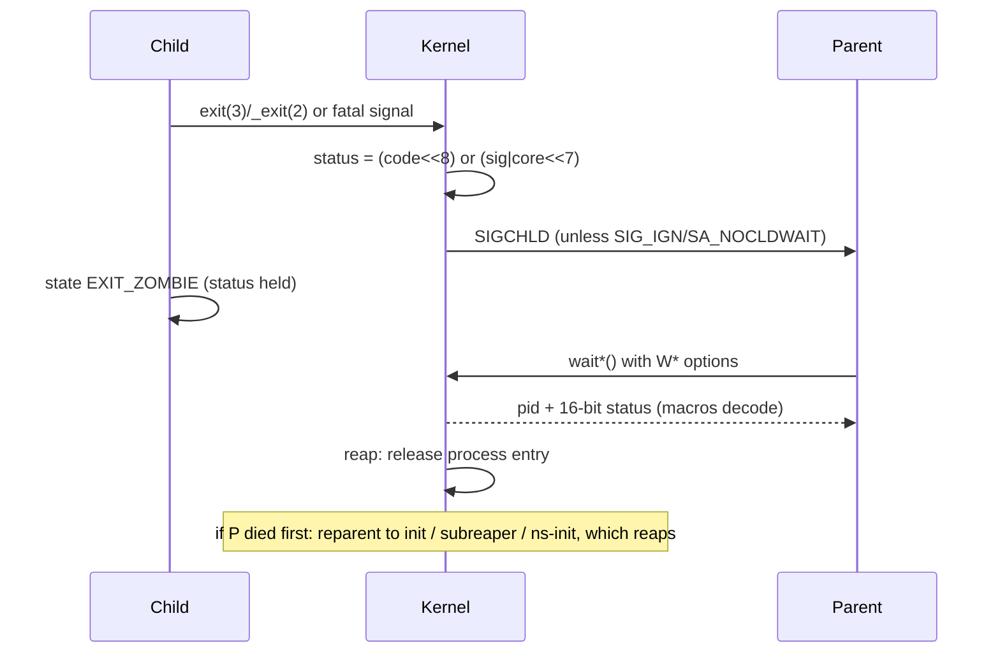

# The Life of an Exit Status (EX-001 — EX-009)

An exit status passes through three distinct layers on its way from a dying process to the
human (or script) that will act on it:

1. **Termination** — the kernel marks the process dead and *encodes* a 16-bit wait status
   (exit code in bits 8–15, signal in bits 0–6, core-dump flag in bit 7). This layer is pure
   Linux implementation.
2. **Status collection** — the parent *decodes* the 16-bit word with the `W*` macros from
   `wait(2)`/`waitpid(2)`/`waitid(2)`. `WEXITSTATUS` hands back only 8 of those bits, so any
   finer information is dropped at exactly this point.
3. **Shell reporting** — a shell translates the collected status into `$?`, using the
   `128+N` convention for signal deaths (POSIX 2.8.2: "greater than 128").

Conflating these three layers is the root of most exit-status folklore. This page traces the
status end to end; [conventions.md](./conventions.md) catalogues the *interpretations* people
stack on top of it.

## EX-001 — `exit(3)`: the normal-termination ceremony

```c
#include <stdlib.h>
void exit(int status);          /* C11 7.22.4.4, POSIX */
```

`exit(3)` is the *cooperative* termination path: it unwinds the process politely before the
kernel ever sees it (per [exit(3)](https://man7.org/linux/man-pages/man3/exit.3.html)):

1. Functions registered with `atexit(3)`/`on_exit(3)` are called in **reverse order** of
   registration. If one of them does not return (it calls `_exit(3)`, or dies on a signal),
   "none of the remaining functions is called, and further exit processing (in particular,
   flushing of stdio streams) is abandoned" (per exit(3)).
2. All open stdio streams are **flushed and closed**; files created by `tmpfile(3)` are
   removed.
3. Files opened with unbuffered/line-buffered stdio are handled per their buffering; buffers
   for streams attached to an interactive device are line-buffered by default, so the
   flush ordering relative to `_exit`-style paths matters (see EX-002).

What the parent receives is not `status` itself: "The `exit()` function causes normal process
termination and the **least significant byte of `status`** (i.e., `status & 0xFF`) is returned
to the parent" (per exit(3)). The truncation consequences are EX-005.

The C standard (C11 7.22.4.4) defines `EXIT_SUCCESS` and `EXIT_FAILURE` as the portable
success/failure spellings — on Linux they are `0` and `1`, and `exit(3)` notes that any
non-zero value generally means "unsuccessful", but only the two macros are portable beyond
Unix. POSIX `exit(1posix)` adds that a value larger than 255 "might be truncated by the
shell, and be unavailable even to a parent process that uses `waitid()` to get the full exit
value" — the exit-status channel is 8 bits wide, full stop.

Registration caveats worth remembering (per exit(3)): calling `exit()` or `longjmp(3)` from
an `atexit` handler is undefined behavior, and a successful `execve(2)` **discards** all
`atexit` registrations — the new program starts with a clean exit-handler list.

## EX-002 — `_exit(2)` / `_Exit(3)`: immediate, unceremonious termination

```c
#include <unistd.h>
void _exit(int status);         /* POSIX.1-2024 */
#include <stdlib.h>
void _Exit(int status);         /* C11, POSIX.1-2024 */
```

`_Exit(3)` is equivalent to `_exit(2)`; both terminate the calling process **immediately**
(per [_exit(2)](https://man7.org/linux/man-pages/man2/_exit.2.html)):

- Open file descriptors are closed (which "may cause an unknown delay, waiting for pending
  output to finish" — if that is undesirable, `tcflush(3)`-style preparation is the caller's
  job; whether pending I/O is cancelled is implementation-dependent).
- stdio buffers are **not** flushed; `atexit` handlers are **not** run. Data written with
  `printf` but not yet flushed is simply lost if the stream is fully buffered (a pipe).
- Children are reparented to init(1) "or the nearest *subreaper* process as defined through
  the use of the `prctl(2) PR_SET_CHILD_SUBREAPER` operation", and the parent is sent
  `SIGCHLD` (per _exit(2); see EX-008).
- The parent sees `status & 0xFF` as the exit status — the same 8-bit funnel as `exit(3)`,
  quoted verbatim in _exit(2).

There are two classic legitimate uses: inside a **forked child** that fails before `exec`
(calling `exit(3)` there would run the parent's `atexit` handlers and flush the parent's
duplicated stdio buffers *twice*), and inside a **signal handler** or async context, because
`_exit` is async-signal-safe (see [async-signal-safety](../interfaces/async-signal-safety.md)).

One Linux subtlety matters for multithreaded programs: the glibc *wrapper* implements the
POSIX meaning — terminate all threads. The **raw kernel syscall terminates only the calling
thread**, and reparenting/SIGCHLD side effects happen only when the last thread in the group
exits (per _exit(2), "C library/kernel differences"). The kernel entry itself is
`SYSCALL_DEFINE1(exit, int, error_code) { do_exit((error_code & 0xff) << 8); }` — the 8-bit
truncation and the shift into bits 8–15 of the wait status are visible right there in
`kernel/exit.c` (verified against Linux master, `kernel/exit.c`).

The per-syscall details live in [_exit(2)](../../syscalls/process/_exit.md); the surrounding
`fork`/`exec`/`wait` program flow is developed in
[process-control](../../sysprog/process-control.md).

## EX-003 — Collecting the status: `wait(2)`, `waitpid(2)`, `waitid(2)`

The only way to *learn* a child's wait status is the wait family (per
[wait(2)](https://man7.org/linux/man-pages/man2/wait.2.html)):

| Interface | Form | Notes |
|-----------|------|-------|
| `wait(int *wstatus)` | Blocks for **any** child | Equivalent to `waitpid(-1, &wstatus, 0)`; fails `ECHILD` when no children remain. |
| `waitpid(pid, &wstatus, options)` | Targeted: `pid` >0, =0 (process group), =−1, <−1 | Non-blocking via `WNOHANG`; can select stopped children via `WUNTRACED` (EX-007). |
| `waitid(idtype, id, &infop, options)` | Structured result: `si_signo=SIGCHLD`, `si_code` (`CLD_EXITED`/`CLD_KILLED`/`CLD_DUMPED`/`CLD_STOPPED`/`CLD_TRAPPED`/`CLD_CONTINUED`), `si_status` | Finer-grained idtypes `P_ALL`, `P_PID`, `P_PGID`, `P_PIDFD` (verified in `include/uapi/linux/wait.h`); `WNOWAIT` polls without reaping. |

`wait3()`/`wait4()` are the legacy BSD forms (rusage instead of / in addition to the status
word); Linux still exposes `wait4(2)` and it is what most libcs call for `waitpid` — see the
per-syscall pages [wait4](../../syscalls/process/wait4.md) and
[waitid](../../syscalls/process/waitid.md).

The macros all take the `int wstatus` word (EX-004 shows its exact bit layout):

```c
/* Verified verbatim against wait(2) macro descriptions */
WIFEXITED(wstatus)   /* true if the child terminated normally via exit(3)/_exit(3)/return from main */
WEXITSTATUS(wstatus) /* the low 8 bits the child passed to exit(3)/_exit(3); use only if WIFEXITED */
WIFSIGNALED(wstatus) /* true if terminated by a signal */
WTERMSIG(wstatus)    /* signal number that caused termination; use only if WIFSIGNALED */
WCOREDUMP(wstatus)   /* true if the child produced a core dump (POSIX.1-2024 added it); only if WIFSIGNALED */
WIFSTOPPED(wstatus)  /* true if stopped by delivery of a signal; requires WUNTRACED or tracer */
WSTOPSIG(wstatus)    /* signal that stopped the child */
WIFCONTINUED(wstatus)/* true if resumed by SIGCONT (since Linux 2.6.10; requires WCONTINUED) */
```

`ECHILD` deserves a note: it can mean "no children at all", or — subtle but standard — the
caller set `SIGCHLD` to `SIG_IGN` (or `SA_NOCLDWAIT`), in which case children never become
zombies and the wait "will block until all children have terminated, and then fail with errno
set to ECHILD" (per wait(2) NOTES).

## EX-006 — The three death classes the parent observes

The 16-bit status word collapses every child death into one of three shapes, and the macro
combination tells the parent which:

| Death class | How it happens | Parent's macros | Kernel `si_code` (waitid) |
|-------------|----------------|-----------------|---------------------------|
| Normal exit | `exit(3)`, `_exit(3)`, return from `main()` | `WIFEXITED`; code = `WEXITSTATUS` | `CLD_EXITED` |
| Signal termination | uncaught fatal signal, `kill(2)` etc. | `WIFSIGNALED`; `WTERMSIG`; `WCOREDUMP` usually false | `CLD_KILLED` |
| Signal termination **with core dump** | fatal signal whose default action is `Core` (SIGQUIT, SIGILL, SIGABRT, SIGFPE, SIGSEGV, ...) | `WIFSIGNALED` + `WCOREDUMP`; same `WTERMSIG` | `CLD_DUMPED` |

Two asymmetries are worth internalizing:

- **The signal is preserved; the exit code is not.** A signal death reports `WTERMSIG` (a
  signal *number*, up to 64 on Linux) with no exit code at all; a normal exit reports an 8-bit
  code with no signal. The shell's `128+N` convention (EX-009, and
  [conventions.md](./conventions.md)) exists precisely to flatten both classes back into one
  8-bit channel.
- **A core dump is evidence, not a guarantee.** `WCOREDUMP` says the *kernel attempted* a
  core dump, and core(5) lists many ways the attempt silently fails: `RLIMIT_CORE`/`RLIMIT_FSIZE`
  = 0 ("However, RLIMIT_CORE will be ignored if the system is configured to pipe core dumps to
  a program"), no write permission, a non-readable binary, `suid_dumpable` restrictions, or an
  empty `core_pattern` (per [core(5)](https://man7.org/linux/man-pages/man5/core.5.html)).
  Conversely, the *absence* of a core file does not mean the process did not crash. Which
  signals dump core by default is tabulated in
  [standard-signals](../signals/standard-signals.md) (`signal(7)`'s "Core" action column).

If you need to *observe* crashes rather than infer them, `waitid()`'s `CLD_DUMPED` vs
`CLD_KILLED` distinction and the `core_pattern` pipe mechanism (systemd-coredump) are the
structured interfaces; the signal-generation side is covered in
[kill-raise](../interfaces/kill-raise.md).

## EX-004 — The exact 16-bit wait status layout (Linux)

POSIX deliberately specifies the *macros*, not the bit layout ("exact bit layout is kernel
implementation detail"). On Linux the layout is stable and observable from two primary
sources:

**glibc** defines the macros in `bits/waitstatus.h` (quote: "Everything extant so far uses
these same bits"; verified against glibc master):

```c
#define __WEXITSTATUS(status) (((status) & 0xff00) >> 8)  /* bits 8-15: exit code   */
#define __WTERMSIG(status)    ((status) & 0x7f)           /* bits 0-6:  signal      */
#define __WIFSTOPPED(status)  (((status) & 0xff) == 0x7f) /* low byte 0x7f: stopped */
#define __WCOREDUMP(status)   ((status) & 0x80)           /* bit 7:     core flag   */
#define __W_EXITCODE(ret,sig) ((ret) << 8 | (sig))        /* construct exit-status  */
#define __W_STOPCODE(sig)     ((sig) << 8 | 0x7f)         /* construct stop-status  */
#define __W_CONTINUED         0xffff                      /* continued sentinel     */
#define __WCOREFLAG           0x80
```

**The kernel** produces exactly these bits in `kernel/exit.c` (verified against Linux master):

```c
SYSCALL_DEFINE1(exit, int, error_code)
{
    do_exit((error_code & 0xff) << 8);          /* exit code -> bits 8-15 */
}
/* wait_task_zombie(): decoding when the parent reaps */
if ((status & 0x7f) == 0) {
    infop->cause = CLD_EXITED;  infop->status = status >> 8;
} else {
    infop->cause = (status & 0x80) ? CLD_DUMPED : CLD_KILLED;
    infop->status = status & 0x7f;              /* signal in bits 0-6 */
}
/* stopped children: wo->wo_stat = (exit_code << 8) | 0x7f; */
```

Bit map of the `int` the wait family returns:

| Bits | Meaning | Set by |
|------|---------|--------|
| 0–6 | terminating/stopping signal number (1–64; 0 = normal exit) | fatal-signal path, `__W_STOPCODE` |
| 7 | core-dump flag (`0x80`) | kernel coredump path |
| 8–15 | exit code passed to `exit`/`_exit`, masked to 8 bits (`__W_EXITCODE`) | `sys_exit`: `(error_code & 0xff) << 8` |

Special encodings: a stopped child is reported as `(stop_signal << 8) | 0x7f` — note the low
byte `0x7f` (127) doubles as the "stopped" marker, which is why a *stopped* job's status has
`WIFSTOPPED` true and `WSTOPSIG == WEXITSTATUS` of the raw word; a continued child is reported
as the sentinel `0xffff` (`__W_CONTINUED`), not as a decodable signal/code pair.

Two caveats that keep this honest:

- The task-canonical `include/uapi/linux/wait.h` defines the **wait option flags**
  (`WNOHANG=0x1`, `WUNTRACED=0x2`, `WSTOPPED` alias, `WEXITED=0x4`, `WCONTINUED=0x8`,
  `WNOWAIT=0x01000000`, plus `__WCLONE`/`__WALL`/`__WNOTHREAD` and the `P_ALL`/`P_PID`/
  `P_PGID`/`P_PIDFD` idtypes) — it does **not** contain the status bit layout. The layout is
  set in `kernel/exit.c` and mirrored in glibc's `bits/waitstatus.h`; both are cited above as
  primary evidence.
- POSIX only guarantees the *macros* behave as documented. Anything that reads raw bits
  (e.g., a shell implementing `$?` from `wait4`) must go through the macros to stay portable.

## EX-005 — Truncation to 8 bits: what is lost and where

The funnel has three stages, all of which agree:

1. libc: `exit(3)`/`_exit(2)` return "`status & 0xFF`" to the parent (quoted above).
2. kernel: `sys_exit` executes `do_exit((error_code & 0xff) << 8)` (source above) — so even
   the kernel-side representation never stores more than 8 bits of exit code.
3. POSIX: XCU 2.8.2 — "When reporting the exit status with the special parameter '?', the
   shell shall report the **full eight bits of exit status available**", and `exit(1posix)`'
   RATIONALE warns "A value larger than 255 might be truncated by the shell".

Consequences, with reproduction (bash and dash agree here — this is the kernel contract, not
a shell choice):

```console
$ bash -c 'bash -c "exit 300"; echo rc=$?'
rc=44                # 300 mod 256
$ bash -c 'bash -c "exit 255"; echo rc=$?'
rc=255
$ bash -c 'bash -c "exit 256"; echo rc=$?'
rc=0                 # 256 mod 256 == 0: a *failure* is indistinguishable from success
```

What information is irrecoverably lost:

- **Only the residue mod 256 survives.** `exit(300) == exit(44) == exit(556)`; `exit(256)`
  reports success. A program wanting to signal "3 distinct errors" can, but "error #300"
  cannot be named.
- **What is *not* lost: the distinction between "wrapped exit code" and "signal death".**
  Because signal deaths carry the signal number in bits 0–6 and *zero* in bits 8–15, a shell
  that reports them as `128+N` (EX-009) can never collide with an honest exit code `N ≤ 128`
  passed by a program — `128 ≤ $?` after a signal vs `? < 128` after a normal exit is
  representable in the 16-bit word. What is *not* representable is the difference between
  **two wrapped codes**: after `exit(300)` and `exit(44)` the parent holds identical words,
  and no post-hoc analysis can separate them. (The distinction between "wrapped code" and
  "died-by-signal" is also exactly as strong as the shell's convention — the raw word for
  `exit(128+2)` as a *code* and a SIGINT death are both `0x8202`-style values only at the
  shell layer; in the kernel word the wrapped code 130 sits in bits 8–15, signal 2 in bits
  0–6 — the bits differ, the shell-visible integer may not. See conventions.md for why one
  integer cannot establish cause.)
- **`WEXITSTATUS` of a signal death is garbage** — it is whatever the low *bits 8–15* contain,
  which for signal deaths is 0; only `WTERMSIG` is meaningful (guard with `WIFEXITED`).

POSIX guarantees the 8-bit reporting rule for `$?`; the *modulo wrap* itself is a property of
the `& 0xFF` contract in exit(3)/_exit(2) plus the kernel source — treat specific "how shells
mangle out-of-range `exit` arguments" quirks as shell-specific (e.g., POSIX explicitly leaves
`exit` with an invalid argument or out-of-range value partially unspecified in
`exit(1posix)` RATIONALE).

## EX-007 — Stopped and continued children: `WUNTRACED`, `WCONTINUED`, and waitid idtypes

By default the wait family reports only **terminated** children. Job-control programs
(including shells) need two more event classes:

| Option | Effect (per wait(2)) |
|--------|----------------------|
| `WUNTRACED` | Also report children **stopped** by SIGTTIN/SIGTTOU/SIGTSTP/SIGSTOP via `WIFSTOPPED`/`WSTOPSIG`. |
| `WCONTINUED` | Also report children resumed by `SIGCONT` via `WIFCONTINUED` (Linux ≥ 2.6.10). |
| `WNOWAIT` (waitid only) | Leave the child in a waitable state — poll the status without reaping. |
| `WNOHANG` | Non-blocking: return 0 immediately if no child has changed state yet. |

The corresponding statuses are *not* terminal: a stopped child can be continued, and a
continued child later dies. A robust waiter therefore loops until `WIFEXITED ||
WIFSIGNALED`, exactly as the wait(2) example program does:

```c
do {
    w = waitpid(cpid, &status, WUNTRACED | WCONTINUED);
    if (w == -1) { perror("waitpid"); exit(EXIT_FAILURE); }
    if (WIFEXITED(status))  printf("exited, status=%d\n", WEXITSTATUS(status));
    if (WIFSIGNALED(status)) printf("killed by signal %d\n", WTERMSIG(status));
    if (WIFSTOPPED(status))  printf("stopped by signal %d\n", WSTOPSIG(status));
    if (WIFCONTINUED(status)) printf("continued\n");
} while (!WIFEXITED(status) && !WIFSIGNALED(status));
```

Notes with sharp edges:

- `SIGCHLD` is **not** generated for stop/continue by default; `sigaction(2)`'s
  `SA_NOCLDSTOP` flag actually *disables* SIGCHLD on stop (the default already omits
  stop/continue notifications — see [standard-signals](../signals/standard-signals.md) and
  [sigaction coverage](../interfaces/sigaction-signal.md)).
- The Linux-specific idtypes `P_PIDFD` (wait on a `pidfd_open(2)` descriptor — no PID-reuse
  races) and `P_PGID` are visible in `include/uapi/linux/wait.h`, alongside the private
  flags `__WALL`/`__WCLONE`/`__WNOTHREAD` that thread-aware waiters need because a
  "clone" child by default reports only to the wait that selects it (per wait(2) Linux
  notes).
- Shells only get `WUNTRACED`-style reports when *they* implement job control; a
  non-interactive shell does not, which is why "background job got stopped" is invisible to
  most scripts (see shells/bash.md).

## EX-008 — Zombies, orphans, SIGCHLD, and who reaps

A terminated child whose status has not been collected is a **zombie**: it holds only the
process-table entry with the wait status, no address space. The parent collects the status by
waiting; the moment the kernel's `wait_task_zombie()` runs, the entry is released ("reaped").
Verified kernel flow (Linux master, `kernel/exit.c`): the dying task enters `EXIT_ZOMBIE`,
notifies its parent (`do_notify_parent()` → `SIGCHLD` unless `SIG_IGN`/`SA_NOCLDWAIT`), and
the status word computed there is what the parent later decodes (EX-004).

If the parent terminates first, the child becomes an **orphan**: "If a parent process
terminates, then its 'zombie' children (if any) are adopted by init(1), (or by the nearest
'subreaper' process as defined through the use of the `prctl(2) PR_SET_CHILD_SUBREAPER`
operation); init(1) automatically performs a wait to remove the zombies" (per wait(2) NOTES).
So the answer to "who reaps when the parent dies" is layered:

| Process that outlives the parent | Reaping duty | Source |
|----------------------------------|--------------|--------|
| System init (systemd, PID 1 in the root namespace) | Reparents to itself and reaps (`Default*` reaping built into systemd's PID-1 loop) | wait(2); systemd docs |
| `PR_SET_CHILD_SUBREAPER` holder (container shims, some supervisors) | Nearest ancestor wins; reaps its adopted orphans | wait(2), prctl(2) |
| PID-1 of a PID namespace | The namespace init "becomes the parent of any child processes that are orphaned"; if *it* exits, the kernel SIGKILLs the whole namespace | pid_namespaces(7) |

If the parent instead sets `SIGCHLD` to `SIG_IGN` or passes `SA_NOCLDWAIT` to
`sigaction(2)`, children **never become zombies** — the kernel auto-reaps, and the parent's
wait blocks until all children are gone and fails with `ECHILD` (per wait(2) NOTES). Explicit
`SIG_IGN` differs from the default disposition (`Ign` in signal(7)'s table is *not* the same
as "ignoring" SIGCHLD at the kernel's reaping layer) — a genuine Linux-flavored gotcha.

Full lifecycle in one picture:



Zombie leaks in real deployments (double-parenting in containers, missing `wait` in a
supervisor loop) are worked through in [containers/pid1-signals](../containers/pid1-signals.md)
and [service-managers/index](../service-managers/index.md).

## EX-009 — Three layers, three vocabularies

The same event is spoken of in three dialects. Keeping the translation table in your head
prevents most exit-status confusion:

| Layer | Interface | Vocabulary | Guarantee class |
|-------|-----------|------------|-----------------|
| Kernel | `exit(3)`/`_exit(2)` → `do_exit()`; `wait*()` | 16-bit status; bits 0–6 signal, bit 7 core, bits 8–15 code | Linux implementation (source-verified) |
| Parent process | `wait(2)`/`waitpid(2)`/`waitid(2)` | `WIFEXITED`/`WEXITSTATUS`/`WIFSIGNALED`/`WTERMSIG`/`WCOREDUMP`/`WIFSTOPPED`/`WSTOPSIG`/`WIFCONTINUED`; `CLD_*` si_codes | POSIX (macros); `WCOREDUMP`/`WIFCONTINUED` are POSIX.1-2024-era additions; layout not specified by POSIX |
| Shell | `$?`, `wait`, `pipefail` | 0–255; `128+N` for signal N; `>128` "interrupted by signal"; 126/127 for exec failures | POSIX XCU 2.8.2 + per-shell manuals ([shells/](../shells/index.md)) |

POSIX's own fence between layers 2 and 3, verbatim from XCU 2.8.2: "Internally, for purposes
of deciding whether a command exits with a non-zero exit status, the shell shall recognize the
entire status value retrieved for the command by the equivalent of the `wait()` function
WEXITSTATUS macro... When reporting the exit status with the special parameter '?', the shell
shall report the full eight bits of exit status available. The exit status of a command that
terminated because it received a signal **shall be reported as greater than 128**." Note what
POSIX *does not* say: it does not mandate the `128+N` encoding itself — that is the
near-universal convention documented in each shell's manual (bash: "When a command terminates
on a fatal signal whose number is N, Bash uses the value 128+N as the exit status"), which
conventions.md treats as evidence-class *shell convention*, not POSIX guarantee.

The XSI additions POSIX makes are exactly the parent-side macros: signal-death and
stop/continue reporting through `WTERMSIG`/`WIFSTOPPED`/`WSTOPSIG`/`WIFCONTINUED` and the
`CLD_*` codes — i.e., POSIX guarantees that a *conforming parent* can distinguish death
classes; it does not guarantee any particular 16-bit layout.

## Related Topics

- [Exit-status conventions and interpretation](./conventions.md) — the 0/1/126/127/128+N table and why one integer cannot establish cause
- [kill(2), raise(3) and the kill utility](../interfaces/kill-raise.md) — the sending side of termination
- [Standard signals](../signals/standard-signals.md) — default dispositions, `Core` vs `Term` actions
- [Async signal safety](../interfaces/async-signal-safety.md) — why `_exit(2)` is the handler-safe exit
- [Process control](../../sysprog/process-control.md) — fork/exec/wait program architecture
- [wait4(2)](../../syscalls/process/wait4.md), [waitid(2)](../../syscalls/process/waitid.md), [_exit(2)](../../syscalls/process/_exit.md) — per-syscall reference pages
- [PID 1 and signal handling in containers](../containers/pid1-signals.md) — reaping and reparenting under Docker/Kubernetes
- [Service managers](../service-managers/index.md) — how init systems consume exit statuses
- [Shell exit-status mechanics](../shells/index.md) — `$?`, `pipefail`, `PIPESTATUS` across bash/dash/zsh
- [C language chapter](../languages/c.md) — `exit`/`atexit` from the language perspective

## References

- `exit(3)` — Linux man-pages project — <https://man7.org/linux/man-pages/man3/exit.3.html>
- `_exit(2)` — Linux man-pages project — <https://man7.org/linux/man-pages/man2/_exit.2.html>
- `wait(2)` (wait, waitpid, waitid) — Linux man-pages project — <https://man7.org/linux/man-pages/man2/wait.2.html>
- `core(5)` — Linux man-pages project — <https://man7.org/linux/man-pages/man5/core.5.html>
- `signal(7)` — Linux man-pages project — <https://man7.org/linux/man-pages/man7/signal.7.html>
- `pid_namespaces(7)` — Linux man-pages project — <https://man7.org/linux/man-pages/man7/pid_namespaces.7.html>
- Linux kernel `kernel/exit.c` (status encoding in `do_exit`/`sys_exit`, `wait_task_zombie`) — torvalds/linux, GitHub mirror — <https://github.com/torvalds/linux/blob/master/kernel/exit.c>
- Linux kernel `include/uapi/linux/wait.h` (wait option flags, waitid idtypes) — torvalds/linux — <https://github.com/torvalds/linux/blob/master/include/uapi/linux/wait.h>
- glibc `bits/waitstatus.h` (W* macro bit definitions) — GNU C Library (mirror) — <https://github.com/bminor/glibc/blob/master/bits/waitstatus.h>
- POSIX.1-2017 XCU Chapter 2, §2.8 Exit Status and Errors (2.8.2), §2.5.2 (`?`), §2.9.1–2.9.3 — The Open Group — <https://pubs.opengroup.org/onlinepubs/9699919799/utilities/V3_chap02.html>
- Bash Reference Manual, §3.7.5 "Exit Status", §3.7.6 "Signals" — Free Software Foundation / Chet Ramey — <https://www.gnu.org/software/bash/manual/bash.html>
