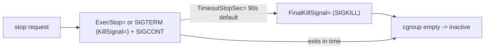

# systemd as a Supervisor — Exit Statuses, Signals, and Restart Policies

This page covers how the systemd service manager observes process death
(exit status vs. signal death), how it maps that observation onto restart
decisions (`Restart=` plus the exit-status/signal conditions), how it
enforces stops (`KillMode=`, `KillSignal=`, `TimeoutStopSec=`,
`FinalKillSignal=`), and how it bounds restart loops (start rate limiting
with `StartLimitIntervalSec=`/`StartLimitBurst=`/`StartLimitAction=`).

It deliberately focuses on the **exit-code / signal / restart angle**. The
general unit grammar, activation lifecycle, and dependency machinery are
covered in [service-units.md](../../init-systems/systemd/service-units.md)
and [overview-architecture.md](../../init-systems/systemd/overview-architecture.md);
the cgroup resource-control angle lives in
[cgroups-resource-control.md](../../init-systems/systemd/cgroups-resource-control.md).
Signal semantics themselves are the subject of
[signals.md](../../sysprog/signals.md); this page only covers what the
service manager does with them.

All option names, values, and defaults below were verified against the
official systemd man pages (`systemd.service(5)`, `systemd.kill(5)`,
`systemd.exec(5)` "Process Exit Codes", `systemd-system.conf(5)`,
`systemd.unit(5)`) as rendered from the systemd source tree (git `main`,
retrieved 2026-10); version-sensitive behavior is called out inline.

## Supervision model and Main PID tracking (SM-005)

systemd is a **cgroup-based supervisor**: every service unit owns a control
group, and *all* processes the unit leaves behind — main process,
`ExecStartPre=` helpers, un-daemonized children, escaped workers — remain
members of that cgroup unless they deliberately break out. The cgroup, not
a pidfile, is the authoritative record of "what belongs to this service",
which is what makes whole-unit teardown (below) possible.

Inside the cgroup, one process is designated the **main PID**:

- With `Type=simple`, `exec`, `notify`, `notify-reload`, `dbus`, and
  `oneshot`, the main PID is the process started by `ExecStart=`.
- With `Type=forking`, the manager learns the main PID from `PIDFile=`
  after the initial parent exits; `GuessMainPID=yes` (the default) lets it
  guess otherwise. The man page warns that if the main PID cannot be
  determined reliably, "failure detection and automatic restarting of a
  service will not work reliably".
- `ExitType=` (values `main`, `cgroup`) decides when the manager considers
  the service *finished* for `Type=` purposes: `main` ties the lifetime to
  the main process; `cgroup` waits until the whole control group is empty,
  which suits services with no stable main process.

Because systemd forks every unit process itself (and is PID 1 on typical
systems), it is the direct parent and **reaps** the exit status of the main
process via `SIGCHLD`/`wait()`. Orphaned grandchildren are re-parented to
PID 1 by the kernel and reaped there; this is standard kernel re-parenting
behavior (see [process-control.md](../../sysprog/process-control.md)),
which is why a wedged cgroup still cannot leak permanent zombies to the
manager. Zombies *inside* a service (children a daemon fails to `wait()`
for) are the daemon's own bug, not the manager's.

**Failure reporting.** After the main process dies, the unit is placed in
`failed` (or `inactive`, depending on the outcome) and the observation is
recorded as the service *result*. `systemctl status foo.service` shows
state, main PID, exit code/signal, and recent logs; `systemctl show -p
Result,ExecMainStatus,ExecMainCode foo.service` exposes the machine-readable
form. The manager also exports the outcome to hook processes:

| `$SERVICE_RESULT` | Meaning (per systemd.exec(5)) |
|---|---|
| `success` | ran successfully, exited cleanly |
| `protocol` | protocol violation vs. the `Type=` readiness contract |
| `timeout` | one of the steps timed out |
| `exit-code` | main process exited with a non-zero exit code |
| `signal` | terminated abnormally by a signal, no core dump |
| `core-dump` | terminated abnormally by a signal with a core dump |
| `watchdog` | watchdog keep-alive ping deadline missed |
| `exec-condition` | `ExecCondition=` exited 1–254 |
| `oom-kill` | a process was OOM-killed |
| `start-limit-hit` | the start rate limit was hit |
| `resources` | catch-all for a failed system operation |

`ExecStop=`/`ExecStopPost=` commands additionally receive `$EXIT_CODE`
(`exited`, `killed`, `dumped`) and `$EXIT_STATUS` (numeric exit code, or
the signal name otherwise), and `OnFailure=`/`OnSuccess=` handler units
receive the same via `$MONITOR_*` variables. This is the documented,
stable interface for "react to a specific kind of death".

## Clean vs. abnormal termination — what the manager observes (SM-001)

The manager reads a `wait()`-style status for the main process and splits
it into exactly the cases `wait(2)` defines: normal exit with a code, death
by signal, death by signal with core dump (see
[wait4.md](../../syscalls/process/wait4.md)). Three things turn that raw
observation into *success* vs. *failure*:

1. **The exit code.** Code 0 is success; anything else is failure — with
   the large documented exception list of `SuccessExitStatus=`
   (SM-004 below).
2. **The killing signal.** For long-running services, systemd
   *pre-classifies* four signals as "clean": `SIGHUP`, `SIGINT`,
   `SIGTERM`, `SIGPIPE`. Killing a service with one of these counts as a
   clean exit ("exited cleanly means … one of the signals SIGHUP, SIGINT,
   SIGTERM, or SIGPIPE"), except for `Type=oneshot`. Any other
   signal — including `SIGKILL` and `SIGSEGV` — is an abnormal death, and
   a core-dumping signal additionally surfaces as `core-dump`.
3. **The `Type=` readiness contract.** A death can also be a *protocol*
   failure: e.g. the process dies during start-up before announcing
   readiness, or `ExecStartPre=` fails, or the watchdog deadline is
   missed. Those surface as `timeout`/`protocol`/`watchdog` results and
   (mostly) as failures regardless of the exit code.

### Type= — what "the exit status" even means

| `Type=` | Unit considered started when | Effect on exit-status interpretation |
|---|---|---|
| `simple` | `fork()` of `ExecStart=` returned (before `execve()`) | default when `ExecStart=` is set and neither `Type=` nor `BusName=` is; a missing binary is discovered only after activation; main-PID death is the observed exit status |
| `exec` | `execve()` of the binary succeeded | same as `simple` but catches setup errors during activation; added in v246 and the recommended long-running type |
| `forking` | initial parent exited; main PID from `PIDFile=` | the *parent's* exit status gates start-up; the daemon's exit status afterwards is the main PID's, so a wrong `PIDFile=` breaks failure detection |
| `oneshot` | `ExecStart=` process exited | death by exit is normal operation; `Restart=on-success`/`always` are *rejected* for oneshot services, and its start timeout is disabled by default |
| `dbus` | unit acquires the `BusName=` on the bus | start-up success is name acquisition; the main PID is tracked for exit-status purposes |
| `notify` / `notify-reload` | daemon sends `READY=1` via `sd_notify()` | readiness is explicit, so `timeout`/`protocol` failures are detectable; `EXTEND_TIMEOUT_USEC=` can stretch start/stop timeouts |
| `idle` | like `simple`, deferred until dispatch | cosmetic; not recommended for long-running services |

> Version note: the man pages through current git still document `simple`
> as the default `Type=`. `Type=exec` was *added* in v246 (NEWS: "A new
> service type has been added: Type=exec"); it did not become the default.
> `Type=notify-reload` requires systemd ≥ 253.

## Restart= — the restart policy matrix (SM-002)

`Restart=` decides whether an observed death (or timeout, or watchdog
expiry) leads to an automatic restart. **The default is `no`** — restart
behavior is entirely configuration-dependent, and an unconfigured unit
never restarts.

| `Restart=` | restart on exit code 0 | on SIGHUP/INT/TERM/PIPE (non-oneshot) | on other signals / core dump | on operation timeout | on watchdog expiry |
|---|---|---|---|---|---|
| `no` (default) | no | no | no | no | no |
| `on-success` | yes | yes | no | no | no |
| `on-failure` | no | no | yes | yes | yes |
| `on-abnormal` | no | no | yes | yes | yes |
| `on-watchdog` | no | no | no | no | yes |
| `on-abort` | no | no | only uncaught, non-clean signals | no | no |
| `always` | yes | yes | yes | yes | yes |

Two exceptions documented in systemd.service(5) cut across this table:

- The service is **never restarted** when its exit code or signal is
  listed in `RestartPreventExitStatus=` (SM-004) or when it was stopped by
  `systemctl stop` or an equivalent operation (a death caused by systemd
  itself is not a crash).
- The service is **always restarted** when the exit code or signal is
  listed in `RestartForceExitStatus=`, regardless of `Restart=`.

Note the asymmetry with respect to *timeout*: `on-failure`,
`on-abnormal`, and `always` restart after a timed-out start/stop/reload;
`on-success` and `on-abort` do not. A watchdog timeout counts as a failure
for the same three settings (`on-watchdog` additionally restarts only on
that condition).

### Restart timing and backoff

| Directive | Default (verified) | Purpose |
|---|---|---|
| `RestartSec=` | `100ms` | sleep before each automatic restart |
| `RestartSteps=` | `0` (off) | number of exponential steps growing `RestartSec=` up to `RestartMaxDelaySec=`; added in **v254** (verified absent in v253, present in v254 man pages) |
| `RestartMaxDelaySec=` | `infinity` (off) | cap of the exponential backoff; effective only with `RestartSteps=` |
| `RestartRandomizedDelaySec=` | `0` | adds random jitter to restarts; present in current git `main` man pages, not yet in the v258 man pages — **verify availability on your release** |

With `RestartSec=10`, `RestartSteps=5`, `RestartMaxDelaySec=160` the delay
sequence is 10s, 20s, 40s, 80s, 160s, 160s, … (the man page's own example)
— exponential backoff is opt-in, so a badly crashing service restarts
every `RestartSec` + 100ms-like cadence until the rate limiter (next
section) stops it.

## Start rate limiting — the restart-loop brake (SM-002)

Restart policy alone does not bound a restart loop; systemd bounds it with
**start rate limiting** configured in the `[Unit]` section
(systemd.unit(5)):

- `StartLimitIntervalSec=` — window; defaults to
  `DefaultStartLimitIntervalSec=10s` from systemd-system.conf(5); set `0`
  or `infinity` to disable/extend.
- `StartLimitBurst=` — allowed starts per window; defaults to
  `DefaultStartLimitBurst=5`.

If the unit is started more than `burst` times within `interval`, further
starts are refused, the unit enters a failed state with result
`start-limit-hit`, and **automatic restarts stop**. The man page is
explicit about the escape hatches: the unit "may still be restarted
manually or from a timer or socket at a later point, after the interval
has passed", and `systemctl reset-failed` "will cause the restart rate
counter for a service to be flushed". Failing condition checks
(`Condition…=`) do not count toward the limit, and the counters of
garbage-collected units are flushed.

> Version note: the option was renamed **`StartLimitInterval=` →
> `StartLimitIntervalSec=` in v230** (verified from the official repo:
> v229 man pages spell `StartLimitInterval=`, v230 spell
> `StartLimitIntervalSec=`); the old name remains accepted as an alias.

`StartLimitAction=` decides what *else* happens when the limit is hit. It
takes the same values as `FailureAction=`, default `none` (just refuse to
start):

| Action | Effect |
|---|---|
| `none` (default) | no extra action |
| `reboot` | clean reboot (`systemctl reboot` semantics) |
| `reboot-force` | forced reboot, processes killed, `systemctl reboot -f` |
| `reboot-immediate` | immediate `reboot(2)` syscall, possible data loss |
| `poweroff`, `poweroff-force`, `poweroff-immediate` | analogous shutdown variants |
| `exit`, `exit-force` | stop the *manager* (user/system instances) |
| `soft-reboot`, `soft-reboot-force` | userspace-only reboot |
| `kexec`, `kexec-force`, `halt`, `halt-force`, `halt-immediate` | kexec / halt variants |

`SuccessAction=`/`FailureAction=` on the unit itself extend the same idea
beyond rate limiting — e.g. `FailureAction=reboot` reboots the machine
whenever the unit fails, the classic kiosk/appliance pattern.

## Stop signals, stop timeouts, and escalation to SIGKILL (SM-003)

Stopping a unit is a two-phase procedure shared by services, sockets,
mounts, swaps, and scopes and configured in systemd.kill(5):

1. **Graceful phase.** The stop command (`ExecStop=`) runs; if there is no
   `ExecStop=`, the manager itself sends `KillSignal=` (default
   **`SIGTERM`**) — always followed immediately by `SIGCONT` so even
   stopped processes receive it; `SendSIGHUP=yes` adds a `SIGHUP` right
   after. `KillSignal=` only applies to stopping; a *restart* job uses
   `RestartKillSignal=` if set, falling back to `KillSignal=`.
2. **Timeout.** `TimeoutStopSec=` bounds each `ExecStop=` command and then
   the service's own termination. It defaults to
   `DefaultTimeoutStopSec=` = **90s** in the system and user managers
   (verified from systemd-system.conf(5); `DefaultTimeoutStartSec=` is
   likewise 90s, `DefaultRestartSec=100ms`). `infinity` disables it.
3. **Final phase.** Remaining processes get `FinalKillSignal=` (default
   **`SIGKILL`**), unless `SendSIGKILL=no`. With
   `FinalKillSignal=SIGQUIT`/`SIGABRT` plus `LimitCORE=`, the final kill
   doubles as a core-dump generator for debugging "why won't it die".

`KillMode=` selects who is targeted at each phase:

| `KillMode=` | SIGTERM phase | SIGKILL phase |
|---|---|---|
| `control-group` (default) | all remaining processes in the cgroup (after `ExecStop=`) | all remaining, after `TimeoutStopSec=` |
| `mixed` | main process only | all remaining (also as soon as the main process exits) |
| `process` | main process only | main process only (not recommended) |
| `none` | nobody (only `ExecStop=` runs; strongly discouraged) | nobody |

Watchdog and abort paths have their own knobs: a missed `WATCHDOG=1`
deadline makes the manager send `WatchdogSignal=` (default `SIGABRT`) and
wait `TimeoutAbortSec=` (falling back to `TimeoutStopSec=`) before the
final kill. `TimeoutStartFailureMode=`/`TimeoutStopFailureMode=`
(`terminate` default, `abort`, `kill`) choose whether a timed-out
start/stop gets `KillSignal=`, `WatchdogSignal=`+abort timeout, or an
immediate `FinalKillSignal=`.



## Exit-status- and signal-based restart conditions (SM-004)

Three directives tune the `Restart=` decision using *exit status
definitions*: a numeric termination status, a termination status name
(`SUCCESS`, `FAILURE`, `TEMPFAIL`, …), or a **termination signal name**
(`SIGKILL`, `SIGHUP`, …) — whitespace-separated, and each directive may
appear multiple times (lists merge; an empty assignment resets):

- `SuccessExitStatus=` — additional statuses that count as *clean
  termination* (beyond 0 and the four clean signals).
- `RestartPreventExitStatus=` — statuses that **prevent** automatic
  restarts regardless of `Restart=`. The man page's own example:
  `RestartPreventExitStatus=TEMPFAIL 250 SIGKILL`.
- `RestartForceExitStatus=` — statuses that **force** a restart
  regardless of `Restart=`.

These apply **only to the main service process** — the man page notes they
"have no effect on processes configured via `ExecStartPre=`,
`ExecStartPost=`, `ExecStop=`, `ExecStopPost=` or `ExecReload=`".

```ini
[Unit]
Description=Payment worker
# restart-loop brake (SM-002)
StartLimitIntervalSec=60
StartLimitBurst=5

[Service]
Type=exec
ExecStart=/usr/libexec/payment-worker --foreground

# restart policy + opt-in exponential backoff (v254+)
Restart=on-failure
RestartSec=2
RestartSteps=4
RestartMaxDelaySec=60

# exit-status / signal conditions (SM-004)
# 1,2,8 count as clean exits; SIGKILL (e.g. from a liveness killer) too
SuccessExitStatus=1 2 8 SIGKILL
# 75 (EX_TEMPFAIL) and 250 mean "don't restart, someone else handles it"
RestartPreventExitStatus=75 250

# teardown protocol (SM-003)
KillMode=mixed
KillSignal=SIGTERM
TimeoutStopSec=30
FinalKillSignal=SIGKILL
SendSIGKILL=yes
```

### The Process Exit Codes vocabulary

systemd.exec(5)'s "Process Exit Codes" section defines the symbolic
vocabulary usable in the directives above (and reported by
`systemd-analyze exit-status`). It groups codes into four families — the
table below is the complete list of *names*; consult the man page for the
full descriptions:

| Family | Codes | Names |
|---|---|---|
| C library | 0, 1 | `EXIT_SUCCESS`, `EXIT_FAILURE` |
| LSB (init-script convention) | 2–7 | `EXIT_INVALIDARGUMENT`, `EXIT_NOTIMPLEMENTED`, `EXIT_NOPERMISSION`, `EXIT_NOTINSTALLED`, `EXIT_NOTCONFIGURED`, `EXIT_NOTRUNNING` |
| BSD `sysexits.h` | 64–78 | `EX_USAGE` … `EX_CONFIG` (`EX_TEMPFAIL`=75, `EX_IOERR`=74, …) |
| systemd-specific | 200–245 | `EXIT_CHDIR`, `EXIT_NICE`, `EXIT_FDS`, `EXIT_EXEC`, `EXIT_MEMORY`, `EXIT_LIMITS`, `EXIT_OOM_ADJUST`, `EXIT_SIGNAL_MASK`, `EXIT_STDIN`, `EXIT_STDOUT`, `EXIT_CHROOT`, `EXIT_IOPRIO`, `EXIT_TIMERSLACK`, `EXIT_SECUREBITS`, `EXIT_SETSCHEDULER`, `EXIT_CPUAFFINITY`, `EXIT_GROUP`, `EXIT_USER`, `EXIT_CAPABILITIES`, `EXIT_CGROUP`, `EXIT_SETSID`, `EXIT_CONFIRM`, `EXIT_STDERR`, `EXIT_PAM`, `EXIT_NETWORK`, `EXIT_NAMESPACE`, `EXIT_NO_NEW_PRIVILEGES`, `EXIT_SECCOMP`, `EXIT_SELINUX_CONTEXT`, `EXIT_PERSONALITY`, `EXIT_APPARMOR_PROFILE`, `EXIT_ADDRESS_FAMILIES`, `EXIT_RUNTIME_DIRECTORY`, `EXIT_CHOWN`, `EXIT_SMACK_PROCESS_LABEL`, `EXIT_KEYRING`, `EXIT_STATE_DIRECTORY`, `EXIT_CACHE_DIRECTORY`, `EXIT_LOGS_DIRECTORY`, `EXIT_CONFIGURATION_DIRECTORY`, `EXIT_NUMA_POLICY`, `EXIT_CREDENTIALS`, `EXIT_BPF` |

The systemd-specific range (LSB reserves ≥ 200 for implementations) is how
the manager reports *its own* setup failures that happen in the forked
child **before `execve()`** — e.g. `203/EXIT_EXEC` ("the actual process
execution failed") is what you see when the binary path is missing, and
`217/EXIT_USER` when `User=` cannot be resolved. These codes flow into
`SuccessExitStatus=`/`RestartPreventExitStatus=` like any other exit
status. For how exit codes map to `$?` in shells and to libc constants,
see [_exit(2)](../../syscalls/process/_exit.md) and
[process-control.md](../../sysprog/process-control.md); the cross-manager
coverage ledger lives at
[../../process-exit-signal-coverage.md](../../process-exit-signal-coverage.md).

## Interview-style takeaways

- A service "won't restart" — check in order: `Restart=` default is `no`;
  the death signal might be one of the four "clean" signals under
  `on-failure`; the code/signal may be in `RestartPreventExitStatus=`;
  or the unit hit `StartLimitBurst` (`Result=start-limit-hit`,
  fix with `systemctl reset-failed`).
- A service "won't die" — check `KillMode=process/none` (escapes are
  by design), `TimeoutStopSec=infinity`, `SendSIGKILL=no`, and
  `FinalKillSignal=` overrides.
- `203/EXIT_EXEC` in `systemctl status` means systemd failed to
  `execve()` the binary — a path/permissions problem, not a daemon bug.

## Related Topics

- [service-units.md](../../init-systems/systemd/service-units.md) — unit
  grammar, activation lifecycle, `Type=` in context of ordering.
- [overview-architecture.md](../../init-systems/systemd/overview-architecture.md) —
  where the manager sits as PID 1 and how units relate to cgroups.
- [cgroups-resource-control.md](../../init-systems/systemd/cgroups-resource-control.md) —
  cgroup v2 mechanics behind `KillMode=control-group` teardown.
- [comparison.md](../../init-systems/comparison.md) — systemd vs. other
  init systems at a glance.
- [signals.md](../../sysprog/signals.md) and
  [process-control.md](../../sysprog/process-control.md) — the underlying
  signal and `wait()` semantics.
- Sibling pages: [openrc.md](./openrc.md), [runit.md](./runit.md),
  [s6.md](./s6.md), [index.md](./index.md).

## References

- systemd.service(5) — systemd man pages (freedesktop.org), `Restart=`,
  `SuccessExitStatus=`, `RestartPreventExitStatus=`,
  `RestartForceExitStatus=`, `RestartSec=/RestartSteps=/RestartMaxDelaySec=`,
  timeouts, `Type=`, `GuessMainPID=`:
  <https://www.freedesktop.org/software/systemd/man/latest/systemd.service.html>
  (content verified from the official repo man sources, git `main`,
  retrieved 2026-10).
- systemd.kill(5) — `KillMode=`, `KillSignal=`, `RestartKillSignal=`,
  `SendSIGKILL=`, `SendSIGHUP=`, `FinalKillSignal=`, `WatchdogSignal=`:
  <https://www.freedesktop.org/software/systemd/man/latest/systemd.kill.html>
- systemd.exec(5), "Process Exit Codes" — exit-code tables and
  `$SERVICE_RESULT` / `$EXIT_CODE` / `$EXIT_STATUS`:
  <https://www.freedesktop.org/software/systemd/man/latest/systemd.exec.html#Process%20Exit%20Codes>
- systemd-system.conf(5) — `DefaultTimeoutStartSec=`/`DefaultTimeoutStopSec=`
  (90s), `DefaultRestartSec=` (100ms), `DefaultStartLimitIntervalSec=`
  (10s), `DefaultStartLimitBurst=` (5):
  <https://www.freedesktop.org/software/systemd/man/latest/systemd-system.conf.html>
- systemd.unit(5) — `StartLimitIntervalSec=`, `StartLimitBurst=`,
  `StartLimitAction=`, `FailureAction=`/`SuccessAction=`.
- systemd NEWS (official repo) — `Type=exec` added in v246; version
  bisects for `RestartSteps=` (v254) and `StartLimitIntervalSec=` (v230):
  <https://github.com/systemd/systemd>
