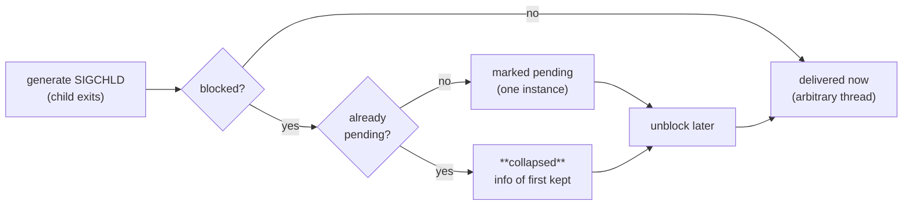

# Standard Signals

This chapter catalogs all 31 standard signals (`SIG-001`–`SIG-031`), the full per-architecture
numbering table (`SIG-032`), disposition and catchability rules (`SIG-033`), and the
generation-versus-delivery semantics that make standard signals unreliable as a queue
(`SIG-034`). For the survey-level treatment, see [Signals](../../sysprog/signals.md); for the
real-time range, see [Real-time signals](./real-time-signals.md); for the interfaces that
manipulate signals, see [Interfaces](../interfaces/index.md).

**Scope of this chapter's tables.** Signal numbers and `SA_*` flag values were verified against
the following UAPI headers of the Linux kernel master tree (`torvalds/linux`, fetched from
<https://raw.githubusercontent.com/torvalds/linux/master/>): `include/uapi/asm-generic/signal.h`,
`arch/x86`, `arch/arm`, `arch/arm64`, `arch/mips`, `arch/alpha`, `arch/sparc`, `arch/parisc`,
`arch/powerpc`, `arch/s390`, `arch/m68k`, `arch/sh`, and `arch/loongarch`. `arch/riscv` defines
no `uapi/asm/signal.h` of its own (that path is absent in the tree) and inherits the asm-generic
numbers. Default actions and behavioral claims are cross-checked against
[signal(7)](https://man7.org/linux/man-pages/man7/signal.7.html) (man-pages 6.19). The tables
cover exactly these architecture trees at this kernel version; completeness is not claimed
beyond them, and future kernels may change numbering only for new architectures (existing UAPI
numbers are frozen ABI).

## Dispositions and catchability rules (SIG-033)

Every signal has a *disposition* — the action the kernel takes on delivery. Per
[signal(7)](https://man7.org/linux/man-pages/man7/signal.7.html), the default dispositions are
one of five actions:

| Action | Meaning |
|--------|---------|
| **Term** | Terminate the process. |
| **Ign** | Ignore the signal (it is discarded when delivered). |
| **Core** | Terminate the process and dump core (see `core(5)`; subject to `RLIMIT_CORE` and `/proc/sys/kernel/core_pattern`). |
| **Stop** | Stop (suspend) the process. |
| **Cont** | Continue the process if it is currently stopped; otherwise ignore. |

A process can change any signal's disposition to *default*, *ignore*, or a *handler* using
`sigaction(2)` or `signal(2)` — with exactly two exceptions that the kernel enforces and that
no privilege level can override: **SIGKILL and SIGSTOP cannot be caught, blocked, or ignored**
(per signal(7); attempts to list them in a `sigaction(2)` `sa_mask` or a `sigprocmask(2)` set
are silently ignored, per
[sigaction(2)](https://man7.org/linux/man-pages/man2/sigaction.2.html) and
[sigprocmask(2)](https://man7.org/linux/man-pages/man2/sigprocmask.2.html)). These two signals
are the kernel's guaranteed external kill switch. `SIGKILL` is delivered as
`Term` without a core dump even though some other `Term` signals are configurable; killing a
process that is stopped works (`SIGKILL` terminates stopped processes directly), and a stopped
process must still be waited for by its parent before it disappears.

Additional rules that POSIX and Linux define around dispositions:

- The disposition is a **per-process attribute**: in a multithreaded process all threads share
  it (per signal(7)). What is per-thread is the *mask* and the *pending* set — see
  [Signal masks](../interfaces/signal-masks.md).
- A child created via `fork(2)` inherits a copy of the parent's dispositions. Across
  `execve(2)`, dispositions of *caught* signals are reset to default; *ignored* dispositions
  stay ignored (per signal(7) and POSIX.1-2017 `exec`).
- If a signal is both blocked and has its disposition set to `SIG_IGN`, it is **not added to
  the pending set** when generated (per
  [sigpending(2)](https://man7.org/linux/man-pages/man2/sigpending.2.html)); the signal is
  simply discarded at generation time.
- POSIX.1 (per signal(2)) makes behavior undefined if you *ignore* `SIGFPE`, `SIGILL`, or
  `SIGSEGV` when they were not generated by `kill(2)`/`raise(3)`: after the faulting
  instruction re-executes it faults again, producing an infinite fault loop.
- The only signals that can be sent to PID 1 (`init`) are those for which init has installed
  handlers, per [kill(2)](https://man7.org/linux/man-pages/man2/kill.2.html).

## The standard signal catalog (SIG-001 … SIG-031)

Numbers in the table are the x86/asm-generic values (1–31; see the architecture table below for
the exceptions). "Default" is the Linux default action per signal(7); "C/I" summarizes
catchability (`no` marks the uncatchable pair). Standards column: `P1990`/`P2001`/`P2024` = POSIX
editions that define the signal; `—` = not specified by POSIX (Linux/BSD/System V extension).

| ID | Signal | # | Standard | Default | C/I | Core? | Purpose, practical use, caveats |
|----|--------|---|----------|---------|-----|-------|---------------------------------|
| SIG-001 | `SIGHUP` | 1 | P1990 | Term | yes | no | Hangup detected on the controlling terminal or death of the controlling process. Conventionally repurposed by daemons as "reload configuration" (`nginx`, `sshd`); `nohup(1)` and `setsid(2)` exist to escape it. Because a session leader that exits (or its terminal closes) hangs up all members of the session, it doubles as the classic "your terminal went away" signal. |
| SIG-002 | `SIGINT` | 2 | P1990 | Term | yes | no | Interrupt from keyboard (`Ctrl+C` on the foreground process group). Interactive programs trap it to unwind cleanly; batch daemons usually treat it like `SIGTERM`. |
| SIG-003 | `SIGQUIT` | 3 | P1990 | **Core** | yes | yes | Quit from keyboard (`Ctrl+\`). Unlike `SIGINT` it dumps core by default, which makes it useful for post-mortem debugging of a misbehaving foreground process; many runtimes re-raise it to get a full thread dump (e.g. the Go runtime, the JVM's `-XX:+UseSIGQUIT`-style dumpers). |
| SIG-004 | `SIGILL` | 4 | P1990 | **Core** | yes* | yes | Illegal instruction. Raised by the CPU exception path, e.g. jumping into data, running a binary compiled with newer ISA extensions than the CPU supports (x86 AVX-512, ARMv8.1 atomics), or `ud2` emitted by `__builtin_unreachable` paths. *Catchable, but POSIX makes behavior undefined if ignored when hardware-generated (per signal(2)); recovery normally means `siglongjmp(3)` out of the handler or death. |
| SIG-005 | `SIGTRAP` | 5 | P2001 | **Core** | yes | yes | Trace/breakpoint trap. Generated by breakpoint instructions (`int3` on x86, `BRK` on ARM64) and by ptrace events. It is the mechanism behind debuggers: `ptrace(2)` uses `SIGTRAP` (with the ptrace event encoded in `si_code`'s high byte) to report breakpoints, single-steps and `PTRACE_EVENT_*` stops — see the ptrace notes in [sigaction(2)](https://man7.org/linux/man-pages/man2/sigaction.2.html). User programs rarely install handlers except JITs that recover from traps. |
| SIG-006 | `SIGABRT` | 6 | P1990 | **Core** | yes | yes | Abort signal, raised by `abort(3)`, failed `assert()`, C++ `std::terminate`, glibc heap-consistency checks. `abort()` unblocks it, raises it, and if the handler returns, restores default and re-raises — it is not reliably catchable as a means of *continuing* (per `abort(3)`; the process always dies). |
| SIG-007 | `SIGBUS` | 7 | P2001 | **Core** | yes* | yes | Bus error — bad memory access of hardware-origin type: unaligned access on strict-RISC targets (SPARC, some ARM configs), `mmap` of a file truncated behind the mapping (the classic `SIGBUS` on page fault past EOF), or machine-check / ECC errors (`BUS_MCEERR_*`). Which hardware faults map to `SIGBUS` vs `SIGSEGV` is architecture-dependent and not documented — see the kernel BUGS note quoted below. *Same undefined-behavior caveat as `SIGILL`. |
| SIG-008 | `SIGFPE` | 8 | P1990 | **Core** | yes* | yes | Erroneous arithmetic operation: integer division by zero (`FPE_INTDIV`), integer overflow of `INT_MIN / -1`, or FP traps. Normal IEEE-754 FP exceptions do *not* trap; they must be enabled per-thread via `feenableexcept(3)` (GNU). *Ignoring it when hardware-generated is undefined per POSIX; the faulting instruction re-executes forever. |
| SIG-009 | `SIGKILL` | 9 | P1990 | Term | **no** | no | Kill signal. Cannot be caught, blocked, or ignored — the kernel's last-resort termination. `kill -9` skips all cleanup: no `atexit` handlers, no `SIGTERM`-style graceful shutdown, data possibly left in buffers. Its existence is precisely why robust daemons journal/fsync instead of relying on shutdown hooks. |
| SIG-010 | `SIGUSR1` | 10 | P1990 | Term | yes | no | User-defined signal 1. Number 16 on alpha/sparc/mips/parisc. Application-defined; the classic convention is a debug/increase-verbosity trigger (`kill -USR1` to nginx rotates logs, to gunicorn bumps workers). |
| SIG-011 | `SIGSEGV` | 11 | P1990 | **Core** | yes* | yes | Invalid memory reference: access outside mapped memory (`SEGV_MAPERR`) or wrong permissions (`SEGV_ACCERR`), also stack-overflow growth failure. `si_addr` gives the faulting address; a `SA_SIGINFO` handler plus `SA_EXPOSE_TAGBITS` (Linux ≥ 5.11) preserves MTE/tag bits on some arches. *Catchable, and catch-and-`siglongjmp` is a legitimate pattern (JS engines, GCs use guard pages); ignoring is undefined. |
| SIG-012 | `SIGUSR2` | 12 | P1990 | Term | yes | no | User-defined signal 2 (17 on alpha/sparc/mips/parisc). Same role as `SIGUSR1`; often used as a second independent control channel (e.g. glibc `memusage`, nginx reopens log files on `USR1` and upgrades on `USR2`). |
| SIG-013 | `SIGPIPE` | 13 | P1990 | Term | yes | no | Broken pipe: write to a pipe/socket whose read end is closed. Default-death is usually wrong for network servers, so they either `signal(SIGPIPE, SIG_IGN)` and check `EPIPE`, or block it per-thread and use `send(2)` with `MSG_NOSIGNAL`. POSIX (`pipe(7)`-relevant rule): if no thread blocks it, the process dies mid-`printf` — a classic sudden-death bug in long-lived tools. |
| SIG-014 | `SIGALRM` | 14 | P1990 | Term | yes | no | Timer signal from `alarm(2)` or `setitimer(2)` (`ITIMER_REAL`). Historically the way to bound blocking calls (the "sleep-and-interrupt" pattern); today `timerfd_create(2)`/`epoll` or `signalfd(2)` are preferred — see [signalfd and pidfd](../interfaces/signalfd-pidfd.md). |
| SIG-015 | `SIGTERM` | 15 | P1990 | Term | yes | no | Termination signal — the *polite* default of `kill(1)`, `killall(1)`, and every service manager's stop phase. Convention: exit cleanly, flush state; if your program ignores `SIGTERM` it will eventually meet `SIGKILL` after the manager's timeout (see the service-manager chapters of this part). |
| SIG-016 | `SIGSTKFLT` | 16 | — | Term | yes | no | Stack fault on coprocessor — **unused** in the kernel (signal.7 comment). Defined on x86/arm/s390/powerpc/m68k at 16 and at 7 on parisc; absent on alpha, sparc, mips. Exists only so numbering is stable; do not use it. |
| SIG-017 | `SIGCHLD` | 17 | P2001 | Ign | yes | no | Child stopped, terminated, or continued. Default *ignore* means children become zombies until waited. Setting `SIG_IGN` explicitly (POSIX.1-2001) makes children auto-reaped — Linux generates one `SIGCHLD` in that case, other systems may not, so the only fully portable zombie-proofing is a handler that loops `waitpid(-1, ..., WNOHANG)` (per sigaction(2) HISTORY). `SA_SIGINFO` fills `si_pid`, `si_status`, `si_utime/stime` (CLD_* codes). |
| SIG-018 | `SIGCONT` | 18 | P1990 | Cont | yes | no | Continue if stopped. The only signal delivered to a stopped process's *queue* without the process being continued first; permission to send it needs only same-session membership, not UID match (per kill(2)). Useful to resume a `SIGSTOP`ped job and deliver data in the same shot; `SIGCONT` is also why "even Ctrl+Z-stopped shells can be continued". |
| SIG-019 | `SIGSTOP` | 19 | P1990 | Stop | **no** | no | Stop process. Uncatchable counterpart of `SIGKILL` for suspension: job control, `ptrace`-free pausing of a runaway process (e.g. before copying its memory), throttling. Cannot be blocked or ignored; `SIGCONT` resumes. |
| SIG-020 | `SIGTSTP` | 20 | P1990 | Stop | yes | no | Terminal stop (`Ctrl+Z`). The catchable/job-control variant of `SIGSTOP`; the shell's job control sends it to the foreground group. Programs may trap it to redraw the screen on resume (e.g. `vim`'s suspension handling). |
| SIG-021 | `SIGTTIN` | 21 | P1990 | Stop | yes | no | Background process attempted to `read(2)` from its controlling terminal — the kernel stops it. The standard fix is for the process to take the terminal (tcsetpgrp(3)) or redirect stdin. |
| SIG-022 | `SIGTTOU` | 22 | P1990 | Stop | yes | no | Background process attempted `write(2)` to the controlling terminal; only delivered when the tty has `TOSTOP` set (usually not), per termios. Same remedy family as `SIGTTIN`. |
| SIG-023 | `SIGURG` | 23 | P2001 | Ign | yes | no | Urgent condition on socket (4.2BSD): TCP out-of-band data. Default-ignored; rarely used since OOB is essentially TCP-only and `so_rcvatmark`/`sockatmark(3)` handle it awkwardly. Also reused by some runtimes internally (Go uses `SIGURG` for preemption on Linux since 1.14). |
| SIG-024 | `SIGXCPU` | 24 | P2001 | **Core** | yes | yes | CPU time limit exceeded (`RLIMIT_CPU`, see setrlimit(2)). `setrlimit(2)` lets you request a repeat delivery when the soft limit is passed again — used by HPC and CI runners for graceful abort before `SIGKILL`. Number 12 on parisc, 30 on mips. |
| SIG-025 | `SIGXFSZ` | 25 | P2001 | **Core** | yes | yes | File size limit exceeded (`RLIMIT_FSIZE`). The `write(2)` that would exceed the limit fails with `EFBIG` *and* raises `SIGXFSZ`; disk-quota tooling often ignores it. |
| SIG-026 | `SIGVTALRM` | 26 | P2001 | Term | yes | no | Virtual alarm clock: `setitimer(2)` `ITIMER_VIRTUAL` (user CPU time of the process). Profilers use it for CPU sampling; number 20 on parisc, 28 on mips. |
| SIG-027 | `SIGPROF` | 27 | P2001 | Term | yes | no | Profiling timer expired (`ITIMER_PROF`: user+system CPU). The classic mechanism behind gprof-style sampling; on modern systems `perf_event_open(2)` + `SIGTRAP` (`TRAP_PERF`) supersedes it. |
| SIG-028 | `SIGWINCH` | 28 | P2024 | Ign | yes | no | Window resize signal (4.3BSD/Sun) sent when the terminal size changes (ioctl `TIOCSWINSZ`). Programs redraw on it; remotes like SSH forward it. Not POSIX until POSIX.1-2024 — per signal(7) it was "P2024"-classified. |
| SIG-029 | `SIGIO` / `SIGPOLL` | 29 | P2001 (`SIGPOLL`) | Term | yes | no | I/O now possible (4.2BSD) / pollable event (System V) — same number, two names (`SIGPOLL` is the SysV alias). Enabling per-fd async notification via `fcntl(2)` `F_SETSIG`/`O_ASYNC` lets a `SA_SIGINFO` handler receive `si_band`/`si_fd`; historical precursor of `epoll`. Default *Term* (not Ign!) — a common footgun: setting `O_ASYNC` without a handler kills the process. |
| SIG-030 | `SIGPWR` | 30 | — | Term | yes | no | Power failure (System V). Convention: UPS on battery → init/systemd flushes and may power off. On alpha it is number 29 and aliased `SIGINFO`; on sparc 29 is `SIGLOST` (`SIGPWR` = `SIGLOST`); on mips/parisc it is 19. Not on POSIX. |
| SIG-031 | `SIGSYS` / `SIGUNUSED` | 31 | P2001 | **Core** | yes | yes | Bad system call (SVr4). On Linux its live use is **seccomp**: a filter returning `SECCOMP_RET_TRAP` delivers `SIGSYS` with `si_code = SYS_SECCOMP` and `si_syscall`, `si_arch`, `si_call_addr` filled (per sigaction(2)). Chrome's sandbox and many runtimes use this instead of `SECCOMP_RET_KILL` so the crashing process can log. `SIGUNUSED` is a synonym for the same number (31) and is no longer defined by glibc ≥ 2.26 (per signal(7)). |

\* Catchable but undefined behavior per POSIX if ignored when the signal was generated by a
hardware exception rather than `kill(2)`/`raise(3)` (per
[signal(2)](https://man7.org/linux/man-pages/man2/signal.2.html)).

### Notes the kernel attaches to specific signals

- **Hardware-exception signals** — `SIGBUS`, `SIGEMT`, `SIGFPE`, `SIGILL`, `SIGSEGV`, `SIGTRAP`:
  signal(7)'s BUGS section records that *which* of these a given hardware exception produces is
  not documented and does not always make sense; an access that yields `SIGSEGV` on one
  architecture may yield `SIGBUS` on another. Treat the pair as "synchronous fault" rather than
  depending on either name.
- **Core-dump history**: up to and including Linux 2.2 the default for `SIGSYS`, `SIGXCPU`,
  `SIGXFSZ`, and (outside SPARC/MIPS) `SIGBUS` was terminate *without* a core dump; Linux 2.4
  conformed to POSIX.1-2001 and made them `Core` (per signal(7)).
- **Standards history**: `SIGWINCH` only entered POSIX with POSIX.1-2024; `SIGEMT`, `SIGINFO`,
  `SIGLOST`, `SIGPWR`, `SIGSTKFLT`, `SIGIO` and the synonyms (`SIGIOT`, `SIGCLD`, `SIGUNUSED`,
  `SIGPOLL`) are non-POSIX conveniences that exist on some or all Linux architectures.

## Generation vs delivery (SIG-034)

A signal is **generated** (the cause exists) and later **delivered** (the action taken). Between
those points it is **pending**. The kernel distinguishes:

- **Process-directed** signals: pending for the process as a whole. Generated for reasons other
  than a hardware exception, or sent via `kill(2)`/`sigqueue(3)` (per signal(7)).
- **Thread-directed** signals: pending for one thread. Generated by a hardware exception
  executed by that thread (`SIGSEGV`, `SIGFPE`…), or sent with `tgkill(2)`/`pthread_kill(3)`.

Each thread has its own signal mask (blocked set — see
[Signal masks](../interfaces/signal-masks.md)) and a pending set; a thread's view of pending
signals is the **union of the process-directed pending set and its own thread-directed pending
set** (per signal(7) and sigpending(2)). A process-directed signal is delivered to *any one*
thread that does not block it; if several qualify, the kernel picks an arbitrary one — which is
why the standard "block everything in all threads, then `sigwait` in one" pattern exists (see
[Sigwait and sigsuspend](../interfaces/sigwait-sigsuspend.md)).

The decisive property of standard signals is that **they do not queue**. Per signal(7):

> Standard signals do not queue. If multiple instances of a standard signal are generated while
> that signal is blocked, then only one instance of the signal is marked as pending (and the
> signal will be delivered just once when it is unblocked).

Consequences, all with the same root cause:

- **Coalescing**: N children exiting while `SIGCHLD` is blocked yield *one* delivery. This is
  why `SIGCHLD` handlers must loop on `waitpid(-1, …, WNOHANG)` until it returns 0/-`ECHILD`.
- **siginfo preservation**: if a standard signal is already pending, the `siginfo_t`
  associated with it is *not* overwritten by later instances — the receiver sees the
  information of the **first** instance (per signal(7)). Only real-time signals queued via
  `sigqueue(3)` deliver one `siginfo_t` per instance — see
  [Real-time signals](./real-time-signals.md).
- **Delivery order among different standard signals is unspecified** (per signal(7); POSIX
  leaves it unspecified too — the ordering guarantee exists only inside the real-time range).
- A pending signal is visible in `/proc/pid/status` as `SigPnd` (thread-directed) and `ShdPnd`
  (process-directed), with `SigBlk`/`SigIgn`/`SigCgt` showing mask, ignored, and caught sets
  (per signal(7) NOTES).
- `fork(2)` starts the child with an **empty** pending set; the pending set (like the mask) is
  preserved across `execve(2)` (per signal(7) and sigpending(2)).

There is one POSIX delivery guarantee for self-signaling: if a process sends a signal to
itself with `kill()` (or `sigqueue()`), and the sending thread does not block it and no other
thread has it unblocked or in `sigwait()`, then **at least one** signal must be delivered to
the sending thread before the call returns (per
[kill(2)](https://man7.org/linux/man-pages/man2/kill.2.html) NOTES and POSIX.1-2017
`kill()`/`sigqueue()`).

## Architecture numbering table (SIG-032)

All 31 standard signals, verified per architecture from the kernel UAPI headers listed in the
scope note. One column is shown for the group of architectures that share the asm-generic
numbers; each named architecture's header was checked individually.

| Signal | asm-generic (also x86 i386/x86-64, arm, arm64, riscv, loongarch, sh, s390, powerpc, m68k) | alpha | sparc | mips | parisc |
|--------|----------------|-------|-------|------|--------|
| `SIGHUP`   | 1  | 1  | 1  | 1  | 1  |
| `SIGINT`   | 2  | 2  | 2  | 2  | 2  |
| `SIGQUIT`  | 3  | 3  | 3  | 3  | 3  |
| `SIGILL`   | 4  | 4  | 4  | 4  | 4  |
| `SIGTRAP`  | 5  | 5  | 5  | 5  | 5  |
| `SIGABRT`/`SIGIOT` | 6 | 6 | 6 | 6 | 6 |
| `SIGBUS`   | 7  | 10 | 10 | 10 | 10 |
| `SIGEMT`   | —  | 7  | 7  | 7  | —  |
| `SIGFPE`   | 8  | 8  | 8  | 8  | 8  |
| `SIGKILL`  | 9  | 9  | 9  | 9  | 9  |
| `SIGUSR1`  | 10 | 30 | 30 | 16 | 16 |
| `SIGSEGV`  | 11 | 11 | 11 | 11 | 11 |
| `SIGUSR2`  | 12 | 31 | 31 | 17 | 17 |
| `SIGPIPE`  | 13 | 13 | 13 | 13 | 13 |
| `SIGALRM`  | 14 | 14 | 14 | 14 | 14 |
| `SIGTERM`  | 15 | 15 | 15 | 15 | 15 |
| `SIGSTKFLT`| 16 | —  | —  | —  | 7  |
| `SIGCHLD`/`SIGCLD` | 17 | 20 | 20 | 18 | 18 |
| `SIGCONT`  | 18 | 19 | 19 | 25 | 26 |
| `SIGSTOP`  | 19 | 17 | 17 | 23 | 24 |
| `SIGTSTP`  | 20 | 18 | 18 | 24 | 25 |
| `SIGTTIN`  | 21 | 21 | 21 | 26 | 27 |
| `SIGTTOU`  | 22 | 22 | 22 | 27 | 28 |
| `SIGURG`   | 23 | 16 | 16 | 21 | 29 |
| `SIGXCPU`  | 24 | 24 | 24 | 30 | 12 |
| `SIGXFSZ`  | 25 | 25 | 25 | 31 | 30 |
| `SIGVTALRM`| 26 | 26 | 26 | 28 | 20 |
| `SIGPROF`  | 27 | 27 | 27 | 29 | 21 |
| `SIGWINCH` | 28 | 28 | 28 | 20 | 23 |
| `SIGIO`/`SIGPOLL` | 29 | 23 | 23 | 22 | 22 |
| `SIGPWR`   | 30 | 29 (=`SIGINFO`) | 29 (=`SIGLOST`) | 19 | 19 |
| `SIGSYS`/`SIGUNUSED` | 31 | 12 | 12 | 12 | 31 |
| `SIGINFO`  | —  | 29 | —  | —  | —  |
| `SIGLOST`  | —  | —  | 29 | —  | —  |

Facts every reader of this table should know (all verified in the headers themselves):

- **asm-generic is the default** for new ports: `arm64`, `riscv`, `loongarch`, and `sh` have no
  numbering of their own — their `uapi/asm/signal.h` merely `#include <asm-generic/signal.h>`
  (arm64 and sh add `SA_RESTORER`, arm64 overrides `MINSIGSTKSZ`/`SIGSTKSZ`). `x86`, `arm`,
  `s390`, `powerpc`, and `m68k` define the same 1–31 values in their own headers.
- **mips is the widest**: `_NSIG = 128` (vs 64 elsewhere), so its real-time range runs to 127 —
  see [Real-time signals](./real-time-signals.md). mips also has **no** `SIGSTKFLT` at all.
- **alpha** renumbered to stay OSF/1-compatible (header comment) and uniquely has `SIGINFO` 29;
  **sparc** kept SunOS values and uniquely names 29 `SIGLOST`.
- **parisc** is the odd one out even among the "old" arches: `SIGSTKFLT` sits at 7 (the only
  architecture that defines it there), `SIGUSR1/2` at 16/17, and the stop signals run 24–28.
- The aliases `SIGIOT`=6, `SIGCLD`=`SIGCHLD`, `SIGPOLL`=`SIGIO`, `SIGUNUSED`=`SIGSYS` are
  preprocessor synonyms inside the same headers; glibc ≥ 2.26 no longer defines `SIGUNUSED`
  (per signal(7)).
- **The `SIGRTMIN` base is 32 on every architecture**, with `SIGRTMAX = _NSIG` (64, or 128 on
  mips) — the kernel reserves numbers ≥ 32 for real-time signals on all arches.
- The per-arch headers also disagree on **flag bits** and on the `SIG_SETMASK`-family *how*
  values (`SIG_BLOCK`/`SIG_UNBLOCK`/`SIG_SETMASK` = 0/1/2 on asm-generic, 1/2/3 on alpha and
  mips, 1/2/4 on sparc) and on `struct sigaction` layout — a direct consequence is that raw
  `rt_sigaction(2)` programs cannot hardcode these; see
  [rt_sigaction and the kernel ABI](../interfaces/rt-sig-syscalls.md).
- This table intentionally mirrors and extends the four-column x86/Alpha-SPARC/MIPS/PARISC table
  in [signal(7)](https://man7.org/linux/man-pages/man7/signal.7.html); the two sources agree.

## Related Topics

- [Real-time signals](./real-time-signals.md) — the queuing half of the signal space
- [Signals overview](../../sysprog/signals.md) — survey of the programming model
- [kill, raise, and the kill utility](../interfaces/kill-raise.md) — how signals are sent
- [sigaction and signal](../interfaces/sigaction-signal.md) — how dispositions are set
- [Signal masks and pending signals](../interfaces/signal-masks.md) — blocking and the pending set
- [Per-syscall page: kill(2)](../../syscalls/signals-time/kill.md), [rt_sigaction(2)](../../syscalls/signals-time/rt_sigaction.md), [sigaltstack(2)](../../syscalls/signals-time/sigaltstack.md), [sigreturn(2)](../../syscalls/signals-time/sigreturn.md)
- [Exit status of a signal-killed process](../../process-exit-signal-coverage.md) — how the shell reports `128+signal`

## References

- *signal(7) — overview of signals*, Linux man-pages 6.19, <https://man7.org/linux/man-pages/man7/signal.7.html>
- *kill(2)*, man-pages 6.19, <https://man7.org/linux/man-pages/man2/kill.2.html>
- *signal(2)*, man-pages 6.19, <https://man7.org/linux/man-pages/man2/signal.2.html>
- *sigaction(2)*, man-pages 6.19, <https://man7.org/linux/man-pages/man2/sigaction.2.html>
- *sigprocmask(2)*, man-pages 6.19, <https://man7.org/linux/man-pages/man2/sigprocmask.2.html>
- *sigpending(2)*, man-pages 6.19, <https://man7.org/linux/man-pages/man2/sigpending.2.html>
- *POSIX.1-2017*, The Open Group Base Specifications Issue 7, 2018 Edition, <https://pubs.opengroup.org/onlinepubs/9699919799/> (esp. XSH 2.4 *Signal Concepts*)
- *Linux kernel UAPI headers* (verified per file, `torvalds/linux` master): [`include/uapi/asm-generic/signal.h`](https://raw.githubusercontent.com/torvalds/linux/master/include/uapi/asm-generic/signal.h), [`arch/x86/include/uapi/asm/signal.h`](https://raw.githubusercontent.com/torvalds/linux/master/arch/x86/include/uapi/asm/signal.h), [`arch/mips/include/uapi/asm/signal.h`](https://raw.githubusercontent.com/torvalds/linux/master/arch/mips/include/uapi/asm/signal.h), [`arch/alpha/include/uapi/asm/signal.h`](https://raw.githubusercontent.com/torvalds/linux/master/arch/alpha/include/uapi/asm/signal.h), [`arch/sparc/include/uapi/asm/signal.h`](https://raw.githubusercontent.com/torvalds/linux/master/arch/sparc/include/uapi/asm/signal.h), [`arch/parisc/include/uapi/asm/signal.h`](https://raw.githubusercontent.com/torvalds/linux/master/arch/parisc/include/uapi/asm/signal.h), [`arch/powerpc/include/uapi/asm/signal.h`](https://raw.githubusercontent.com/torvalds/linux/master/arch/powerpc/include/uapi/asm/signal.h), [`arch/s390/include/uapi/asm/signal.h`](https://raw.githubusercontent.com/torvalds/linux/master/arch/s390/include/uapi/asm/signal.h), [`arch/m68k/include/uapi/asm/signal.h`](https://raw.githubusercontent.com/torvalds/linux/master/arch/m68k/include/uapi/asm/signal.h), [`arch/arm/include/uapi/asm/signal.h`](https://raw.githubusercontent.com/torvalds/linux/master/arch/arm/include/uapi/asm/signal.h), [`arch/arm64/include/uapi/asm/signal.h`](https://raw.githubusercontent.com/torvalds/linux/master/arch/arm64/include/uapi/asm/signal.h), [`arch/loongarch/include/uapi/asm/signal.h`](https://raw.githubusercontent.com/torvalds/linux/master/arch/loongarch/include/uapi/asm/signal.h), [`arch/sh/include/uapi/asm/signal.h`](https://raw.githubusercontent.com/torvalds/linux/master/arch/sh/include/uapi/asm/signal.h), [`include/uapi/asm-generic/signal-defs.h`](https://raw.githubusercontent.com/torvalds/linux/master/include/uapi/asm-generic/signal-defs.h)
