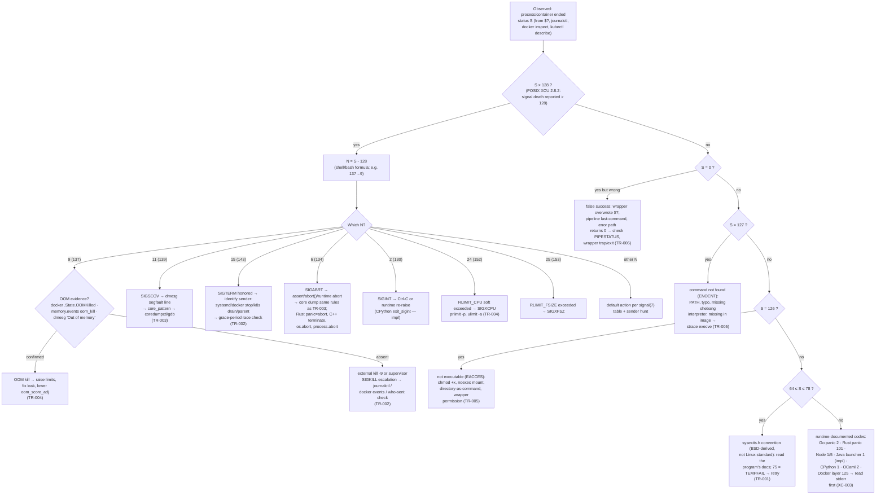

# Exit-Status Decision Tree: From Observed Status to Confirmed Cause

TR-009. This page turns [common-status-values.md](./common-status-values.md)
(TR-001..TR-008) into an ordered procedure: start from what you *observed*
(the status plus whatever evidence is available), enumerate plausible
causes, and run the confirmatory check **before** naming a cause. The
governing rule: 128+9 proves SIGKILL, not OOM; 143 proves SIGTERM was
received, not that cleanup ran; 1 proves nothing by itself.

## The mermaid flowchart

Every evidence node names its source: the >128 rule is POSIX XCU 2.8.2;
the N=S−128 arithmetic is the shell formula (bash manual; Node's process
docs state the same rule); the OOM checks are `ContainerState.OOMKilled`
(Engine API), cgroup-v2 `memory.events` (`oom_kill`), and the kernel
`oom-kill` log line; the core-dump conditions are man 5 `core`; the
126/127 split is POSIX XCU 2.8.2 verbatim; 64–78 is `sysexits.h(3head)`
(STANDARDS: BSD); the runtime codes are each runtime's own documentation
([../languages/comparison.md](../languages/comparison.md) XC-003).

## Text version (same content, sequential)

**Step 0 — Record the raw observation.** Where did the status come from?
`$?` after a shell command, `journalctl -u <unit>` (`code=exited,
status=N` / `code=killed, status=N/SIG`), `docker inspect` (`State.ExitCode`,
`State.OOMKilled`), `kubectl describe pod` (`Last State: Terminated, Exit
Code: N, Reason: …`). Note the *sender* if visible — it is evidence, not
the diagnosis.

**Step 1 — Is S > 128?** (POSIX XCU 2.8.2: a command "terminated because
it received a signal shall be reported as greater than 128".)

- Yes → N = S − 128 (shell formula; POSIX guarantees only "> 128").
  Decode N with man 7 `signal`'s table, then:
  - **N = 9 (137):** SIGKILL — uncatchable, so no handler ran. Check OOM
    evidence *first* (it is the only self-inflicted case): `docker inspect
    <c> .State.OOMKilled`; `cat /sys/fs/cgroup/<path>/memory.events`
    (`oom_kill` counter, `oom_group_kill` if `memory.oom.group` fired);
    `journalctl -k | grep -i oom`. No OOM evidence → an external
    `kill -9` or a supervisor escalation after an ignored/unhandled
    SIGTERM (TR-002; check `journalctl` "Killing process…", `docker
    events`).
  - **N = 11 (139):** SIGSEGV. `dmesg` for the `segfault at … in <lib>`
    line (library attribution); check `core_pattern`, `ulimit -c`, and
    `coredumpctl list` for a recorded core (TR-003). Repeat offenders:
    re-run under `gdb`/ASan with the core.
  - **N = 15 (143):** SIGTERM. Identify the sender (systemd stop,
    `docker stop` at timeout, Kubernetes drain, parent process); then ask
    whether cleanup finished — a 143 followed later by nothing is normal,
    a 143 immediately followed by a 137 means the grace period expired
    mid-cleanup (TR-002).
  - **N = 6 (134):** SIGABRT — `assert()`, C `abort`, C++ uncaught
    exception → `std::terminate` → `abort`, Rust `panic=abort` or
    `process::abort`, Python `os.abort`, Node `process.abort` (XC-003).
    Core-dump rules identical to N = 11; the panic/exception message on
    stderr is usually the primary evidence.
  - **N = 2 (130):** SIGINT — Ctrl-C, or a runtime that re-raises SIGINT
    after its own cleanup (CPython `exit_sigint`, marked impl).
  - **N = 24/25 (152/153):** rlimit signals SIGXCPU/SIGXFSZ — check
    `prlimit --pid`, `ulimit -a`, systemd `CPUQuota`/`LimitFSIZE`
    (TR-004).
  - **Other N:** look up the default action in man 7 `signal`; if the
    process installed handlers, hunt the sender (`strace -e trace=kill`,
    audit logs).
- No → continue.

**Step 2 — Is S = 0?**

- Yes, *but the task failed anyway* → false success: wrapper overwrote the
  status, the pipeline's last command succeeded, or an error path returns
  0. Check `PIPESTATUS`/`pipefail`, wrapper `trap`/`exit $st` discipline,
  and the program's stderr (TR-006).
- Yes and correct → done; consider `EX_*` (sysexits) returns only if the
  program documents them.

**Step 3 — Is S = 126 or 127?** (POSIX-documented meanings; both also pass
through `docker run` unchanged, while Docker adds its own 125 for daemon
failures — TR-005.)

- 127 → `execve` got ENOENT: PATH wrong in that environment, typo, missing
  `#!` interpreter, binary absent from the container image. Confirm:
  `strace -f -e trace=execve` → read the errno; `ls` the exact path with
  the exact environment.
- 126 → found but not executable: mode bit, `noexec` mount, directory as
  command, wrapper permission. Confirm the same way (`EACCES`).

**Step 4 — Is 64 ≤ S ≤ 78?** BSD sysexits convention (`sysexits.h(3head)`
— present on Linux, but a convention, not a standard). Read the program's
documentation; `EX_TEMPFAIL` (75) means "retry later" by contract with
mailers/schedulers (TR-001).

**Step 5 — Otherwise: runtime-documented codes.** Match against the
producer's own documented table before inventing semantics: Go panic → 2
(+ stack dump on stderr), Rust main-thread panic → 101, Node uncaught → 1
/ V8 fatal → 5, CPython unhandled → 1 (130 only for Ctrl-C), OCaml
uncaught → 2, Java launcher → 1 (impl). If stderr contains a traceback or
panic dump, that message — not the number — is the diagnosis. Docker's 125
means the daemon failed before your command ran.

**Step 6 — Write down what was proven vs assumed.** Status + evidence =
diagnosis; status alone = hypothesis.

## Worked examples

These deliberately mirror the drills in
[../containers/troubleshooting-scenarios.md](../containers/troubleshooting-scenarios.md)
(CT-011) — read those for full command output:

1. **137 after a deploy** (drill 1). Status 137 → N = 9. The tree routes
   through the OOM-evidence node: `kubectl describe pod` shows
   `Last State: Terminated, Reason: OOMKilled, Exit Code: 137` → confirmed
   container-memory OOM (raise the limit or fix the leak). If `Reason`
   were empty and `memory.events` showed no `oom_kill`, the cause would be
   the escalation node instead (grace period → SIGKILL).
2. **143, then 137** (drill 3). The SIGTERM node asks "who sent it and did
   cleanup finish": journal shows SIGTERM at T, SIGKILL at T+10s (docker
   default stop timeout) → the app ignored or outlived TERM → check
   `SigIgn`/`SigCgt` masks and PID-1 form (`sh -c` entrypoint,
   [../containers/pid1-signals.md](../containers/pid1-signals.md)) → fix
   handler, then re-test (TR-008).
3. **139 with no core file** (drill 4). SIGSEGV node: dmesg names the
   faulting library; `ulimit -c` is 0 and `core_pattern` is a systemd
   pipe → enable cores (`prlimit`/unit `LimitCORE`), retrieve with
   `coredumpctl` (TR-003).
4. **127 from `docker run`, binary exists in the image** (docker chapter).
   127 node: strace shows `execve("/srv/bin/run") = -1 ENOENT` despite the
   file — the `#!` interpreter is missing in the *image* → 127 attributes
   to the interpreter, not your script (TR-005).
5. **Exit 1 in CrashLoopBackOff** (drill 6). Steps 1–4 eliminated: the
   runtime-codes node applies → read the termination message / logs, not
   the code; the `terminationMessagePath` capture (kubernetes.md) is the
   documented channel for the real reason.

## Related Topics

- Deep status reference: [Common status values](./common-status-values.md)
  (TR-001..TR-008)
- Cross-language status semantics: [Languages comparison](../languages/comparison.md)
  (XC-003, XC-006)
- Container drills with full output:
  [Troubleshooting scenarios](../containers/troubleshooting-scenarios.md)
- Supervisors' exit-code contracts: [Service managers](../service-managers/index.md)
- Kernel interfaces: [kill/raise](../interfaces/kill-raise.md) ·
  [signal masks](../interfaces/signal-masks.md) ·
  [tgkill](../interfaces/tgkill.md)
- Signal reference: [Standard signals](../signals/standard-signals.md)

## References

- POSIX.1-2017 XCU §2.8.2 (Exit Status for Commands — >128 rule; 126/127
  definitions) — https://pubs.opengroup.org/onlinepubs/9699919799/
- Linux man-pages: `signal(7)` (default actions, uncatchable signals,
  signal-number table), `core(5)` (core_pattern, RLIMIT_CORE,
  systemd-coredump, coredumpctl), `getrlimit(2)` (SIGXCPU/SIGXFSZ),
  `proc_pid_oom_score_adj(5)`, `sysexits.h(3head)`, `sigprocmask(2)` —
  https://man7.org/linux/man-pages/ (all fetched/verified 2026-10)
- Kernel cgroup v2 admin guide (`memory.events`, `memory.oom.group`) —
  https://docs.kernel.org/admin-guide/cgroup-v2.html
- Docker docs: engine "Exit status" (125/126/127), CLI reference
  (`--oom-score-adj`); Engine API `ContainerState.OOMKilled` as cited in
  [../containers/docker.md](../containers/docker.md) —
  https://docs.docker.com/engine/containers/run/
- Kubernetes: pod lifecycle & termination message docs as cited in
  [../containers/kubernetes.md](../containers/kubernetes.md) —
  https://kubernetes.io/docs/concepts/workloads/pods/pod-lifecycle/
- Runtime exit-code documentation (Node process exit-codes table, Go
  runtime GOTRACEBACK "exit code 2", Rust `rt.rs` 101, Python/Java/OCaml
  per XC-003): see the per-language References in
  [../languages/comparison.md](../languages/comparison.md)
