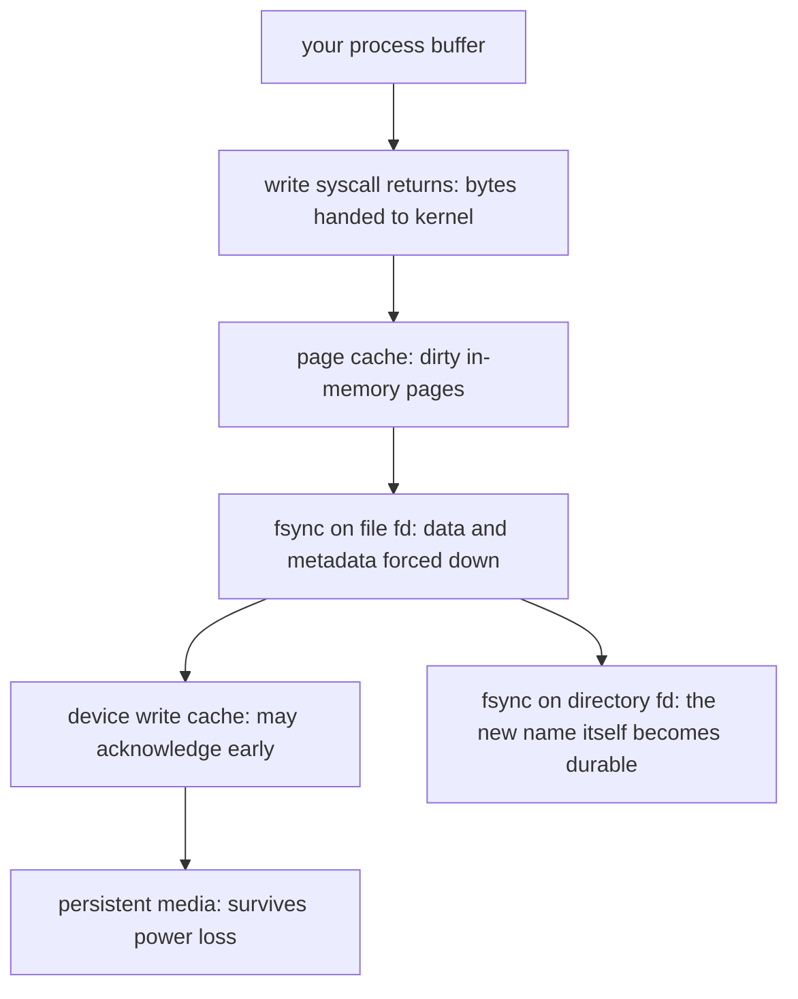

# Filesystem Durability Assumptions: What "write() Returned" Silently Promises

## Overview

The taught rule of this chapter is the most load-bearing sentence in systems programming: "write() returned, so my data is safe." It is false in a precise, documented, testable way. A successful `write()` means the kernel has accepted your bytes into the page cache — a volatile, in-memory cache of file contents — and nothing more. Between your buffer and the persistent medium sit several caches and reordering layers, each with its own contract, and the POSIX interface exposes only blunt tools for punching through them: `fsync()`, `fdatasync()`, and rename ordering. Get the sequence wrong and the file that "was written" is empty, truncated, or gone after a crash — a failure mode with a famous public debate (ext4's 2009 zero-length-file episodes) and a canonical source of database corruption guidance.

This chapter audits durability assumptions with the collection's five-step pattern. The primary sources are unusually good here: the SQLite project documents exactly which shortcuts corrupt database files, the PostgreSQL manual documents what happens when fsync is disabled, and the Linux man pages document what fsync does and does not promise. All were fetched and verified during writing.

The journey every byte takes before it is truly durable:

Only after both fsyncs — the file's and the directory's — is a newly created file with its name guaranteed to survive a power cut.

## Assumption 1: "write() Returned, So the Data Is on Disk"

### The taught rule

Call `write(fd, buf, n)`, check the return value equals `n`, and the data is safely stored.

### The hidden assumptions

- `write()` transfers data from your process into the kernel's page cache. The bytes are in RAM, marked dirty, and will be written back to storage *eventually*, on the kernel's schedule — seconds later under no pressure, or much later under memory pressure.
- Power loss or kernel panic loses all dirty pages. Nothing about `write()`'s return value speaks to persistence; it speaks to delivery into the kernel.
- Being *notified* of an underlying failure is not guaranteed either: if writeback later fails (device unplugged, quota exceeded), the process that called `write()` may never hear about it. The error surfaces to whoever calls `fsync()` — which is why fsync's return value matters, not just its call.

### Counterexample

The SQLite documentation page "How To Corrupt An SQLite Database File" enumerates, from a database's point of view, the ways storage stops doing what applications assume. Several of its items are exactly this assumption failing: disabling synchronous writeback for speed, filesystems or drives that acknowledge writes before persisting them, and power loss during writeback. The PostgreSQL manual makes the same point from the database engine's side: its WAL configuration chapter states that running with `fsync = off` risks unrecoverable data corruption after a power failure, and `full_page_writes` exists because a partially written page after a crash can leave torn records that even WAL replay cannot repair without them. An application that checks `write()`'s return value and stops there has verified none of this.

### What changes when the assumption is removed

Corrected statement: *write() means "the kernel has my bytes"; fsync on the file descriptor means "the storage stack has acknowledged them"; fsync on the containing directory's descriptor means "the file's name is durable too" — and each link must be made explicitly.* The atomic-file-replace recipe used by editors and package managers encodes the whole chain: write the new content to a temporary file in the same directory, `fsync` the file, `rename` it over the target, then `fsync` the directory so the rename itself survives. Skipping the directory fsync is the classic last link forgotten — the file content is durable but the crash loses the name pointing at it.

### Consequences

Database engines (SQLite, PostgreSQL) are the reference implementations because they must survive arbitrary crashes; application code that aspires to the same discipline — config writers, package managers, message-queue journals — should copy the recipe rather than invent a shorter one. The buffering page in the OS track shows the same stack from the kernel side.

## Assumption 2: "rename() Is Atomic, So the Replace Is Safe"

### The taught rule

`rename(old, new)` atomically replaces the destination: readers see either the old file or the new file, never a half-written one. This is the standard idiom for atomic updates.

### The hidden assumptions

- rename's atomicity is a *namespace* property within one filesystem — the name flips atomically. It says nothing about when the renamed file's *data* reaches the medium relative to the rename.
- With delayed allocation (ext4's default allocation strategy for years now), the kernel may defer deciding where new data blocks live on disk until writeback. A rename can be journaled and committed while the data blocks it points to are still dirty in the page cache. If power is lost in that window, the new name exists at boot but points at allocated-yet-unwritten blocks — the zero-length file.
- rename *across* filesystems is not rename at all: POSIX specifies that `rename()` fails with `EXDEV` when old and new are on different mounts, forcing applications to fall back to copy-plus-delete, which has no atomicity guarantee.

### Counterexample

In early 2009, shortly after Ubuntu shipped ext4 as a default filesystem, users reported that after power losses, months of mail and configuration had become zero-length files. The applications in question (KDE 4.2's mail indexer was the poster child) used the write-temp-then-rename idiom *without* fsync — an idiom that had been incidentally safe on ext3's ordered-data mode but was not on ext4's delayed allocation. The resulting linux-ext4 mailing-list thread, titled "Linux Filesystem, ext4 delalloc, and Zero-length Files" (March 2009), is the canonical record; LWN's contemporaneous coverage by Jonathan Corbet ("Losses and gains of ext4's delayed allocation", March 2009) summarizes the debate. The resolution had two halves: applications were wrong per the standards (fsync was always required for durability), but the kernel also grew the `auto_da_alloc` mount option, under which ext4 detects the replace-via-rename pattern and forces the delayed allocations out before committing the rename — an explicit concession that real applications would not be fixed immediately and that durability heuristics had to absorb common idioms.

### What changes when the assumption is removed

Corrected statement: *rename gives an atomic name swap on a single filesystem; durability of that swap requires fsync discipline (data before rename, rename before directory fsync), and cross-filesystem "renames" are copy-and-delete with no atomicity at all.* When the target may be on another filesystem, the atomic-replace design must be re-thought entirely — write-in-place with journaling, or a directory handoff, or accepting a small window of inconsistency and designing readers to tolerate it.

### Consequences

This is why "it worked on ext3" is not an argument: filesystem generations change the ordering and allocation behavior underneath an unchanged application. The ext4 page in the OS track covers delayed allocation mechanics; the journaling page covers how the journal orders metadata and data. In interviews, the question "is rename durable?" — answered "it is atomic, not durable, and the two are different" — is a strong seniority signal.

## Assumption 3: "fsync Is fsync" (the Right Descriptor, the Right Scope)

### The taught rule

Call `fsync(fd)` after writing and your data is durable.

### The hidden assumptions

- fsync is per-descriptor and per-object: syncing the file's descriptor does not make the *directory entry* durable (that needs a directory-fd fsync), and syncing the directory does not flush the file's data.
- `fdatasync()` is cheaper than `fsync()` because it skips metadata the data does not depend on — but "metadata the data does not depend on" is a subtle boundary: a file *size* change is data-affecting and is included, while timestamp updates are not. Choosing between them is a correctness decision, not just an optimization.
- The POSIX man page for fsync(2) carries an explicit caveat that calling fsync() does not necessarily ensure the directory entry has reached disk — that requires an fsync on a descriptor for the directory — and that on some filesystems fsync may not be implemented at all (returning `EINVAL`). The interface's strength varies by mount.
- Every fsync is a latency spike: it forces the writeback queue down to the medium and waits. Over-fsyncing turns a fast program into a slow one; under-fsyncing turns a correct one into a losing one. Databases batch fsyncs through a single journal for exactly this reason.

### Counterexample

The durability gaps in this section are precisely the corruption modes the SQLite "how to corrupt" page warns about, and the PostgreSQL WAL configuration chapter formalizes the engine-side response: fsync every WAL record or group-commit them, and pair `fsync = on` with `full_page_writes = on`. The failure mode of a *missed directory fsync* is silent in testing: the file and its data both survive a graceful reboot (the page cache is flushed by the OS on shutdown), so only a true power-cut test — or an injected one — reveals that the name was never persisted. That is the same reason the bug survived so long in mainstream desktop applications.

### What changes when the assumption is removed

Corrected statement: *durability is a property of the (data, metadata, name) triple, each made durable by its own sync call, on a filesystem that actually implements fsync honestly.* Use `fdatasync` for the common append/rewrite case where size is already established, fsync directories when names change, and verify the storage stack below: a drive with a volatile write cache and no barrier support can acknowledge fsync and still lose the data — which is a hardware honesty question, not an API question.

### Consequences

Code review checklists for anything touching files should include: "which descriptors are fsynced, and is the directory among them?" Performance work should treat fsync frequency as a first-class cost (batching, group commit, WAL design). The write-ahead-log design connection is developed in the connection atlas chapter on event sourcing and WALs.

## Assumption 4: "Crash Testing Is Optional" (and What the Disk Does After Power Loss)

### The taught rule

If the code is correct per the above, you are durable; testing for power loss is paranoia reserved for database vendors.

### The hidden assumptions

- The storage stack beneath the filesystem is a chain of caches and shims — device write caches, VM host caches, SAN controllers, USB bridges — any of which may acknowledge writes before persisting them, or drop flush commands entirely.
- Filesystem code paths have their own ordering rules (journal commit points, delayed allocation heuristics like `auto_da_alloc`) whose interaction with your specific write pattern is not derivable from first principles by the application author.
- The only way to know what survives is to cut power (or simulate it) and inspect — which is why SQLite's corruption page explicitly discusses power-loss testing, and why the device-mapper `dm-flakey` target exists: it is a kernel-provided fault injector that drops or corrupts writes on a schedule.

### Counterexample

A practical crash-test harness: mount the filesystem under test on a `dm-flakey` device (documented in the kernel's device-mapper admin guide) configured to drop writes during specified up/down intervals, run the application's write path, then force the equivalent of a crash by stopping the device mid-interval and remounting the underlying device read-only to inspect what survived. Teams that run this discover things no code review finds: a mail server that loses the day's index on every simulated power cut, or a config writer whose rename lands but whose data does not. The 2009 ext4 episode is again the public case study — the zero-length files were found by real power failures before they were reproduced deliberately.

### What changes when the assumption is removed

Corrected statement: *durability is a property you test, not one you reason your way to — the stack from application buffer to platter has too many independent actors.* Budget for crash testing the same way database vendors do: simulate power loss (dm-flakey, VM pause-kill, or a physical switched outlet for the brave), verify the recovered state matches the model (all-or-nothing file replacement, monotonic journals), and rerun the harness on every storage-layer change — new filesystem, new kernel, new hypervisor, new disk.

### Consequences

Databases and package managers earn their reputation from this discipline: a DBMS's WAL-plus-fsync protocol is designed to be crash-safe by construction, and dpkg/rpm's on-disk journals exist because an interrupted package upgrade must leave the system resolvable. The deeper architectural pattern — sequential, checksummed, fsync-batched logs as the durability substrate — is the subject of the connection atlas chapter on event sourcing and WALs.

## Interview Questions

1. **What does a successful write() actually guarantee?** That the kernel accepted the bytes into the page cache. Not that they reached the medium, not that writeback will succeed, and nothing about durability. Persistence requires fsync (file), fsync (directory, for the name), and an honest storage stack.
2. **Walk through the fully durable atomic file replacement.** Write temp file in the same directory; fsync the temp file's fd; rename over the target; fsync the directory fd. Each step closes one gap: data durability, atomic name swap, name durability.
3. **Why did ext4 lose zero-length files in 2009 while ext3 did not, and what changed?** ext4's delayed allocation let rename journal-commit before data blocks were written; ext3's ordered mode incidentally flushed data before metadata. Kernel added the auto_da_alloc heuristic for the replace-via-rename pattern; the correct fix remains application fsync discipline.
4. **fdatasync versus fsync — when is the cheaper one incorrect?** When metadata changes affect data retrieval and would be skipped: notably when extending a file, the size change must be persisted (fdatasync includes it), but if your durability story depends on metadata fdatasync excludes (certain timestamp/ordering schemes), fsync is required.
5. **How would you test that a config writer is crash-safe?** Fault injection at the storage layer: run the write path under dm-flakey (or a VM power-kill), crash mid-sequence at each interesting boundary, remount, and assert the recovered state matches all-or-nothing semantics — old file or new file, never empty or absent.

## Key Takeaways

- write() hands bytes to the kernel's page cache; durability begins at fsync, not at write.
- A new file needs two fsyncs — the file's and its directory's — or a crash can leave data durable but the name (or vice versa) lost.
- rename is an atomic namespace operation on one filesystem, not a durability operation; delayed allocation made the difference visible in 2009, and auto_da_alloc is a heuristic bandage, not a contract.
- Cross-filesystem rename is copy-plus-delete: no atomicity, and the design must change accordingly.
- fsync is per-object and varies in strength by filesystem and honesty of the layers below; batch it for performance, but never skip the ones your correctness model requires.
- Crash behavior is testable — dm-flakey and friends exist for exactly this — and untested durability code is indistinguishable from broken durability code.

## Cross-References

- [Journaling filesystems](../../os/filesystems/journaling.md) — how journals order metadata and data writes.
- [ext4](../../os/filesystems/ext4.md) — delayed allocation and the auto_da_alloc heuristic in depth.
- [I/O buffering](../../os/io/buffering.md) — the page cache and writeback machinery behind write().
- [Event sourcing and WALs](../connection-atlas/event-sourcing-wal.md) — the log-based durability architecture databases build on this substrate.
- [GitLab 2017 data loss](../failure-casebook/gitlab-2017-data-loss.md) — what happens when backup durability fails alongside storage assumptions.
- [SQLite atomic commit](https://www.sqlite.org/atomiccommit.html) — the reference fsync/journal protocol, from the source.
- [Storage durability](storage-durability.md) — sibling chapter: backups, RAID, and object-store durability assumptions.
