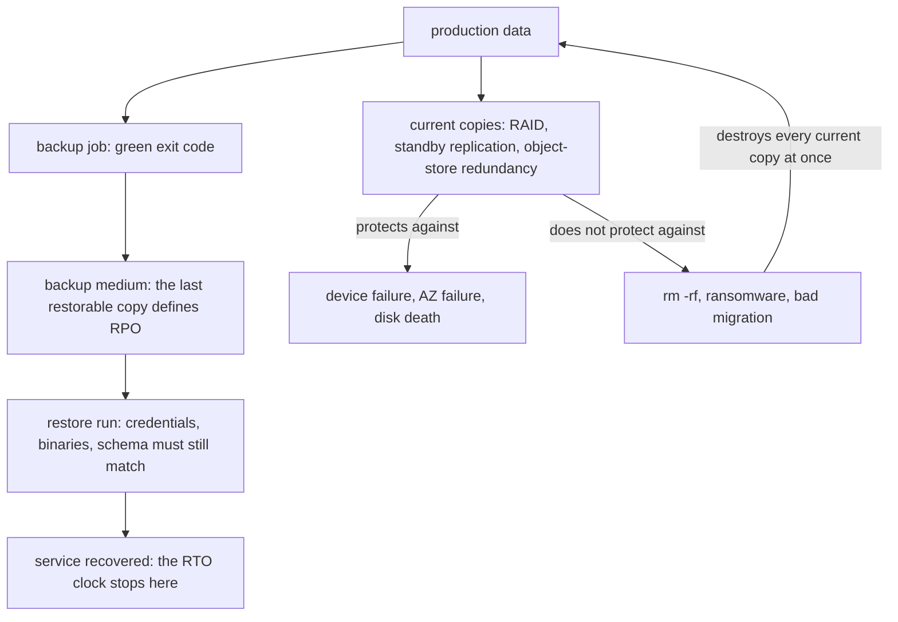

# Storage Durability Assumptions: What "We Have Backups" Actually Promises

## Overview

"We have backups, so we can recover", "RAID protects my data", and "the cloud never loses data" are three phrasings of one sentence — *the bytes survive* — and all three are conditional statements whose conditions are almost never stated. Storage durability is where the gap between the taught rule and the production preconditions is widest, because the failure is invisible until the one moment it cannot be inspected calmly: the restore. A backup job reports whether it *ran*, not whether it produced a restorable artifact. RAID and replication report whether the *current* copy is redundant, not whether any *history* exists. Object storage reports a durability target for its own fabric, not for anything you did or did not put there.

This chapter audits the family with the collection's five-step pattern, anchored on GitLab.com's January 31, 2017 database incident, where five deployed backup and replication mechanisms each failed differently. GitLab facts and quotes were verified against the company's live incident post and full postmortem, object-storage figures against AWS documentation, and point-in-time-recovery claims against the PostgreSQL manual; all cited URLs returned HTTP 200 during writing.

## Assumption 1: "We Have Backups, So We Can Recover"

### The taught rule

The database is backed up nightly, with snapshots and a standby replica besides. If the primary is lost, we restore and lose minutes.

### The hidden assumptions

- The backups are *restorable*. A backup is a program run with credentials against a schema, producing an artifact another program consumes later — and every element can drift while the job stays green: dump binary no longer matching the server version, expired bucket credentials, uninstalled restore tooling, a runbook whose author has left.
- The backups are *recent* — meaning the age of the last *restorable* copy, not the last green job. A nightly job that has silently produced nothing for a year has an RPO of "whenever it last actually worked", unknowable if nobody checks.
- Somebody monitors *restores*, not just jobs — exit codes are blind to a dump producing a few bytes, an upload landing in a bucket nobody reads, a snapshot mechanism never enabled.

### Counterexample

GitLab.com, January 31, 2017 is the cleanest documented case of every mechanism failing at once (timeline and sources in the [casebook chapter](../failure-casebook/gitlab-2017-data-loss.md)). While fighting a spam-induced load incident, replication broke; the repair procedure required wiping the secondary's data directory and re-syncing from the primary; the engineer running the wipe targeted the wrong host and removed the *primary's* data directory — around 300 GB, gone within seconds. The backup inventory then failed mechanism by mechanism: the pg_dump backups were not in S3 — "The S3 bucket was empty" — because the dump process ran PostgreSQL 9.2 binaries against a 9.6 database and was "failing silently. No SQL dumps were made as a result"; Azure disk snapshots were never enabled for the database servers — the team "assumed that our other backup procedures were sufficient enough"; and the hot standby had just been wiped by the same re-sync. The live post's summary: "out of five backup/replication techniques deployed none are working reliably or set up in the first place." Recovery fell back to an LVM snapshot six hours old; the postmortem's loss estimate is "roughly 5,000 projects, 5,000 comments and 700 new user accounts".

This is the "backup job green but restore fails" pattern in its purest form — a green job emitting no dumps. Its restore-side siblings (expired credentials, tooling that no longer runs, schema drift where the backup predates a migration) are what restore drills exist to catch.

### What changes when the assumption is removed

Corrected statement: *an untested backup is not a backup; the deliverable of a backup system is a measured, successful restore, not a green job.* Operationally: schedule restore drills as first-class work (restore into isolation, exercise the application, run the clock), monitor restore outcomes rather than job exit codes, verify artifacts (sizes, checksums, periodic test loads), and pin the restore's dependencies — credentials, tool versions, schema expectations.

### Consequences

"How do you *know* your backups work?" is a standard seniority probe, and "because the job is green" is wrong by construction: GitLab's job was green while producing no SQL dumps. "When did you last restore, and how long did it take?" dates the claim and prices it — backup evidence, like every claim in this collection, has a timestamp and a duration.

### Boundary case: restore time versus business expectation

RTO is arithmetic before it is policy. Restoring a 2 TB database over a 1 Gbps link moves 2×10^12 bytes × 8 = 1.6×10^13 bits — 16,000 seconds, about 4.5 hours, at *full line rate with zero overhead* — before decompression, replay, and validation. GitLab's real restore shows the gap: even the successful path — the six-hour-old snapshot — required copying staging data whose bottleneck, per the postmortem, "was in the drives", and the database was restored without webhooks at 17:00 UTC on February 1, roughly eighteen hours after the wipe. Corrected statement: *RPO and RTO are measured quantities, not document fields* — and the 3-2-1 pattern (three copies, two media, one offsite), extended with an immutable copy and a verified zero-error restore (backup vendors' "3-2-1-1-0"), is the posture that makes both numbers real.

## Assumption 2: "RAID Protects My Data"

### The taught rule

The volume is RAID 1, 5, or 6; a disk can fail and no data is lost.

### The hidden assumptions

- RAID is redundancy among the disks of *one machine*, updated in *real time* — no time dimension, no independent copy. It covers exactly one failure class, device failure, and propagates every other: `rm -rf` deletes the file from every mirror and parity member at once; ransomware encrypts every block it can read; fire and theft take the whole array; a controller or array-software bug can corrupt metadata across the array, because the array *is* software.
- Redundancy is not integrity: parity can be perfectly consistent with corrupt data — the XOR of wrong bytes is self-consistent — so a silent bad write is faithfully preserved by the parity that reproduces it. Checksummed filesystems (ZFS, Btrfs) exist because plain RAID cannot see this failure class.
- The rebuild window: after a device fails, the array runs without redundancy until the replacement is fully rewritten. At a sustained ~200 MB/s, repopulating a 10 TB drive takes on the order of 14 hours, during which a second failure — or an unrecoverable read on a remaining disk (spec-sheet rates near 1 in 10^15 bits) — can abort the rebuild. Spec-sheet arithmetic, not measurements.

### Counterexample

The generic shape needs no incident: on a RAID-6 volume, `rm -rf /srv/database` removes the data from every device in one pass; redundancy multiplies nothing back, because every copy is updated in real time. The named shape is GitLab again: replication faithfully mirrored the wipe — "data had already been wiped from both the primary and secondary, meaning we could not restore from either host" (postmortem). Every current copy was destroyed together, because "current" is a property RAID and replication share by design.

### What changes when the assumption is removed

Corrected statement: *RAID protects bytes from dying; backups protect bytes from you. RAID is an availability component of one machine's storage stack; a backup is an independent copy in a different failure domain at a different point in time — a property no in-machine redundancy can have.* The design test: if the copy can be destroyed by the same command that destroys the original, it is not a backup.

### Consequences

"Is RAID a backup?" is the interview question; the strong answer names failure classes on both sides: device failure (RAID covers it), second failure during rebuild (probably), rm -rf, ransomware, fire (RAID does not; backups do), "give me last night's version" (RAID cannot — no history). The 1988 RAID paper (Patterson, Gibson, Katz) framed the technique as disk-array *availability*; the data-protection reading came later.

## Assumption 3: "The Cloud Never Loses Data"

### The taught rule

Objects in Amazon S3 are designed for 99.999999999% durability — eleven nines — so data in the cloud is safe.

### The hidden assumptions

- The eleven nines are a *durability* design target for *stored objects* over a year. AWS's documentation states S3 Standard is "designed to provide 99.999999999% durability and 99.99% availability of objects over a given year", with objects redundantly stored "across a minimum of three Availability Zones" and integrity verified by checksums. Durability (the object still exists) and availability (you can read it now) are separate contracts three orders of magnitude apart, and the SLA is an availability commitment.
- The durability figure says nothing about *getting the right bytes back*. The API deletes objects when asked — by a script, a misconfigured lifecycle rule, or stolen credentials. AWS's data-protection guidance exists to close that gap: versioning lets you "recover from both unintended user actions and application failures", and Object Lock adds write-once retention — the vendor telling you the nines do not cover operator error.
- "The cloud" is not one setting: the One Zone-IA class keeps objects within a *single* Availability Zone, and cross-region replication is opt-in — and the fabric cannot make backups exist that no job ever wrote.

### Counterexample

Two real shapes, one on each side of the durability/availability split. First, GitLab: the backup destination *was* S3, and "The S3 bucket was empty" — eleven-nines storage, durably holding nothing, because the producing job had silently failed. Second, the casebook's [AWS S3 us-east-1 chapter](../failure-casebook/aws-s3-us-east-1-2017.md) (February 28, 2017): a control-plane mistake left core S3 APIs in the region degraded or unavailable for roughly four hours — while losing no objects. Availability collapsed; durability held — different contracts, and that day only one was suspended.

### What changes when the assumption is removed

Corrected statement: *name durability, availability, and recoverability separately.* Durability is the fabric's target for keeping stored objects intact; availability is the likelihood you can read them now; recoverability is whether *you* can get the right version back after deletion, overwrite, or corruption — from controls you configure, not nines you inherit. The standard package: versioning on; Object Lock for immutable copies; cross-region or cross-account replication; lifecycle rules that age copies into colder, more protected classes.

### Consequences

In design reviews, "we store backups in S3" is incomplete until someone asks: which storage class, which account, versioning or object lock, replication where — and who, or what, is authorized to issue a delete.

## Assumption 4: "Replication Is a Backup"

### The taught rule

There is a standby replica in another zone; if the primary dies, we fail over, so disaster recovery is covered.

### The hidden assumptions

- Replication is asynchronous in most deployments, so the lag window is an RPO: everything in the last few seconds — or minutes, under exactly the load that causes incidents — exists only on the primary. Failures cluster, so lag is widest when the replica is needed most.
- Replication replicates *everything*, including mistakes: a bad migration, an UPDATE with a broken WHERE clause, ransomware — the standby applies the same log at the same speed. A standby spreads hardware failure, not logic failure.
- A standby is a *current* copy, not a *history*: "primarily used for failover purposes and not for disaster recovery" (postmortem). Failover answers "the primary died"; recovery answers "the data was destroyed and I need yesterday back".
- Replication depends on the primary *retaining* the log. GitLab's secondary could not catch up because "WAL segments needed by the secondary were already removed from the primary" and the site "was not using WAL archiving" — so the only repair was a manual re-sync, and that re-sync, run against the wrong host, destroyed the primary.

### Counterexample

In sequence: under load the secondary's replication lagged, then failed because the WAL it needed had been recycled; with no archiving, the only repair was a wipe-and-base-backup re-sync; that re-sync wiped the secondary, and the same procedure run on the wrong host wiped the primary. The redundancy did exactly what it was designed to do — keep a second current copy — and that was not a backup.

### What changes when the assumption is removed

Corrected statement: *replication is a second now; a backup is a then. The RPO of asynchronous replication is the lag at failure time — unbounded under load — and corruption propagates at replication speed.* The mechanism that turns a replication log into recovery is point-in-time recovery: PostgreSQL's [continuous archiving](https://www.postgresql.org/docs/current/continuous-archiving.html) pairs a base backup with archived WAL and restores to any moment since that base backup — making logical corruption recoverable by stopping replay *before* the mistake.

### Consequences

Two interview probes: "your replica is 40 minutes behind when the primary dies — what do you lose?" (the lag window, plus anything only in the primary's memory), and "how is PITR different from a standby?" (a time axis versus a second copy). Design-side, WAL retention must exceed the maximum realistic lag.

## Interview Questions

1. **Is RAID a backup?** No. RAID is real-time redundancy among one machine's disks: it covers device failure, propagates deletion, ransomware, and fire (every copy updated at once), has no history, and can be defeated by array-software bugs and the rebuild window. A backup is an independent copy in another failure domain at another point in time.
2. **Nightly backups of a 2 TB database over a 1 Gbps link; the business expects one-hour recovery. Where does this break?** RPO: up to 24 hours of loss before anything even fails. RTO: 1.6×10^13 bits ÷ 10^9 bits/s ≈ 4.5 hours at full line rate, before decompression, replay, and validation. Both are violated by arithmetic; the fixes are WAL archiving with PITR and a faster, rehearsed restore path.
3. **What does 99.999999999% durability promise, and what does it not?** A design target that stored objects survive intact over a year via multi-device, multi-AZ redundancy. It does not promise availability (a separate, three-orders-of-magnitude-lower figure), does not cover operator error (versioning and Object Lock exist for that), and says nothing about copies you never configured.
4. **Why is a hot standby not disaster recovery, and what fills the gap?** It is a second *current* copy: it answers "the primary died", not "the data was destroyed at 14:00". It carries an RPO equal to its lag and replicates logical corruption at log speed. Point-in-time recovery via WAL archiving adds the time axis — stop replay before the mistake.
5. **How do you catch a backup system failing silently?** Monitor restores, not jobs: scheduled timed drills into isolation, automated canary restores with integrity checks, artifact verification, credential and tool-version pinning, and alerts that treat a failed restore drill like a production incident.

## Key Takeaways

- An untested backup is not a backup: a green job says the job ran, nothing more.
- RAID and replication are current-copy mechanisms: no time axis, deletions and corruption propagate, and they answer failover, not recovery.
- Durability, availability, and recoverability are three contracts: eleven nines describes the fabric, the SLA describes reading objects now, only your controls cover you.
- Asynchronous replication's RPO is its lag, widest under incident load, and it replicates mistakes at the same speed as everything else.
- Point-in-time recovery turns a log into a time axis; RTO is transfer-plus-processing arithmetic that must be measured, not hoped.
- 3-2-1 with an immutable copy and a zero-error restore drill costs calendar time and pays for itself in the first incident it survives.

## Cross-References

- [Filesystem durability](filesystem-durability.md) — where "the bytes reached the medium" ends and the copy story begins.
- [GitLab 2017 data loss](../failure-casebook/gitlab-2017-data-loss.md) — timeline and primary sources for the incident used throughout.
- [AWS S3 us-east-1, February 2017](../failure-casebook/aws-s3-us-east-1-2017.md) — durability held while availability failed.
- [Crash recovery and WAL](../why-not-handbook/crash-recovery.md) — the mechanism comparison whose assumptions this chapter audits.
- [Primary-backup replication](../../distributed/replication/primary-backup.md) — replication modes and their lag semantics.
- [RAID](../../os/filesystems/raid.md) — levels, parity, and rebuild mechanics behind Assumption 2.
- [Log-based recovery](../../dbms/transactions/log-recovery.md) — the database-side machinery WAL archiving extends.
- [GitLab.com database incident, February 1, 2017](https://about.gitlab.com/2017/02/01/gitlab-dot-com-database-incident/) — live incident post; primary source for the five-mechanism quotes (verified).
- [GitLab postmortem of the January 31, 2017 database outage](https://about.gitlab.com/blog/postmortem-of-database-outage-of-january-31/) — primary source for the recovery inventory and impact figures (verified).
- [AWS S3 data protection](https://docs.aws.amazon.com/AmazonS3/latest/userguide/DataDurability.html) — durability/availability figures and versioning recommendation (verified).
- [Amazon S3 Object Lock](https://docs.aws.amazon.com/AmazonS3/latest/userguide/object-lock.html) — write-once retention for immutable copies (verified).
- [PostgreSQL continuous archiving and PITR](https://www.postgresql.org/docs/current/continuous-archiving.html) — the PITR mechanism, from the source (verified).
- [Amazon RDS automated backups](https://docs.aws.amazon.com/AmazonRDS/latest/UserGuide/USER_WorkingWithAutomatedBackups.html) — managed-engine point-in-time restore (verified).
