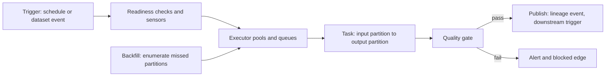

# Batch Orchestration and Lineage: Dependencies Made Operational

## Overview

Batch orchestration is the build system of the data world: a directed acyclic graph of tasks, scheduled, retried, and backfilled by a runtime whose job is to execute the DAG in dependency order despite failures, skew, and time itself. Lineage is the record of what that runtime actually did — which input dataset versions fed which task runs, which outputs they produced, at which code version — and it converts "we think the nightly job feeds the dashboard" into a queryable graph. This page maps the two as one system, because they are: the orchestrator *executes* the dependency graph, and lineage *records* the edges as they fire, binding data versions to the runs that consumed and produced them. Two atlas connections carry the analysis. First, an orchestration DAG is dependency resolution at operational scale — topological order, invalidation propagation, and the difference between "rebuild what changed" and "rebuild everything" are the incremental-computation and dependency-resolution pages' ideas wearing cron and terabytes. Second, every task is a fold over an input partition into an output partition, and all the safety questions — is the fold idempotent, can it be re-run, what happens on interleaving with live writes — are the event-sourcing page's questions in batch clothing. The distinctive pressure that makes batch interesting is the fourth dimension: jobs run on schedules, so their inputs are *time partitions*, and backfilling last Tuesday means re-running a fold over historical state — safely, concurrently with today's live traffic, and (with good lineage) only for the partitions a change actually invalidates.

## The Nodes, Independently

**The scheduler.** The trigger layer: cron-style timetables, dataset-materialization triggers ("run when table X's 2024-06-01 partition lands"), and sensors that block until external conditions hold. The scheduler's product is not execution — it is *readiness*: a declarative statement that a task's preconditions are met, which the executor then enforces against finite capacity.

**The task graph.** Operators (SQL run, Spark job submitted, file moved) wired by dependencies into a DAG. Tasks are the unit of retry, logging, and SLA; edges are the unit of correctness. A well-formed task is pure-ish: a function of (input partition, code version, config snapshot) → output partition, with no hidden inputs — the same purity that makes build caches safe.

**The executor and capacity.** Workers with slots, queues, and pools. Capacity is finite and contended: 200 worker slots shared by 80 DAGs is a queueing system with priorities, head-of-line blocking, and midnight spikes. The executor is where orchestration meets the queueing pages — throughput, latency, and fairness are queue-discipline decisions.

**Partitions.** The time- (or key-) sliced units of data a task consumes and writes. Partitions are what make idempotency and backfill tractable: "re-run task T" is dangerous and vague, while "re-run T for partition 2024-06-01" is a bounded, overwritable operation.

**Backfill machinery.** The loop that enumerates missed partitions, enqueues them respecting the same DAG and capacity limits, and — critically — serializes them correctly against concurrent live runs writing the same tables.

**Lineage capture.** Events emitted per run binding (run ID, task, code version, config) to input dataset-partition versions consumed and output versions produced, collected into a graph service. Standardized event models (OpenLineage-class) make the graph queryable across orchestration engines instead of trapped in one vendor's metadata database.

**Data quality gates.** Checks — row-count deltas, null-rate bounds, referential integrity, freshness SLOs — attached as tasks that fail loudly and, in fail-closed designs, sever the lineage edge so downstream consumers do not build on silent garbage.

**The same nodes under different names.** The family tree makes the abstraction legible. *Make plus crontab* is the primitive ancestor: a DAG of file targets, timestamps as freshness checks, `make` as the topological executor — everything below adds durability, retries, and telemetry to that skeleton. *Airflow* is task-centric: a DAG of operators, XCom for metadata, executors and queues for capacity. *Dagster and Prefect* are asset-centric: the software artifact declares the *data assets* it produces and the types between them, so lineage is a first-class declaration rather than an emitted side-effect — the same shift the book's build-system pages describe as moving from "commands that produce files" to "targets with content addressing." *dbt* is the SQL-native special case: `ref()` calls are the dependency edges, the compiled manifest is the task graph, and model tests are quality gates with a lineage-native placement. *Spark and Flink schedulers* hide below the orchestration layer as the compute pools a task slot actually runs on. The invariants — partition idempotency, recorded (input, code, config), complete lineage — survive every translation; only the declaration surface changes, which is why the assumptions page on scheduled jobs reads as a catalog of ways to violate them.

## How the Nodes Feed Each Other

The steady-state loop: schedule fires → readiness checks pass → the executor enqueues ready tasks into pools → tasks read declared input partitions, write output partitions, and emit lineage events → dataset-materialized events trigger downstream DAGs. The repair loop branches off: a failed or backfilled partition re-enters the same graph as new runs, guarded by idempotency; a quality-gate failure blocks propagation and raises an alert instead. Lineage then closes two feedback loops: blast-radius queries ("which of the 40 tables downstream of this source saw the bad enum values?") direct targeted backfills, and staleness SLOs feed capacity planning (how many worker slots keep the freshest table inside its freshness budget at peak midnight load).

## The Shared Invariants

**Idempotency per partition.** Re-running a task on the same input partition must produce the same result without duplicating effects — the replay-safety invariant from the queue page, enforced here by partition-replace writes (`INSERT OVERWRITE`) or deterministic dedup keys rather than by hope. **Recorded code version and data version together.** Lineage that binds outputs to inputs but not to the code that transformed them cannot answer "what did last Tuesday's data look like under Thursday's code" — reproducibility requires the (input, code, config) triple, exactly the pure-function key of the build-cache page. **Lineage completeness.** A transformation outside the registry is an invisible dependency; the graph's answers are only as complete as the set of tools that emit events, so "anything that writes a table must emit lineage" is a platform invariant, not a convention. **Serialization at the write path.** Backfills and live runs may target the same table; either partitions are the exclusive unit of write (different partitions never conflict) or a write-ordering discipline (per-partition locks, last-writer-wins with staleness flags) must exist — the interleaving problem again, with partition keys as the serialization boundary.

## Failure Propagation

**The midnight herd** is queueing failure: hundreds of DAGs cron-aligned to 00:00 enqueue thousands of tasks simultaneously; pools saturate, SLAs breach in priority order rather than importance order, and the fix (pools, priorities, staggered schedules, dataset-triggered DAGs) is pure queue discipline. **Non-idempotent retries** corrupt silently: an append-style aggregation that runs twice after an executor timeout double-counts a partition, and the error surfaces days later as a reconciliation discrepancy — no exception, no stack trace, just wrong numbers with provenance that says "computed successfully." **Backfill-versus-live interleaving** produces nondeterministic tables: a backfill racing today's incremental run interleaves old-state folds with new-state folds, and depending on commit order the partition holds a mix of code versions' outputs — detectable only by lineage version skew per row. **Sensor deadlocks** propagate as cascading SLA breaches: a never-arriving upstream partition holds a chain of sensors, each downstream DAG timing out in sequence, and the alert storm points at 30 DAGs whose single root cause is one silent producer. **The lineage gap** maximizes blast radius: when an upstream semantics change (an enum gained a value) is discovered in a dashboard, the absence of recorded edges forces "recompute everything downstream" — a 96-hour full rebuild instead of an 11-table targeted one. **Silent schema drift** is the type-system failure: the task runs green because CSV/JSON has no contract, and the quality gate placed *after* the expensive transform is the only thing that catches it — gates belong at read boundaries, where they act as the boundary type check the format lacks. **DST and timezone schedules** are the calendar-shaped failure: a daily trigger set to 02:30 in a zone that springs forward simply never fires (the instant does not exist), and in the fall-back it fires twice — duplicate loads downstream if idempotency is partition-keyed by local date. Schedules are inputs to the time infrastructure, and the robust convention is UTC internally with presentation-layer conversion only, which is the wall-clock discipline from the time-synchronization page expressed as a scheduling policy.

## Design Levers

**Dataset-triggered over schedule-triggered** wherever possible: a DAG that runs when its real input lands cannot fire against stale partitions and cannot herd at midnight. **Partition-level retry and backfill** instead of whole-DAG reruns, with catchup policies bounding how many historical partitions may run concurrently. **Pools and priorities per workload class** so a 3,000-partition backfill cannot starve hourly freshness jobs — the queueing lever applied to metadata. **Write discipline**: partition-replace for re-runnability, append-plus-dedup only where partitions are genuinely non-overlapping, and per-partition write serialization documented as an invariant. **Gate placement at read boundaries** with freshness and null-rate SLOs, fail-closed for downstream aggregates, fail-open-with-staleness-flag for human dashboards. **Automated lineage capture** via standardized events from the executor itself, so completeness does not depend on each developer remembering to declare outputs. **Staleness SLOs as contracts**: every published table carries a max-age, schema guarantees, and nullability bounds published alongside it — a data contract that downstream alerts key off lineage events rather than tribal knowledge of "the nightly" — and a contract violation (freshness breached, schema drifted) is actionable at the boundary where it was declared, not three dashboards away.

## A Concrete Worked Example

A platform runs 80 DAGs — 1,200 tasks — on an executor with 200 slots. At 00:00, 620 tasks arrive at once, averaging 45 seconds: drain time is 620 × 45 / 200 ≈ 139 seconds, comfortably fine. The same executor also hosts a requested 3,000-partition backfill of a 30-second task: 90,000 task-seconds = 450 slot-minutes ≈ 7.5 slot-hours of continuous occupancy — enough to delay every hourly freshness job by 20+ minutes if unpooled. The fix is two pools (freshness gets 120 slots, backfill 80) plus a max-active-runs cap of 4 partitions; freshness p95 delay drops from 22 minutes to under 1. At 10:00, a source system adds an enum value; lineage shows 14 downstream tables affected, of which 3 are gated and fail their null-rate checks by 10:40, and the remaining 11 are scheduled for targeted backfill: average 6 hours of compute each, executed in dependency order for a makespan of 14 wall-clock hours — against 96 hours for the blind full rebuild lineage made unnecessary. The idempotency story, quantified: the one append-style task (retry rate 2%, 5M rows per partition) double-appended on 1.6% of retries during a week of executor timeouts — 5M × 0.02 × 0.016 × 7 ≈ 11,200 duplicated rows/day, a +0.22% revenue-metric skew caught by reconciliation, which is the cross-system checksum doing its job.

## Interview Questions

1. Why does partition-level idempotency — rather than task-level "it's deterministic" — decide whether automatic retries are safe? Give the interleaving that corrupts an append-style aggregate.
2. A 3,000-partition backfill delays hourly freshness jobs. Which two mechanisms bound the interference, and what queueing principle explains the delay before the fix?
3. A source enum gains a value and dashboards go wrong. Walk the lineage query that produces a targeted backfill plan, and state precisely what the plan would be without lineage.
4. Where should data quality gates sit, and why is "after the expensive transform" the common-but-wrong answer? Connect your answer to boundary type checking.
5. Compare dataset-triggered and schedule-triggered DAGs on three axes: stale-input risk, midnight herding, and metadata overhead.

## Key Takeaways

- Batch orchestration is dependency resolution at operational scale; lineage is the recorded execution of that graph, and the two are one system, not two tools.
- Partitions are the unit of idempotency, retry, backfill, and write serialization — designs that get partitions right inherit all four properties.
- Every task is a fold over an input partition; replay safety and interleaving-with-live-traffic are the same questions the event-log page asks.
- Lineage completeness is a platform invariant: one unregistered transformation is an invisible dependency that converts targeted repairs into full rebuilds.
- Capacity is a queueing system with metadata on it — pools, priorities, and trigger style are queue-discipline levers, not tuning afterthoughts.
- Timezone-naive schedules are latent double-fire and skip-fire bugs; UTC internally, presentation-layer conversion externally, is the scheduling discipline that matches the time infrastructure underneath.

## Cross-References

- [../why-not-handbook/etl-vs-elt.md](../why-not-handbook/etl-vs-elt.md) — ETL vs ELT — where transformation happens, and why it changes the shape of the DAG and its lineage.
- [dependency-resolution.md](./dependency-resolution.md) — Dependency Resolution — topo sort, invalidation propagation, and partial orders at build-system scale.
- [incremental-computation.md](./incremental-computation.md) — Incremental Computation — recompute only what a change invalidates, the principle targeted backfills exploit.
- [event-sourcing-wal.md](./event-sourcing-wal.md) — Event Sourcing and WAL — tasks as folds over immutable inputs; replay safety shared with message replay.
- [build-caches-reproducibility.md](./build-caches-reproducibility.md) — Build Caches and Reproducibility — the (input, code, config) key that makes both build artifacts and data partitions reproducible.
- [../assumptions-hunt/scheduled-jobs-assumptions.md](../assumptions-hunt/scheduled-jobs-assumptions.md) — Scheduled Jobs Assumptions — the cron-and-clock assumptions orchestration runtimes inherit and violate.
- [../../data-engineering/airflow.md](../../data-engineering/airflow.md) — Airflow — the canonical scheduler/executor mechanics behind this map.
- [../../data-engineering/data-lineage.md](../../data-engineering/data-lineage.md) — Data Lineage — graph capture and query mechanics beneath the blast-radius workflow. Orchestration reference: [Airflow docs](https://airflow.apache.org/docs/apache-airflow/stable/); the open lineage event model: [openlineage.io](https://openlineage.io/).
