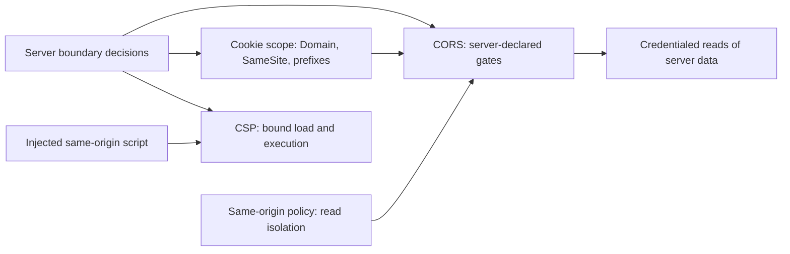

# The Browser Security Model: Origin Isolation as a Distributed Boundary

## Overview

The browser is the most widely deployed sandbox in existence: it runs untrusted code (every site's JavaScript) on a shared machine, against shared network credentials (the user's cookies), and keeps the results apart with a handful of mechanisms. This page maps those mechanisms as one system and, critically, connects each of them to the server-side decision it empowers. The pieces: the **origin** (scheme, host, port) as the unit of isolation; the **same-origin policy (SOP)**, which makes cross-origin *reads* fail by default while permitting many cross-origin writes; **CORS**, the fetch-spec machinery by which a server *opts in* to being read cross-origin; **cookies**, ambient credentials attached to requests by domain scope rather than by application logic; and **CSP**, a per-response policy restricting what resources a page may load and which scripts may execute. The connection worth naming: the browser enforces *defaults*, not intent — every one of these surfaces is a boundary the server must configure deliberately, because the browser's job is to keep sites apart, not to know which sites *should* talk to each other. That is why this page sits beside, not inside, the identity page: sessions and tokens are credentials whose issuance and semantics belong to the auth map, while the confinement of those credentials — where they attach, who may read responses bearing them, what an injected script can still do — is this map's territory. Read it as the client-side half of every server-side boundary decision: the `Access-Control-Allow-Origin` header, the cookie's `Domain` attribute, the CSP nonce, and the CSRF token are four expressions of the same design act, taken in different enforcement layers.

## The Nodes, Independently

**The origin.** Scheme plus host plus port — nothing else. Two pages agree on an origin only when all three match; `https` and `http` on the same host are different origins (scheme counts), and so are two ports. The origin is the trust unit: SOP isolates origins from each other, and everything else on this page is either enforcement of, exception to, or damage limitation around that unit.

**Same-origin policy.** The default rule set: scripts from origin A may read the DOM, storage, and responses of origin A only. The asymmetry is the load-bearing subtlety — cross-origin *embeds* and *writes* are often allowed (images, forms, navigations), while cross-origin *reads* are barred. That asymmetry is why CSRF exists at all: a cross-site POST can be sent with ambient cookies attached, the browser just will not let the attacker read the response. SOP is not a network firewall; it is a read-isolation rule over a network that happily forwards requests.

**CORS.** The server-controlled relaxation of SOP, specified in the Fetch standard. For simple requests the browser sends the request and withholds the *response* unless the server's headers permit the caller's origin; for non-simple requests (custom headers, methods beyond GET/HEAD/POST-with-simple-content-types) the browser first sends a preflight `OPTIONS` asking permission, and only fires the real request on an adequate answer. The headers — `Access-Control-Allow-Origin`, `-Allow-Credentials`, `-Allow-Methods`, `-Allow-Headers` — are the server's *policy statement*, not a firewall rule; the browser merely enforces what the target server chose.

**Cookies.** Name-value pairs with scoping attributes — `Domain` (default host-only; a `Domain` attribute widens to the parent domain), `Path`, `Secure` (HTTPS only), `HttpOnly` (no script access), `SameSite` (attachment policy: `Strict` blocks cross-site attachment, `Lax` allows top-level safe navigations, `None` restores ambient behavior), and the `__Host-`/`__Secure-` name prefixes that force sane combinations. Cookies attach to requests by scope, automatically, without application logic — which is precisely their power and precisely their danger.

**CSP.** A per-response policy (`Content-Security-Policy` header) restricting resource loading (`script-src`, `img-src`, ...), inline execution (nonces or hashes instead of `unsafe-inline`), framing (`frame-ancestors`, retiring `X-Frame-Options`), and object/embed surfaces. SOP cannot help when the attacker's script *is* same-origin — XSS — so CSP is the second line: it bounds what injected code can load and exfiltrate toward.

**Nested and third-party contexts.** Iframes create nested origins with `postMessage` as the explicit, targetOrigin-checked channel; third-party scripts and iframes run inside the page's origin but were loaded from someone else's — the supply-chain surface where CSP allowlist granularity becomes the security boundary.

**The same nodes under different names.** The model has been growing new layers, and each one is the browser telling the server something the older headers could not. *Fetch Metadata* (`Sec-Fetch-Site`, `-Mode`, `-Dest`) puts the request's provenance in server-readable headers — "this request originated cross-site" — which converts CSRF defense from token bookkeeping to a one-line middleware check; it is the request-side complement to CORS's response-side policy. *Cross-origin opener and embedder policies* (COOP/COEP) escalate isolation from the DOM to the *process*: explicit declarations that refuse to share a renderer process with untrusted origins, which is the prerequisite for features like `SharedArrayBuffer` and the modern replacement for hoping document.domain never gets abused. *Permissions-Policy* delegates or forbids powerful browser features (camera, geolocation, fullscreen) per origin and per embed. And `Content-Security-Policy-Report-Only` is the staging mode every CSP rollout should pass through — the same canary instinct as any other policy deploy. The invariants below hold across all generations; the newer layers mostly close gaps that the "browser enforces defaults" stance left open.

## How the Nodes Feed Each Other

SOP establishes the default wall; CORS opens specific, server-declared gates in it; cookies decide which requests cross those gates *carrying credentials*; and CSP bounds the damage when code inside the origin goes rogue. The interactions are where the design lives: a credentialed CORS response (`Allow-Credentials: true`) means "this origin's cookies may accompany a cross-origin read of my data" — combining that with a wildcard or reflected origin is a full cross-origin read of user data, by construction. Cookie scope decides what CORS even has to protect: a host-only, `__Host-`-prefixed session cookie is invisible to sibling subdomains, shrinking the blast radius of a compromised subdomain to itself. CSP interacts with everything by governing script: it cannot replace CORS (it does not govern reads of other origins) and cannot replace cookie scoping (it does not govern attachment), but it is the only layer that helps after XSS succeeds.

## The Shared Invariants

**The server owns the policy; the browser owns enforcement.** Every mechanism here is configured by response headers or attributes the server emits; the browser cannot know intent, only defaults. **Ambient credentials and permissive cross-origin reads must never coexist.** A cookie-scoped API that reflects `Origin` and emits `Allow-Credentials: true` is a data-exfiltration primitive by specification, not by bug. **Read asymmetry defines the threat classes.** Writes crossing origins without reads are CSRF's territory (SameSite and tokens answer it); reads crossing origins are SOP's territory (CORS answers it); code running *inside* the origin is XSS's territory (CSP answers it) — three threat classes, three non-interchangeable defenses. **Origin scope is a design decision.** Which services share an origin, which share a cookie domain, and which get their own subdomain is the actual access-control topology; both `Domain=.example.com` wideness and same-origin cohabitation widen it deliberately or accidentally.

## Failure Propagation

**Reflected-origin CORS** is worse than a wildcard: an API echoing the caller's `Origin` header with credentials enabled lets *any* site read authenticated responses — a wildcard at least requires the attacker to be the allowlisted origin. The failure is silent: no error, no log line at the API, just another site's JavaScript reading user data. **Subdomain compromise cascades through cookie scope**: a stale CI bucket on `analytics.example.com` cannot read `HttpOnly` cookies, but a wide `Domain=.example.com` session cookie means the compromised subdomain can *send* it anywhere in the zone (attachment is not reading), and sibling subdomains' non-`HttpOnly` cookies are directly readable. **XSS nullifies SOP from inside**: one injected script reads every same-origin secret in the page's reach — DOM, storage, non-`HttpOnly` cookies — and its exfiltration is a plain same-origin fetch SOP will not stop; CSP nonce policy is the remaining bound, and its failure mode is allowlist granularity (one allowlisted CDN serving attacker-chosen content reopens the hole). **CSRF rides the write asymmetry**: a state-changing POST with no `SameSite` and no token succeeds cross-site with ambient cookies; the damage is a write the server cannot distinguish from the user's intent. **Supply-chain script** (a compromised third-party tag) fails loudly nowhere: it runs same-origin, inside CSP's own allowlist, and the mitigation — SRI, strict allowlists, Trusted Types — must exist before the compromise. **`postMessage` with wildcard targets** turns a nested iframe into a listener that accepts attacker-crafted messages — the same "ambient trust" bug class as CSRF, in message form. **Clickjacking** attacks the write asymmetry from the presentation layer: the victim site is iframed at near-zero opacity over decoy buttons, so the user's *authenticated* clicks land on state-changing controls they never saw — SOP is irrelevant (the attacker reads nothing), which is precisely why the defense is a dedicated directive (`frame-ancestors`, with `X-Frame-Options` as the legacy form). **Mixed content** is the boundary the padlock does not cover by itself: an HTTPS page pulling HTTP subresources reopens an active attacker's control of script (actively blocked by modern browsers) or of imagery (passively allowed, and enough for tracking) — the transport-misconception page's claim, made concrete at the resource level.

## Design Levers

**Origin topology first**: put trust levels on distinct origins (or at minimum distinct host-only cookie scopes) so that a compromise of one tier cannot even *attach* to another's credentials; prefer `__Host-`-prefixed cookies, which force `Secure`, host-only scope, and no `Domain` attribute, structurally. **CORS allowlists pinned to exact origins**, never reflected, `Allow-Credentials` only where a documented first-party surface needs it; public data can be `*`-readable with credentials disabled. **SameSite as the default**: `Lax` for ordinary sessions, `Strict` for high-value flows entered only by navigation, `None; Secure` only for genuinely cross-site embeds — with a server-side CSRF token (or Fetch-Metadata check) as the second line, because `SameSite` is browser-configurable and history shows defaults arriving late. **Fetch Metadata headers** (`Sec-Fetch-Site`, `-Mode`, `-Dest`) as a server-side filter: reject cross-site requests to state-changing endpoints in one middleware, closing CSRF for browsers that send them without touching cookie semantics. **CSP with nonces per response and `strict-dynamic`** instead of domain allowlists, plus `frame-ancestors` and Trusted Types where DOM sinks are rich; treat each `unsafe-inline` as a design debt item. **SRI on every first-party-loaded third-party script**, and an origin-allowlist review for tags, because the third-party script supply chain is a credential-bearing same-origin dependency whether or not anyone wrote it down. **Process-level isolation declarations** — COOP/COEP on high-value surfaces — stop cross-origin documents from sharing a renderer at all, converting several spectral-era and side-channel concerns into configuration; the cost is that every embedded third-party resource must also opt in, which makes the lever a supply-chain negotiation, not a header. **Defense in depth as non-redundancy**: SOP, cookie scoping, CSRF tokens, and CSP address disjoint failure classes — dropping any one because "another layer covers it" is a category error.

## A Concrete Worked Example

An attacker compromises a forgotten CI bucket served at `https://dashboard.analytics.example.com`, planting one script. Setup A (the vulnerable configuration): the platform's session cookie is `Set-Cookie: session=...; Domain=.example.com; SameSite=None` (no `Secure`, no `HttpOnly` on one legacy cookie), and `api.example.com` reflects `Origin` with `Access-Control-Allow-Credentials: true` to support an old mobile webview. The payload is two lines: `fetch('https://api.example.com/v1/accounts', {credentials:'include'})` followed by an exfiltration POST. The browser attaches the `.example.com` cookie; the API sees a valid session; the response — 18,402 account records, 2.1 MB — is fully readable cross-origin because the API's own reflection opted in. Total attacker cost: one bucket. Setup B, the hardened configuration, breaks the chain at four independent links: the cookie is `__Host-session=...; Secure; HttpOnly; SameSite=Lax` (host-only — the subdomain cannot attach it), the API allowlists exact origins (the script's origin is absent — preflight denied in ~40 ms), Fetch-Metadata middleware rejects the cross-site call server-side in ~1 ms before any handler runs, and the dashboard's CSP (`script-src 'nonce-...' ; require-trusted-types-for 'script'`) blocks the planted inline script from executing at all. Same attacker, same bucket: zero records. The arithmetic of the lesson: each fix is one header or attribute; the incident it prevents is a full account-catalog exfiltration whose detection, absent these layers, typically arrives as a customer report weeks later.

## Interview Questions

1. Explain the read/write asymmetry of the same-origin policy and derive CSRF's existence from it. Why is "CORS prevents CSRF" a category error?
2. An API reflects the caller's `Origin` header with credentials enabled. Walk the exact attack, then give the two header changes and the one cookie change that break it.
3. A subdomain is compromised. Trace precisely what a wide `Domain=.example.com` cookie exposes versus a `__Host-`-prefixed one, distinguishing cookie *attachment* from cookie *reading*.
4. Why does CSP not replace SOP or cookie scoping? State the failure class each of the three layers addresses and one interaction where CSP is the only surviving defense.
5. Design the server-side boundary checks for a state-changing endpoint: SameSite choice, CSRF token versus Fetch Metadata, and CORS credentials — and justify which layer you would drop last under pressure.

## Key Takeaways

- The browser enforces defaults; the server expresses policy — every mechanism here is a server-side boundary decision wearing a client-side enforcement mechanism.
- Origin scope is the real access-control topology: cookie `Domain` wideness and origin cohabitation are trust-granting decisions, not conveniences.
- Ambient credentials plus permissive credentialed CORS is an exfiltration primitive by specification; allowlists must be exact, never reflected.
- Three threat classes, three defenses: SOP for cross-origin reads, SameSite/tokens for ambient writes, CSP for same-origin code — none subsumes another.
- TLS is transport confidentiality, not an origin-isolation or XSS story; "HTTPS means secure" is the misconception this map exists to correct.

## Cross-References

- [auth-identity-session.md](./auth-identity-session.md) — Auth, Identity, and Session — issuance, semantics, and revocation of the credentials this page confines.
- [../misconceptions/https-means-secure.md](../misconceptions/https-means-secure.md) — HTTPS Means Secure — the transport-layer misconception adjacent to every boundary here.
- [../followup-tree/http-protocol.md](../followup-tree/http-protocol.md) — HTTP Protocol — the request/response semantics and header mechanics all four layers ride on.
- [../../web-development/cors.md](../../web-development/cors.md) — CORS — the canonical preflight, header, and credential-flow details.
- [../../web-development/cookies-storage.md](../../web-development/cookies-storage.md) — Cookies and Storage — attribute-level scoping and storage surfaces behind the credential half.
- [../../web-development/security-deep.md](../../web-development/security-deep.md) — Web Security Deep Dive — XSS/CSRF attack mechanics and remediation detail.
- [../../security/web-security.md](../../security/web-security.md) — Web Security — the security-track treatment of the same boundaries from the defender's side. Authoritative specifications: [Same-origin policy (MDN)](https://developer.mozilla.org/en-US/docs/Web/Security/Same-origin_policy), [Fetch Standard](https://fetch.spec.whatwg.org/), [CSP Level 3](https://www.w3.org/TR/CSP3/).
