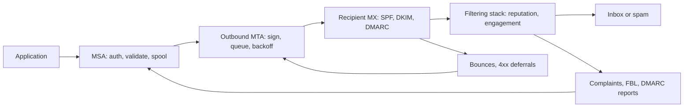

# Email Delivery Pipeline: Reputation as the Admission Currency of Push Delivery

## Overview

Email looks like one protocol but behaves like a distributed system with five loosely coupled authorities: the sending application, the submission and relay tier (MSA and outbound MTAs), the DNS-based authentication fabric (SPF, DKIM, DMARC), the recipient mailbox provider with its filtering stack, and the feedback machinery of bounces, complaint loops, and blocklists. No single component decides whether a message arrives; deliverability is an emergent property of all five interacting, and the coupling medium is not packets but *reputation* — a per-sender score that every stage reads and writes continuously. This page maps the pipeline as one system: how each stage feeds the next, which invariants must hold end to end, how failures propagate (reputation collapse is the canonical case, greylisting the subtle one), and which levers — IP warm-up, separation of transactional and bulk streams, DMARC alignment — actually move the outcome. The connection generalizes: email is the internet's oldest large-scale at-least-once push system with feedback-driven admission control, which makes it a reusable lens for notification pipelines, webhook fan-out, and any third-party delivery API you will ever integrate.

## The Nodes, Independently

**The application and the submission agent (MSA).** The application composes a message and hands it to a submission agent on port 587 (or an ESP API), which authenticates the client, validates headers, fills in `Message-ID`, `Date`, and `Reply-To`, and spools the message durably to disk before acknowledging. That spool is the system's first queue: from this moment the message exists independently of the sending process, and delivery becomes the relay's problem. The MSA is also the natural place for sanity checks — malformed addresses, suppressed recipients, per-tenant volume ceilings — because every rejected message here is one that never burns sender reputation downstream.

**The relay tier (outbound MTA).** The outbound MTA resolves each recipient domain's MX records, maintains per-destination queues, and schedules connections with per-domain concurrency caps and exponential backoff on temporary failures. It signs with DKIM, chooses the source IP from a pool, and processes synchronous SMTP replies: 2xx means accepted, 4xx means retry later (the message stays queued), 5xx means the recipient refused permanently (bounce). Queue management here is textbook queueing discipline under an adversarial scheduler: the "server" on the other end is deliberately slow, deliberately picky, and watching how politely you handle its 4xx replies.

**The DNS authentication fabric.** SPF ([RFC 7208](https://www.rfc-editor.org/rfc/rfc7208.html)) publishes, in a DNS TXT record, which IPs may send for a domain; the receiver checks the connecting IP against it using the *envelope* sender domain. DKIM ([RFC 6376](https://www.rfc-editor.org/rfc/rfc6376.html)) has the sending MTA add a `DKIM-Signature` header covering selected headers and the body hash, signed with a private key whose public half lives at `selector._domainkey.<domain>`; the receiver fetches that record and verifies. DMARC ([RFC 7489](https://www.rfc-editor.org/rfc/rfc7489.html)) binds the two to the *visible* `From:` domain (alignment), publishes a policy (`p=none/quarantine/reject`), and asks receivers to send aggregate reports back. DNS here is a replicated, TTL-cached trust store — the same "cached copy of truth with a staleness budget" structure that underlies all addressing layers.

**The recipient mailbox provider.** The MX receiver performs the SMTP conversation: reverse lookups, SPF check, DKIM verification, DMARC evaluation, rate limiting, and often greylisting — a deliberate 4xx deferral of unseen sender/recipient triplets to test whether the sender retries properly. After acceptance, a second, opaque stack decides *placement*: IP and domain reputation, engagement history (opens, replies, moves out of spam, deletes-without-reading, spam-button complaints), content classification, and volume anomalies. Placement is the true output of the system; "accepted by SMTP" and "delivered to the inbox" are different events separated by a probability distribution.

**The engagement asymmetry.** One structural fact explains most deliverability advice: the receiver has engagement data and the sender does not. Mailbox providers observe, across billions of messages, whether users open, reply, drag to inbox, delete unread, or report spam — per sending domain and IP — and they fold those observations into placement before any content classifier runs. The sender's view of its own mail stops at the SMTP 2xx; opens are sample data filtered by pixel-blocking, and spam-folder placement is usually invisible. This asymmetry is why seed-list monitoring and postmaster dashboards exist: they are instruments for reading a signal the receiver holds and the sender needs. It also explains why engagement-driven list hygiene (sunset policies, preference centers, one-click unsubscribe) is not politeness but mechanism — every disengaged address that stops being mailed removes a negative data point from the receiver's model of you.

**The feedback machinery.** Hard bounces (5xx, permanent), soft bounces (4xx, transient), NDRs, feedback-loop complaint feeds from ISPs, blocklists (Spamhaus-class), and postmaster dashboards (Google Postmaster Tools, Microsoft SNDS) all flow information back toward the sender. This is the loop that makes the pipeline a control system rather than a one-way pipe: ignore it, and the receiver's view of you degrades faster than you can observe.

## How the Stages Feed Each Other

The forward path is: application → MSA (validate, spool) → MTA (resolve MX, sign, connect, backoff) → DNS (looked up *by the receiver*, not just the sender) → recipient MX (authenticate, rate-limit, greylist) → filtering stack → inbox, spam folder, or rejection. The return path is: bounces and 4xx replies → the MTA's bounce processor → suppression list and queue state; complaint feeds and DMARC aggregate reports → the domain owner's reputation model. Each stage's output is the next stage's input *and* the next stage's evidence: volume patterns, retry politeness, alignment, and bounce handling at every upstream stage are all folded into the downstream admission decision. That is why the pipeline cannot be debugged stage by stage in isolation — a misconfigured SPF record silently changes mailbox placement three hops later.

## The Shared Invariants

Four invariants hold across the whole map. **Identity alignment:** the envelope-from domain, the visible `From:` domain, and the DKIM signing domain must agree, or the receiver's trust computation fails no matter how good each individual signal is — one identity, stated consistently at every layer, exactly like a session claim that must match the token and the request. **At-least-once with receiver-side dedup:** queues spool before ack, 4xx retries retransmit, and duplicates are prevented by `Message-ID` conventions and suppression lists on the sending side — the entry fee is the same idempotency discipline every delivery system demands. **DNS as the trust store:** all three authentication mechanisms are lease-like DNS records with TTLs, so key rotation is a dual-record overlap operation, and any DNS outage converts into authentication failures downstream. **Feedback must be consumed:** unprocessed bounces are the email equivalent of ignoring 429 responses — a soft failure the sender upgrades into a hard reputation failure.

## Failure Propagation

**Reputation collapse** is the characteristic cascading failure. Reputation is per-IP and per-domain, decays slowly, and is shared: one tenant's bad campaign on a shared pool lowers placement for every tenant on that pool. Complaint rates above roughly 0.1–0.3% begin to distort placement, and above ~1% receivers start throttling or rejecting the pool outright — at which point *transactional* mail (password resets, order confirmations) inherits the damage. The failure propagates sideways across tenants and forward in time, because rebuilding reputation takes weeks.

**Greylisting** propagates as delay, not loss — but only for senders whose retry loop is correct. A receiver 4xx-defers an unseen (IP, envelope-from, recipient) triplet; a conforming sender retries per the backoff schedule and passes on the second attempt; a fire-and-forget sender never does, which is exactly the discrimination the mechanism exploits. The subtle failure is on the sender side: a retry implementation that gives up after one 4xx, or that retries *before* the receiver's minimum defer interval, turns a designed delay into permanent loss or a reputation-marking hammer.

**Blocklists and backscatter** are the contagion modes. One compromised host in a /24 can get the range listed, propagating one operator's failure onto every co-tenant. Conversely, a sender that bounces messages to forged envelope addresses produces *backscatter* — NDR floods aimed at spoofed victims — which converts the sender into a weapon and earns its own blocklisting. Finally, DNS-layer failures propagate silently: a DKIM key record that times out yields a tempfail the receiver may forgive or may score, and exceeding SPF's ten-lookup limit yields a permerror that DMARC then treats per policy.

**Instrumenting the blind spots** is itself a mitigation, because the worst propagation is the one you cannot see. Seed accounts spread across major providers detect placement drops (inbox versus spam) within minutes; DMARC aggregate reports reveal unauthorized senders and alignment gaps within a day; postmaster dashboards expose domain reputation trends the SMTP layer never shows. A sender without these instruments discovers reputation collapse from angry users, which is a lag of hours to days — and reputation decays whether or not you are watching it.

## Design Levers

**Warm-up** is reputation cache-filling: a new IP or domain starts with low volume to highly engaged users and ramps over two to six weeks, because receivers have no engagement history to trust and treat any sudden volume as an anomaly signal. The ramp multiplier is decided by observed bounce and complaint rates, making warm-up a feedback-driven process, not a fixed schedule. **Stream separation** is blast-radius isolation: transactional and bulk mail are sent from different IPs and subdomains (and usually different ESP accounts), so bulk's reputation can never contaminate password-reset delivery — a cell boundary drawn in reputation space. **Alignment and policy ramping** move a domain from `p=none` (monitor) to `quarantine` to `reject` only after aggregate reports confirm all legitimate paths align, which is a canary rollout for a trust policy. **List hygiene** (hard-bounce suppression, sunset policies for disengaged users, one-click `List-Unsubscribe`) keeps the engagement signals that feed placement positive. The lever that must *not* be pulled is squeezing more volume through a degraded pool: it is the equivalent of adding concurrency to a thrashing system.

## A Concrete Worked Example

An ESP runs a shared pool of four IPs moving 500k messages/day: 80% transactional for 40 tenants, 20% marketing for 3 tenants. One marketing tenant uploads a stale purchased list and sends 2M cold messages in a day. Hard bounces hit 9% and complaints 0.8% within hours; two receivers begin 4xx-throttling the whole pool; transactional password resets on the same IPs now queue behind deferrals, and their p99 delivery latency moves from ~5 seconds to ~40 minutes. Mitigation sequence: stop the campaign, move transactional traffic to clean IPs (stream separation that should have existed), suppress the bounced addresses, and ramp the pool back with engaged-only volume — expect two to six weeks for placement to recover. The arithmetic of the disaster is the point: 2M messages bought a tenant a few thousand conversions and cost 40 other tenants their delivery SLA, because the pool was a shared reputation domain without an isolation boundary.

## Interview Questions

1. Why does email authentication need three DNS-based mechanisms (SPF, DKIM, DMARC) instead of one? Name the specific failure each one closes and what DMARC adds beyond both.
2. Design a warm-up schedule for a new sending domain. Which observable signals would you use to decide the daily volume multiplier, and what would make you pause the ramp?
3. Transactional open rates drop 40% the day a marketing campaign launches, with no code change. Walk the propagation path stage by stage and give the first three mitigations in order.
4. Compare greylisting to a rate limiter with cache-miss semantics. What does the sender's correct behavior look like, and how does a broken retry loop convert a designed delay into permanent loss?
5. Why is DMARC alignment defined against the visible `From:` header domain rather than the envelope sender, and what attack does that choice close?

## Key Takeaways

- Deliverability is an emergent property of five coupled stages, and the coupling medium is reputation — a slowly-decaying, shareable, feedback-driven score, not a per-message boolean.
- The identity invariant (envelope-from, From:, DKIM domain alignment) is the email version of "one claim, stated consistently at every layer"; misalignment fails silently at the placement stage, not the protocol stage.
- Greylisting, throttling, and warm-up are all admission-control devices that distinguish well-behaved retrying senders from fire-and-forget ones; every sender is graded on its feedback handling.
- Failure propagation is sideways (shared pools, blocklisted ranges) and temporal (slow reputation decay), so blast-radius isolation — separate IPs and subdomains per stream — is the highest-leverage structural decision.
- The map transfers directly to webhooks and notification APIs: spool before ack, retry with backoff, consume feedback, dedup on the receiving side, and never share a reputation domain between critical and bulk traffic.

## Cross-References

- [dns-cdn-routing.md](./dns-cdn-routing.md) — DNS and CDN Routing — the "cached copy of truth with a TTL lease" structure that SPF, DKIM, and MX records all instantiate.
- [webhook-delivery.md](./webhook-delivery.md) — Webhook Delivery — the modern at-least-once HTTP sibling: retries, signing, dedup, and pull fallback mirror the email loop.
- [tcp-distributed-failure.md](./tcp-distributed-failure.md) — TCP and Distributed Failure — timeouts as statistical failure detectors and the retry-plus-dedup entry fee.
- [observability-pipeline.md](./observability-pipeline.md) — Observability Pipeline — the feedback half of this map is a fan-in telemetry system with its own fidelity losses.
- [auth-identity-session.md](./auth-identity-session.md) — Auth, Identity, and Session — alignment of identity claims across layers, and key rotation as a lease operation.
- [../followup-tree/message-queues.md](../followup-tree/message-queues.md) — Message Queues Follow-up Tree — spooling, backoff, and redelivery as queue discipline.
- [../../networks/dns/record-types.md](../../networks/dns/record-types.md) — DNS Record Types — MX and TXT records that carry the entire authentication fabric.
- [../../networks/dns/security.md](../../networks/dns/security.md) — DNS Security — what the DNS trust store can and cannot guarantee.
- [../../distributed/messaging/queues.md](../../distributed/messaging/queues.md) — Message Queues — the broker-side mechanics behind spool-and-retry.
- [../../sre/slo-error-budget.md](../../sre/slo-error-budget.md) — SLOs and Error Budgets — framing "delivered to inbox within X seconds" as the only SLO that matches user experience.
- [RFC 7208 — SPF](https://www.rfc-editor.org/rfc/rfc7208.html) — sender authorization via DNS.
- [RFC 6376 — DKIM](https://www.rfc-editor.org/rfc/rfc6376.html) — cryptographic message signing.
- [RFC 7489 — DMARC](https://www.rfc-editor.org/rfc/rfc7489.html) — alignment, policy, and reporting.
