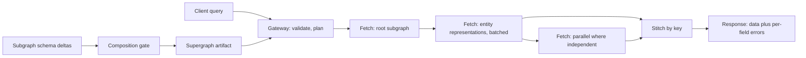

# GraphQL Federation: A Query Planner Across Team Boundaries

## Overview

GraphQL federation lets many teams own small schemas ("subgraphs") that compose into one supergraph served by a gateway, so a client posts a single query and the gateway plans and routes it across services. The design is a stack of this atlas's favorite problems wearing one API. It is a *query-planner* problem: the client states declarative intent ("these fields, these relationships"), and the gateway derives an execution DAG — which subgraph to call first, which entity keys must be passed between calls, what can run in parallel — under cost and availability constraints, exactly the shape of the planner/dataflow connection. It is a *partitioning* problem: each subgraph owns a partition of the type space, entity keys are the partition keys, and joining a product to its reviews across subgraphs is a partition join by key — the spread-versus-locality tension of the load-balancing page, decided here by schema composition. And it is a *deployment* problem: each team ships schema changes independently, composition validates them into a new supergraph, and the supergraph ships as a versioned artifact — a custody chain with a compatibility gate, homologous to the schema-registry gate on the serialization page. The connection worth naming: federation is a federated query planner whose join keys are declared in the schema, and whose planner runs on every request; the plan quality, the failure semantics (partial data plus an errors array, never a distributed transaction), and the composition gate are the three places where all the interesting engineering lives.

## The Nodes, Independently

**Subgraphs.** Services that own a slice of the type space and the resolvers behind it. Ownership is exclusive — exactly one subgraph defines each field — which is what makes composition decidable. A subgraph extends shared entities by declaring a key (`@key(fields: "upc")`) and contributes fields resolvable from that key.

**The supergraph schema.** The composition output: all subgraph schemas merged, with join directives recording which subgraph defines what and how entities travel between them. The supergraph is a build artifact — generated in CI, tested, and deployed atomically to the gateway — never hand-edited, never composed at runtime in production.

**The gateway (router).** Receives client queries, validates them against the supergraph, builds a query plan, executes it by calling subgraphs, and stitches results by key. It is the only component that sees the whole graph, which concentrates both the leverage (batching, caching, complexity limits) and the risk (one bad plan policy affects every client).

**Entities and representations.** The federation join mechanism: a subgraph needing another's fields sends a *representation* — `{ "__typename": "Product", "upc": "123" }` — and the owning subgraph resolves the entity by key. Representations are partition-key tuples passed between plans; their shape is the federation equivalent of a foreign key.

**Subgraph execution and batching.** Inside each subgraph, the classic GraphQL N+1 machinery: resolver calls per entity are batched (DataLoader-class) into single data-source queries. Federation multiplies the stakes — one client query can produce hundreds of entity resolutions — so subgraph-side batching is not an optimization but a correctness-level requirement.

**Composition CI.** The gate where every team's schema deltas meet: composition runs on each pull request, rejects overlapping field definitions, unresolvable keys, and nullability conflicts, and emits the next supergraph version. This is the serialization page's registry gate transposed to schema land — the mechanical check that converts "teams coordinate informally" into "incompatible changes cannot merge."

**The client cache.** GraphQL clients do not just render responses — most store entities in a normalized cache keyed by `(type, id)`, so a query for `{ product { reviews } }` and a later query for `{ review(id) { stars } }` read the same cached Review objects. The client is thus running its own miniature entity store with exactly the coherence problems the server side has: after a mutation, which cached objects are now stale, and by what invalidation channel? This makes every federation result also a cache-coherence decision, which is why mutation responses that omit affected entities produce the classic "the list didn't update" bug.

**The same nodes under different names.** Federation is the second generation of the idea, and the lineage clarifies what the directives actually buy. *Schema stitching*, the predecessor, let a gateway hand-wire resolvers across separately served schemas — powerful, but with no composition-time guarantee that the seams were consistent, which made every stitching deployment a bespoke artifact. *Apollo-style federation* moved the seams into declarative join directives (`@key`, `@external`, `@requires`) plus a composition step that can *prove* the merged schema coherent before deploy. Open implementations (Cosmo, Mesh, Hasura-style gateways) and in-house routers re-instantiate the same nodes; and the *backend-for-frontend* pattern is the degenerate case — one BFF per client is hand-rolled federation without the composition machinery, which is exactly why it stops scaling at the third or fourth client. The invariants are stable across all of them: exclusive ownership, resolvable keys, one atomic schema version at a time.

## How the Nodes Feed Each Other

Client query → gateway parses and validates against the supergraph → the planner derives fetch nodes: a root fetch against the owning subgraph, then representation-passing fetches for extended entities, parallel where independent, serial where a plan needs another's output → subgraphs execute their fragments with internal batching → the gateway stitches by key and returns one response with per-field errors attached. Control flows back into CI: subgraph schema deltas → composition → supergraph artifact → gateway deploy, with the compatibility gate between every team's ambition and the merged truth.

## The Shared Invariants

**Exclusive field ownership.** Each field is defined by exactly one subgraph; duplication is a composition error, not a shadow read — the partitioning invariant that makes routing decidable. **Resolvable keys.** An entity's key must be resolvable by the owning subgraph from the representation alone; a key that requires context the gateway cannot provide breaks every join through it. **Partial failure, not partial lies.** The gateway never promises cross-subgraph transactions; subgraph failure yields nulls plus typed errors, and *nullability propagation* rules (a non-null field error nulls its parent, bubbling per the schema's declarations) are the contract for how far damage spreads. **One schema version at a time.** The gateway serves one supergraph atomically; clients see a consistent schema, and schema evolution is gated by composition — the same "compatibility checked against the union of live versions" discipline as wire schemas, with composition playing the registry.

## Failure Propagation

**Cross-boundary N+1** is the classic blast: a list of 200 products extended by reviews and inventory becomes 1 + 2 batched fetches *if* subgraphs batch, and 1 + 200 + 200 unbatched subgraph calls at ~10–20 ms overhead each if they do not — a plan that is correct and unusable, with latency p95 in the seconds. **Unbounded query cost** turns the gateway into an amplifier: deep selections and introspection abuse let one request schedule disproportionate work, so complexity limits and depth limits are admission control (the rate-limiting page's problem in schema clothing), and persisted queries are the strong form. **Subgraph outage** propagates as nullability propagation: a down reviews subgraph nulls every `reviews` selection across all clients — contained, *if* the field is nullable and the error policy marks it `DATA`-level rather than killing the response; a non-null chain turns one subgraph outage into whole-object errors. **Composition break as global deploy block** is the organizational failure: the gate is shared, so a schema error in one team's PR blocks every team's release train; the mitigation is fast, local feedback (compose in CI per PR) rather than a slower central process. **Representation forgery** is the security failure: anything that can call a subgraph directly can claim any entity key, so subgraphs must authenticate the gateway and treat keys as untrusted input — trust boundaries follow network reality, not diagram arrows. **Stale client caches after mutation** propagate at the edge of the system: a mutation whose response omits the entities it changed leaves the normalized client cache serving yesterday's objects silently — no error, just UI divergence from server truth — which is why cache update policies (manual eviction, refetch of affected keys, or mutations that return full entities) are part of the API contract rather than a client implementation detail.

## Design Levers

**Entity key design** — stable, minimal, immutable identifiers — determines join cost everywhere; keys that change with business state turn every plan into a two-step read-then-fetch. **Fetch grouping and batch hints** in the planner collapse parallel representation-passing fetches, and subgraph-side batching caps convert pathological plans into bounded ones. **Complexity budgets and persisted queries** bound per-request cost and shrink the parser attack surface; they are the query-plan analogue of rate limits and belong at the gateway. **Error policies per field** (nullable by default at federation boundaries, `DATA`-level errors) decide how far a subgraph failure propagates — nullability is a blast-radius dial. **Composition as CI gate with local loops** keeps the shared-block time to minutes; supergraph versions ship like artifacts (digest-pinned, rollback-ready) so a bad composition is a revert, not an investigation. **Pushing hot joins into a subgraph** (denormalizing reviews-count onto Product) trades one team's write amplification for every client's read latency — a partition-placement decision that should be made from plan telemetry, not taste. **Schema contracts** (client-specific schema subsets) decouple client lifecycles from the supergraph's full surface. **Field migration across subgraphs** — moving `stock` from `inventory` into `products` — is staged with override directives: the new subgraph serves the field while the old one still defines it, composition watches both, and the migration completes by removal — the expand-contract shape from the migrations page applied to schema ownership. **Deferred and streamed execution** (`@defer`, `@stream`) extend the plan shape from "one response" to "one response with continuations," which the planner must treat as scheduling constraints rather than afterthoughts — worth naming because interview questions about "partial responses" are usually probing exactly this machinery.

## A Concrete Worked Example

An e-commerce supergraph: `products` (owner of Product), `reviews`, and `inventory` subgraphs. Query: `{ products(first: 50) { title reviews { stars } stock } }`. The plan: fetch 50 products from `products`; pass 50 representations to `reviews` and 50 to `inventory` in parallel. Subgraph p95 latencies: products 40 ms, reviews 45 ms, inventory 30 ms. Critical path: 40 + max(45, 30) = 85 ms. Without entity batching — one resolver call per product — the same query is 1 + 50 + 50 calls at 15 ms HTTP overhead alone: ~1,515 ms of overhead plus data-source load multiplied 50×, which is the difference between a DataLoader at the subgraph and an incident review. The gate story: the reviews team PRs `author: User!` on Review, with `User` owned by an `accounts` subgraph and no `@external` declaration path for the key — composition fails in CI in 90 seconds with a message naming the owning subgraph, versus the pre-federation failure mode: two teams discover at runtime that both defined `User.email`, and whichever client wins, the other's clients break. Deploy arithmetic under federation: 3 teams × independent PRs composed per PR, supergraph produced in minutes, gateway rollback via the previous artifact — the coordination cost of a cross-team API change drops from "calendar meeting" to "green CI," which is the federation value proposition stated as pipeline latency.

## Interview Questions

1. Walk the query plan for a query joining three subgraphs through entity keys: what runs in parallel, what runs serial, and what exactly travels in a representation?
2. Why is subgraph-side entity batching a correctness-level requirement rather than an optimization? Give the arithmetic for a 200-entity list without it.
3. A subgraph goes down. Using nullability propagation and error policies, design the response shape so product pages degrade but do not fail — and state the schema decision that makes it possible.
4. What makes composition a *global* deploy gate, and how do mature setups keep one team's schema mistake from blocking every team's release train?
5. A client query schedules disproportionate subgraph work. Which gateway-level levers bound the cost, and which page's admission-control principles do they instantiate?

## Key Takeaways

- Federation is a federated query planner: declarative client intent in, planned subgraph fetch DAG out, with entity keys as the declared join keys.
- Exclusive field ownership and resolvable keys are the partitioning invariants that make composition decidable and routing mechanical.
- Partial failure is the contract: nulls plus typed errors, never cross-subgraph transactions — nullability is a blast-radius dial.
- The composition gate is the schema-registry gate transposed: incompatible changes fail mechanically in CI instead of spontaneously in production.
- Batching, complexity limits, and persisted queries are admission control for plans; without them the gateway amplifies rather than routes.
- The client's normalized cache makes every federation response a cache-coherence event: mutations that omit affected entities trade server correctness for silent UI staleness.

## Cross-References

- [../why-not-handbook/graphql-vs-rest.md](../why-not-handbook/graphql-vs-rest.md) — GraphQL vs REST — the single-service version of the trade-offs before federation scales them across teams.
- [../followup-tree/api-gateway.md](../followup-tree/api-gateway.md) — API Gateway — the sibling edge pattern: cross-cutting policy without schema composition.
- [query-planner-dataflow.md](./query-planner-dataflow.md) — Query Planner and Dataflow — declarative intent to execution DAG under a cost model, the same skeleton one layer up.
- [load-balancing-partitioning.md](./load-balancing-partitioning.md) — Load Balancing and Partitioning — ownership, keys, and the spread-versus-locality tension behind entity placement.
- [rate-limiting-distributed.md](./rate-limiting-distributed.md) — Distributed Rate Limiting — admission control for the query-cost problem the gateway inherits.
- [deployment-artifact-promotion.md](./deployment-artifact-promotion.md) — Deployment Artifact Promotion — the supergraph as digest-pinned, rollback-ready artifact.
- [../../backend/api/graphql-federation.md](../../backend/api/graphql-federation.md) — GraphQL Federation — canonical directive semantics and gateway mechanics beneath this map. Language-level detail: [spec.graphql.org](https://spec.graphql.org/); federation reference: [Apollo Federation docs](https://www.apollographql.com/docs/federation/).
