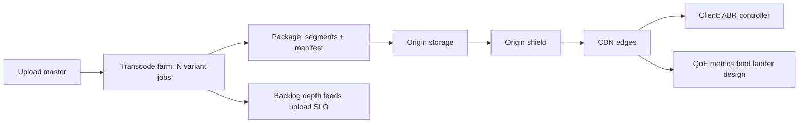

# Media Optimization and Delivery: The Derivative Ladder from Master to Byte-Range

## Overview

A media platform never serves the file a user uploaded. It serves a family of machine-made derivatives — transcodes at several resolutions and bitrates, thumbnails, poster frames, audio-only renditions — assembled on demand by a client that *chooses* among them at playback time. The system behind that choice is a pipeline with a shape familiar from other corners of this atlas: expensive transformation at write time buys cheap, cacheable, decision-rich serving at read time. This page maps the whole ladder as one connected machine — the master (mezzanine) asset, the transcode farm, the variant ladder, the packaging step that segments media and writes manifests, the origin stores, and the cache hierarchy through which every byte flows — and names the principles that hold it together. Derivatives are content-addressed facts: same master plus same encoding parameters must yield the same bytes, or caches fragment and integrity checks lie. The manifest is a schema: it declares which variants exist, at which bandwidths, and clients treat it as the contract. And the whole pipeline is a study in write-time amortization — the same principle the vector-embedding page applies to text, applied here to pixels, with the same failure signature: when the write-time half of the pipeline backs up, the failure surfaces as upload latency and missing variants, not as serving errors. What this page deliberately does not cover is *which* edge serves the bytes — routing, anycast, and purge propagation belong to the DNS/CDN connection; this page ends where the cache key begins.

## The Nodes, Independently

**The master asset.** The uploaded original (or a normalized mezzanine): highest-quality source, typically high-bitrate H.264/ProRes-class video plus untangled audio tracks, stored durably and rarely touched. Every derivative is a pure function of (master, parameters), so the master is the system's single source of truth — immutable, versioned by content hash, and expensive enough to reprocess that keeping it is always worth the storage.

**The transcoder.** A CPU/GPU farm that converts the master into each rung of the ladder. Encoding is embarrassingly parallel across files and painfully expensive per file: minutes of compute per minute of output at high quality, two-pass rate control for accurate targets, and a per-title analysis pass that picks ladder rungs to match the actual content rather than a fixed table. The transcoder is the write-time cost center; its queue depth *is* the platform's backlog.

**The variant ladder.** The ordered set of renditions — for video, typically 5–8 rungs from a low-bitrate mobile rung (~300 kbps) to a high-bitrate 1080p/4K rung — each a compromise between bitrate and quality chosen so the client can always step down under network pressure. Images get the same treatment in miniature: width-parameterized variants, WebP/AVIF re-encodes, and a thumbnail/poster family.

**Packaging.** Segmentation of each variant into small independently fetchable pieces (2–6 second segments for video) plus a manifest (HLS's `.m3u8` or DASH's `.mpd`) that indexes the ladder. Packaging is where "a movie" becomes "a directory tree of immutable objects and a small, frequently re-read index."

**Origin storage.** Durable stores for masters (cold, cheap, integrity-checked) and derivatives (warm, high-throughput). Derivative objects are addressed by a key that encodes (asset ID, variant, segment, codec) — and the best keys are content hashes, which makes the address prove the content.

**The cache hierarchy.** Browser cache, CDN edges, and an origin shield that collapses per-edge misses into at most one origin request per object. Caching policy is entirely URL-and-header driven, which is why the naming scheme is a correctness surface: immutable segments earn effectively infinite TTLs; manifests change and need versioned names or short TTLs.

**The client.** Fetches the manifest, measures throughput, and runs adaptive bitrate logic — stepping up when bandwidth allows, down when it collapses. The client is a controller closing a loop through the cache hierarchy; every ladder design decision is really a statement about this controller's dynamics.

**The same nodes under different names.** The pipeline instantiates twice with different economics, and knowing which species a surface belongs to prevents re-deriving everything per medium. *Images* run the on-the-fly species: a request like `/img/abc.jpg?w=800&fmt=avif` is transformed on cache miss in milliseconds (the imgproxy/Cloudinary/Next-Image class), so the "ladder" is unbounded and demand-defined — variants materialize when first requested and then behave exactly like immutable cacheable objects. *Video* runs the precomputed species: encode cost is minutes per minute of output, so rungs must be chosen before anyone asks, packaged into segments, and published as a fixed ladder. The invariants above hold for both (derivative identity, immutability, manifest-as-schema); what changes is who chooses the variant set — the client's URL parameters for images, the packager for video — and therefore where ladder mistakes surface: as cache fragmentation for images, as QoE degradation for video. Audio sits between them: precomputed renditions at a few bitrates, but with segment durations stretched to 30–90 s because switching granularity matters far less than request economy.

## How the Nodes Feed Each Other

The forward path is a fan-out: upload → validate → transcode one master into N variants → package each into segments plus a manifest → publish to origin → client pulls manifest → client pulls segments through edge caches. The transcode step is a DAG in miniature (per-variant jobs that can run in parallel, a packaging job that joins them, a quality check that gates publication), so orchestration machinery — dependencies, retries, idempotent re-runs — is not an analogy but a literal requirement. The read path is demand-filled: nothing is fetched from origin until some edge misses, and the shield turns N edges' misses into one origin fetch. Feedback closes in three places: transcode queue depth feeds upload-latency SLOs; per-variant CDN hit ratios feed which rungs clients actually use (killing unused rungs saves origin work); and QoE metrics (rebuffer ratio, startup time) feed ladder redesign — the client's measured behavior is the only honest signal about whether the ladder's rungs are in the right places.

## The Shared Invariants

**Derivative identity is (content, parameters).** Same master and same encoding settings must produce byte-identical output; when that holds, derivative addresses can be content hashes, re-encodes deduplicate, and cache keys are honest. When an encoder upgrade changes output for identical inputs, the address scheme must change with it — or the cache silently serves two truths under one key. **Segments are immutable; manifests are not.** A published segment is never modified in place; new encodings get new URLs. This is the same discipline as artifact promotion — a content-addressed fact is never mutated, only superseded — and it is what makes "cache forever" safe. **The manifest is the schema of the ladder.** Clients plan against it; a rung missing from the manifest does not exist, and a bandwidth label that lies (says 3 Mbps, delivers 4.5) makes client controllers oscillate. **Every derivative is reproducible or recoverable.** Losing a derivative is an incident only if the master is gone or re-encoding is nondeterministic; keeping the master converts "lost data" into "lost time."

## Failure Propagation

**Transcode backlog** propagates as write-time pain: a 4× real-time GPU farm that loses half its capacity doubles upload-to-ready latency for every new asset while serving continues unaffected — the failure is invisible to the read path and completely visible to content teams, which is why backlog depth and age are first-class SLOs. **A missing or mislabeled ladder rung** fails quietly and far away: clients that cannot find a mid rung must jump from 720p to 4 Mbps-class rungs, and a bandwidth spike on poor networks converts into rebuffering — the CDN sees only a bitrate mix shift; users see a broken video; the rung's absence shows up only in QoE dashboards. **Cache-key fragmentation** is the self-inflicted origin overload: a `Vary: User-Agent` or per-device URL variants multiplies the effective object count by orders of magnitude, hit ratios collapse, and origin egress — sized for 4% of traffic — takes 30%. **Compression applied to segments** breaks byte-range seeking and wastes CPU re-gzipping already-compressed media; the failure surfaces as weird playback stalls, not errors. **Stale manifests racing new segments** produce playback that references unpublished rungs or misses published ones — a classic two-store consistency problem where the manifest is the cache of the ladder's truth. **The master-asset loss** is the unrecoverable one: derivatives can be rebuilt, a deleted master cannot, and the retention policy for masters is therefore a different, stricter conversation than any derivative policy. **Live media inverts one assumption**: the ladder is computed in real time as the event happens, and the manifest — rewritten every few seconds to append new segments — becomes the churn hotspot; the segment-immutability invariant survives (live segments are still never mutated), but manifest read amplification now scales with viewer count, and DVR windows are a retention policy over segments that are structurally identical to VOD's. The failure signature flips too: VOD fails as missing rungs, live fails as manifest-serving load and segment-publish latency, which converts directly into stream latency and, past a threshold, into player rebuffering storms.

## Design Levers

**Per-title encoding** replaces a fixed ladder with one chosen by content analysis — animation needs few rungs, sports needs many — cutting average bitrate 15–30% at equal quality. **Codec generation** is the biggest single lever: H.264 → HEVC/AV1 typically saves 30–50% bitrate at equal perceptual quality, at the cost of encode CPU and a client-support matrix that forces dual-ladder packaging for years. **Segment duration** trades startup latency and switching granularity (shorter is better) against request overhead and cache efficiency (longer is better); 2–4 s is the equilibrium most platforms land on. **Eager versus lazy derivatives** — transcode everything at upload versus generate rarely-used variants (4K, AVIF thumbnails) on first request — trades upload latency against origin compute spikes; the usual compromise is eager for the common rungs, lazy plus cache-lock for the tail. **Naming as cache policy**: versioned, canonical, extension-and-parameter-bearing URLs with `immutable`-class headers for segments and short TTLs or revalidation for manifests. **Byte-range and resumability** design for images-and-small-video surfaces (the srcset/picture family on the image side) trades origin complexity for graceful degradation on flaky networks. **Origin shield topology** and request coalescing turn edge misses into single origin fetches — the difference between 100 PoPs × misses and one miss per object. **Content negotiation** for the image species lets the client declare capability (`Accept: image/avif`) and the server pick the variant — but every negotiated dimension must appear in the cache key (a careful `Vary: Accept`) or the cache serves WebP to an AVIF-capable client under one ambiguous key; the lever is inseparable from the fragmentation failure above, which is why URL-parameter variants are often preferred operationally even when negotiation is cleaner semantically.

## A Concrete Worked Example

A 90-minute master arrives at ~60 Mbps: 90 × 60 s × 7.5 MB/s ≈ 40.5 GB. The ladder has six H.264 rungs (300 kbps → 5,800 kbps); two-pass encoding yields roughly 4.6 GB of segments total, and an AV1 rung family trims the same content to ~2.9 GB — a 37% saving paid for in encode time. Packaging at 4-second segments produces 1,350 segments per variant, 8,100 immutable objects per movie. Encode capacity arithmetic: at 4× real-time per GPU per variant, one title costs 90 min × 6 / 4 = 135 GPU-minutes; at 1,000 uploads/day that is 2,250 GPU-hours/day — 94 GPUs, which is why backlog SLOs and per-title encoding (fewer rungs for easy content) are economic decisions, not tuning. Serving arithmetic: a 50k-hour catalog with 96% edge hit ratio on 1 PB/week of egress pulls only 40 TB from origin per week — and the shield matters more than the hit ratio suggests, because at 100 edges without coalescing those 40 TB would arrive as ~100 near-simultaneous fetches of the same segment during a new-episode spike; with coalescing it is exactly one origin fetch per segment. The failure case, quantified: adding `Vary: User-Agent` for one experiment fragments the key space ~40×, drops the hit ratio from 96% to 71%, and multiplies origin egress 7× (40 TB → 280 TB) in a day — caught not by serving errors but by the origin egress alarm that exists because someone did this arithmetic in advance.

## Interview Questions

1. Why must published segments be immutable while manifests are mutable, and what cache-header policy expresses that difference? Give the failure that mutating a segment in place causes.
2. Walk the arithmetic connecting transcode-farm capacity, uploads per day, and upload-to-ready latency. Which lever moves the latency most per dollar?
3. A `Vary: User-Agent` header was added for an experiment and origin egress grew 7×. Explain the mechanism, and name two design changes that fix it.
4. Where exactly does this pipeline's responsibility end and the CDN-routing page's begin? State what the cache key must contain for that boundary to be clean.
5. Design the ladder for a per-title encoder: which signals choose the rungs, and what does a mislabeled bandwidth attribute do to the client's ABR controller?

## Key Takeaways

- Media serving is write-time amortization: expensive transformation at upload buys cheap, cacheable, choice-rich serving at playback — the same contract as embedding pipelines and build caches.
- Derivatives are pure functions of (master, parameters); content-addressed derivative keys are what make caches, dedup, and integrity honest.
- Segments immutable, manifests mutable, manifest-as-schema: the packaging layer is where "a movie" becomes a contract clients can plan against.
- The client is a controller, not a receiver: ladder design, bandwidth labels, and segment duration are all statements about control-loop dynamics.
- Cache-key canonicalization is a correctness surface; one careless `Vary` can multiply origin load by an order of magnitude without producing a single error message.

## Cross-References

- [dns-cdn-routing.md](./dns-cdn-routing.md) — DNS and CDN Routing — which edge serves the bytes: routing, anycast, and purge propagation, deliberately excluded here.
- [virtual-memory-caching.md](./virtual-memory-caching.md) — Virtual Memory and Caching — the demand-filled hierarchy this read path instantiates at planetary scale.
- [git-cas.md](./git-cas.md) — Git and Content-Addressed Storage — hash-the-content-not-the-location, applied to derivative objects.
- [search-vector-embedding.md](./search-vector-embedding.md) — Search and Vector Embeddings — write-time amortization's other flagship, with the same backlog-shaped failure signature.
- [../followup-tree/http-protocol.md](../followup-tree/http-protocol.md) — HTTP Protocol — caching headers, byte ranges, and conditional requests that the naming scheme leans on.
- [../../interview/system-design/case-studies/video-transcoding-pipeline.md](../../interview/system-design/case-studies/video-transcoding-pipeline.md) — Video Transcoding Pipeline — the canonical system-design walkthrough of the transcode half.
- HTTP streaming fundamentals are specified by Apple's HLS authoring guide at [developer.apple.com](https://developer.apple.com/streaming/), and image-variant selection via `srcset` is defined at [MDN](https://developer.mozilla.org/en-US/docs/Web/API/HTMLImageElement/srcset).
