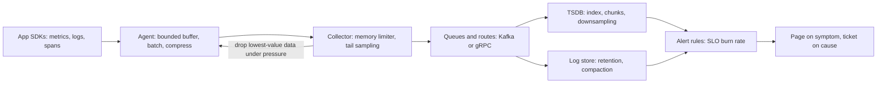

# The Observability Pipeline: From Metric to Page

## Overview

Observability is itself a distributed system — arguably the most overloaded one you run. Every service emits metrics, logs, and traces; agents collect, buffer, batch, and forward them; pipelines sample, aggregate, and route; a time-series database ingests the flood; and an alerting layer turns it into pages. The pipeline's defining constraint is inverted relative to every other system in this atlas: **telemetry must never harm the workload it observes.** A user-facing service may shed requests under overload; the telemetry pipeline may not block the application's threads, slow its request path, or fill its memory — so it sheds *itself* instead, dropping spans, coalescing metrics, and truncating logs by policy. That inversion makes the observability pipeline the purest studied example of backpressure-with-designed-in-drops, and the reason this page leans on the atlas's queueing machinery: the pipeline is a chain of bounded queues where *where you drop* is a product decision about what you will not be able to see later.

The second defining structure is the **fan-in**: thousands of producers, each producing at a rate the producers control, all landing on a small number of storage nodes. Push-versus-pull is therefore not a style preference but a control-theory choice — pull (Prometheus-style scraping) makes the *collector* the pacing authority and gives scraping a second job as a health check, while push makes the *producers* the pacing authority and must survive the correlated burst when an outage ends and every client retries at once. Add the cardinality explosion — the way a single innocent label dimension multiplies into millions of stored series — and the pipeline's three hard problems emerge: what to drop (sampling), what to index (cardinality), and what to page on (alerting). Each is a coupling problem between layers, which is exactly the kind of question this atlas exists to train.

## The Subsystems, Independently

**The three signals.** Metrics are pre-aggregated numeric time series (counters, gauges, histograms) — cheap to store, cheap to alert on, blind to individuals. Logs are per-event records — full fidelity, expensive to store and index, and (see [./event-sourcing-wal.md](./event-sourcing-wal.md)) themselves an append-only event stream with all the retention and compaction questions that implies. Traces are per-request spans carrying shared context (trace ID propagated through headers), reconstructing one request's journey across services — the only signal that shows *causality across boundaries*, which is why [../../distributed/microservices/observability.md](../../distributed/microservices/observability.md) treats them as the connective tissue of microservice debugging.

**Collection agents and buffers.** A node agent (OpenTelemetry Collector, Fluent Bit, Vector, node exporters — see [../../os/kernel-advanced/tracing-probes.md](../../os/kernel-advanced/tracing-probes.md) for the kernel-side sources) receives from SDKs, transforms, batches, compresses, and forwards. Every hop has a buffer, and buffer policy is where "never harm the app" is implemented: SDKs use bounded in-memory queues that *drop* when full (an application must not block on telemetry); forwarders may spool to disk to survive restarts. The trade is the atlas's oldest one — bounded queue + drop policy versus unbounded growth — applied to data you will never be able to regenerate, which is why the drop policy (what to keep: errors, tail latencies, exemplars) is a design deliverable, not an implementation detail. The OpenTelemetry Collector's memory-limiter and queued-retry processors are exactly a backpressure controller plus a bounded retry queue (see [./backpressure.md](./backpressure.md)).

**Sampling.** Full-fidelity tracing at scale is unaffordable, so pipelines sample. **Head-based sampling** decides at the root span (keep 1% of traces) — cheap, uniform, but it *provably loses* the rare bad trace: the one request that hit an outage has the same 1% chance as everything else. **Tail-based sampling** buffers complete traces and decides at the end (keep all errors, all slow traces, 1% of the rest) — the correctness choice, paid for in buffering every trace for its full duration, which makes the tail sampler itself a fan-in buffer system needing its own backpressure. Metrics usually avoid sampling but pay cardinality instead; logs use both (rate-limiting noisy producers, sampling debug levels).

**Time-series storage.** A TSDB ingests millions of samples per second of (series ID, timestamp, value). Two tricks dominate: *layout* — append-only chunks, columnar per series, often LSM-flavored (see [../../dbms/advanced/tsdb-internals.md](../../dbms/advanced/tsdb-internals.md) and [../../dbms/internals/timeseries-databases-internals.md](../../dbms/internals/timeseries-databases-internals.md)) — and *compression*: delta-of-delta timestamps and XOR-encoded floats shrink typical samples to ~1–2 bytes. The index maps label sets → series IDs, and *the index, not the data, is what explodes* under cardinality. Retention and downsampling (raw → 5-minute → 1-hour rollups) are the storage-side policy dials.

**Alerting.** The last stage converts queries into pages. The hard-won doctrine: alert on *symptoms* (user-facing SLO burn) rather than *causes* (CPU, disk), using multi-window burn-rate rules that page on fast burns and ticket slow ones (see [../../sre/slo-error-budget.md](../../sre/slo-error-budget.md)). Alerting couples to every earlier stage: a dropped series, a sampled-away error, a cardinally-explosive query timeout, or a scraped-once-per-minute gauge each silently change what alerts can ever fire — which is why alert design cannot be separated from pipeline design.

## The Shared Principle

**The observability pipeline is a fan-in, lossy-by-design flow where every stage trades fidelity for affordability, and the trade must be made explicitly because the data cannot be re-collected.** This is backpressure ([./backpressure.md](./backpressure.md)) with a twist worth naming precisely: in user-facing systems you shed *demand* (reject requests); in telemetry you shed *evidence* (drop spans, coalesce metrics), because blocking the producer would harm the very workload you exist to watch. Little's Law still sizes the buffers (a collector receiving 100k spans/s with 2 s of buffering holds 200k spans in flight — memory budgeted, not discovered), and the same laws govern the scrape loop (see [./scheduling-queueing.md](./scheduling-queueing.md)).

The second shared idea: **every fidelity knob couples two layers, and the coupling is usually invisible until an incident.** Sampling couples SDK to tail-decision (head sampling makes the *worst* traces least likely to be kept); cardinality couples a service's label design to the TSDB's memory; push-vs-pull couples producer failure to collector load; alert windows couple to scrape intervals (a 1-minute scrape cannot alert on a 10-second outage, no matter how the alert rule is written). When an incident reveals "we had no data," the root cause is almost always one of these couplings set wrong months earlier — the pipeline failed *at configuration time*, not at incident time.

## Where the Coupling HOLDS and BREAKS

| Coupling | HOLDS | Where it BREAKS |
|---|---|---|
| App ↔ agent | Bounded buffers + drop policies guarantee the app never blocks on telemetry | Drop silently degrades observability — a full SDK queue after an incident starts is exactly when you lose the spans that mattered |
| Producer ↔ collector (push) | Push crosses NATs, suits ephemeral jobs, fires immediately | End-of-outage retry storms: every client flushes its backlog simultaneously at the collector — telemetry's own retry storm (see [./backpressure.md](./backpressure.md)) |
| Collector ↔ TSDB (pull) | Scrape paces ingestion, discovery handles churn, failed scrapes are themselves a health signal | Short scrape intervals multiply load on thousands of exporters; pull cannot see between intervals (a spike that starts and ends within one interval may never be observed) |
| Labels ↔ storage | Labels are the query model: filter, group, aggregate | Unbounded label values (user ID, URL, trace ID) multiply series combinatorially — the cardinality explosion (see [../../sre/metrics-cardinality.md](../../sre/metrics-cardinality.md)) |
| Sampling ↔ debugging | Sampling bounds cost; tail rules keep errors and slow traces | Head sampling biases against the rare-failure traces debugging needs; tail sampling's buffering makes the sampler a new overload point |
| Alert ↔ pipeline | Symptom-based burn-rate alerts survive most noise | Every upstream drop or scrape interval bounds what alerts can see; alert rules inherit every earlier fidelity loss |

## A Concrete Worked Example

**The cardinality bill, with numbers.** A team adds a `request_id` label to a latency histogram "temporarily." One service, 2,000 req/s, 4 histogram buckets: without the label that is ~4 series per instance × 50 instances = 200 series. With it, every unique request ID creates 4 series that live for their retention window: 2,000 × 4 = 8,000 new series per second, ~29 M series/hour — the TSDB's *index* (in-memory label→series maps) grows to gigabytes, queries that scan series lists time out, and the node OOMs (see [../../os/modern/oom-killer.md](../../os/modern/oom-killer.md)). The fix moves the dimension *out of the metric*: keep the histogram aggregate, attach the request ID as an **exemplar** — a pointer from a histogram bucket to one stored trace (see [../../sre/exemplars.md](../../sre/exemplars.md)) — giving the debugging workflow "metric → exemplar → trace" at bounded cardinality. The general rule the arithmetic teaches: **a label is affordable only if its value count × series lifetime is bounded; per-entity dimensions belong in traces and logs, not in metric labels** (distinct-count estimation for such audits is done with sketches — see [../../dbms/advanced/sketch-algorithms.md](../../dbms/advanced/sketch-algorithms.md)).

**Tail-hunting an SLO breach.** p99 latency on the checkout API crosses its burn-rate threshold; the alert fires on *symptom*. The workflow descends the pipeline in fidelity order: (1) the burn-rate query localizes time and endpoint (cheap, always-on); (2) exemplars on the latency histogram hand over trace IDs of actual slow requests; (3) the trace shows the 900 ms span on a downstream recommendation call; (4) logs correlated by trace ID show cache-stampede retries. Each stage was only possible because the *earlier* stages preserved fidelity where it mattered: tail sampling kept the slow trace, exemplars linked metric to trace, log sampling kept error-level events. A pipeline that sampled head-based 1% would likely have kept no trace of the breach at all — the workflow is a designed chain, not a lucky search.

## When This Connection Is Useful

- **Problem-solving heuristics.** Audit any telemetry system along four questions: Where does it drop, and by what policy (buffer sizes, sampling rules)? What is its cardinality budget (labels × lifetimes × series)? Who paces ingestion (push, pull, or quotas)? And what can its alerts *never* see (scrape intervals, sampled-away classes, dropped series)? Any "we were blind during the incident" postmortem resolves to one of these four — see [../../sre/cache-patterns.md](../../sre/cache-patterns.md) for the adjacent caching-pattern choices.
- **Interview answers.** "Design a metrics/tracing system" is answered with the pipeline skeleton: SDK buffers → agent → collector (sampling, routing) → TSDB/log store → alerts, then the three hard problems (sampling choice, cardinality budget, push-vs-pull) argued explicitly with numbers. "Why is Prometheus pull-based?" is the pacing-and-health-check argument; "how would you trace at 1% while keeping all failures?" is the tail-sampling-and-buffering argument; "why did our metrics DB OOM after adding a label?" is the cardinality arithmetic.
- **Engineering decisions.** Give every SDK queue an explicit drop policy biased toward keeping errors and tails; default to tail-based sampling for user-facing services and head-based for the long tail of internal ones; enforce label allowlists in review (per-entity IDs are exemplars, not labels); alert on SLO burn with multi-window rules rather than on resource causes; and treat the collector tier as a first-class load-bearing service with its own SLOs — it is the one system that must stay up *during* everyone else's incident.

## Interview Questions

1. Why must telemetry pipelines drop data rather than apply backpressure to their producers, and how does that change the design of every buffer from SDK to collector? Contrast with a user-facing service's shedding policy.
2. Compare head-based and tail-based sampling on three axes: cost profile, what is provably lost, and the new failure modes tail sampling introduces. Which fits a checkout service, and which fits internal tooling?
3. Explain the cardinality explosion with arithmetic: what happens to a TSDB's index when a request-ID label is added at 2,000 req/s, and why is the exemplar pattern the structural fix?
4. Argue push-versus-pull for metrics: who paces, what each does during a wide outage, why a failed scrape doubles as a health check, and when push is unavoidable (ephemeral jobs, NAT boundaries).
5. A burn-rate alert fired but no traces exist for the breaching period. Walk the fidelity chain backwards to identify which pipeline configuration most likely caused it, and name the redesign that prevents the class.

## Key Takeaways

- The observability pipeline is a fan-in, lossy-by-design system whose cardinal rule is inverted: it sheds *its own evidence* (drops, sampling) rather than blocking the workloads it watches.
- Backpressure still governs — bounded queues, Little's-Law-sized buffers, drop policies — but every drop is a permanent loss of data that cannot be re-collected, so drop policy is a design artifact.
- Push versus pull is a pacing choice with incident consequences: pull gives the collector pacing authority and a free health check, push creates end-of-outage retry storms; most real systems run both for different jobs.
- Cardinality, not volume, is what kills time-series storage: a label's cost is value-count × lifetime × series, per-entity IDs belong in traces/logs or as exemplars, and distinct-count audits belong to sketches.
- Alerting inherits every upstream fidelity decision: alert on symptoms via SLO burn rates, design multi-window rules around scrape intervals, and remember that "no data during the incident" was configured months earlier.

## Cross-References

- [./backpressure.md](./backpressure.md) — Backpressure — the upstream-demand machinery this pipeline implements with designed-in drops.
- [../why-not-handbook/push-vs-pull.md](../why-not-handbook/push-vs-pull.md) — Why-Not Handbook: Push vs Pull — the decision framework behind scrape versus OTLP ingestion.
- [./scheduling-queueing.md](./scheduling-queueing.md) — Scheduling and Queueing — Little's Law applied to buffers, scrape loops, and collector sizing.
- [./event-sourcing-wal.md](./event-sourcing-wal.md) — Event Sourcing and WAL — logs as append-only event streams with retention and compaction.
- [./tcp-distributed-failure.md](./tcp-distributed-failure.md) — TCP and Distributed Failure — retries and timeouts inside the telemetry transport layer.
- [../../distributed/microservices/observability.md](../../distributed/microservices/observability.md) — Microservices Observability — traces as cross-service connective tissue.
- [../../dbms/advanced/tsdb-internals.md](../../dbms/advanced/tsdb-internals.md) — TSDB Internals — chunk layout, compression, and indexing.
- [../../dbms/internals/timeseries-databases-internals.md](../../dbms/internals/timeseries-databases-internals.md) — Time-Series Database Internals — engine-level storage detail.
- [../../dbms/advanced/sketch-algorithms.md](../../dbms/advanced/sketch-algorithms.md) — Sketch Algorithms — HLL and friends for cardinality auditing.
- [../../sre/metrics-cardinality.md](../../sre/metrics-cardinality.md) — Metrics Cardinality — the label-design playbook.
- [../../sre/slo-error-budget.md](../../sre/slo-error-budget.md) — SLOs and Error Budgets — symptom-based multi-window alerting.
- [../../sre/exemplars.md](../../sre/exemplars.md) — Exemplars — linking metric aggregates to individual traces.
- [../../os/kernel-advanced/tracing-probes.md](../../os/kernel-advanced/tracing-probes.md) — Tracing and Probes — where the telemetry originates in the kernel.
- Prometheus storage documentation: prometheus.io/docs/prometheus/latest/storage/; OpenTelemetry Collector documentation: opentelemetry.io/docs/collector/.
