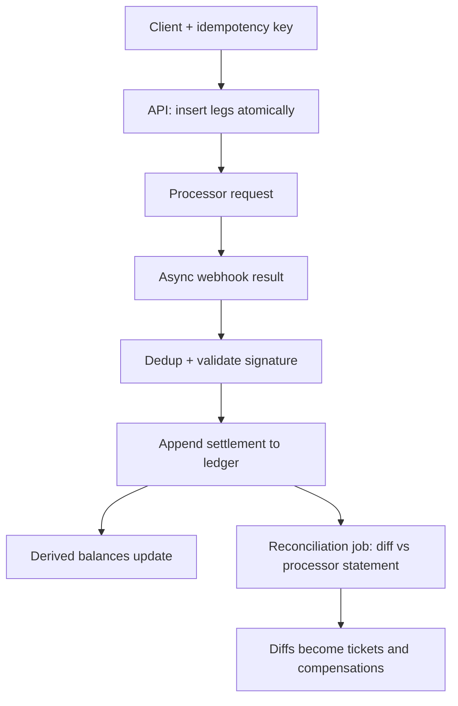

# Payments and the Double-Entry Ledger: Append-Only Truth for Money

## Overview

A payments system is a distributed system that cannot lose, cannot duplicate, and cannot lie — under network partitions, process crashes, retried requests, and adversarial users. The architectural answer the industry converged on is not "a really good balance column" but an **append-only, double-entry ledger**: every financial movement is recorded as an immutable transaction with equal and opposite legs, balances are derived views, idempotency keys make retried writes safe, reconciliation compares two independently recorded histories, and compensation transactions unwind partial failures across service boundaries. Each element exists because a specific failure — the orphan debit, the duplicate webhook, the reconciliation gap — would otherwise be not just possible but routine.

The connection this page maps is that a payments ledger is the accounting profession's centuries-old instance of the same pattern modern systems call event sourcing plus at-least-once delivery plus reconciliation: state is a fold over an immutable, ordered log; dedup keys tame retried delivery; and periodic comparison of two logs (internal ledger vs processor statement) catches every divergence either side dropped. What double-entry adds over generic event sourcing is a *conservation invariant* — the sum of debits equals the sum of credits within every transaction — which turns "is my data consistent?" from an audit into an arithmetic check. Failure propagation here is sneaky because money movements are *pairs* split across time and services, so the failures are orphans and gaps rather than crashes; the design levers — append-only ledgers, idempotency at every write, scheduled reconciliation — are all mechanisms for making orphans visible and re-pairable.

## The Systems, Independently

**The double-entry ledger.** A ledger records *transactions*, not balances. Each transaction is immutable and carries two or more legs: debit one account, credit another, always equal in sum. A payment of $100 from a user to a merchant with a 2.5% fee is three legs — debit user $100, credit merchant $97.50, credit platform $2.50 — and the equality holds by construction. Accounts have balances, but balances are *derived*: sum of legs, computable at any time, cacheable for speed, recomputable from the log if the cache corrupts. Nothing is ever updated or deleted; corrections are new transactions (reversals) that reference their targets. The properties this buys: a complete audit trail by default, the ability to answer "what did we believe at time T?", detection of any dropped leg (the sum check fails), and freedom from lost-update races on balance columns, because you never mutate a balance — you append and recompute.

**Idempotency keys, eventual consistency, reconciliation, compensation.** *Idempotency keys* let clients safely retry: the writer attaches a unique key; the server stores the key with the response and returns the stored response on repeat, deduplicating the second attempt. *Eventual consistency* enters because money movement spans systems: your ledger, the card processor, the bank, each records its side on its own clock. *Reconciliation* is the scheduled comparison of two such records — internal ledger vs processor settlement file — surfacing every transaction one recorded and the other did not. *Compensation transactions* are the saga pattern applied to money: a cross-service flow (charge card, reserve inventory, ship) that fails at step three is undone by *new forward transactions* (release inventory, refund charge), each itself idempotent, rather than by trying to edit the past.

**The chart of accounts underneath.** Ledger accounts are not just "user 42" — they are designed: internal accounts (fees, float, settlement pending, risk reserves) mirror the external ones, *pending* and *cleared* sub-accounts model the window where money has left one side but not arrived on the other, and per-currency accounts keep the sum-zero invariant from hiding exchange-rate effects. This design layer is what makes state queryable: "money in flight to the processor" is a balance on a named internal account, not a status bit buried in a row — so the pipeline's waiting states become first-class ledger citizens that reconciliation can watch.

## How the Chain Feeds Itself

The payment flow: client requests payment with an idempotency key → API writes an *intent* and the legs atomically (one DB transaction: legs plus key registry) → funds movement is requested from the processor → the processor's async result arrives via webhook, validated and deduplicated → the ledger appends the settlement record → balances shift as derived views update → nightly/periodic reconciliation ingests the processor's statement and diffs it against the ledger → every diff spawns a follow-up (missing settlement, duplicate refund, unknown charge) with an owner and a deadline. Compensation is the loop's error path: any step that fails after a later step committed emits compensating transactions in reverse order, keyed idempotently so a crash mid-compensation is safe to retry.

Shared invariants: **conservation** — legs within a transaction sum to zero, always, enforceable by constraint; **append-only** — no updates, no deletes; corrections are new entries; **idempotency at every entry point** — every API that moves money takes a key and deduplicates on it; **every external movement gets two records** — one from your side, one from the counterparty's, so reconciliation is possible in principle.

## The Shared Principle

**The ledger is an event-sourced system with a conservation invariant; balances are materialized caches over the log; idempotency keys are the dedup layer that makes at-least-once delivery safe; and reconciliation is the checksum pass over two independently folded copies of the same history.** Every clause transfers from the atlas's other pages. State as a fold over an immutable log is exactly the event-sourcing/WAL pattern — money simply adds the sum-to-zero constraint, which is why double-entry predates and outperforms "mutate the balance" designs: mutating a balance loses *why* and *whence*, and a crash between read and write loses the amount itself. Idempotency keys are application-level dedup on top of at-least-once delivery — the same contract TCP's idempotent-method reasoning and every queue consumer needs. And reconciliation is the end-to-end checksum argument: reliability cannot be ensured inside one system when the boundary is adversarial; you must compare records *across* the boundary, periodically, as a first-class job.

## Where the Analogy HOLDS and BREAKS

| Aspect | HOLDS | BREAKS |
|---|---|---|
| Event sourcing | Immutable log, fold to state, replays, time travel | Money logs face *regulatory* retention and *disputability* requirements (chargebacks arrive months later), so "compact the log" is mostly off the table and the fold must be auditable, not just correct |
| At-least-once + dedup | Idempotency keys tame retries exactly as in messaging | The dedup store must itself be durable and transactional with the write it guards — a key stored *after* committing the legs (or in a different DB) recreates the duplicate it exists to prevent |
| Caches (balances) | Derived views, recomputable, speed layer over truth | A stale balance is not a UX nuisance but a *credit risk decision*: overdraft checks on a stale view either annoy (false declines) or lose money (false approvals) — staleness tolerance is a risk parameter |
| Sagas/compensation | Forward-only recovery across services transfers verbatim | Compensation on money must preserve the conservation invariant too: a refund is new legs, not a deletion, so "undo" is really "transact the opposite" — and refunds can themselves be duplicated and must be idempotent |

## Failure Propagation

**Orphan debits.** The primitive failure: process A debits the user, crashes before crediting the merchant. With balances-as-columns and two separate writes, this is not just possible but expected; with double-entry in *one* transaction (both legs inserted atomically), it is structurally impossible *within* one system. But the boundary to external systems reintroduces it: you charged the card, the webhook confirming settlement is lost (processor outage, your queue full), and your ledger shows "pending" forever — an orphan from the other side. Propagation: orphan → user charged with no order → support ticket → refund (a compensation) → and if the reconciliation job is absent, the orphan is discovered by the *user*, which is the worst possible detector. The duplicate sibling is equally costly: a payment webhook retried without dedup credits a wallet twice — double-spend against *your* float, invisible until the processor statement arrives and reconciliation finds you are $50,000 short.

**Reconciliation lag.** Discrepancies compound while undetected: a daily reconciliation that surfaces 3-day-old gaps means 3 days of decisions (payouts, credit limits, fraud thresholds) made on divergent books. Lag also poisons attribution — by the time a gap surfaces, was it the retry storm on Tuesday or the deploy on Thursday? The levers are frequency (intraday for high-volume flows), narrowness (reconcile per processor per currency per day, not one mega-diff), and automation (every diff auto-creates a case; humans triage, never transcribe).

## A Concrete Worked Example

**A $100 payment, end to end, with the failure injected.** Legs inserted atomically: debit `user:42` $100, credit `merchant:7` $97.50, credit `platform:fees` $2.50. Conservation check: −100 + 97.50 + 2.50 = 0. The processor call times out — did it charge the card? Unknown: this is the at-least-once boundary. The retry uses the *same idempotency key*; the processor (which deduplicates on its side too, ideally with your key forwarded) returns the original result either way. Now inject a crash: the webhook arrives; the consumer commits "settlement confirmed" to the ledger but dies before acking the queue; redelivery hits; the idempotency key on the *webhook event ID* dedups — no second settlement entry. Finally the statement arrives: reconciliation diffs 10,482 processor records against 10,481 ledger entries; the one diff is a settlement whose webhook was lost in yesterday's queue outage; a backfill job re-queries the processor's API by transaction ID and appends the missing record. Every number in the loop is checked by an invariant: legs sum to zero, keys dedup, diffs surface — and the $100 never depended on any single write surviving.

## Design Levers

- **Append-only ledger with the sum-zero constraint.** Enforce conservation in the schema (per-transaction check or balanced-insert trigger), never expose `UPDATE`/`DELETE` on leg tables, and derive balances as materialized views with documented staleness budgets.
- **Idempotency keys at every money-moving boundary.** Client APIs, webhook consumers, compensation emitters, and the processor call itself all take keys; the key registry lives in the same transaction as the write it guards; TTL the registry long enough to outlive any realistic retry window.
- **Periodic, narrow, automated reconciliation.** Intraday for high-volume flows, scoped per counterparty and currency, with diffs auto-converted to cases; treat reconciliation lag as an SLO, not a chore.
- **Compensation over mutation.** Cross-service failures unwind via idempotent reverse transactions (refunds, releases) in saga order; "pending" is a *state with an SLA*, and a pending older than its SLA pages someone.
- **Immutable audit as a product feature.** Disputes, chargebacks, and regulatory queries are answered by replaying the log; design queries ("show every movement touching this user in March") at schema time, because retrofitting them on a mutated-balance history is impossible.
- **Ordering with bounded patience.** Ledger writes from async sources (webhooks, settlement files) arrive out of order; the log tolerates that — each entry carries its own business timestamp — but derived views and reconciliation windows need a cutoff policy ("books close" per day per counterparty), after which late entries become explicit adjustment transactions instead of silent edits to a closed period.

## Interview Questions

1. Why does double-entry beat mutating balance columns? Give three concrete failure scenarios the ledger design makes impossible, and one it merely makes detectable.
2. Design idempotency for a payment API end to end: where does the key come from, where is it stored relative to the transactional write, and what happens on a retry after the first attempt's response was lost?
3. A webhook consumer crashed after committing the settlement but before acking the queue. Walk the exact mechanism that prevents a double credit, and what breaks if the dedup store is a different database from the ledger.
4. Your reconciliation job finds a $12,400 gap against a processor statement from three days ago. What does the gap's existence tell you about your invariants, and what is the investigation and repair path?
5. Explain compensation transactions in a payments saga and why each compensation must itself be idempotent. What invariant does the compensation phase preserve that a naive "delete the rows" rollback would violate?

## Key Takeaways

- A ledger records immutable, sum-to-zero transactions; balances are derived caches — this single inversion eliminates lost updates, preserves causality, and makes consistency an arithmetic check.
- Money movement spans systems that each record their own side, so at-least-once delivery is the ambient condition: idempotency keys at every boundary are the dedup layer that turns retries from double-spends into no-ops.
- Orphan legs and lost webhooks are the characteristic failures — pairs split across time and services — and reconciliation is the scheduled, cross-system checksum that surfaces them before users do.
- Compensation transactions preserve the conservation invariant while unwinding failures: undo in money is transacting the opposite, idempotently, never editing the past.
- The ledger is event sourcing with a conservation constraint and regulatory stakes — reuse the log, fold, dedup, and reconciliation patterns, and treat reconciliation lag as an SLO.

## Cross-References

- [./event-sourcing-wal.md](./event-sourcing-wal.md) — Event Sourcing and the WAL — state as a fold over an immutable log; the ledger is that pattern with a conservation invariant.
- [./tcp-distributed-failure.md](./tcp-distributed-failure.md) — TCP and Distributed Failure — retries are only safe with deduplication; idempotency keys are that contract at the application layer.
- [../followup-tree/acid-transactions.md](../followup-tree/acid-transactions.md) — ACID Transactions — the atomicity that makes two legs one transaction, and its limits across service boundaries.
- [../why-not-handbook/stateless-vs-stateful.md](../why-not-handbook/stateless-vs-stateful.md) — Stateless vs Stateful — the ledger is the deliberately stateful core inside otherwise stateless payment services.
- [../../dbms/transactions/saga.md](../../dbms/transactions/saga.md) — Sagas — compensation transactions as the canonical cross-service recovery mechanism.
- [../../dbms/transactions/acid.md](../../dbms/transactions/acid.md) — ACID — the guarantees that hold within one ledger database and where they stop at the processor boundary.
