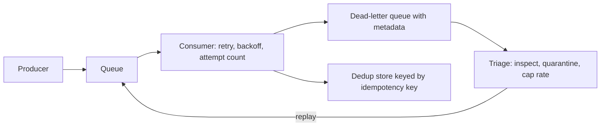

# Queues, Dead Letters, and Replay: The Recovery Loop of Asynchronous Systems

## Overview

A healthy asynchronous pipeline is producer → queue → consumer, and almost every production incident in such a system ends up in the part nobody diagrams: the dead-letter queue, the replay tooling, and the idempotency keys that make re-injection survivable. The DLQ is failure containment — a parking area for work the consumer refused N times — and replay is the controlled re-execution of that work after the cause is fixed. This page maps the whole recovery loop as one system: how each node feeds the next, which invariants (payload immutability, bounded ordering loss, producer-assigned idempotency) must hold for replay to be safe, how failures propagate (replay storms, poison messages that crash consumers on deserialization, silent ordering loss), and which levers — replay rate caps, per-message replay, poison quarantine — turn a landfill back into a pipeline. The connection worth naming: the queue is a fold over an ordered log and the consumer's effect is a function of that fold; the DLQ is where the fold *stopped*, and replay is resuming the fold under new code. Everything about replay safety is therefore a statement about what makes re-running a fold idempotent.

## The Nodes, Independently

**Producer and queue.** The producer publishes messages to a broker that stores them durably, orders them per queue or partition, and holds them until acknowledged-consumed. Ordering is partition-local, not global, and the broker's redelivery semantics are at-least-once: a consumer that crashes after processing but before acking gets the message again. The queue's job during failure is the same as during success — hold work — which is why "send it to the DLQ" is a routing decision the *consumer* makes after attempts, not a broker feature that appears on its own.

**Consumer.** The consumer pulls (or receives pushes), processes, and acks. Around processing sits the retry machinery: visibility timeouts or lease-based redelivery, per-message attempt counters, retry with backoff, and a maximum delivery count after which the message is parked to a DLQ instead of redelivered. A well-built consumer distinguishes transient failures (dependency timeout — retry makes sense) from deterministic ones (schema violation, business-rule rejection — retry is pure load), because only the first class benefits from more attempts.

**Dead-letter queue.** A DLQ is an ordinary queue with extraordinary metadata: the original payload, the exception class and message, timestamps, attempt counts, and the queue of origin. It is the system's failure working set — bounded, inspectable, and alarming if it grows. Its size and age distribution are health metrics the same way cache miss rate is: not a bug tracker, a signal of where the fold keeps stopping.

**Replay tooling.** Replay is re-injection: scan the DLQ, inspect payloads, purge or quarantine poison, and publish selected messages back to the origin queue (or a repair queue) at a controlled rate, usually with headers preserved or annotated. Good tooling supports per-message replay from a triage UI, rate-capped batch replay, and canary replay (first 1% observed before the rest) — the same staging instincts as a deploy pipeline.

**Idempotency keys.** The producer attaches a stable business key (order ID and step, payment intent, event ID); the consumer keeps a dedup store keyed by it and skips effects it has already produced. Idempotency converts the transport's at-least-once into an effectively-once contract at the effect layer — which is the only layer where "exactly once" can actually be paid for.

**The same nodes under different names.** Every broker instantiates this loop with different wiring, and knowing the mapping prevents re-learning it per vendor. Kafka has no DLQ primitive — dead letters are a *consumer convention*: after `max.poll` retries, the client library or your code publishes the failed record to a `<topic>-dlq` topic with headers carrying the exception and origin partition. RabbitMQ has first-class support: queues declare `x-dead-letter-exchange`, and rejected or expired messages are routed automatically, with `x-death` headers recording the history. AWS SQS offers redrive policies that move a message to a configured DLQ ARN after `maxReceiveCount` receives, and Lambda event sources do the same with `bisectBatchOnFunctionError` for partial-bulk isolation. Google Pub/Sub retries with exponential backoff and forwards to a dead-letter topic after `maxDeliveryAttempts`. The invariants above survive every translation; only the configuration surface changes, which is exactly why interviewers probe the invariants rather than the flags.

## How the Nodes Feed Each Other

The forward path is producer → queue → consumer, with the consumer's retry loop (redelivery, backoff, attempt counting) living between queue and consumer. The recovery path branches: after max deliveries, the broker or consumer routes the message to the DLQ; triage reads the DLQ and either quarantines the message (poison) or replays it to the origin queue, where it rejoins the same forward path — now processed by fixed code, against repaired dependencies, or after a data fix. Feedback closes twice: DLQ inflow rate tells the operator which upstream producer or dependency is degrading, and replay throughput must be throttled by the consumer's real capacity, making replay an exercise in backpressure. The whole loop is a control system: DLQ depth is the error signal, replay rate is the actuator, and the consumer's saturation point is the plant's physical limit.

## The Shared Invariants

**Payload immutability.** Messages in a DLQ are evidence; patching payloads in place turns the DLQ into a second production database with no tests. The fix belongs in code, config, or data — then the original payload is replayed as-is. **Bounded ordering loss.** After replay, the original interleaving with other messages is gone; per-partition order can be preserved by replaying with original partition keys, but global order is unrecoverable. Consumers must therefore be correct under *any* interleaving, not merely the common one — the same requirement event-sourced systems place on projections. **Effect-level idempotency.** At-least-once transport plus idempotent effects is the only composition that yields effectively-once behavior; keys must be stable across producer retries (business identity), not regenerated per attempt. **Replay is a migration.** Replaying 100k messages runs 100k executions of current code against production state — with staging discipline (canary, rate cap, rollback plan) or not at all.

## Failure Propagation

**Replay storms** are the classic self-inflicted wound. A pipeline running 10k msg/s fails for an hour and parks 90k messages; the fix deploys; an operator drains the DLQ at full broker throughput. The consumer now sees a burst above its steady-state capacity, latency spikes, fresh messages time out, and the DLQ refills with *new* victims — the replay recreated the original overload without the original pacing. Backpressure must apply to replay, not just to producers. **Poison quarantine** addresses the deterministic subset: a message that crashes the consumer during deserialization will be redelivered forever, and if replayed blindly it takes down every worker that touches it. Quarantine (side-channel storage plus schema validation) before replay, canary the first slice, and keep the crash isolated to one worker rather than the fleet. **Ordering loss** propagates silently: replayed messages interleave with live traffic, and a consumer that assumed "status update always follows create" starts seeing updates with no create in sight — the failure appears downstream as data anomalies, not as errors. **DLQ-as-landfill** is the slow failure: an unbounded, unalerted DLQ hides a systemic bug for months until someone finally replays 4 million messages in a weekend. Depth and age alerts are the cheap prevention. **Dedup-store decay** is the failure that unmasks all the others: idempotency registries have finite retention (TTLs, table pruning), and a message replayed after its key expired produces its effects a second time with no error anywhere — replay windows must therefore be shorter than dedup retention, and the two limits should be configured as one pair, not independently. The general shape of every propagation here is the same: the queue's retry machinery converts a small deterministic failure into fleet-wide load *precisely because* the pipeline is doing its job, which is why recovery tooling needs the same admission control as the pipeline itself.

## Design Levers

**Replay rate caps** make replay a first-class workload: a token bucket per replay job, sized to a fraction of consumer capacity (start at 5–10%), with the cap raised as error rates hold steady. **Per-message replay** from triage tooling handles the long tail — 95% of DLQ volume is usually three root causes, and the rest deserves one-at-a-time human judgment. **Poison quarantine** separates "cannot process now" from "cannot process ever," with schema validation at quarantine time so the second category is labeled before it can hurt anyone. **Retry architecture** is a lever with real trade-offs: escalating-delay retry queues (retry-1m, retry-10m, retry-1h) give transient failures room to heal without consuming the main queue's attempt budget, while a single queue with attempt counters is simpler but conflates "slow dependency" with "dead message." **Idempotency key placement** decides whether replay is boring: keys derived from business identity survive producer restarts; random UUIDs per attempt do not, and every replay then double-charges a customer. Finally, **DLQ topology** — one DLQ per consumer group versus a shared one — trades blast-radius isolation against operational toil; per-group DLQs with shared triage tooling is the usual equilibrium.

## A Concrete Worked Example

A payments pipeline consumes 10k msg/s; a dependency on the fraud service degrades at 14:00 and 90k messages exhaust their 3 deliveries by 14:20, parking in the DLQ. The dependency recovers at 14:40. Naive replay — drain 90k at broker speed — pushes a 90k burst into a consumer sized for 10k/s steady state; worse, triage later shows ~3k messages were poison (a schema regression introduced at 13:55 means they deserialize into objects that throw mid-transaction), and an uncapped replay crash-loops six workers. The capped alternative: quarantine the poison subset via schema validation (3k messages, zero fleet impact), canary-replay 1% and watch error rate for five minutes, then drain the remaining 86k at a 2k/s cap — total drain ≈ 43 seconds of added load per 1k-rate slice the consumer absorbs without visible latency change, all inside the consumers' existing dedup window (idempotency keys: `payment_intent:capture`), so the roughly 4% of messages that had produced effects before their first DLQ parking are skipped, not double-charged.

The same event has a second ledger to reconcile: the *queue depth* of live traffic that backed up behind the failure. At 10k msg/s in and a consumer that was effectively down for 20 minutes, the main queue holds ~12M messages; even at full 10k/s recovery capacity the drain takes 20 minutes, during which every minute of new producer traffic adds another 600k. Little's Law turns this arithmetic into expectations: latency for the last message in the backlog is depth divided by drain rate, and publishing that projection to stakeholders is the difference between a controlled recovery and an incident channel demanding to know why orders are "slow" while the dashboard shows the consumer at 100% CPU doing exactly the right thing. Replay of the DLQ is then sequenced *behind* live-traffic recovery: the parked messages are older, less latency-sensitive, and guarded by dedup, while live messages are newer and unguarded.

## Interview Questions

1. A consumer crash-loops on one message and its redeliveries are starving the queue. Walk your triage from first alert to restored flow, naming where quarantine, max-delivery, and replay each apply.
2. Why can global message ordering never survive replay, and what consumer-side discipline makes that acceptable? Give a concrete interleaving that breaks a non-idempotent consumer.
3. Design the replay tooling for a 50-service platform: rate caps, canarying, audit trail, and who is allowed to press the button. Which invariants does your tool enforce mechanically rather than by policy?
4. Where should idempotency keys be generated, and what goes wrong when they are generated per retry attempt? Tie your answer to at-least-once redelivery semantics.
5. Your DLQ grows 0.5% per day steadily for two months. Why is "schedule a replay" the wrong first move, and what would you investigate first?

## Key Takeaways

- The DLQ is the failure working set of an asynchronous system; its depth, age distribution, and inflow rate are health metrics, and a landfill DLQ is a systemic bug with a delay fuse.
- Replay is re-running a fold over a log under new code: safe only when payloads are immutable, effects are idempotent under stable business keys, and consumers tolerate arbitrary interleaving.
- Replay storms recreate the original incident without the original pacing — backpressure and rate caps apply to recovery traffic exactly as to production traffic.
- Poison quarantine plus canary replay converts "one bad message kills the fleet" into "one message in a quarantine bucket with a schema error label."
- Effectively-once is an effect-layer property purchased with idempotency keys, never a transport property; every design that claims otherwise is at-least-once wearing a costume.

## Cross-References

- [backpressure.md](./backpressure.md) — Backpressure — why replay traffic must be throttled by downstream capacity, and Little's Law as the sizing tool.
- [payments-ledger-double-entry.md](./payments-ledger-double-entry.md) — Payments Ledger and Double-Entry — idempotency keys and reconciliation where replayed effects must not double-charge.
- [event-sourcing-wal.md](./event-sourcing-wal.md) — Event Sourcing and WAL — state as a fold over an immutable log; replay as resuming the fold.
- [tcp-distributed-failure.md](./tcp-distributed-failure.md) — TCP and Distributed Failure — retries, timeouts as failure detectors, and the dedup entry fee.
- [../followup-tree/message-queues.md](../followup-tree/message-queues.md) — Message Queues Follow-up Tree — escalation chains for queue semantics, acks, and redelivery.
- [../../distributed/messaging/queues.md](../../distributed/messaging/queues.md) — Message Queues — canonical broker mechanics behind queues and redelivery.
- [../../distributed/messaging/kafka.md](../../distributed/messaging/kafka.md) — Kafka — partition-local ordering and consumer-group offsets in the canonical log-based broker.
- [../../distributed/messaging-internals/exactly-once-semantics.md](../../distributed/messaging-internals/exactly-once-semantics.md) — Exactly-Once Semantics — what the transport can and cannot promise.
- [../../dbms/transactions/log-recovery.md](../../dbms/transactions/log-recovery.md) — Log Recovery — the database engine's version of replay: redo from a durable log under idempotent rules.
