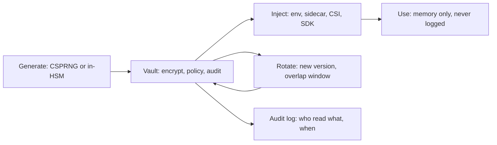

# Secrets Management Pipeline: The Custody Chain of High-Value Bytes

## Overview

A secret is a credential whose entire value lies in being unknown to attackers; the secrets-management pipeline is the custody chain that moves those bytes from generation to use while minimizing the number of places they exist and maximizing the speed of removing them from every place they did. The chain has named links — generate, store, inject, use, rotate, revoke, audit — and each link is a copying event, which makes the system's central quantity the *exposure surface*: the set of all locations where the plaintext exists, from vault memory to environment variables to crash dumps to a support engineer's terminal scrollback. This page maps that chain as one connected machine and names its shared principle: custody, not access control, is the problem. Authentication systems answer "who is calling" (the sibling page on identity owns that question); the secrets pipeline answers "where do the bytes of the answer live, for how long, and how fast can they be unmade." Two atlas connections recur throughout. A secret is a *lease on validity* — TTLs, rotation windows, and overlap periods are the same grant-and-expire machinery as distributed leases, applied to bytes instead of locks. And the pipeline is a *custody chain with a provenance log* — the same shape as artifact promotion, where the chain of who held what, when, and under which identity is the audit trail that both deters and detects. The failure modes are correspondingly uniform: every leak is a custody break, and every rotation design decision is really a decision about how long two versions of the truth may coexist.

## The Nodes, Independently

**Generation.** Secrets are born from cryptographically secure randomness sized to their threat model — 256 bits of CSPRNG output for high-value machine credentials, not "remember to make it long" — and formatted to their consumer's constraints (database password policies, header charset rules). Generated secrets must never transit a human: the moment a secret is visible in a chat, ticket, or terminal, it is a copy outside the system of record. Some high-value keys are generated *inside* the storage layer (an HSM or KMS never exports the private half), collapsing generation and storage into one custody boundary.

**Storage.** The vault/KMS tier: encryption at rest under keys that never leave the boundary (HSM-backed or equivalent), access policies expressed against *workload identity* rather than network location, and a mandatory audit log of every read. Storage is also the policy engine: TTLs, max-use counts, and per-path grants live here. The vault's availability becomes a dependency of everything downstream — a bootstrapping problem every design must answer (see failure propagation).

**Injection.** Delivery of the plaintext to the using process at start-up or on demand: environment variables (simple, leaked via `/proc`, child processes, and error reports), mounted files refreshed by a sidecar (better: rotation without restart, plaintext on disk under tight permissions), CSI-style volume mounts (key material never enters the image or the pod spec), or an in-process SDK fetching directly from the vault (fewest copies, deepest coupling). The injection mechanism determines the rotation clock: env-var secrets change only at process start; sidecar-mounted secrets can hot-swap.

**Use.** The runtime contract: keep plaintext in memory only, never log it (including at debug level and in panic dumps), and hold just-in-case copies for reconnection only as long as the connection pool lives. This is where secrets meet the logging discipline in the assumptions collection — the log line that prints a connection string is the most common custody break in practice.

**Rotation and revocation.** Rotation replaces, never edits: a new version is generated, published, consumers move to it during an *overlap window* where both versions validate, then the old version is revoked. Revocation is the emergency path — kill a version immediately and accept the outage of consumers still on it. The overlap window is the single most consequential design parameter, because it is simultaneously the safety margin for consumers and the extension of the attacker window after a leak.

**Audit.** The vault's read log is the shadow ledger of the whole chain: every read binds (identity, secret, version, time), and it is the only place a leak is usually *detectable* — an unknown service account reading a credential is an incident regardless of what the caller does next.

**The same nodes under different names.** Every platform instantiates the chain with a different weakest link, and knowing the mapping tells you where to look first. Kubernetes Secrets are etcd objects that are base64-*encoded*, not encrypted — unless encryption-at-rest is configured and etcd access is audited, cluster read access is custody of every secret at once. Cloud-native tiers (AWS Secrets Manager with rotation Lambda hooks, SSM Parameter Store, GCP Secret Manager) bundle storage and rotation; Vault adds *dynamic* secrets — credentials generated on demand with a TTL — and engine-specialized forms (database credentials, PKI certificates, cloud STS tokens). The `.env` file is the chain's ancestor: plaintext at rest, no audit, no TTL, and a permanent gravitational pull toward being committed. And the build tier is the leakiest: CI variables and `docker build --build-arg` values land in image layer history and job logs — custody breaks that happen before the secret ever reaches the vault-managed runtime. The invariants above survive every translation; what changes is which link leaks first, which is why the audit tier — present in none of the weak instantiations — is the differentiator between a custody chain and a shared password list.

## How the Nodes Feed Each Other

The forward path is generation → storage → injection → use, with policy flowing from the vault outward (TTLs, grants) and telemetry flowing back (reads, failures, rotation completion). Rotation closes the loop: the vault publishes a new version, injectors detect it (hot-reload watchers, cache TTL expiry, or scheduled restarts), consumers re-read and reconnect, and after the overlap window the vault retires the old version. Each arrow copies bytes, so the architecture question at every step is the same: can this link be replaced by a *reference* instead of a copy? Config stores that hold `vault:db/readonly#password` rather than the password itself — the config-management page's layering applied to secrets — shrink the exposure surface to exactly the processes that need plaintext.

## The Shared Invariants

**Immutability of issued values.** A secret version is immutable once issued; change means new version plus overlap, because in-place mutation desynchronizes every holder simultaneously. **Identity binds the chain.** Every hop that touches plaintext must authenticate the recipient by workload identity — a network perimeter is not a custody boundary; the vault answering "any pod on this subnet" has outsourced custody to IP-address archaeology. **Dual validity is bounded and intentional.** Overlap windows exist to absorb consumer pickup latency, and their length is computed from that latency (cache TTLs, pool recycle intervals), not chosen to be safe-sounding. **Plaintext exists at the minimum number of places.** Every architecture is scored by the count of stores holding plaintext, and the design lever is replacing copies with references until only the using process holds bytes. **The audit log is the detection surface.** A custody chain without a read log is a pipeline whose leaks are visible only after the damage, which is the worst possible telemetry topology.

## Failure Propagation

**The env-var leak family** propagates through everything that can read process state: `/proc` inspection by a compromised neighbor, crash dumps shipped to observability, child processes inheriting the environment, and debug endpoints that echo configuration. The failure is silent until the credential appears in an attacker's inventory — which is why the audit log's anomaly detection (unknown identity, unusual read volume) is the only early warning. **Zero-overlap rotation** propagates as an availability storm: the old version is revoked while hundreds of pods still hold it, every reconnection fails at once, and the incident looks like a database outage rather than a secrets-policy bug — the reverse of the intended trade. **Excessive overlap** propagates as the mirror image: a leaked credential that "should" have died in 15 minutes remains valid for 24 hours because the overlap window was set for the slowest consumer rather than computed from it. **Vault-outage bootstrapping** is the dependency-inversion failure: if every pod fetches secrets at start, a vault incident blocks every new pod in the fleet — rescheduling, autoscaling, and crash-loop recovery all freeze. Caching at the injector with a safe staleness bound converts a hard dependency into a degraded one. **The git-history leak** is the irreversibility failure: a credential committed three years ago exists in every fork and clone; there is no revocation that reaches them all, only rotation that makes them worthless — which is the argument for assuming breach and rotating on schedule regardless. **Partial log masking** propagates as false confidence: a CI log redacts the exact match but prints the UUID half of a connection string, and the secret is reconstructable; masks must be designed against composition, not single-pattern matches. **The build-time leak** is the pre-incident incident: a credential passed as a build arg is baked into the image layer that goes to the registry, so every pull of the image is a custody copy, and removing it requires image history surgery plus registry GC — the practical rule being that build-time injection of runtime credentials is itself the finding, with runtime injection (vault at pod start) as the only acceptable path.

## Design Levers

**Dynamic secrets** delete the shared static credential entirely: the vault brokers per-instance database credentials generated on demand with a TTL of an hour or less, so "rotation" becomes expiry, revocation becomes denying the next lease, and the audit log gains per-credential resolution — the lease machinery from the consensus page applied to bytes, with the vault's availability as the new dependency to bound. **Short TTLs with automatic rotation** turn the leak window into a constant — a credential valid for one hour is worth one hour of an attacker's patience — but only if consumers can absorb rotation without restarts, which couples this lever to the injection choice. **Eliminate static secrets entirely** where workload identity platforms allow: mutual TLS or SPIFFE-style identities replace stored credentials with cryptographic identity at the transport layer, deleting whole classes of custody (the remaining secrets shrink to signing roots). **Envelope encryption** keeps bulk data local: encrypt under a data key, wrap the data key under a KMS master key, and only the wrap operation touches the vault — the plaintext payload never transits custody. **Reference-based injection** through config stores keeps secrets out of images, manifests, and CI variables. **Break-glass paths** — offline credentials under dual control, tested quarterly — bound the blast radius of a vault failure; an untested break-glass path is decorative. **Secret scanning in CI and pre-commit** plus scan-on-history converts the git leak from an annual audit finding into a minutes-scale detection. **Compute overlap windows from consumer arithmetic**: overlap ≥ injector staleness + reconnect latency + safety factor, with the same number reviewed whenever the injection mechanism changes. **Per-secret blast-radius labeling**: classify credentials by what one leak unlocks, and spend engineering on the top tier (database roots, signing keys) rather than uniformly.

## A Concrete Worked Example

A platform rotates its primary database credential every 24 hours. Four hundred pods read it through a sidecar with a 5-minute staleness bound; connection pools recycle within 10 minutes of a new secret version appearing. The overlap window is computed, not guessed: 5 min pickup + 10 min reconnect + 5 min safety = 20 minutes of dual validity. At 14:03, an audit anomaly fires: service account `support-tool`, which has no grant on `db/primary`, read the credential once. Response: 14:05 revoke `support-tool`'s grant and quarantine the version; 14:07 publish a new version — but the leaked *version* remains valid during overlap by design, so 14:12 the team shortens the loop: revoke the leaked version outright and accept that the ~60 pods mid-recycle will fail one connection attempt and retry against the new version (the pool's retry policy absorbs it; measured error budget impact: one 40-second window of elevated 500s on 2.1% of requests). Total attacker window: from read at 14:03 to revocation at 14:12 — nine minutes. The counterfactual is the argument for the whole pipeline: the same leak under the previous regime (static password, 90-day rotation, no read audit) has a detection time of "next quarterly review" and an attacker window of up to 90 days. The pipeline did not prevent the leak — the support tool's logging did that part badly — it *bounded* it, which is the honest claim every secrets design should be able to make with numbers.

## Interview Questions

1. Enumerate every location where a credential's plaintext exists in a design that injects via environment variables versus a sidecar-mounted file, and explain how the exposure surface shapes the rotation policy.
2. Why must rotation overlap windows be computed from consumer pickup arithmetic rather than chosen for safety, and what does each error direction (too short, too long) look like as an incident?
3. A vault outage is blocking all pod startups fleet-wide. Which design decision caused this dependency inversion, and what two mechanisms bound the damage?
4. A credential was committed to git two years ago. Why is revocation insufficient, and what property of rotation makes it the only complete response?
5. Design the audit-log anomaly detection for a vault: which signals catch a leaked credential fastest, and what makes read-logging the detection surface rather than a compliance checkbox?

## Key Takeaways

- Secrets management is custody, not access control: the governing quantity is the set of all places plaintext exists, and every architectural choice is a copies-versus-references decision.
- A secret is a lease on validity — TTLs, overlap windows, and rotation schedules are grant-and-expire machinery applied to bytes.
- Identity must bind every custody hop; network perimeters are not custody boundaries.
- Overlap windows are computed from consumer pickup latency; each error direction is a distinct incident (availability storm versus extended attacker window).
- The read audit log is the only early-warning sensor most designs have; a custody chain without one detects leaks after the damage.

## Cross-References

- [auth-identity-session.md](./auth-identity-session.md) — Auth, Identity, and Session — who is calling, and how session credentials differ from the machine-credential custody this page maps.
- [config-management-pipeline.md](./config-management-pipeline.md) — Config Management Pipeline — reference-based layering and propagation clocks that keep secrets out of config payloads.
- [deployment-artifact-promotion.md](./deployment-artifact-promotion.md) — Deployment Artifact Promotion — the custody-chain-with-provenance pattern this page applies to bytes instead of artifacts.
- [../assumptions-hunt/logging-and-pii.md](../assumptions-hunt/logging-and-pii.md) — Logging and PII Assumptions — the log-line custody break and the masking-composition trap.
- [../../security/secrets-management.md](../../security/secrets-management.md) — Secrets Management — canonical storage and lifecycle mechanics beneath this pipeline.
- [../../security/vault.md](../../security/vault.md) — Vault — the reference implementation of the storage, policy, and audit tier. Key-management doctrine: [NIST SP 800-57](https://csrc.nist.gov/pubs/sp/800/57/pt1/r5/final); operational vault patterns: [Vault docs](https://developer.hashicorp.com/vault/docs).
