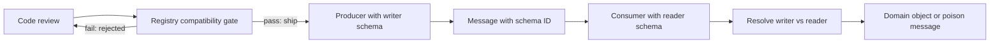

# Serialization and Schema Evolution: The Contract Between Independent Deploys

## Overview

Serialization turns an in-memory object into bytes; the schema is the contract that lets some *other* process, possibly written years later in a different language, turn those bytes back into something meaningful. The hard part is not the encoding — it is that producers and consumers deploy independently. A message written today may be read tomorrow, or replayed from a fourteen-day-old log into code that did not exist when it was written. Schema evolution is the discipline of changing the contract while every direction of skew between writer and reader keeps working. This page maps that system as one connected machine: the wire format, the writer and reader schemas, the schema registry that turns an implicit contract into a versioned and enforced one, and the deployment pipeline that the registry gates. The connection worth naming: compatibility is a property of a *pair* of schemas, not of one — "backward compatible" means new readers read old data, "forward compatible" means old readers read new data, and every production rollout is an exercise in sequencing deploys so that the pair present in the fleet at every instant is compatible. A schema registry is to data what a type system is to code, checked not at compile time but at the boundary between independently versioned processes — which is why the registry's compatibility gate is the data-plane's CI, and a rejected schema is a failed build.

## The Nodes, Independently

**Wire formats.** Text formats like JSON carry self-describing field names in every message — flexible, human-readable, and expensive in both size and parse cost, with no type fidelity (a 64-bit integer becomes an IEEE double or a string depending on who is writing). Binary frameworks like Protobuf and Avro instead encode small field *tags* plus values: the tag says "this is field 3," the type comes from the schema, not the bytes. Protobuf messages are self-contained under a stable schema; Avro goes further and strips the schema from the wire entirely, carrying instead a fingerprint (or, in some configurations, the full writer schema) that the reader resolves out-of-band. The format choice determines what evolution even means: with position-based or tag-based encodings, compatibility is defined by which tags each side knows.

**Writer and reader schemas.** Avro makes the resolution mechanics explicit and worth stating exactly, because every other system implements them informally. The reader resolves its schema against the writer's field by field: fields present in both, by name (or alias), are read with reader-side type promotion allowed only upward (int to long, long to float — never narrowing); fields in the writer but not the reader are skipped; fields in the reader but not the writer are filled from a *default* declared in the reader's schema. If a needed default is missing, resolution fails loudly at read time. Protobuf's rules are similar in spirit — unknown fields are preserved rather than dropped (since proto3, retained on re-serialization), `optional`/`required` semantics changed across versions in ways that themselves became a compatibility lesson — and the operational conclusion is identical: a reader must be able to make sense of any writer it can encounter.

**The schema registry.** A registry stores every historical version of every schema under a subject (usually a topic name), assigns version numbers, enforces a compatibility mode at *registration* time, and hands producers a small schema ID to stamp on each message so consumers can fetch the right writer schema once and cache it. The registry's real product is not storage — it is the **gate**: `POST /compatibility/subjects/PaymentCaptured/versions/latest` answers "may this new schema exist alongside the ones still in flight," and the answer is computed mechanically rather than argued about in a design review. Registration-time enforcement converts an organizational promise ("we will only make compatible changes") into a check that cannot be forgotten.

**Compatibility modes.** BACKWARD: new schema can read data written by the last schema (the default almost everywhere, because it matches the deploy order where consumers upgrade first). FORWARD: old schema can read new data (matches producer-first rollouts). FULL: both. The transitive variants extend the check across *all* prior versions, not just the latest — which matters for logs, because data does not expire on the registry's schedule. Deleting a field is backward compatible only if nothing still needs it; adding a field is backward compatible only if the new reader can supply a default or treat it as optional for writers that omit it.

**The deployment pipeline.** Schemas ride with the code that uses them. A producer release carries a writer schema; a consumer release carries a reader schema; a rolling deploy guarantees only that *some* mixture of old and new instances is live for a window. The pipeline and the registry therefore have to compose: CI registers the candidate schema against the gate, and only a passing schema may ship. Getting the sequencing right is arithmetic, not policy — the worked example at the end makes it concrete.

## How the Nodes Feed Each Other

The forward path: a producer serializes with a writer schema it has registered (or has been pinned to), stamps the schema ID, and emits. The message travels through whatever transport — a log, a queue, a request body — which is deliberately dumb about the contract. The consumer receives, looks up the writer schema by ID, fetches it from the registry if not cached, resolves it against its own reader schema, and deserializes. The control path runs parallel and *opposite*: candidate schemas flow from code review into the registry's compatibility check before deploy, and the check result is a hard gate on the pipeline. Two feedback loops close the system. First, the registry's per-subject mode is a policy dial that operations tighten or loosen per topic based on blast radius. Second, old data is a permanent, asynchronous consumer: every log replay, backlog drain, or late subscriber is a reader whose schema is pinned by history, which is why the transitive flags exist.

## The Shared Invariants

**Field identity is forever.** A field tag or name, once assigned, must never be reused with a different type or meaning — the one change that no compatibility mode can survive, because old bytes wearing the new tag are indistinguishable from new bytes. Protobuf's `reserved` declarations and Avro's aliasing exist to make the forbidden move *hard to type*, not just hard to justify. **Defaults are load-bearing.** Every field a future reader may require must be born with a default; a schema added without one works in staging and detonates the first time an old message — written before the field existed, held in a two-week log — meets the new reader. **Compatibility is checked against the union of live writers and readers, not the latest pair.** During a rolling deploy and for as long as the log retains old records, the system simultaneously executes every historical version whose data is still reachable; "transitive" is not paranoia, it is retention-window arithmetic. **The registry is infrastructure, not documentation.** Its availability gates producer writes and first-time consumer reads; its cache-then-fail behavior (serve stale schemas when the registry is down) must be designed, because a registry outage taking down the data plane is a self-inflicted partition.

## Failure Propagation

**The rejected-by-runtime incompatibility** is the loudest failure: a producer ships a schema the registry never saw (or a consumer ships a reader without a default), and every message from that point fails deserialization. Because deserialization happens before business logic, the failures look exactly like poison messages — consumers crash-loop, retry budgets burn, and the dead-letter queue fills with bytes nobody can read (the DLQ mechanics are the sibling page's subject). The cheap prevention is a canary consumer that deserializes the latest production traffic against the candidate reader *in CI*, before any deploy. **Silent narrowing** is the quieter twin: JSON numbers coerced through JavaScript's double lose precision above 2^53 — a 64-bit order ID becomes a different, wrong order ID with no error anywhere; Avro-style promotion forbids narrowing precisely to make this class unrepresentable. **The registry outage** propagates by availability inversion: if consumers hard-fail on cache miss, a registry incident becomes a fleet-wide deserialization incident; if they serve stale, the cost is only that new schemas cannot roll. **Schemaless drift** is the slow failure of "we just use JSON": field spellings fork (`orderId` vs `order_id`), timestamps acquire three timezones, and every downstream consumer re-implements a private, unversioned schema in code — the contract still exists, but now it is distributed, unenforced, and invisible to tooling. **The historical-reader trap** is the delayed one: a breaking change against a retained log passes every live test, then fires nine days later when a replay crosses an old offset — the failure mode that makes log retention part of schema policy.

## Design Levers

**Compatibility mode per subject** is the primary dial: BACKWARD with transitive for event logs (readers must survive all history), FULL for request/response surfaces where both ends deploy in lockstep windows, and stricter modes where blast radius is large. **Envelope design** — schema ID in a prefix versus self-describing payloads — trades a byte or two for registry independence; log-embedded schemas (Avro's container files) survive registry loss but complicate cross-system reads. **Tag discipline** in Protobuf (reserve retired tags, never renumber) and **default discipline** in Avro (every new field carries a default) are conventions that exist to make the invariants cheap. **The CI compatibility gate** — produce with the new writer, read with every reader version still in the fleet, assert success — mechanizes the sequencing question and belongs next to unit tests, not after them. **Deploy ordering** is a derived lever: under BACKWARD compatibility, upgrade consumers before producers, and the fleet is compatible at every instant; under producer-first ordering, FORWARD is the mode that matches. **Versioned subjects** (a new topic per breaking change, with an overlap-and-drain migration) convert an impossible in-place transition into two compatible ones at the cost of a dual-consumer window — the same expand-contract shape used for database migrations. Finally, **the escape hatch**: for genuinely unstructured surfaces (user content, third-party payloads), declare the schema unknown and validate at the boundary with an explicit, versioned parser rather than pretending the contract does not exist.

## A Concrete Worked Example

A payments platform emits 180M `PaymentCaptured` events per day onto a log with 14-day retention; three consumers read it, and a schema registry enforces FULL_TRANSITIVE on the subject. Version 1 is `{id: string, amount_cents: long, currency: string}`. Version 2 adds `refund_reason: string` with default `""` — both directions survive (old readers skip the field or fill the default; new readers fill the default for old data), the gate passes, and the rollout is sequenced consumer-first: three consumers deploy over 45 minutes, then the producer flips at minute 50, and every writer/reader pair live at every instant during the window resolves cleanly. Version 3 attempts `amount_cents: long → int` to save four bytes per event; the gate rejects it — old writers produce longs that a new int reader would have to narrow, and narrowing is not a legal promotion — and the four bytes die there: 180M events × 4 B ≈ 720 MB per day was the entire prize, against 3 consumers replaying 14 days of history through a reader that would silently corrupt amounts. The instructive near-miss: version 4 adds a *required* field without a default, which passes staging (every test writes v4) and would fail 14 days later, when a replay of the ~1.1B events older than the field meets the new reader — roughly 1.1B deserialization failures, discovered by the CI gate instead: produce one v1 fixture, read it with the v4 reader, zero-cost failure, fix the default, ship.

## Interview Questions

1. Explain backward versus forward compatibility using a concrete rolling deploy: which mode matches consumer-first upgrades, and what pair of schemas is live at each instant of the rollout?
2. Why is changing a field's type from long to int rejected by registries even when "it would save space," and what does the answer have to do with type promotion rules in reader/writer resolution?
3. A team proposes dropping the schema registry and putting the full JSON schema in every message. What does that trade away, and under what failure does the registry's cache-then-fail design become the difference between an incident and an outage?
4. Design the CI check that prevents the "required field without a default" failure before deploy. Which artifacts does it need, and which failure does it *not* catch?
5. Your event log retains data for 14 days but the schema registry only enforces compatibility against the latest version. Construct the timeline of a failure that transitive enforcement would have prevented.

## Key Takeaways

- Compatibility is a property of the writer-reader pair, not of a schema alone; every deploy ordering implies a mode, and every mode implies a deploy ordering.
- The schema registry's real function is the registration-time gate — it converts "we promise to be careful" into a mechanical check that cannot be forgotten.
- Reserved tags, mandatory defaults, and upward-only type promotion are the mechanical expression of "field identity is forever."
- Old data is an asynchronous consumer: log retention windows extend the compatibility obligation far past the deploy, which is why transitive checks exist.
- Deserialization failures are poison messages by another name; the cheapest prevention is a canary consumer that reads production-shaped fixtures in CI.

## Cross-References

- [../assumptions-hunt/serialization-compatibility.md](../assumptions-hunt/serialization-compatibility.md) — Serialization Compatibility Assumptions — the silent assumptions (defaults exist, fields are typed, numbers are precise) this page's gate exists to catch.
- [../why-not-handbook/app-events-vs-cdc.md](../why-not-handbook/app-events-vs-cdc.md) — App Events vs CDC — two producers of change events whose schema-evolution obligations differ.
- [event-sourcing-wal.md](./event-sourcing-wal.md) — Event Sourcing and WAL — logs whose readers may not exist for years, making transitive compatibility the standing rule.
- [queue-dead-letter-replay.md](./queue-dead-letter-replay.md) — Queues, Dead Letters, and Replay — where unreadable messages land and how replay turns old schemas into live readers.
- [migrations-deploy-coupling.md](./migrations-deploy-coupling.md) — Migrations and Deploy Coupling — the same independent-deploy problem against a database instead of a wire format.
- [../../distributed/messaging/schema-registry.md](../../distributed/messaging/schema-registry.md) — Schema Registry — canonical registry mechanics, subjects, and mode configuration.
- [../../backend/serialization.md](../../backend/serialization.md) — Serialization — encoding fundamentals beneath the evolution story.
- [../../backend/serialization/protobuf-encoding.md](../../backend/serialization/protobuf-encoding.md) — Protobuf Encoding — wire-level tags, varints, and reserved ranges behind the invariants. See also [protobuf.dev](https://protobuf.dev/programming-guides/proto3/).
- [../../backend/serialization/avro.md](../../backend/serialization/avro.md) — Avro — writer/reader resolution, defaults, and promotion rules; the specification is at [avro.apache.org](https://avro.apache.org/docs/1.11.1/specification/).
