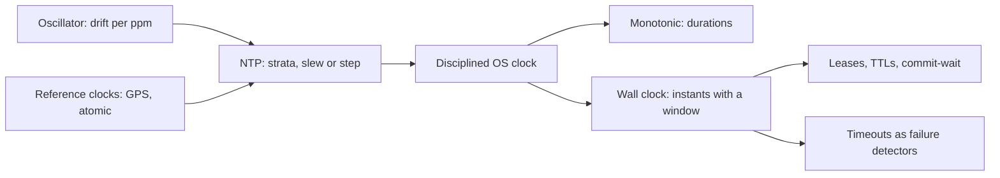

# Time Synchronization Infrastructure: The Clock You Lease, Not Own

## Overview

No process owns time. Every node's clock is a local oscillator whose reading drifts away from every other node's, corrected periodically by a distribution protocol — which means a timestamp is not a fact but a *cached copy* of a fact, with a staleness bound that the synchronization machinery exists to keep narrow. That framing puts clocks squarely in this atlas's territory: a clock is a demand-refreshed cache of civil time, NTP is its invalidation-and-refresh protocol, and drift is the staleness that grows between refreshes. This page maps the infrastructure as one connected machine: quartz physics and parts-per-million drift; the NTP stratum hierarchy that spreads time from reference clocks through layers of servers; PTP's hardware timestamping for sub-microsecond niches; cloud time services that expose clocks as *bounded-uncertainty ranges* rather than points; and the two clock families every process actually touches — monotonic for durations, wall for instants. Downstream, everything that smells like a deadline leans on this machinery: leases expire at wall-clock instants, timeouts are statistical decisions that presume bounded clock-rate error, certificate validation fails when skew crosses minutes, and commit-wait protocols literally pay latency to shrink uncertainty. The connection worth naming: synchronization does not buy accuracy, it buys a *window* — "now is somewhere in [t_lo, t_hi]" — and every correct consumer treats the window as the truth. Systems that pretend timestamps are points do not run faster; they merely discover the window's edges during incidents.

## The Nodes, Independently

**The oscillator.** Every node's raw clock is a quartz oscillator with a nominal frequency and a real one that differs by tens of parts per million and wanders with temperature. At 50 ppm, an unsynchronized clock gains or loses 4.3 seconds per day; even at 2 ppm, a minute-scale lease across a fleet is already ambiguous. The oscillator is the reason synchronization is *continuous* maintenance, not a boot-time fix.

**NTP.** The internet's time distribution: a hierarchy of strata, where stratum 0 is the reference (atomic/GPS), stratum 1 servers are directly attached, and each layer below syncs to the one above, with peer-to-peer redundancy inside a layer. A client estimates offset by exchanging timestamps and correcting for round-trip time — under the assumption that path delays are symmetric, which is exactly where congestion and asymmetric routing inject error. NTP slews small corrections (adjusting clock rate) and steps large ones (jumping the clock), and its default poll intervals (64 s to 1024 s) define the staleness budget between corrections. RFC 5905 specifies the protocol; RFC 8633 collects the operational client practices.

**PTP (IEEE 1588).** The same problem with hardware help: boundary clocks in switches, hardware timestamping at the NIC, and sub-microsecond agreement on LANs. PTP exists where NTP's microsecond-to-millisecond error is too wide — trading floors, 5G TDD grids, industrial control — and its relevance to software engineers is as a reminder that the error budget, not the protocol, decides the mechanism.

**Bounded-uncertainty time services.** Cloud databases expose time as a range: TrueTime-style APIs return `[earliest, latest]` bracketing true now, with uncertainty on the order of milliseconds maintained by GPS-plus-atomic-clock infrastructure. The API design is the lesson: honesty about the window, and let consumers pay (in waiting) to shrink it when correctness demands.

**Monotonic versus wall clocks.** Within a process, `CLOCK_MONOTONIC` advances without steps and is the only legal input to duration math; the wall clock (`CLOCK_REALTIME`) is civil time, subject to slews, steps, leap-second smearing, and admin interference. Every "elapsed time" bug traces to confusing the two; every "timestamps across machines" bug traces to trusting the wall clock as a point.

**The same nodes under different names.** Every deployment instantiates the hierarchy with different daemons and trade-offs, and the mapping prevents re-learning it per platform. On Linux, **chrony** dominates modern fleets: aggressive slew rates, burst sync, an explicit `makestep` policy for boot-time offsets, and offline corrections — while **ntpd** carries the classic codebase and **systemd-timesyncd** covers the client-only minimal case (SNTP-class, no serving, no outlier arbitration, so it is a leaf-node choice, not a stratum choice). Cloud providers run the stratum-1 tier for you — AWS's Time Sync Service at a link-local address, Google's infrastructure behind TrueTime's bounded-uncertainty API, Azure's PTP-capable clocks for instances that need sub-microsecond — which moves the failure question from "do we run NTP" to "do our instances actually use the provider source, and with what poll and step policy." PTP arrives as profiles (the telecom G.8275.1 flavor puts boundary clocks in every hop), and its hardware prerequisites — NIC timestamping, switch support — are the reason it stays niche despite being strictly better when available. The invariants above survive every translation; only the configuration surface changes.

## How the Nodes Feed Each Other

Oscillators feed NTP clients; stratum servers feed each other and the fleet; the disciplined OS clock feeds every `System.currentTimeMillis`-class call in every process. From there the readings fan out into the expensive consumers: log timestamps (correlation across machines), lease and TTL expiry decisions (consensus-leases territory), timeout-based failure detection (the TCP/distributed page's statistical detectors), certificate and token validity windows, and database commit protocols that wait out uncertainty. Control flows back upstream too: sync health (offset, stratum, source agreement) is telemetry, and its absence is how clock incidents stay invisible until a lease breaks. The diagram below compresses the machine.

## The Shared Invariants

**Timestamps are ranges, not points.** Any cross-machine comparison inherits the sum of both sides' uncertainty; protocols that need ordering either shrink the window (commit-wait), take the max with a logical tiebreaker (hybrid logical clocks), or stop using physical time for ordering at all (vector/Lamport clocks). **Monotonicity is per-process only.** Monotonic clocks are not comparable across machines, and wall clocks are not monotonic even within one machine — the two invariants are orthogonal and both violated routinely. **Correction rate is bounded.** Slew rates cap how fast drift can be repaired (a typical cap of 500 ppm repairs a 10-second offset in about 5.6 hours), so large offsets *must* step, and steps are visible events downstream schedulers must survive. **All absolute times must come from one source discipline.** Comparing a GPS-disciplined timestamp to an NTP-smoothed one mixes two error distributions; comparisons are only meaningful within one synchronization regime. **Causality is never bought from clocks.** The best a synchronized clock provides is a bound: if the uncertainty windows of two events do not overlap, ordering is known; where they overlap, only logical methods decide.

## Failure Propagation

**Drift exhausts a staleness budget**: a VM whose host pauses for migration returns with a multi-second offset, and until NTP repairs it (slowly, by slew), every lease it checks is examined with the wrong "now" — two holders, one resource, and the fencing-token argument from the lease page is the only thing standing between the bug and corruption. **Step corrections detonate schedulers**: a backward step makes cron-style triggers skip a window or double-fire, and a forward step fires everything at once — the same thundering-herd shape as any clock-driven batching. **Leap seconds** are the industry-scar incident: the 2012 Linux hang where `gettime` spun in a tight loop under load brought down name servers; the durable fix is smearing (spreading the second over hours) coordinated fleet-wide, which converts a protocol event into a configuration invariant. **Asymmetric paths corrupt offsets**: a congested return link makes the RTT/2 correction underestimate one-way delay, and clients adopt offsets that are wrong by the asymmetry — NTP's mitigation (multiple sources, outlier rejection via the Marzullo-style algorithm, sanity limits) is exactly a consensus-lite design over noisy sensors. **Certificate and token validation** fails noisily at skew: a client 90 seconds fast rejects perfectly valid certificates until its clock is fixed, converting a time-infrastructure fault into an "TLS outage" that wastes an on-call shift. **Log correlation lies silently**: during drift, interleavings reconstructed from wall timestamps across machines are wrong, which misdirects incident analysis — observability pipelines that sort by arrival instead of timestamp are, partly, an admission of this. **The protocol itself is attack surface**: NTP's mode-6/7 control queries historically answered "give me the list of clients you know" (the `monlist` trap), and open resolvers were weaponized as amplification reflectors with factors in the hundreds — a time-infrastructure fault that propagates as someone else's DDoS. The durable fixes are configuration invariants: control queries disabled by default, `restrict default noquery`, source-address validation, and monitoring that treats unexpectedly high query rates from unknown peers as an incident in their own right.

## Design Levers

**Source redundancy and outlier rejection**: at least three independent NTP sources with the client's selection algorithm discarding outliers; a single source is a single point of epistemic failure. **Slew-versus-step thresholds**: keep steps rare and logged, because every step is an event downstream systems must tolerate; tune the step threshold to the largest offset slew can repair inside one poll interval. **Poll intervals as staleness budgets**: tightening poll from 1024 s to 64 s narrows worst-case drift by the same factor at the cost of query load — the same knob shape as cache TTL. **Monotonic-only duration discipline**: timeouts, rate-limit windows, and backoff computed exclusively on monotonic clocks; wall clocks only for instants that humans or cross-machine protocols need. **Commit-wait versus hybrid logical clocks**: paying guaranteed latency (TrueTime-style waits of several milliseconds) buys external consistency; HLCs buy ordering without waiting but cannot bound "now" — the choice is a latency-for-guarantees exchange, not a correctness trick. **Smearing policy** as a fleet invariant, never per-node improvisation. **Hardware holdover** raises the floor under the whole hierarchy: temperature-compensated or oven-controlled oscillators (TCXO/OCXO), disciplined GNSS receivers, and rubidium modules reduce free-running drift by orders of magnitude — a good OCXO loses microseconds per day where quartz loses seconds — so a brief upstream outage becomes a non-event instead of an incident, at the cost of hardware and maintenance discipline. **Lease TTL sizing** that includes clock error explicitly: an effective exclusion window is the lease minus the worst-case offset sum of checker and holder, so TTLs must be quoted in the same units as the drift arithmetic.

## A Concrete Worked Example

A fleet of 40,000 VMs syncs against three stratum-2 sources at a 64-second poll. Quartz wander averages 50 ppm, so worst-case drift between corrections is 64 s × 50e-6 = 3.2 ms — the uncertainty window each machine carries about "now" is roughly ±3.2 ms plus path asymmetry, say ±5 ms total. Two decisions follow arithmetically. First, a lease service issuing 30-second TTLs is actually excluding for 30 s ± (holder 5 ms + checker 5 ms + sync client state), which is fine — but the same service must reject any design that measures "elapsed" with the wall clock, because a 4.3 s/day drift machine would see a 30-second lease as 25.7 or 34.3 seconds. Second, a Spanner-style commit-wait under ±5 ms uncertainty costs up to 10 ms per commit (wait until `now > t_safe`, where `t_safe` is the timestamp plus uncertainty); at 2,000 writes/s per shard that is negligible throughput cost for externally consistent reads, whereas fixing the same guarantee with HLCs removes the wait but forces every read to accept logical ordering — no externally consistent snapshot without the wait. The incident that validates the arithmetic: one host's guest clocks run 2.4 s fast after a maintenance window without resync; its 20 pods fail TLS validation for ~90 s until slew repairs the offset (2.4 s at 500 ppm takes 4,800 s to slew — hence the brief step, logged), and the 3 leases it held are safe only because fencing tokens, not clocks, were the final check.

## Interview Questions

1. Why is a timestamp a range rather than a point, and what are the three ways a system can cope with the overlap of two uncertainty windows?
2. A lease service uses wall-clock comparisons on both holder and checker. Construct the exact sequence where a fast clock grants a second holder, and explain what property of fencing tokens makes the damage harmless.
3. Why does slew have a bounded rate, and what does that imply about the maximum correctable offset between NTP polls? Give the arithmetic.
4. Your cron jobs double-fired during a leap-second smear and again during a VM migration. What invariant about step corrections did the scheduler violate, and how should it consume time instead?
5. Compare commit-wait and hybrid logical clocks as responses to clock uncertainty: what does each buy, what does each cost, and which applications cannot accept the second option?

## Key Takeaways

- A clock reading is a cached copy of civil time with a drift-driven staleness bound; synchronization is the refresh protocol, and its poll interval is a TTL.
- Correct consumers treat timestamps as windows; ordering inside an overlapping window must come from logical clocks or be paid for with commit-wait latency.
- Monotonic for durations, wall for instants, one source discipline per comparison — three rules whose violation explains nearly every time bug.
- Steps and leap seconds are events, not corrections: schedulers, leases, and validation windows must be designed around them, and smearing is a fleet invariant.
- Timeouts, leases, and certificates are all consumers of the same upstream machinery; when time infrastructure wobbles, they fail in ways that look like their own domains' bugs.

## Cross-References

- [../assumptions-hunt/clocks-and-time.md](../assumptions-hunt/clocks-and-time.md) — Clocks and Time Assumptions — the everyday code assumptions (monotonic wall clocks, comparable timestamps) this infrastructure actually underwrites.
- [consensus-leases.md](./consensus-leases.md) — Consensus and Leases — the largest consumer of bounded time: grants, expiries, and fencing tokens.
- [tcp-distributed-failure.md](./tcp-distributed-failure.md) — TCP and Distributed Failure — timeouts as statistical failure detectors that presume bounded clock-rate error.
- [../../networks/advanced/time-synchronization.md](../../networks/advanced/time-synchronization.md) — Time Synchronization — canonical NTP/PTP protocol mechanics behind this map.
- [../../distributed/advanced/hybrid-logical-clocks.md](../../distributed/advanced/hybrid-logical-clocks.md) — Hybrid Logical Clocks — the logical-plus-physical compromise for ordering without waiting.
- [../../distributed/fundamentals/time.md](../../distributed/fundamentals/time.md) — Time and Order in Distributed Systems — Lamport and vector clocks, the logical half of the story. Protocol details: [RFC 5905](https://www.rfc-editor.org/rfc/rfc5905) and [RFC 8633](https://www.rfc-editor.org/rfc/rfc8633).
