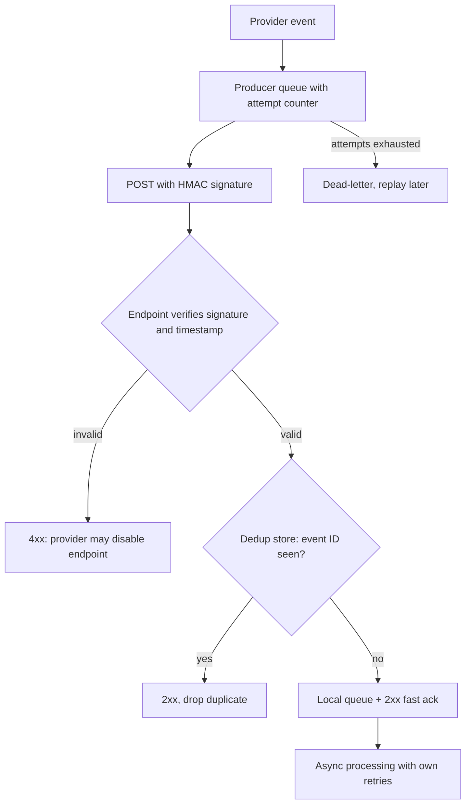

# Webhook Delivery: At-Least-Once All the Way Down

## Overview

A webhook is an HTTP callback: instead of you polling a provider for events, the provider pushes them to your endpoint. It looks like the simplest integration in the world — one URL, one POST — and it is actually the application layer re-implementing everything TCP and message queues learned about reliable delivery: retries with backoff, at-least-once semantics, deduplication on the consumer side, signed messages, dead-letter handling, and backpressure between a producer that wants to push and a consumer that may be drowning. The provider cannot know your endpoint processed an event until you say so, your "I processed it" is just a 2xx response, and the network between you will occasionally lie in both directions — so every serious webhook system delivers *at least once*, which makes idempotency on your endpoint not an optimization but the entry fee.

This page maps the full delivery chain — producer queue, retry schedule, signing and verification, endpoint dedup, consumer processing, dead-letter and replay — as one pipeline, then names the shared principle: webhook delivery is exactly the retry-plus-dedup contract of any at-least-once messaging system, carried over HTTP instead of a broker protocol. The failure propagation is dominated by two storms: the *replay storm* (a provider's retry policy hammering an endpoint that is slow because it is processing synchronously, turning a slowdown into an outage) and the *silent loss* (attempts exhausted with no dead-letter destination, events vanishing while both sides believe delivery happened). The levers — HMAC signing, idempotency keys, fast-ack-then-process, delivery dashboards, pull fallback — are all ways of keeping that pipeline observable and reversible.

## The Systems, Independently

**Webhooks, retries, and the delivery queue.** The producer maintains an event in a pending state until the consumer acknowledges it: attempt delivery, and on non-2xx (or timeout) schedule a retry — typically exponential backoff with jitter, e.g., 1 min, 5 min, 30 min, 2 h, 6 h, 24 h, with a final attempt count. The pending set *is* a queue: unbounded from the consumer's point of view, ordered (or not) by provider policy, and with a retention clock — the quiet detail that decides whether exhausted events are parked in a dead-letter state you can replay, or dropped into a logs-only afterlife. On the consumer side, the endpoint must respond *fast* (200 now, process async) or the provider's timeout converts your slow processing into a retry, and then into many concurrent redeliveries of the same event.

**Signing, idempotency, and consumer processing.** *Signing* (HMAC with a shared secret, or a signature over a timestamped payload) lets the endpoint authenticate that the request truly came from the provider and was not altered in transit — plus a timestamp window to reject replays of old captures. *Idempotency keys* (the provider sends a unique event ID; you keep a dedup store keyed by it) make the guaranteed duplicates harmless. *Consumer processing* is your own pipeline: validate signature → dedup check → enqueue locally → acknowledge → process at your pace with your own retries — so that your processing speed is decoupled from the provider's retry clock, which is the single most protective design decision in the whole chain.

## How the Chain Feeds Itself

The pipeline: provider emits event → producer queue entry (event ID, endpoint, attempt counter, next attempt time) → HTTP POST with signature → endpoint verifies signature and timestamp → dedup store check (event ID seen? ack 2xx, drop) → local enqueue → 200 response → provider marks delivered → your workers process at their own pace, with their own retry and DLQ. Failure paths feed the same chain from the sides: verification failure → 4xx (provider may disable the endpoint after repeated failures); processing failure after ack → *your* queue's problem, invisible to the provider, which is why your side needs its own dead-letter and replay tooling; attempts exhausted → provider dead-letter (if it has one) → manual or automatic replay, which is itself a bulk redelivery that your dedup store must absorb.

Shared invariants: **at-least-once** — the provider will redeliver anything not 2xx-acked, and may redeliver even things that were, so duplicates are guaranteed in the long run; **end-to-end acknowledgment** — a 2xx is a contract that the event is durably yours, not that you finished with it; **authenticity before processing** — an unsigned or badly verified webhook is an unauthenticated write API to your system, a fact attackers know better than most integrators do.

## The Shared Principle

**Webhook delivery is at-least-once messaging over HTTP: the producer's retry queue is a TCP-style retransmission buffer, the 2xx is an ACK, the event ID is the sequence number, and the consumer's dedup store is the same idempotency layer every queue consumer needs — the entire TCP retransmission contract reappears at the application layer with business semantics attached.** The atlas has met every piece: retries-are-only-safe-with-dedup is the core lesson of [tcp-distributed-failure.md](./tcp-distributed-failure.md); the pending queue with bounded attempts and a dead-letter is a message queue with extra paperwork ([../followup-tree/message-queues.md](../followup-tree/message-queues.md)); and the interaction between a push-happy producer and a slow consumer is the backpressure problem — with the twist that HTTP webhooks have *no native backpressure channel*, so the consumer's only signals are response codes and latency, which the producer reads as retry triggers ([./backpressure.md](./backpressure.md)). Signing is the integrity-and-origin layer that TLS establishes in transit and HMAC extends to the payload's storage and forwarding life — an end-to-end check rather than a hop-by-hop one.

## Where the Analogy HOLDS and BREAKS

| Aspect | HOLDS | BREAKS |
|---|---|---|
| TCP retransmission | Attempt counters, backoff, ACK semantics, duplicates on timeout all transfer | TCP's receiver cannot shed load; a webhook consumer *can* return 5xx or 429 — so consumer-side flow control exists, but only as a blunt signal, and providers interpret it inconsistently |
| Message queues | Pending set, attempts, DLQ, replay all map onto broker mechanics | There is no consumer group or offset: ordering, partitioning, and "at most once per consumer" guarantees are whatever the provider built — each provider is its own proprietary broker with a different API |
| API contract | Signature + event schema is a contract like any API | The contract is *behavioral* too: retry schedule, timeout, ordering, and retention are undocumented-or-barely-documented provider policy, and they change — the assumptions-hunt angle (your integration assumes a retry schedule that is not in the SLA) |
| Pull vs push | The pending queue means the provider is really offering you a pull API via a push facade | Configuration asymmetry: with pull you choose the moment; with push the producer chooses — which is why the pull fallback (poll the events API when webhooks fail) is a resilience feature, not an admission of defeat |

## Failure Propagation

**Replay storms.** The canonical cascade: your endpoint processes synchronously (10 s per event); the provider's timeout is 5 s; every delivery "fails" from its perspective and schedules a retry while the first processing continues. Redeliveries arrive mid-processing, lengthen your queues, slow processing further, fail again — a self-sustaining loop where the producer's retry policy and your slow processing amplify each other. If N events were in flight when you slowed down, the provider can be attempting N concurrent redeliveries at peak backoff overlap — a thundering herd you built the attractor for. The propagation rule: **retry policies multiply** — provider retries × your internal retries × queue redeliveries — and nobody computed the product. The fast-ack pattern breaks the loop at the first link: 200 within milliseconds, process async, and the provider's clock stops mattering.

**Silent loss and forged events.** Attempts exhausted without a dead-letter is loss with a clean conscience: the provider's dashboard may show "delivery failed" in a row nobody reads, while your system is missing, say, every `invoice.paid` from a two-hour window — an accounting gap discovered by reconciliation days later, if at all. On the security side, an endpoint that skips signature verification is an unauthenticated endpoint that mints internal state: forged "payment succeeded" events credit accounts, forged "refund" events trigger them. Even with verification, missing timestamp checks permit replays of captured old events — the dedup store protects against provider duplicates, not attacker replays; the freshness window covers those.

## A Concrete Worked Example

**One duplicate, one storm, with numbers.** Duplicate: the provider sends `event_id=e-991` ("charge succeeded, $80"); your worker commits the credit but crashes before acking; redelivery arrives; your dedup store — keyed by event ID, written *in the same transaction* as the credit — returns "seen," you ack 2xx, drop. Total cost: one log line. Remove the dedup store and the same sequence credits $160, found by reconciliation or by the customer's support ticket. Storm: Black Friday; your processing p50 goes from 200 ms to 8 s; provider timeout 5 s, retry schedule 1 m/5 m/30 m with unlimited attempts for 24 h. At 9:00, 5,000 events in flight; by 9:20 each has been attempted ~3 times — ~15,000 inbound POSTs hitting an endpoint whose capacity is ~40 concurrent slow requests; p99 inflow 15,000/1,200 s ≈ 12.5 req/s sustained *purely from retries*, on top of the new-event rate. Each redelivery also occupies a provider-side worker, so *other customers'* deliveries on that provider may degrade — your slowdown is now a third party's incident. With fast-ack: all 5,000 POSTs cost ~5 ms each (≤25 s of aggregate endpoint work), enter your queue, and process at your pace; the provider sees 100% 2xx within its first attempt; the storm never exists.

## Design Levers

- **Fast ack, then process.** Verify, dedup-check, local-enqueue, 200 — milliseconds; all real work happens behind your own queue with your own retries and DLQ. This single decision removes the provider's timeout from your latency budget.
- **Idempotency keyed by the event ID, stored transactionally.** Dedup store in the same database transaction as the state change it guards, with a TTL beyond the provider's maximum replay window; replay storms after provider-side incidents then become no-ops.
- **HMAC signing plus timestamp windows.** Verify origin and integrity on every request, reject stale timestamps, rotate secrets with overlap; treat an unverified webhook as an unauthenticated write API, because it is one.
- **Dead-letter with replay as a product surface.** Exhausted attempts land in a queryable dead-letter state with a replay action; your *own* processing failures get the same; delivery dashboards show per-endpoint success rate, attempt histograms, and backlog depth.
- **Pull fallback and provider backpressure signals.** When webhook delivery for an endpoint is degraded, poll the events API as the recovery path; return 429/5xx deliberately (and know your provider's policy for them) instead of hanging — slow-fail is the worst of both worlds.

## Interview Questions

1. Why must a webhook endpoint be idempotent even though the provider "only sends each event once"? Where exactly do duplicates come from, and what does the dedup store need to be correct?
2. Design the endpoint handling pipeline for a provider with a 5 s timeout and exponential-backoff retries. What does the 2xx mean, and why does processing synchronously create a replay storm?
3. Walk the failure chain of "attempts exhausted, no dead-letter" for a payments provider. What business-level failure does it surface as, and which two mechanisms catch it?
4. What does HMAC signing add over HTTPS, and what does the timestamp window add over HMAC alone? Describe the attack each layer closes.
5. Compare push (webhooks) and pull (polling the events API) as delivery contracts: latency, load coupling, failure recovery — and design the system that uses each where it wins.

## Key Takeaways

- Webhooks are at-least-once delivery over HTTP: the provider's retry queue is a retransmission buffer, the 2xx is an ACK, and duplicates are a certainty — idempotency keyed by event ID is the entry fee, stored transactionally with the state change it guards.
- Retry policies multiply across boundaries (provider × your workers × your queue); fast-ack-then-process-async is the design that keeps your processing speed out of the producer's retry loop and prevents replay storms.
- Exhausted attempts without dead-letter are silent loss discovered by users or reconciliation weeks later; DLQ plus replay plus a delivery dashboard converts loss into a recoverable queue.
- An unverified webhook is an unauthenticated write API: HMAC plus timestamp windows close forgery and replay; the dedup store that handles provider duplicates does not handle attacker replays.
- The producer chooses the moment in push delivery, so consumer-side flow control is weak by construction — pull fallback and deliberate 429/5xx responses are the backpressure levers you actually have.

## Cross-References

- [./tcp-distributed-failure.md](./tcp-distributed-failure.md) — TCP and Distributed Failure — retransmission, ACKs, and the retries-need-dedup contract that webhook delivery re-invents at the application layer.
- [./backpressure.md](./backpressure.md) — Backpressure — what happens when a push-based producer meets a bounded consumer, and why HTTP webhooks lack a native demand channel.
- [./event-sourcing-wal.md](./event-sourcing-wal.md) — Event Sourcing and the WAL — the delivery log as an append-only record; replaying a dead-letter is re-running a fold over old events.
- [../followup-tree/message-queues.md](../followup-tree/message-queues.md) — Message Queues — pending sets, attempts, dead-letters, and consumer-side dedup in their canonical broker form.
- [../followup-tree/rate-limiter-design.md](../followup-tree/rate-limiter-design.md) — Rate Limiter Design — shaping inbound redelivery bursts and protecting the processing path under replay storms.
- [../assumptions-hunt/api-contracts.md](../assumptions-hunt/api-contracts.md) — API Contracts Assumption Audit — the undocumented behavioral contract (retry schedule, timeout, retention) integrations silently assume.
- [../../networks/http/https.md](../../networks/http/https.md) — HTTPS — the transport security layer that HMAC signing extends to payload integrity at rest and on forward.
