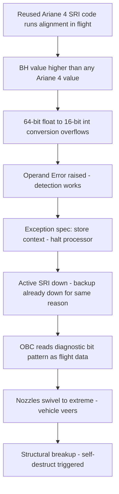

# Ariane 5 Flight 501, June 4, 1996: A Sixty-Four-Bit Float in a Sixteen-Bit World

## Overview

On June 4, 1996, the maiden flight of the Ariane 5 launcher ended in failure: about 40 seconds after initiation of the flight sequence, at an altitude of roughly 3,700 m, the vehicle veered off its flight path, broke up, and exploded [2]. Ariane 5 is an uncrewed launcher — no one was aboard, so the loss was entirely material and programmatic — but the vehicle and its payload were destroyed, and the failure became one of the most consequential software-failure case studies ever written.

The proximate cause, established by the ESA inquiry board chaired by Prof. J. L. Lions, was a software exception inside an Inertial Reference System (SRI): a conversion from a 64-bit floating-point number to a 16-bit signed integer received a value larger than the 16-bit type could represent, raised an *Operand Error*, and — per the system's exception-handling specification — the SRI processor halted [1]. Both flight-critical SRIs ran **identical software on identical hardware**, so both failed for the same reason within roughly one 72-millisecond data cycle of each other. The On-Board Computer (OBC), suddenly receiving a diagnostic bit pattern instead of attitude data, swiveled the engine nozzles, the launcher veered, and aerodynamic forces broke it up.

CONFIRMED (per the [inquiry board report][1]): the overflowing variable was an internal alignment-function result called **BH, Horizontal Bias**, related to the horizontal velocity sensed by the platform; its value was much higher than expected because the early part of the Ariane 5 trajectory differs from Ariane 4's and produces considerably higher horizontal velocity. The code was reused Ariane 4 software; the specific conversion was left unprotected to meet an 80% maximum processor workload target; and the alignment function served no purpose after lift-off, yet ran for roughly 40 seconds of flight because a 50-second alignment window was a requirement inherited from Ariane 4 [1].

## System Context

- **The SRI (Inertial Reference System)** is a strap-down inertial system that measures accelerations and rotations and computes attitude and velocity data for the launcher's guidance and attitude control [1].
- **Redundancy design:** the flight control system carried considerable equipment-level redundancy. Two SRIs operated in parallel, with **identical hardware and software**; one was active and one in hot stand-by. If the On-Board Computer (OBC) detected that the active SRI had failed, it would immediately switch to the other — *provided that unit was functioning properly*. There were likewise two OBCs [1].
- **The SRI software was reused from Ariane 4.** Parts of it — including the alignment function — were carried over into Ariane 5 [1].
- **The alignment function** computes the platform alignment, using an internal result called BH (Horizontal Bias) as an indicator of alignment precision over time. It "computes meaningful results only before lift-off. As soon as the launcher lifts off, this function serves no purpose" [1].
- **Exception-handling specification:** in the event of any exception, the SRI was to indicate the failure on the databus, store the failure context in EEPROM, and **shut the processor down** [1].
- **Workload budget:** a maximum workload target of 80% had been set for the SRI computer. Not all conversions were therefore protected against Operand Errors; the protection decision was underpinned by an analysis of every operation that could raise an exception — an analysis performed against Ariane 4 assumptions. There is no evidence that any Ariane 5 trajectory data were used to analyze the behavior of the unprotected variables, and it was "jointly agreed not to include the Ariane 5 trajectory data in the SRI requirements and specification" [1].

## What Happened

| Time (June 4, 1996) | Event | Source |
|---|---|---|
| Window opens 08:35 local (Kourou) | Launch put on hold at H0−7 minutes because visibility criteria were not met; conditions improved and launch was initiated | [1] |
| H0 − 3 s | SRI Flight Mode starts; the 50-second alignment window begins counting | [1] |
| H0 (lift-off) | Flight proceeds normally; telemetry received on the ground until H0+42 s | [1] |
| ~H0 + 36.7 s | The back-up SRI computer becomes inoperative: an internal variable related to horizontal velocity exceeds a software limit, raising an unhandled Operand Error. Approximately 0.05 seconds later (one 72 ms data cycle), the **active** SRI fails for the same reason | [1] |
| Immediately after | OBC attempts to use attitude data; the active SRI is transmitting its diagnostic bit pattern, which is interpreted as flight data. The OBC commands nozzle deflections; the nozzles of the two solid boosters (and, slightly later, the Vulcain engine) swivel to extreme positions and the launcher veers abruptly | [1] |
| ~H0 + 40 s, ~3,700 m | The launcher breaks up; self-destruction is triggered by rupture of the links between the solid boosters and the core stage. Debris falls over ~12 km² east of the pad | [1][2] |

The board reconstructed the SRI-internal sequence precisely: both SRIs were recovered from the debris and their failure contexts were read out of EEPROM, and the internal events were reproduced by simulation [1].

## Technical Mechanism

### 1. The conversion that overflowed

Inside the SRI's alignment function, the variable **BH (Horizontal Bias)** is computed as an indicator of alignment precision over time, related to the horizontal velocity sensed by the platform [1]. The relevant operation converts BH from a 64-bit floating-point value to a 16-bit signed integer. On Flight 501, BH was "much higher than expected" because the early part of the Ariane 5 trajectory differs from Ariane 4's and results in **considerably higher horizontal velocity** [1]. The value exceeded what a 16-bit signed integer can represent, and the Ada runtime raised an *Operand Error*.

```text
BH (64-bit float, value driven by horizontal velocity)
  → conversion to 16-bit signed integer
  → value out of range → Operand Error raised
  → exception-handling specification: halt the SRI processor
```

Note what did *not* happen: the error was detected. The runtime worked as designed; what followed — processor shutdown — was specified behavior. The board drew the distinction explicitly: the Operand Error "did not cause the mission to fail. The specification of the exception-handling mechanism also contributed to the failure" [1].

### 2. Why the fatal code was running at all

The alignment function is operative for 50 seconds after the start of the SRIs' Flight Mode, which occurs at H0−3 seconds in Ariane 5 — so it continues for roughly 40 seconds of flight [1]. This time sequence was "based on a requirement of Ariane 4 and is not required for Ariane 5": under Ariane 4 procedures, continued alignment after the start of flight mode allowed a restart within a launch hold, because ground equipment needed time to resume full control [1]. Ariane 5 did not need it, but the inherited requirement — and the inherited code satisfying it — flew anyway. The overflow was triggered by *a code path with no purpose at the moment it ran*.

### 3. Why the conversion was unprotected

Because an 80% maximum workload target had been set for the SRI computer, not all conversions were guarded against Operand Errors. An analysis was performed on every operation that could raise an exception to decide which could safely go unprotected — but the values such variables could take depend on the flight trajectory, and the Ariane 5 trajectory data were deliberately excluded from the SRI requirements and specification [1]. Comparable conversions at the same place in the code *were* protected; this one was not [1].

### 4. Why hardware redundancy did not save the flight

The redundancy concept was sound against the failure class it was designed for. The board observed that exception-handling mechanisms in this programme were designed for **random hardware failures**, "which can quite rationally be handled by a backup system" [1]. Flight 501's fault was *systematic*: both SRIs ran the same software, computed the same BH value, and overflowed on the same conversion. The backup SRI failed during the previous 72 ms data cycle — about 0.05 s *before* the active one — so when the OBC needed to switch over, there was nothing healthy to switch to [1]. Identical redundancy is defense against faults that differ between units; a shared line of code does not differ.

### 5. From dead SRIs to breakup

With both SRIs down, the OBC read the active SRI's diagnostic bit pattern as flight data and commanded nozzle deflections based on it. The nozzles of the two solid boosters — and slightly later the Vulcain main engine — swiveled to extreme positions, the launcher veered abruptly, and it broke up; the self-destruction system then fired on rupture of the links between the boosters and the core stage [1]. The chain from one out-of-range variable to total vehicle loss took about four seconds.



## Trigger vs Contributing Factors

**Trigger (CONFIRMED):** the BH conversion Operand Error at ~H0+36.7 s, during the inherited alignment window in flight.

**Contributing factors (CONFIRMED, per the inquiry report):**
- Reuse of Ariane 4 SRI code without revalidation against the Ariane 5 flight envelope.
- Ariane 5 trajectory data excluded, by joint agreement, from the SRI requirements and specification; no evidence trajectory data were used to analyze the unprotected variables.
- Protection removed from the fatal conversion to meet the 80% workload target, while comparable conversions were protected.
- Exception-handling specification that required processor shutdown for any exception.
- Redundancy built from identical hardware and identical software — no protection against a systematic software fault.
- The alignment function, useful only before lift-off, ran ~40 seconds into flight per an Ariane 4 requirement not required for Ariane 5.
- No test exercised the SRI against the Ariane 5 countdown, flight time sequence, and trajectory; the board noted that a ground test injecting simulated accelerometric signals with a turntable for angular motion would have exposed the failure mechanism.
- The review process did not surface the SRI software's limitations; test coverage was inadequate to expose them [1].

**Contributing factors (INTERPRETATION):** the workload target that drove the protection decision is a familiar shape — a performance budget spent against a safety margin, justified by an analysis whose inputs (trajectory data) were frozen out of the specification. The board documents the decision and its basis; why the organization valued the 20% headroom that highly is not in the record, and we present the pattern without attributing internal motives.

## Why Safeguards Didn't Prevent It

- **Hardware redundancy (two identical SRIs + two OBCs).** Defeated by common-mode failure: the backup's software was bit-identical, so it hit the same fault ~72 ms earlier. Redundancy covers random, independent faults; this fault was deterministic and shared [1].
- **Exception handling.** The mechanism detected the error correctly and then did the most damaging thing possible with the information: it shut down a mission-critical component. The board was explicit that the SRIs "could have continued to provide their best estimates of the required attitude information" and that "there is reason for concern that a software exception should be allowed, or even required, to cause a processor to halt while handling mission-critical equipment" [1].
- **The workload-budget analysis.** Every exception-raising operation was analyzed — but under the wrong trajectory. An analysis is only as good as the input distribution it assumes; the 16-bit range is safe until the launcher's horizontal velocity no longer is.
- **Reviews and qualification.** The report notes that reviews found and fixed thousands of problems across the programme, but "the limitations of the SRI software were not fully analysed in the reviews," that it "was not realised that the test coverage was inadequate," and that the implications of running alignment software during flight were not realized [1].
- **Simulation and test.** Guidance precision was verified by analysis and simulation — against quantities that were also beyond what was expected for Ariane 5 — but no test exercised the SRI as a black box against the Ariane 5 count-down and flight sequence. The gap was not effort but *scenario coverage*: nothing fed the new trajectory into the old code [1].

## Lessons & Mitigations

1. **Redundancy without diversity does not cover systematic software faults.** Two copies of the same binary share the same defects with probability 1. Where software faults dominate, diversify the implementation, the exception strategy, or the sensing modality — not just the hardware slots.
2. **The exception policy is an architecture decision.** "Detect, record, halt" is a reasonable policy for a desktop program and a catastrophic one for a sensor feeding a control loop. For critical components, prefer degrade-and-continue (best estimates, flagged quality) over shutdown — the substance of the board's recommendations R3 ("Do not allow any sensor... to stop sending best effort data") and R6 (confine exceptions to tasks; devise backup capabilities) [1].
3. **Reused code carries implicit assumptions about its environment.** The fatal assumption was about the distribution of a physical quantity — horizontal velocity — not about arithmetic in the abstract. The board's R5 asks projects to "identify all implicit assumptions made by the code" and verify variable value ranges; that is the general form: when you import a component, import its assumptions into your review.
4. **Code that serves no purpose should not run — especially in flight.** The alignment function did nothing useful after lift-off; its cost when it ran was the mission. Recommendation R1 states the principle: "no software function should run during flight unless it is needed" [1].
5. **Performance budgets must not be spent out of safety margins silently.** Unprotecting a conversion to meet an 80% workload target is a defensible engineering trade *only* under a proven input range. When the envelope changes, the trade must be re-made; the budget decision should be traceable to the assumption it rests on.
6. **Test the whole system against the new scenario, not the old one.** The pieces were qualified; the composition — Ariane 4 code, Ariane 5 trajectory — never was. The board's R2 (closed-loop testing with realistic injected inputs, complete simulations before any mission, high test coverage) is the standing fix [1].

## Connection to This Repository

- [Floating-point assumptions hunt](../assumptions-hunt/floating-point.md) — numeric representation is a set of assumptions (range, precision, conversion semantics) that code makes about its inputs; Flight 501 is what happens when the input distribution moves.
- [Firmware](../../embedded-systems/firmware.md) and [real-time systems](../../embedded-systems/real-time-systems.md) — exception strategy, watchdogs, and degradation policies for code that physically acts on the world.
- [Integration testing](../../testing/integration-testing.md) — the missing closed-loop, full-sequence test is the type of composition test this case argues for.
- [Common failure modes](../../failure-modes/common-failures.md) — the "reused component outside its validated envelope" pattern in generic form.
- [Postmortem culture](../../sre/postmortem-culture.md) — the Lions report is a model inquiry document: evidence-driven, mechanism-first, and willing to indict process as well as code.

## Interview Questions

1. Your team reuses a validated component in a new environment whose inputs push some values outside the old range. Design the review and test process that catches out-of-envelope assumptions before deployment. Which single artifact from the Ariane 5 case (trajectory data excluded from the spec; unprotected conversion; identical backup) corresponds to each failure of that process?
2. A sensor in a safety-critical control loop hits an unrecoverable internal error mid-operation. Compare three exception policies — halt and signal, halt silently, continue with best-effort estimates and a quality flag — and argue which fits which failure class. Relate to the Ariane 5 SRI exception specification.
3. Two identical redundant computers run the same software for availability. What failure classes does this design actually protect against, what does it not, and how would you add coverage for the unprotected class?
4. A performance budget (e.g., "keep CPU below 80%") caused a validation to be skipped. How do you make such trade-offs auditable so that a later environment change reopens them instead of silently inheriting them?
5. The failure needed a conjunction: reused code + new trajectory + removed protection + fatal exception policy + identical backup. Remove any two links and show concretely how the outcome changes.

## Key Takeaways

- A 64-bit float whose value no Ariane 4 trajectory could have pushed past a 16-bit integer did exactly that on Ariane 5 — the arithmetic was fine; the assumption about the input distribution was not.
- Both SRIs failed within ~72 ms of each other because they were identical: hardware redundancy does not duplicate protection against a shared line of code.
- The error was detected and handled — by shutting down the processor, per specification. An exception policy that halts mission-critical equipment converts a recoverable anomaly into a total loss.
- The fatal code served no purpose in flight; it ran because an Ariane 4 requirement (a 50-second alignment window tied to hold-and-restart procedures) was carried into a vehicle that did not need it.
- The inquiry's fixes are process-shaped: include trajectory data in specifications (R10), review test coverage (R11), identify implicit assumptions in reused code (R5), and never let a sensor stop sending best-effort data (R3).

## Sources

1. J. L. Lions et al., *Ariane 5 Flight 501 Failure — Report by the Inquiry Board*, ESA, Paris, July 1996. Full text consulted via the University of Bologna mirror: http://www.cs.unibo.it/~laneve/papers/ariane5rep.html (fetched and quoted; URL verified at time of writing).
2. ESA Press Release, "Ariane 501 — Presentation of Inquiry Board report," July 23, 1996. https://www.esa.int/Newsroom/Press_Releases/Ariane_501_-_Presentation_of_Inquiry_Board_report (fetched and quoted; URL verified at time of writing).

## Cross-References

- [Therac-25, 1985–87](./therac-25.md) — code reuse and software-only interlocks in a safety-critical system; the medical counterpart to this aerospace case.
- [Knight Capital, 2012](./knight-capital-2012.md) — reused and repurposed code whose hidden assumptions were never re-validated; the trading-system counterpart.
- [Cloudflare regex, 2019](./cloudflare-regex-2019.md) — a valid-but-unusual input amplified into a global failure by the composition of systems, and a test suite that could not measure the dimension that broke.
- [Floating-point assumptions hunt](../assumptions-hunt/floating-point.md) — the general treatment of numeric range and conversion assumptions.
- [Postmortem culture](../../sre/postmortem-culture.md) — the inquiry-report discipline this casebook follows.
