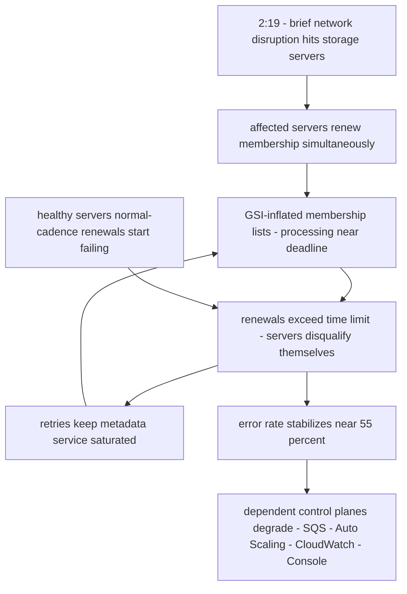

# AWS DynamoDB, September 20, 2015: Membership Metadata and a Five-Hour Retry Storm

## Overview

Early on Sunday morning, September 20, 2015, a brief network disruption struck a portion of Amazon DynamoDB's storage servers in AWS's US-East Region (the region now universally known as us-east-1). Under normal circumstances this is exactly the kind of event a distributed key-value store is built to absorb. Instead, it produced a five-hour service event: CONFIRMED (per [AWS's official summary][1], published on the aws.amazon.com/message/ site) by 2:37 AM PDT the customer error rate had risen "far beyond any level experienced in the last 3 years," stabilizing at approximately 55%, and it was not until 7:10 AM PDT that DynamoDB recovered to error rates low enough for most customers and dependent AWS services to resume normal operations.

The mechanism was not the network disruption itself but what the disruption activated. DynamoDB storage servers periodically confirm their "membership" — the assignment of table partitions to servers — with an internal metadata service, and a server that cannot retrieve its membership in time removes itself from the request path and retries. Over the preceding months, rapid customer adoption of Global Secondary Indexes (GSIs) had inflated membership lists for storage servers holding partitions of large tables, pushing metadata-processing times close to the retrieval deadline. The simultaneous renewal requests triggered by the network disruption pushed them over it. Storage servers disqualified themselves in waves, their retries kept the metadata service saturated, and healthy servers' routine renewals began failing too — a self-sustaining retry storm centered on metadata, not data.

The outage's second half is the cascade. Several AWS services stored control-plane state in DynamoDB, and the primary summary documents how SQS, EC2 Auto Scaling, CloudWatch, and the AWS Console each degraded through a different coupling mechanism. No stored data was lost; existing customer instances and queues kept serving. The event is therefore the canonical demonstration that a database outage's blast radius is set less by the data it holds than by the control planes that depend on it — and that a latent capacity erosion, invisible to monitoring, converts a routine disturbance into a plateau of 55% errors.

## System Context

- **Partitions and membership.** A DynamoDB table is split into partitions spread across many servers for consistent low-latency access and replication. The assignment of a group of partitions to a given server is called a "membership." Memberships are managed by DynamoDB's internal metadata service, which is itself internally replicated and runs across multiple datacenters [1].
- **The check-in protocol.** Storage servers periodically confirm their membership with the metadata service, which retrieves the partition list and related information from its own store, bundles it into a message, and transmits it back. Servers also re-fetch membership after a network disruption or on startup. After processing an assignment, a server verifies it holds the local table/partition data, creates any new partitions assigned, and retrieves replicas from other servers [1].
- **The refusal rule.** If a storage server cannot retrieve its membership data within a specific time period, it retries the request and *temporarily disqualifies itself from accepting requests* [1]. This is a deliberate safety default: a server that cannot confirm what it owns must not serve. INTERPRETATION: defensible in isolation — and the hinge of this incident.
- **Global Secondary Indexes.** GSIs, a then-recent DynamoDB feature, let customers query table data by alternate keys. Because they are global, each GSI has its own set of partitions on storage servers, increasing the size of a server's membership data; a table with many GSIs could see its contribution to membership lists "quickly double or triple" [1].
- **The audience.** DynamoDB is used both directly by customers and internally by other AWS services for state such as queue metadata and scaling-group records — a fact the event would make visible to everyone [1].

## What Happened

| Time (PDT, Sep 20, 2015) | Event | Source |
|---|---|---|
| 2:15 AM | EC2 Auto Scaling begins delivering significantly increased API faults (its group/launch-configuration state lives in a DynamoDB table) | [1] |
| 2:19 AM | Brief network disruption impacts a portion of DynamoDB storage servers; affected servers simultaneously request membership renewal; metadata-service processing times — already near the retrieval allowance for the largest lists — exceed it; servers disqualify themselves and retry | [1] |
| 2:35 AM | CloudWatch begins experiencing delayed and missing EC2 metrics | [1] |
| 2:37 AM | DynamoDB customer error rate rises far beyond any level of the prior 3 years, stabilizing at approximately 55% | [1] |
| Early hours | Attempts to add metadata-service capacity fail — the service is too loaded to process the administrative requests themselves | [1] |
| 5:06 AM | AWS pauses requests to the metadata service; retry activity drops, relieving load; capacity is then added successfully and requests reactivated | [1] |
| 5:45 AM | DynamoDB finishes disabling traffic to enable metadata-service recovery; SQS can no longer refresh its queue-metadata caches, error rates rise significantly | [1] |
| 5:45–7:10 AM | AWS Console logins slow dramatically for customers attempting to log in (a long-timeout API call relying on DynamoDB blocks login progress) | [1] |
| 5:51 AM | CloudWatch PutMetricData calls enter significantly elevated error rates for all AWS service metrics and custom metrics | [1] |
| 7:10 AM | DynamoDB restored to error rates low enough for most customers and dependent services; SQS and Console recover; Auto Scaling APIs recover | [1] |
| 7:29 AM | CloudWatch Metrics Service fully recovered | [1] |
| 7:10–10:52 AM | Auto Scaling drains a large backlog of accumulated launch/termination activities in its background scheduler; existing instances operate properly throughout | [1] |
| Monday, Sep 21 | Residual 0.15–0.25% error rate persists; customers report tables stuck in updating/deleting states; cause found in one metadata partition still not taking its share of traffic; AWS later acknowledges it "should have posted the green-i to the dashboard sooner" | [1] |

All rows above are CONFIRMED against the AWS summary [1]. The summary dates its own account to the morning of the event and enumerates four dependent services in detail; it states plainly that there were "several other AWS services that use DynamoDB that experienced problems during the event" beyond those four, without enumerating them [1].

## Technical Mechanism

### 1. Membership as a correctness gate

DynamoDB's storage servers will not serve customer requests unless they have current confirmation of what partitions they own [1]. The design intent is straightforward: a server with a stale membership view could serve data it no longer owns or miss data it does. The consequence is architectural: any slowdown in the metadata service converts directly into lost request-handling capacity, at the pace of membership-renewal timeouts. The refusal rule is not a bug — it is what makes the metadata layer the single most capacity-sensitive dependency in the service.

### 2. GSI adoption as silent load-model drift

Membership messages are not a fixed cost. GSIs added their own partitions to the same storage servers, and customers adopting multiple GSIs on very large tables doubled or tripled their contribution to membership lists [1]. Processing time inside the metadata service for the heaviest requests "began to approach the retrieval time allowance" — a margin erosion driven by *customer behavior*, not by any code change or capacity reduction. AWS's own diagnosis is explicit: "We did not have detailed enough monitoring for this dimension (membership size), and didn't have enough capacity allocated to the metadata service to handle these much heavier requests" [1]. INTERPRETATION: this is load-model drift — the per-request cost distribution changed shape while capacity planning and monitoring were still pointed at the old shape. No alarm exists for a margin nobody knew was being consumed.

### 3. The retry storm

With the trigger pulled at 2:19 AM, the loop ran: simultaneous renewal requests → metadata processing exceeds the allowance → servers disqualified → retries keep the metadata service loaded → renewals of *previously healthy* servers also start failing → more disqualification and more retries [1]. Note the scope expansion: the overload migrated from the originally disrupted servers to the whole fleet through the normal check-in cadence. The error rate plateaued near 55% rather than 100% because many renewals still succeeded [1] — a partial-collapse state, arguably harder to reason about than a clean outage because healthy and failing paths interleave.

### 4. The remedy that required the patient's cooperation

The standard response — add metadata-service capacity — failed repeatedly, because making the administrative requests required the metadata service itself to respond [1]. At 5:06 AM AWS chose the non-obvious move: pause requests to the metadata service. Stopping the renewal stream starved the retry loop; load fell; capacity was added; traffic was reactivated [1]. DynamoDB fully disabled customer traffic at 5:45 AM to enable metadata recovery [1]. INTERPRETATION: this is a "stop the world to break a feedback loop" recovery — the same class of move as Facebook's 2021 manual BGP intervention. It worked, but it was reached only after several failed capacity attempts, roughly 2.7 hours into the plateau; a rehearsed, earlier pause decision is the counterfactual the timeline suggests.

### 5. The cascade: four services, four coupling mechanisms

The summary's per-service breakdown is a taxonomy of dependency failure [1]:

- **SQS** cached queue metadata from an internal DynamoDB table; the caches were not in the send/receive path, but when DynamoDB disabled traffic at 5:45, SQS could not refresh caches, and error rates rose significantly. Queue data itself was not lost [1].
- **EC2 Auto Scaling** stored group and launch-configuration state in DynamoDB; API writes failed from 2:15 AM, and even after API recovery at 7:10 AM, a large backlog of pending scaling activities in a background scheduler took until 10:52 AM to drain. Existing instances kept running throughout [1].
- **CloudWatch** enriched incoming EC2 metrics with Auto Scaling group membership read from DynamoDB; intermittent metric gaps began at 2:35 AM, and PutMetricData calls for all AWS and custom metrics errored heavily from 5:51 to 7:10 AM [1]. INTERPRETATION: observability here was a *downstream consumer of the failed dependency* — the monitoring system partially shared fate with the incident, echoing the pattern in the December 2021 us-east-1 event.
- **The Console** made a login-flow API call that relied on DynamoDB, with "a very long timeout"; the call did not need to succeed for login to proceed, but its timeout blocked login progress for tens of seconds. A reduced-timeout fix already existed in AWS's test process — it had simply not rolled out [1].

The common thread, CONFIRMED by the data-plane behavior descriptions: stored data and running instances were fine; *control planes* broke. The blast radius followed which service kept which state in DynamoDB, not which service held the most data there.

## Trigger vs Contributing Factors

**Trigger (CONFIRMED):** the brief network disruption at 2:19 AM PDT that caused a portion of storage servers to renew membership simultaneously against a metadata service already processing near its deadlines.

**Contributing factors (CONFIRMED, per the summary):** GSI-driven membership growth pushing processing time toward the retrieval allowance; insufficient monitoring of the membership-size dimension; insufficient metadata-service capacity for the heavier request profile; storage-server retry behavior without an apparent global rate control toward the metadata service; administrative (capacity-adding) requests sharing the overloaded service; and dependent AWS services holding control-plane state in DynamoDB with refresh-or-fail coupling (SQS), write coupling (Auto Scaling), enrichment coupling (CloudWatch), and long-timeout call coupling (Console).

**Contributing factors (INTERPRETATION):** the refusal rule — disqualify yourself if membership cannot be confirmed — is correct as a consistency safeguard, but nothing bounded the aggregate retry load the rule could generate. Each server behaved locally rationally; the fleet's aggregate behavior was the outage. This is the signature of emergent load: no component was misbehaving, and the composition failed.

## Why Safeguards Didn't Prevent It

- **Capacity headroom existed against the wrong model.** The metadata service had enough capacity for the membership sizes of the pre-GSI world; the world changed underneath it. Capacity planning is only as good as its input distribution, and the input distribution was controlled by customers adopting a new feature.
- **Monitoring missed the leading indicator.** AWS concedes the membership-size dimension lacked detailed monitoring [1]. By the time customer-facing error rates alarmed, the margin was already gone; the leading indicator (processing time approaching the allowance) was invisible.
- **Retries had no fleet-level governor.** The refusal rule guaranteed retries, and retries guaranteed load. The corrective actions AWS announced — reducing the rate at which storage nodes request membership data and lengthening the processing time allowed [1] — are, in effect, the missing backoff and the missing margin, retrofitted after the storm.
- **The recovery lever was inside the blast radius.** Adding capacity required the overloaded service to cooperate. A pause was possible but had to be discovered as a strategy mid-incident; it was not a pre-staged runbook action with a rehearsed decision point.
- **Aggregate health hid individual failures.** After the main recovery, a 0.15–0.25% residual error rate read as acceptable noise while specific customers had tables stuck in updating/deleting states [1]. AWS concedes it should have posted the green status to the dashboard sooner [1] — aggregate rates masked disproportionate per-customer impact.

## Lessons & Mitigations

1. **Instrument the cost drivers, not just the traffic.** The request rate stayed roughly normal; the *cost per request* changed. Any metadata/config service whose payload size depends on user behavior needs telemetry on payload shape and processing-time margins — the same lesson as monitoring cache key cardinality or queue depth skew, not just QPS.
2. **Bound the aggregate behavior of correct components.** Local safety rules that trigger retries need a global view: jittered backoff, retry budgets, or admission control toward the metadata tier. Otherwise thousands of individually-correct servers implement a synchronized attack on their own control plane.
3. **Keep a break-glass that does not share fate.** "Pause the world, shed load, add capacity, resume" should be a documented, rehearsed recovery strategy for metadata systems — decided by criteria known in advance, not improvised at 5 AM.
4. **Treat control-plane state placement as a blast-radius decision.** Every service that stores its group/queue/metric-enrichment state in a shared datastore inherits that datastore's failure modes. The December 2021 us-east-1 event would make the same point at larger scale.
5. **Fail fast on non-critical path calls.** The Console's long-timeout call did not need to succeed; its timeout alone degraded login. A call that is not load-bearing must fail quickly — a one-line fix that was already written and waiting in test [1].
6. **Segment what cannot be allowed to fail together.** AWS's long-term fix — many metadata-service instances, each serving only a portion of the storage fleet, to contain software, capacity, or infrastructure failures [1] — is cell-based architecture applied to the control plane; read it alongside the [cell architecture](../../sre/cell-architecture.md) pattern.

## Connection to This Repository

- [AWS us-east-1, December 2021](./aws-us-east-1-2021.md) — the same region, six years later: an internal scaling activity, retry amplification without backoff, and control-plane blast radius. Read together, they bracket the control-plane-separation lesson.
- [AWS S3 us-east-1, 2017](./aws-s3-us-east-1-2017.md) — the other classic us-east-1 shared-fate event: a destructive command against a subsystem few people remembered existed.
- [Fastly, June 2021](./fastly-june-2021.md) — globally propagated configuration; here the propagation is membership state, there it is customer config.
- [Timeouts and retries](../assumptions-hunt/timeouts-and-retries.md) — the assumption audit this incident demands: every timeout creates retries, every retry is load.
- [Consistent hashing](../../distributed/partitioning/consistent-hashing.md) — how partition-to-node assignment schemes shape membership metadata in Dynamo-style systems.
- [DynamoDB](../../cloud/aws/dynamodb.md) — the service itself: partitions, GSIs, and the consistency model behind the refusal rule.
- [Cell architecture](../../sre/cell-architecture.md) — the segmentation pattern AWS announced as the long-term fix.

## Interview Questions

1. A metadata service's per-request cost depends on a customer-controlled feature's adoption. Design the monitoring and capacity model that would have caught GSI-driven membership growth before it consumed the retrieval-time margin.
2. Storage servers that cannot confirm membership must stop serving. Where exactly should backoff, jitter, and retry budgets live in such a design, and what aggregate guarantee do you want the fleet to give the metadata service?
3. You cannot add capacity to an overloaded service because the administrative requests themselves time out. Walk through the "pause, shed, grow, resume" recovery: what pre-incident preparation makes it safe and fast?
4. Four services degraded through four different couplings to one datastore (cache refresh, state writes, metric enrichment, long-timeout call). For each, name the decoupling pattern you would apply and its cost.
5. After recovery, an aggregate error rate of 0.2% masked customers with stuck tables. How do you design dashboards and SLOs so that small aggregates cannot hide disproportionate per-tenant impact?

## Key Takeaways

- A brief network disruption at 2:19 AM PDT triggered simultaneous membership renewals against a metadata service whose margins had silently eroded as customers adopted Global Secondary Indices; the error rate stabilized near 55% within 18 minutes.
- The refusal rule (no confirmed membership, no serving) is a consistency safeguard that converted metadata slowness into fleet-wide capacity loss through unbounded retries.
- Recovery required pausing the metadata service at 5:06 AM to break the retry loop — a stop-the-world move reached only after capacity additions failed because they needed the overloaded service's cooperation.
- The cascade hit control planes, not data: SQS queue metadata, Auto Scaling group state, CloudWatch metric enrichment, and a Console login call each failed differently; queues lost no data and running instances kept serving.
- AWS's own corrective actions name the missing disciplines: monitoring the membership-size dimension, reducing and slowing membership requests, and segmenting the metadata service into cells.
- The Monday tail — a 0.15–0.25% aggregate error rate hiding stuck tables — is the case for per-tenant SLO thinking alongside fleet-level dashboards.

## Sources

1. Amazon Web Services, "Summary of the Amazon DynamoDB Service Disruption and Related Impacts in the US-East Region," September 20, 2015. https://aws.amazon.com/message/5467D2/ (fetched and quoted this session; all CONFIRMED facts above trace to this statement)

## Cross-References

- [AWS us-east-1, December 2021](./aws-us-east-1-2021.md) — retry amplification and control-plane blast radius in the same region, six years on.
- [AWS S3 us-east-1, 2017](./aws-s3-us-east-1-2017.md) — us-east-1 shared fate via a different mechanism: the typo'd command.
- [Fastly, June 2021](./fastly-june-2021.md) — globally propagated configuration state and the fragility of uniform fleets.
- [Timeouts and retries](../assumptions-hunt/timeouts-and-retries.md) — the assumption inventory behind every retry storm.
- [Consistent hashing](../../distributed/partitioning/consistent-hashing.md) — partition assignment and membership in Dynamo-style systems.
- [Cell architecture](../../sre/cell-architecture.md) — the segmentation pattern behind AWS's long-term metadata fix.
- [DynamoDB](../../cloud/aws/dynamodb.md) — service-level background for partitions, GSIs, and internal state.
- [Postmortem culture](../../sre/postmortem-culture.md) — how AWS's same-day message fits the evolution of cloud-incident disclosure.
