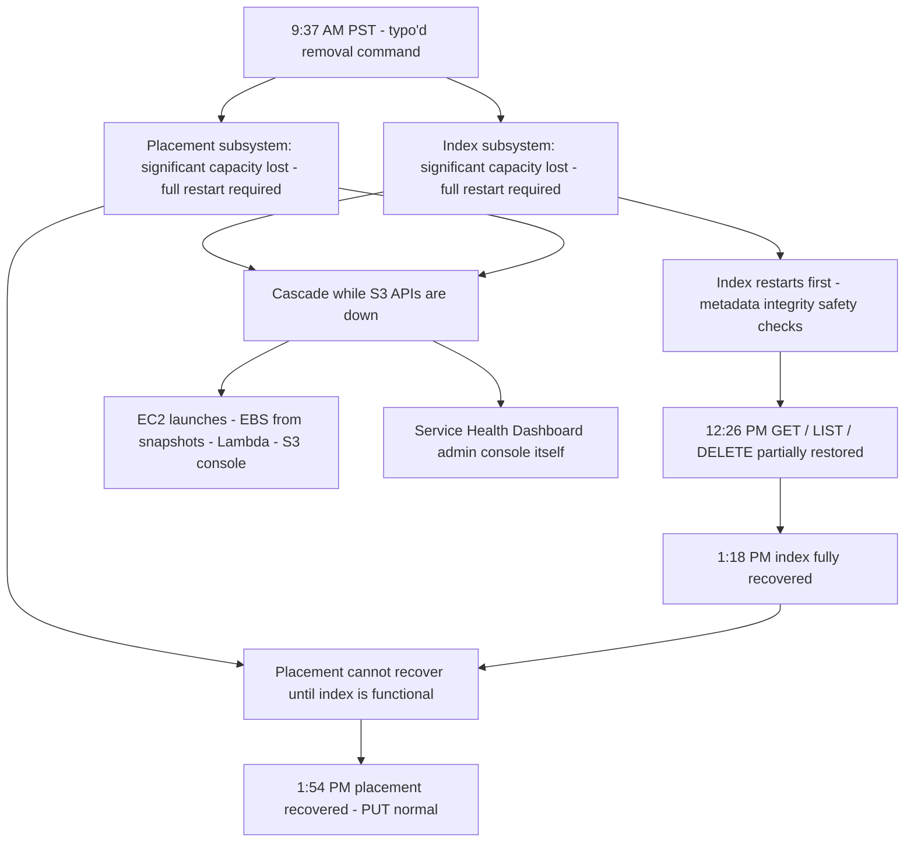

# AWS S3 us-east-1, February 28, 2017: One Command, Two Cold Subsystems, and the Recovery-Order Problem

## Overview

On the morning of February 28, 2017, an authorized Amazon S3 team member, following an established playbook, executed a command to remove a small number of servers from an S3 subsystem used by the billing process. One input to the command was entered incorrectly; a **larger set of servers was removed than intended**. The removed servers supported two other S3 subsystems — the **index subsystem** (metadata and location information for all S3 objects in the region) and the **placement subsystem** (allocation of new storage for PUT requests).

CONFIRMED (per AWS's own summary [1]): while these subsystems restarted, S3 was unable to service requests. The index subsystem — which had not been completely restarted in the larger regions for many years — took until 1:18 PM PST to fully recover; the placement subsystem, which depends on the index, finished recovering at 1:54 PM PST. In total, S3's core APIs were degraded or unavailable for roughly four hours in the region. The failure cascaded to **EC2 instance launches, EBS volume creation from snapshots, AWS Lambda, and the S3 console** — and, notably, to the **AWS Service Health Dashboard itself**, whose administration console depended on S3.

The incident is the definitive case study in three mechanisms: the danger of destructive control-plane commands without capacity guardrails, the *recovery-order dependency* between coupled subsystems, and the failure mode of **critical subsystems that are too important to have ever been restarted** — so their restart is slow, unrehearsed at scale, and full of surprises.

## System Context

- **S3's internal architecture** (as described by AWS [1]): object storage composed of cooperating subsystems. The **index subsystem** "manages the metadata and location information of all S3 objects in the region" and "is necessary to serve all GET, LIST, PUT, and DELETE requests." The **placement subsystem** "manages allocation of new storage and requires the index subsystem to be functioning properly to correctly operate"; it is used during PUT requests to allocate storage for new objects [1].
- **Cells.** AWS describes factoring services into "small partitions which we call cells" so that "engineering teams can assess and thoroughly test recovery processes of even the largest service or subsystem" [1]. As of 2017, S3 had refactored parts of the service into smaller cells, but the index subsystem partitioning work was incomplete and had been planned for later in the year [1].
- **Capacity removal as routine operations.** S3 subsystems are designed to support removal or failure of significant capacity with little or no customer impact; removing and replacing capacity is a core operational process used since S3's launch [1]. This is what made the playbook normal — and the failure instructive.
- **Regional coupling.** US-EAST-1 is the oldest and largest AWS region, and many other AWS services store data in or fetch artifacts from S3: EC2 stores machine images/snapshot data there; Lambda and others store deployment artifacts there [1].

## What Happened

| Time (PST, Feb 28, 2017) | Event | Source |
|---|---|---|
| Morning | S3 team is debugging an issue causing the S3 billing system to progress more slowly than expected | [1] |
| 9:37 AM | An authorized S3 team member, "using an established playbook," executes a command intended to remove a small number of servers for one of the S3 subsystems used by the billing process. "Unfortunately, one of the inputs to the command was entered incorrectly and a larger set of servers was removed than intended." The removed servers supported the **index** and **placement** subsystems | [1] |
| 9:37 AM → | Removing a significant portion of capacity causes both subsystems to require a **full restart**. While they restart, S3 cannot service requests | [1] |
| Morning | Cascade begins: S3 console, EC2 new instance launches, EBS volumes (when data was needed from an S3 snapshot), and AWS Lambda are impacted while S3 APIs are unavailable. Some services accumulate backlogs that extend their recovery | [1] |
| Until 11:37 AM | AWS cannot update individual services' status on the Service Health Dashboard "because of a dependency the SHD administration console has on Amazon S3." Status is communicated via the @AWSCloud Twitter feed and SHD banner text | [1] |
| 12:26 PM | Index subsystem has activated enough capacity to begin servicing GET, LIST, and DELETE requests | [1] |
| 1:18 PM | Index subsystem fully recovered; GET, LIST, DELETE APIs functioning normally | [1] |
| 1:54 PM | Placement subsystem — which began recovery only once the index was functional — finishes recovery; PUT normal; S3 operating normally. Other services begin recovering; some need extra time to drain accumulated backlogs | [1] |

Post-incident changes (CONFIRMED, from the same statement [1]): the removal tool was modified to remove capacity more slowly; safeguards were added to prevent capacity removal when it would take any subsystem below its minimum required capacity; AWS began auditing other operational tools for similar safety checks; index-subsystem partitioning was reprioritized to begin immediately; the SHD administration console was changed to run across multiple AWS regions.

## Technical Mechanism

### 1. A destructive command with too much authority

The command's purpose was narrow — remove a small number of servers from one billing-support subsystem — but its blast radius was bounded only by the correctness of one typed input. AWS's own diagnosis of the tool gap is the sharpest sentence in the statement: "While removal of capacity is a key operational practice, in this instance, **the tool used allowed too much capacity to be removed too quickly**" [1].

The fixes AWS describes map directly onto the standard design principles for destructive control-plane operations:

- **Rate limit the destructive action** ("remove capacity more slowly") — turn one irreversible large mistake into many small, interruptible ones.
- **Enforce an invariant** ("prevent capacity from being removed when it will take any subsystem below its minimum required capacity level") — encode the safety property in the tool, not in the operator's attention.
- **Sweep for the same defect elsewhere** ("auditing our other operational tools") — because a missing guardrail is rarely unique.

INTERPRETATION: AWS's statement does not say what interactive confirmation the tool did or did not require, and we will not speculate. What the statement does establish is that the effective safety boundary was a correctly typed input — meaning the tool's authority exceeded its verification. The generalizable rule: **the tool, not the human, must know the minimum safe capacity of the target subsystem.**

### 2. Why removing servers forced a *full restart*

The removed servers did not merely reduce capacity; taking "a significant portion" of the index and placement subsystems offline caused each to require a complete restart [1]. The precise internal reason is not published. INTERPRETATION, clearly labeled: a metadata-serving subsystem that suddenly loses a large fraction of its capacity cannot simply continue in degraded mode if the remaining capacity cannot consistently serve the metadata and location lookups every API call requires — restart-from-persisted-state becomes the only coherent option. This is a design trade-off in metadata systems: partitioned, fault-tolerant metadata serving resists partial loss; a monolithic or coarsely partitioned index degrades catastrophically past some capacity threshold. The fact that AWS's remediation list leads with **cell-based partitioning** of the index subsystem [1] supports this reading.

### 3. The recovery-order dependency

This is the heart of the incident's duration. The two damaged subsystems were not independent:

The placement subsystem "requires the index subsystem to be functioning properly to correctly operate" [1]. So recovery is a **serial dependency chain**: index first, then placement, and PUT — the API needing both — comes back last. The index's own recovery was slow for two stated reasons: S3 had grown massively, and the restart involved "running the necessary safety checks to validate the integrity of the metadata," which "took longer than expected" [1].

INTERPRETATION: "took longer than expected" is a measured admission that recovery time was untested at current production scale. The subsystem had not been completely restarted in a large region "for many years" [1] — so the recovery path had silently drifted out of calibration as the metadata volume grew. Everything about the recovery was *cold*: cold caches, cold code paths, cold operational muscle memory.

### 4. Coupled control planes made diagnosis and communication slow

Two couplings amplified the incident beyond S3 itself:

- **Customer-visible services depend on S3 for their own control paths.** New EC2 instance launches and EBS volume creation from snapshots need S3 data; Lambda needs it for deployment artifacts [1]. This converts a storage outage into a *platform* outage: the failure propagates through other services' management planes, not just their data planes.
- **The status page depended on the thing that was down.** The SHD administration console had a dependency on S3, so for the first two hours AWS could not update per-service status [1]. An observability tool coupled to a single region's storage is an availability defect in the observability system itself — which is why the fix was to run the SHD console across multiple regions [1].

### Trigger vs Contributing Factors

**Trigger (CONFIRMED):** an incorrectly entered input to a capacity-removal command at 9:37 AM PST.

**Contributing factors (CONFIRMED):** tooling that permitted too much removal, too fast; no capacity-floor guardrail; index and placement subsystems unrehearsed for full restart at production scale; placement's hard dependency on index (serial recovery); widespread service dependencies on S3 control paths; SHD console coupled to S3.

**Contributing factors (INTERPRETATION):** the debugging context — the command was executed as part of diagnosing a billing slowdown — illustrates how *routine operations during unrelated investigations* are a top source of collateral incidents. The playbook was established; the command was authorized; none of that matters when the tool lacks an invariant.

## Why Safeguards Didn't Prevent It

- **The safety property lived in people, not the tool.** "Authorized team member" + "established playbook" + correct-typing = the entire defense. There was no mechanical enforcement of minimum capacity [1].
- **Routine success bred procedural confidence.** Capacity removal had been used "to maintain our systems since the launch of S3" [1] — thousands of uneventful executions. The untested path was precisely the one no one had walked: full restart of the largest subsystems.
- **Redundancy was intra-subsystem, not inter-plan.** The subsystems were designed to survive removal of significant capacity [1] — but the design assumption was met neither by the tool (which could exceed the threshold in one action) nor by the recovery plan (which had never been exercised at that scale in a large region).
- **Observability shared a fate with the outage.** The dashboard could not report the outage it was observing [1]; customers and AWS both flew on instrument noise for the first two hours.

## Lessons & Mitigations

1. **Give destructive tools invariants, not permissions.** Every capacity-removal tool should know the target's minimum safe capacity and refuse to cross it, regardless of input. Rate-limit irreversible actions. (Both are AWS's own fixes [1].)
2. **Treat full-restart of critical subsystems as a rehearsed drill.** If a subsystem has not been completely restarted at production scale within a bounded, tested time, its recovery time is unknown. Chaos-style restart drills — the practice behind [chaos engineering](../../sre/chaos-engineering.md) — exist exactly to keep this number known.
3. **Model recovery as a dependency graph, not a duration.** Time-to-recover is the longest path through component dependencies (index → placement → PUT). Any design that adds a hard serial dependency adds it to the tail of every recovery. Partition metadata (cells) to break the chain — AWS's remediation [1].
4. **Break control-plane coupling between services.** A storage service should not be a single point of failure for other services' ability to *launch* (EC2, Lambda) or *report* (SHD). Multi-region admin consoles and artifact stores turn cascade failure into local failure.
5. **Distinguish blast radius from authority.** The command was scoped to a billing subsystem but was technically capable of removing unrelated, far larger subsystems. Authority should be mechanically scoped to blast radius: name the subsystem, and the tool validates that only that subsystem's capacity is addressable.

## Connection to This Repository

- [Amazon S3](../../cloud/aws/s3.md) — the service itself; read the consistency and durability model, then notice which parts of it depend on the index subsystem.
- [Amazon EC2](../../cloud/aws/ec2.md) and [AWS Lambda](../../cloud/aws/lambda.md) — the cascade victims; both fetch launch/deployment artifacts from S3.
- [Bulkheads](../../sre/bulkheads.md) — the cell-partitioning principle (blast-radius containment) AWS was mid-way through applying.
- [Chaos engineering](../../sre/chaos-engineering.md) — why recovery drills must include *full restarts*, not just single-node kills.
- [Common failure modes](../../failure-modes/common-failures.md) — the generic "control-plane outage" and "dependent service cascade" patterns.
- [Multi-region architectures](../../sre/multi-region.md) — the SHD fix (admin console across regions) generalizes to any control plane.
- [Incident management](../../sre/incident-management.md) — communicating status when the status system itself is degraded.

## Interview Questions

1. Design the CLI/API for a "remove capacity" operation against a critical metadata subsystem. What does the tool know, validate, and rate-limit? How does it behave when the operator requests an amount that would violate the minimum-capacity invariant?
2. Your system's mean time to recover has never been measured for a full restart of its largest subsystem. What drill do you design, and what do you expect to find broken the first time you run it?
3. Subsystem B cannot recover until subsystem A is healthy. What are three architectural ways to break that serial recovery dependency, and what does each cost?
4. The status page for a platform depends on the platform's own storage. Give a concrete design for status reporting that survives a regional outage, and explain the coupling you are removing.
5. Why is "authorized engineer + established playbook" not a safeguard? Frame your answer in terms of the difference between human-level and system-level defenses, with this incident as the example.

## Key Takeaways

- A single mistyped input removed enough capacity to force a full restart of the region's metadata index and placement subsystems — the tool's authority was far larger than the task's blast radius.
- Recovery was serial and slow because placement depends on index, and the index had not been restarted at scale in years; recovery time was an untested property, not a designed one.
- The outage cascaded through other services' *control planes* (EC2 launches, Lambda, EBS-from-snapshot, even the status dashboard), multiplying the visible blast radius far beyond S3.
- AWS's fixes are the canonical trio for destructive operations: slower action, invariant enforcement in the tool, and a sweep for the same defect in sibling tools.

## Sources

1. Amazon Web Services, "Summary of the Amazon S3 Service Disruption in the Northern Virginia (US-EAST-1) Region," AWS Message, February 28, 2017. https://aws.amazon.com/message/41926/ (fetched and quoted; URL verified at time of writing)

## Cross-References

- [Knight Capital, 2012](./knight-capital-2012.md) — another case where a tool's authority exceeded its safeguards; data-plane vs control-plane runaway.
- [Facebook BGP, 2021](./facebook-bgp-2021.md) — control-plane coupling at global scale: the tools needed for recovery were unreachable because of the failure.
- [Cloudflare regex, 2019](./cloudflare-regex-2019.md) — dashboards and internal tools going down with the product; the "own your dogfood" risk.
- [GitHub, October 2018](./github-october-2018.md) — long recovery dominated by restore-from-backup mechanics, another "cold path" duration surprise.
- [Bulkheads](../../sre/bulkheads.md) — cell partitioning as blast-radius engineering.
- [Chaos engineering](../../sre/chaos-engineering.md) — the practice that would have surfaced the cold-restart cost before February 28.
