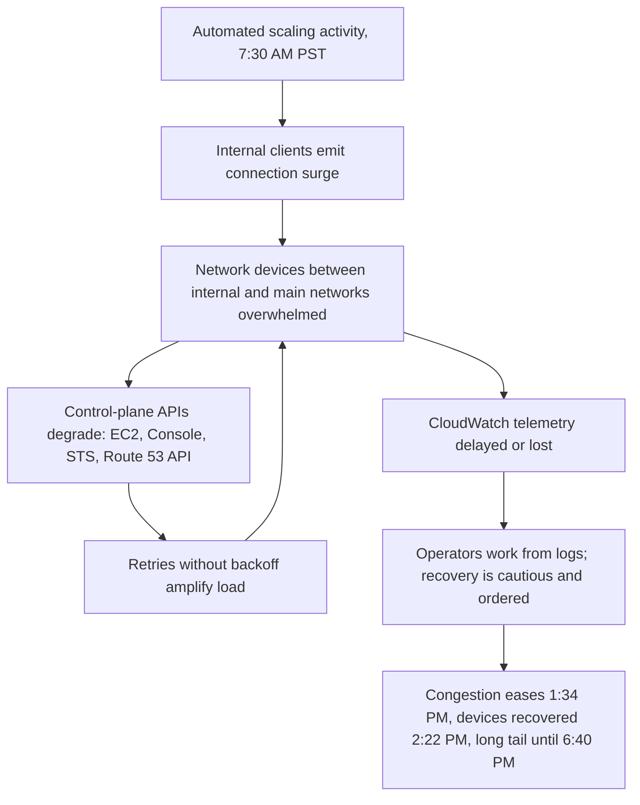

# AWS us-east-1, December 7, 2021: An Internal Scaling Activity That Took Down the Control Plane

## Overview

On December 7, 2021, an automated activity to scale capacity of one AWS service triggered unexpected behavior from clients on AWS's internal network. The resulting surge of connection activity overwhelmed the networking devices between AWS's internal and main networks, and the effects cascaded outward through the control planes of many US-EAST-1 services for most of a working day [1].

CONFIRMED (per the AWS statement [1]): the event began at 7:30 AM PST; EC2 API error rates rose from 7:33 AM; Route 53 APIs were impaired until 2:30 PM; AWS Console login failures lasted until 2:22 PM; STS did not fully recover until 4:28 PM; API Gateway was largely recovered by 4:37 PM; Amazon Connect resumed normal operations at 4:41 PM; Fargate API errors persisted until 5:00 PM; and EventBridge latency did not return to normal until 6:40 PM — roughly eleven hours after the trigger. S3 and DynamoDB were not directly impacted, but access to them via VPC Endpoints was impaired [1].

The incident is a case study in three compounding properties of large platforms: automation that acts on a shared network substrate, internal clients whose retry behavior amplified congestion instead of backing off from it, and an observability stack that sat inside the blast radius — the operators had to diagnose the event partly through logs because real-time monitoring was itself impaired [1].

## System Context

- AWS is operated as a very large set of services that share physical regions. The data-plane workloads (customer instances, storage objects, queued messages) run on fleets spread across many data centers, but the **control-plane operations** — launching instances, issuing credentials, resolving AWS's own service endpoints, shipping telemetry — flow across specific network paths, including devices that connect AWS's *internal* networks to the *main* customer-facing networks [1].
- AWS runs substantial **internal automation** for its own capacity management. When demand grows, internal systems scale capacity of AWS services themselves. This automation is the machinery that keeps a region's services healthy — and it is also software that emits network traffic like any other client [1].
- December 7, 2021 was a normal business day in North America. US-EAST-1 is AWS's oldest and largest region and a dependency hub for the rest of the platform: many AWS services keep internal state or invoke each other there. Customer architectures that treated US-EAST-1 as their "home" region felt the event directly, and architectures in other regions felt it indirectly wherever a workflow called into US-EAST-1 [1].

## What Happened

| Time (PST, Dec 7, 2021) | Event | Source |
|---|---|---|
| 7:30 AM | Automated capacity-scaling activity for one AWS service triggers unexpected behavior from clients on the internal network; connection surge overwhelms networking devices between internal and main AWS networks; Route 53 APIs impaired; EC2 and Console issues begin in the following minutes | [1] |
| 7:33 AM | EC2 APIs show increased error rates and latency; AWS Console login failures begin | [1] |
| 9:28 AM | DNS resolution errors fully recovered | [1] |
| 12:35 PM | EventBridge event delivery disabled (protective action) | [1] |
| 1:15 PM | EC2 API error rates begin improving | [1] |
| 1:34 PM | Congestion significantly improved | [1] |
| 1:35 PM | API Gateways and most container services begin recovery | [1] |
| 2:22 PM | All network devices recovered; AWS Console access restored | [1] |
| 2:30 PM | Route 53 APIs recovered | [1] |
| 2:35 PM | EventBridge event delivery re-enabled | [1] |
| 2:40 PM | EC2 instance launches recovered | [1] |
| 4:28 PM | STS fully recovered | [1] |
| 4:37 PM | API Gateway largely recovered | [1] |
| 4:41 PM | Amazon Connect (phone/chat/task contacts) resumes normal operations | [1] |
| 5:00 PM | Fargate API error rates return to normal | [1] |
| 6:40 PM | EventBridge latency returns to normal | [1] |

CONFIRMED: real-time monitoring was unavailable for parts of the event, so operations teams worked from logs; internal deployment systems were also impacted, which slowed remediation; and AWS states it acted deliberately cautiously to avoid impacting workloads that were still functioning [1].

## Technical Mechanism

**1. A scaling action became a traffic generator.** The trigger was not a failed deployment or a bad config push in the customer-facing sense: it was routine automation scaling the capacity of one AWS service. That automation caused "unexpected behavior from clients in the internal network" — a surge of connection activity aimed across the internal-to-main network boundary [1]. INTERPRETATION: the most likely shape of this, given the description, is that the scaling event caused many internal clients to re-resolve, reconnect, or re-register simultaneously, and the connection establishment itself became the load. Whatever the precise client behavior, the mechanism that turned it into an outage is well understood: a herd of well-behaved-at-idle clients became a synchronized attack on a shared bottleneck the moment the trigger fired.

**2. Retry amplification where backoff was missing.** The AWS statement is explicit about the feedback loop: the congestion created a cycle in which connection delays led to more connection attempts and retries, prolonging the overload [1]. This is the classic amplification mechanism — a client whose request times out is a client that will try again, and a million clients trying again with synchronized timers reconstruct the original spike, slightly shifted and larger. INTERPRETATION: the statement says AWS would ship "a fix for the issue preventing networking clients from backing off during congestion" within two weeks [1] — which tells us the internal clients lacked (or did not apply) congestion-aware backoff. The engineering lesson generalizes far beyond AWS: a fleet of clients with retries and no jitter/backoff is a hidden DDos source aimed at its own infrastructure.

**3. The blast radius followed control-plane coupling.** The services that degraded first and longest are the ones whose *control planes* sit on the congested paths: EC2 APIs (instance launches), the Console, STS (credential issuance), Route 53 APIs (DNS record management — note: DNS *resolution* errors recovered by 9:28 AM while the *APIs* stayed impaired until 2:30 PM [1]), and the container services' APIs. Meanwhile S3 and DynamoDB — data planes — kept serving, but access through **VPC Endpoints** was impaired [1], which effectively made two of the healthiest services unreachable for many customers. INTERPRETATION: this is the modern form of the "control plane and data plane must be separable" principle — separation only helps if the *paths to* the data plane are also independent of the control plane's network substrate.

**4. Observability inside the blast radius.** CloudWatch experienced monitoring delays, with some data not captured at all [1]. The operators diagnosing the event therefore lacked the real-time dashboards that normally drive incident response, and had to reconstruct what was happening from logs [1]. INTERPRETATION: this is the "observability shares fate with the system it observes" problem — the monitoring stack consumed the same congested network and the same impaired STS/Console dependencies. Every serious postmortem template asks "could we see what was happening?"; here the answer, from the primary source, is "not in real time."

**5. Recovery was gated by the network, not by any single service.** The recovery sequence — congestion significantly improved at 1:34 PM, network devices fully recovered at 2:22 PM, then a long tail (STS 4:28 PM, Fargate 5:00 PM, EventBridge 6:40 PM) as backlogged work drained and protective actions (EventBridge delivery had been disabled at 12:35 PM) were reversed in order [1] — shows the shape of recovery in coupled systems: the shared substrate had to come back first, then services resumed in dependency order, each unblocking the next. The deliberate pace was protective: AWS states it chose not to rush actions that might impact workloads still working [1].

## Trigger vs Contributing Factors

- **Trigger:** one automated capacity-scaling activity at 7:30 AM PST [1].
- **Contributing factors:** internal clients whose retry behavior amplified congestion instead of backing off [1]; networking devices between internal and main networks as a shared bottleneck [1]; control planes of many services routed across that bottleneck; an observability stack that shared fate with the incident [1]; internal deployment systems impacted, slowing fixes [1]; US-EAST-1's role as the platform's dependency hub.

## Why Safeguards Didn't Prevent It

- **Multi-AZ redundancy did not apply.** Redundancy within a region protects against data-center failures, not against a shared regional network substrate that both control planes and monitoring traverse. The affected devices were between networks, not inside any one AZ.
- **The automation itself was functioning.** Nothing about the scaling activity was malformed; the system behaved as designed, and the design did not bound the collateral connection surge of its internal clients [1]. Safeguards that check *inputs* (valid configs, correct commands) do not catch *emergent load* (what thousands of clients do in response to a legitimate change).
- **Backoff discipline was missing on internal clients.** AWS's own mitigation list — a fix to make networking clients back off during congestion [1] — is the confirmation that retry hygiene was not yet universal on the internal fleet.
- **Monitoring could not lead the response.** With real-time telemetry delayed or missing [1], the response slowed to the speed of logs and caution. Any safeguard that depends on seeing the incident in real time is weakened when observability shares the incident's failure mode.

## Lessons & Mitigations

1. **Treat internal automation as a load-generating tenant.** Scaling actions, health-check storms, certificate rotations, and re-registration waves all consume the same substrate. Capacity planning and rate limits should cover *internal* clients, not only customer traffic.
2. **Backoff with jitter everywhere, especially internally.** The difference between an incident and a non-event is often whether ten thousand clients retry in the next second or spread their retries over the next minute. AWS's promised client-backoff fix [1] is the canonical confirmation of this principle from inside the largest cloud.
3. **Separate the paths, not just the planes.** Data/control-plane separation is incomplete if the network path to the data plane traverses the control plane's bottleneck (here, VPC Endpoint access to healthy services [1]).
4. **Keep an observability path that cannot share fate** — out-of-band monitoring, independent network paths, or last-known-state caching — and rehearse diagnosing without dashboards.
5. **Protective degradation beats silent overload.** Disabling EventBridge delivery at 12:35 PM [1] traded availability of one service for recoverability of the whole; load shedding with explicit re-enablement is a design pattern, not an admission of failure.
6. **Recovery has a dependency order.** Substrate first, control planes second, data-plane-adjacent services third, then the backlog. Plan the re-enable sequence before the incident.

## Connection to This Repository

- [Retry and timeout assumptions](../assumptions-hunt/timeouts-and-retries.md) — the amplification loop here is the exact mechanism that page warns about, at fleet scale.
- [Backpressure, queues, and rate limiting](../connection-atlas/backpressure.md) — what was missing between the internal clients and the network devices was intake control; load shedding and pacing are the same ideas in different layers.
- [Scaling up vs scaling out](../why-not-handbook/scaling-up-vs-out.md) — "just add capacity" failed because the bottleneck was shared infrastructure under a synchronized herd, not total capacity.
- [GitHub, October 2018](./github-october-2018.md) and [Facebook BGP, 2021](./facebook-bgp-2021.md) — sibling cases in which internal tooling and internal networks determined both the failure and the recovery pace.
- [AWS S3 us-east-1, 2017](./aws-s3-us-east-1-2017.md) — the same region, four years earlier: an operator-driven removal there, automation-driven surge here; both show recovery order dominating customer-visible duration.
- [Bulkheads](../../sre/bulkheads.md) and [postmortem culture](../../sre/postmortem-culture.md) — the partitioning discipline and the reporting discipline this case validates.

## Interview Questions

1. **"The AWS statement says monitoring was unavailable during the event. How would you design monitoring so it can't die with the system it watches?"** Strong answers separate the monitoring path (network and credentials) from production dependencies, keep a last-known-good local state, and rehearse log-only diagnosis; weak answers add more dashboards on the same substrate.
2. **"Your service survived the event — clients in another region did not. What did their architecture do wrong?"** The correct reasoning is that calling into a region for credentials, DNS APIs, or STS creates hidden cross-region control-plane coupling; the fix is regional independence for critical paths and a dependency audit, not "avoid us-east-1" folklore.
3. **"The trigger was routine automation working as designed. What class of safeguard catches that?"** Answers should distinguish input-validation safeguards from emergent-load safeguards: rate limits on internal clients, backoff/jitter requirements, and canarying automation at reduced blast radius.
4. **"Why did S3 and DynamoDB stay up but remain unreachable for many customers?"** Because the VPC Endpoint path was impaired — a demonstration that availability is a property of the whole path, not of the service.

## Key Takeaways

- A legitimate, correctly-executed internal automation action became a regional event because its *second-order effect* — a connection surge from internal clients — was unbounded and synchronized.
- Retry amplification is not an edge case; it is the default behavior of every unsophisticated client under stress. Backoff with jitter is a safety property, not a nicety.
- The blast radius of a network event is determined by path coupling, not by which services are "down": healthy data planes were unreachable through impaired endpoint paths.
- Observability that shares fate with production turns a diagnosable incident into a cautious, slow one. Out-of-band visibility is part of the reliability budget.

## Sources

1. AWS, "Summary of the AWS Service Event in the Northern Virginia (US-EAST-1) Region", AWS message, December 10, 2021. https://aws.amazon.com/message/12721/ (fetched and quoted; URL verified at time of writing)

## Cross-References

- [Assumptions: timeouts and retries](../assumptions-hunt/timeouts-and-retries.md) — the amplification mechanism, formalized.
- [Backpressure, queues, and rate limiting](../connection-atlas/backpressure.md) — the missing intake-control layer.
- [GitHub, October 2018](./github-october-2018.md) — internal network maintenance as trigger; recovery pacing dominated by internal tooling.
- [Facebook BGP, 2021](./facebook-bgp-2021.md) — the other great "internal control plane took the platform with it" case.
- [AWS S3 us-east-1, 2017](./aws-s3-us-east-1-2017.md) — same region, different trigger class; both prove recovery order drives duration.
