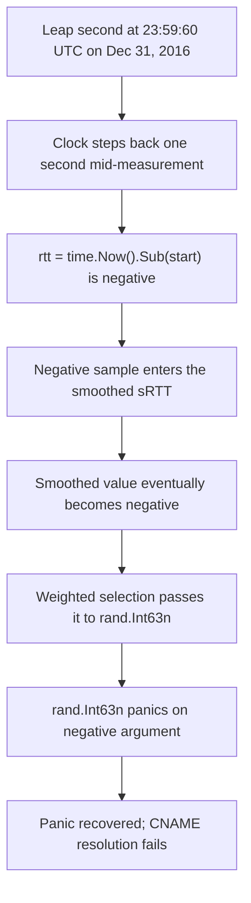

# Cloudflare, January 1, 2017: A Leap Second, a Negative Duration, and the DNS Resolver That Panicked

## Overview

At midnight UTC on New Year's Day 2017 — moments after the leap second inserted at the end of December 31, 2016 — a number deep inside Cloudflare's custom authoritative DNS server went negative where the code assumed it could never be below zero. Cloudflare's own write-up, published the same day by John Graham-Cumming, opens with exactly that observation: "At midnight UTC on New Year's Day, deep inside Cloudflare's custom RRDNS software, a number went negative when it should always have been, at worst, zero. A little later this negative value caused RRDNS to panic." The panic was caught by Go's `recover`, so servers did not die; instead, individual DNS resolutions failed. The affected code path was CNAME lookups, so only customers who use CNAME records with Cloudflare were exposed, and only a small number of machines across Cloudflare's 102 data centers were affected. At peak, approximately 0.2% of DNS queries to Cloudflare were affected and less than 1% of all HTTP requests to Cloudflare encountered an error [1].

What makes the case worth studying is not the size but the shape. The trigger was not traffic, not a deploy, not an attacker — it was time itself, jumping backwards by one second, simultaneously and uniformly, in every data center on the planet. A single bad sample entered a smoothing filter, the smoothed value eventually went negative, and the negative value was passed to a standard library function whose documented contract is to panic on negative input. The fix was one character. The post is also a compact demonstration of a disciplined staged rollout under incident conditions: canary node, canary data center, most-impacted data center, then worldwide.

| Field | Value (per Cloudflare's post) |
|---|---|
| Date | January 1, 2017 (leap second at 23:59:60 UTC, December 31, 2016) |
| Duration | Impact 00:00–06:45 UTC per the post's timeline; most affected machines patched within 90 minutes |
| Peak impact | ~0.2% of DNS queries affected; <1% of HTTP requests errored |
| Scope | CNAME-using customers; small number of machines across 102 data centers |
| Primary source | Cloudflare blog, "How and why the leap second affected Cloudflare DNS" (Jan 1, 2017) |

## System Context

Cloudflare operates authoritative DNS for customer domains. Customers point their domains at Cloudflare in one of two ways: they enter A records with literal IP addresses, or they enter a CNAME pointing at a host managed by an upstream hosting provider. In the CNAME case, Cloudflare "has occasionally to do a lookup, using DNS, for the actual IP address of the origin server," performed "automatically using standard recursive DNS" — this is the CNAME flattening feature [1]. That lookup path is what failed.

Internally, each data center runs multiple DNS resolvers for redundancy, and RRDNS talks to these resolvers to resolve CNAMEs. RRDNS does not treat the resolvers as interchangeable; it measures how well they perform and applies weighted selection, choosing "the most performant" resolver. Performance measurement is continuous: for each upstream query, RRDNS records the round-trip time. Because resolvers are fast — the post notes Cloudflare tuned them to answer "in a few milliseconds" — these measurements are tiny, and the code that produced them was written against an assumption the author names explicitly: that the difference between two time reads is always, at worst, zero [1].

RRDNS is written in Go, and the post records the exact language-level gap: Go's `time.Now()` "does not guarantee monotonicity," and at the time "Go currently doesn't offer a monotonic time source (see issue 12914 for discussion)" [1]. So every measurement of elapsed time in RRDNS was, structurally, an subtraction of two wall-clock reads that could go backwards. Nothing about normal operations ever exercised that possibility; the leap second arrives roughly every few years and lasts exactly one second.

## What Happened

The timeline below is reproduced from Cloudflare's post, which publishes it as "the complete timeline of the events around the leap second bug"; all times are UTC on January 1, 2017 [1].

| Time (UTC, Jan 1, 2017) | Event | Source |
|---|---|---|
| 00:00 | Impact starts (leap second crosses midnight UTC) | [1] |
| 00:10 | Escalated to engineers | [1] |
| 00:34 | Issue confirmed | [1] |
| 00:55 | Mitigation deployed to one canary node and confirmed | [1] |
| 01:03 | Mitigation deployed to canary data center and confirmed | [1] |
| 01:23 | Fix deployed in most impacted data center | [1] |
| 01:45 | Fix being deployed to major data centers | [1] |
| 01:48 | Fix being deployed everywhere | [1] |
| 02:50 | Fix rolled out to most of the affected data centers | [1] |
| 06:45 | Impact ends | [1] |

CONFIRMED details around the timeline: the problem was "quickly identified"; the most affected machines were patched in 90 minutes; the fix rollout was prioritized "by those locations with the most errors first," which the post illustrates with a chart of per-data-center error rates dropping as fixes land [1]. The post also states the blast radius precisely: only CNAME-using customers, "only a small number of machines across Cloudflare's 102 data centers," and at peak "approximately 0.2% of DNS queries" and "less than 1% of all HTTP requests" hitting an error [1]. No customer names, per-customer figures, or absolute query volumes appear in the post; this page does not invent them.

## Technical Mechanism

The mechanism is a chain of three small decisions that only compose into a failure when time runs backwards. The post quotes the responsible code directly [1]:

```
// Update upstream sRTT on UDP queries, penalize it if it fails
if !start.IsZero() {
    rtt := time.Now().Sub(start)
    if success && rcode != dns.RcodeServerFailure {
        s.updateRTT(rtt)
    } else {
        s.updateRTT(TimeoutPenalty * s.timeout)
    }
}
```

Step one: a non-monotonic difference. `rtt` is `time.Now().Sub(start)` — wall clock minus wall clock. If the clock steps back one second between the two reads, `rtt` is negative. During the leap second, "time goes back a second" and "the perceived resolution time will be negative" for resolutions in flight at that instant [1].

Step two: smoothing. RRDNS "doesn't just keep a single measurement for each resolver, it takes many measurements and smoothes them." One negative sample would not, by itself, make the smoothed value negative. But "after a few measurements the smoothed value would eventually become negative" [1]. This is the subtle step: the filter that exists to suppress noise converted a one-second anomaly into a persistent corrupt state, because negative inputs are just as admissible to an average as positive ones unless the code refuses them.

Step three: a strict contract. When RRDNS selects an upstream resolver it runs a weighted selection algorithm that feeds the upstream time values to Go's `rand.Int63n()`. As the post states: "rand.Int63n promptly panics if its argument is negative. That's where the RRDNS panics were coming from" [1]. The panic was caught by Go's `recover`, so the process survived — but the resolution was lost.



The fix the post describes is deliberately minimal: "we allowed RRDNS to forget about current upstream performance, and let it normalize again if time skipped backwards. This prevents leaking of negative numbers to the server selection code." The author frames the underlying error as "the belief that time cannot go backwards," and adds the general precaution: "when using a non-monotonic clock source ... always check whether the difference between two timestamps is negative" [1]. INTERPRETATION: the single most instructive line is that the bug was not in the smoothing mathematics or in `rand.Int63n` — both behaved as designed. The defect was an unstated clock invariant smuggled into a performance heuristic.

## Trigger vs Contributing Factors

The trigger is unambiguous and, unusually for this casebook, astronomical: the leap second inserted at the end of 2016 caused clocks to step backwards one second. Nothing Cloudflare deployed that day triggered the failure; the trigger fired everywhere at once.

The contributing factors are all local to the code and the platform:

- **A non-monotonic time source used for interval measurement.** Go offered no monotonic clock at the time (issue 12914 is cited by the post), so elapsed-time code had to defend itself; this code did not [1].
- **Millisecond-scale measurements.** Because resolvers were tuned to answer in a few milliseconds, a one-second backwards step is not a small perturbation — it is thousands of times larger than any legitimate measurement, guaranteeing a negative value rather than a merely noisy one [1].
- **A smoothing filter with no sign check.** The filter's job is to average out outliers, and it did its job on its own terms — it just had never been told that its inputs could be invalid. The negative state persisted "after a few measurements," extending the failure window beyond the leap second itself [1].
- **A panic-based contract at the selection boundary.** `rand.Int63n`'s behavior on negative input is documented and correct; feeding it unvalidated smoothed values made a numeric edge case into an availability event [1].
- **Heterogeneous fleet sensitivity.** The post notes "some data centers were more affected than others" — the same global event produced different local error rates, likely because the number of CNAME resolutions in flight at the instant of the step varied. INTERPRETATION: a correlated trigger interacting with uncorrelated local load.

## Why Safeguards Didn't Prevent It

- **Redundant resolvers per data center** protected against any one resolver failing. They did nothing here: the leap second hit every resolver's clock simultaneously, so the correlated failure defeated redundancy by construction [1].
- **Go's `recover`** is the safeguard that kept a panic from becoming a process crash. It also defined the failure mode: instead of dying loudly and being restarted by a supervisor, affected resolutions failed quietly and repeatedly. INTERPRETATION: recovering from panic at a per-request boundary trades blast radius for visibility; the post's own error chart shows how uneven the resulting impact looked.
- **Smoothing** was intended as a noise-robustness safeguard for performance measurements. With no validation of input sign, it extended a one-second anomaly into a multi-minute corrupt state — the safeguard amplified the event's duration [1].
- **Staged deployment** did not apply at trigger time (time is not deployed), but the same discipline structured the response: canary node at 00:55, canary data center at 01:03, most-impacted data center at 01:23, then major data centers and worldwide [1]. The safeguard that could not prevent the incident is exactly the one that controlled the fix.
- **The post-incident sweep**: Cloudflare stated it was "inspecting all our code to ensure that there are no other leap second sensitive uses of time intervals" [1]. INTERPRETATION: this is the safeguard that actually closes the class — searching for sibling defects — and it is a response-stage control, not a preventive one.

## Lessons & Mitigations

1. **Treat clock reads as untrusted inputs.** The post's own generalization is the lesson: if the clock is non-monotonic, every derived duration must be checked, and a negative duration must either be discarded or force a reset of the measurement state — as Cloudflare's fix did by letting RRDNS "normalize again if time skipped backwards" [1]. This is the concrete incident behind [clocks and time assumptions](../assumptions-hunt/clocks-and-time.md).
2. **Validate at API boundaries with strict contracts.** `rand.Int63n` panics on negative input; any value crossing into such an API should be validated where it is produced, not where it is consumed. The failure surfaced three layers away from the defect because nobody clamped at the source.
3. **Smoothing filters need input validation, not just statistics.** An average is a faithful summarizer of garbage. Filters on operational telemetry should reject physically impossible values — negative latencies, negative counts — rather than average them in [1].
4. **Global time events are perfectly correlated failures.** Redundancy assumptions must be tested against events that hit all replicas at once: leap seconds, NTP step changes, certificate expiries, timezone and DST transitions. The post's aside that "there are many other falsehoods programmers believe about time" is the checklist invitation [1].
5. **Prioritize remediation by observed error, not by geography.** Cloudflare deployed "prioritizing those locations with the most errors first," cutting peak impact while the rollout proceeded [1]. This is [canary release](../../sre/canary-releases.md) discipline inverted for incident response: rank the fleet by pain, then walk the rollout down that ranking.
6. **Audit for the class, not just the instance.** The closing commitment — inspecting all code for "leap second sensitive uses of time intervals" [1] — is the difference between fixing a bug and fixing a category.

## Interview Questions

1. Walk through how a leap second made Cloudflare's DNS resolver panic: where exactly did the negative value originate, and what three code behaviors had to combine for it to matter?
2. RRDNS smoothed many RTT samples, yet the smoothing made things worse, not better. When does averaging operational measurements amplify a failure instead of damping it?
3. Go at the time offered no monotonic time source. What defensive patterns would you apply to elapsed-time measurement on top of a wall clock, and what do they cost?
4. Every resolver in a data center failed in a correlated way. Name three other classes of events that produce perfectly correlated failures across redundant components, and how you would test for each.
5. The panic was recovered, so the process kept running while resolutions failed. Compare "recover and continue" versus "crash and restart" as failure strategies for a hot request path.

## Key Takeaways

- A leap second at the end of 2016 made `time.Now().Sub(start)` negative inside Cloudflare's RRDNS; smoothing eventually turned the raw negative into a negative smoothed value, and `rand.Int63n` panicked on it — DNS resolutions for CNAME-using customers failed at up to ~0.2% of queries, under 1% of HTTP requests [1].
- The root cause, in the author's words, was "the belief that time cannot go backwards"; the platform offered no monotonic clock (Go issue 12914), so the invariant had to be enforced in code [1].
- The fix was one character of sign-handling plus a fleet restart: forget upstream performance state when time steps backwards, preventing negatives from leaking into selection [1].
- Response was fast and staged: impact start 00:00 UTC, issue confirmed 00:34, canary node 00:55, most-impacted data center 01:23, worldwide by 06:45, with rollout prioritized by per-data-center error rates [1].
- The case is the canonical illustration that redundancy does not cover correlated global triggers, and that statistical aggregation is not a substitute for input validation.

## Sources

1. John Graham-Cumming, "How and why the leap second affected Cloudflare DNS," blog.cloudflare.com (published January 1, 2017). https://blog.cloudflare.com/how-and-why-the-leap-second-affected-cloudflare-dns/ — fetched in full this session; all quotes, the code excerpt, the timeline, and every figure on this page come from this post. The post is Cloudflare's own first-party account, published the day of the event. Where the post is silent — absolute query volumes, per-customer impact, machine counts beyond "a small number" — this page is silent too.

This page is deliberately single-source, mirroring the [AWS Kinesis 2020](./aws-kinesis-2020.md) precedent in this casebook: the first-party post is both the incident report and the root-cause analysis, published while the rollout was still in progress. Interpretive statements are labeled INTERPRETATION; everything else is traceable to the post.

## Cross-References

- [Cloudflare regex outage, 2019](./cloudflare-regex-2019.md) — the sibling Cloudflare case: a global outage whose engine was a pathological input to a regex engine, where the leap-second case is a pathological input to a clock; read together they show how one company's edge fleet turns tiny defects into correlated global events.
- [Clocks and time assumptions](../assumptions-hunt/clocks-and-time.md) — the repository page that catalogs exactly this assumption class, from monotonicity to NTP steps to timezone arithmetic.
- [DNS resolution](../followup-tree/dns-resolution.md) — how recursive and authoritative resolution interact, the machinery CNAME flattening sits on top of.
- [DNS resolution and record types](../../networks/dns/resolution.md) — the book chapter on resolvers, caching, and the lookup path whose measurement side failed here.
- [Canary releases](../../sre/canary-releases.md) — the staged-rollout discipline Cloudflare executed under incident pressure: node, then data center, then fleet, ranked by error rate.
