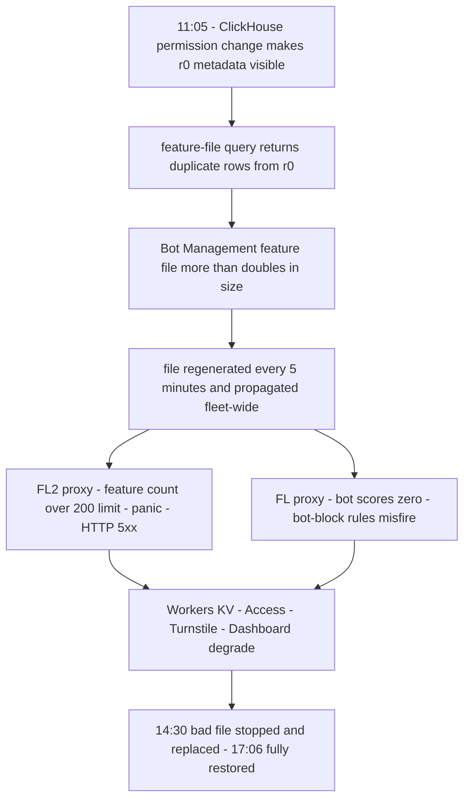

# Cloudflare, November 18, 2025: A Permissions Change, a Doubled Feature File, and the Worst Outage Since 2019

## Overview

On November 18, 2025, Cloudflare — one of the largest reverse proxies on the internet, fronting a substantial share of the web's traffic — suffered a global outage in which its network could not reliably deliver core traffic. Users visiting customer sites received error pages generated from within Cloudflare's network. CONFIRMED (per the [official postmortem][1], written by co-founder Matthew Prince and published the same day): the outage was not caused by any cyber attack or malicious activity. It was triggered by a change to a database permission on a ClickHouse cluster used by Cloudflare's control plane. The change caused a metadata query to return duplicate rows, which more than doubled the row count of the "feature file" consumed by the Bot Management machine-learning module. The oversized file was propagated to machines across the network; the proxy software enforced a hard limit on the number of features it could load, and hitting that limit caused the proxy to panic and return HTTP 5xx errors for any traffic that depended on the affected module.

The impact list in the post reads like an inventory of the modern edge stack: core CDN and security services returned 5xxs; Workers KV failed through its front-end gateway; Cloudflare Access authentication failed for most users; Turnstile would not load, which in turn locked most users out of the dashboard; and Email Security saw degraded spam-detection accuracy. The company's own proxy fleet failed in two different ways at once — the newer FL2 proxy panicked and emitted 5xxs, while the older FL proxy served traffic but assigned every request a bot score of zero, producing false-positive blocks for customers whose rules blocked bots. Cloudflare's post states plainly that this was its worst outage since 2019, and that core traffic was largely flowing normally again by 14:30 UTC with all systems restored by 17:06 UTC [1].

The case is a study in how an innocuous, well-intentioned infrastructure change — making database permissions explicit — can escape through a config-generation pipeline that nobody treated as a validation boundary, and how a safety limit designed to protect memory became the exact mechanism of the outage.

## System Context

- **The request path.** Every request to Cloudflare terminates at the HTTP/TLS layer, flows into the core proxy (internally "FL," for Frontline), and then through Pingora, which performs cache lookups or origin fetches. As a request transits the core proxy, Cloudflare runs its security and performance products — WAF rules, DDoS protection, bot scoring — through domain-specific modules that apply each customer's configuration and policy [1].
- **Bot Management and its feature file.** Bot Management includes a machine-learning model that scores every request as automated or not. The model takes as input a "feature" configuration file — a collection of individual traits used for prediction. This file is regenerated every few minutes and published to the entire network so the system can react quickly to new bot tactics [1]. Rapid, frequent, global configuration refresh is a design strength; this incident shows its failure mode.
- **The 200-feature limit.** Each module on the proxy has limits to avoid unbounded memory consumption and to preallocate memory as a performance optimization. Bot Management's runtime limit on machine-learning features was set to 200 — well above the roughly 60 features actually in use [1].
- **The ClickHouse control-plane cluster.** The feature file is generated by a query running on a ClickHouse database cluster. Cloudflare's setup used ClickHouse distributed tables in a database named `default`, powered by the `Distributed` table engine, which fan queries out to underlying tables in a database named `r0` on each shard. Queries to the distributed tables historically ran under a shared system account; as part of a security and reliability effort, Cloudflare was migrating them to run under the initial user accounts, with explicit grants [1].
- **A fleet mid-migration.** Unrelated to the outage, Cloudflare was migrating customer traffic to a new proxy engine, FL2. Both FL and FL2 were affected, with different symptoms [1] — a heterogeneity that mattered for both impact and diagnosis.

## What Happened

| Time (UTC, Nov 18, 2025) | Event | Source |
|---|---|---|
| 11:05 | ClickHouse access-control change deployed: explicit grants make underlying `r0` tables visible to users querying metadata | [1] |
| 11:20 (post intro) / 11:28 (timeline) | The post's opening paragraph dates the start of significant network failures to 11:20 UTC; its own timeline records impact starting at 11:28, when the deployment reached customer environments and the first errors appeared on customer HTTP traffic | [1] |
| 11:31 | First automated test detects the issue | [1] |
| 11:32–13:05 | Manual investigation begins at 11:32; incident call created 11:35. Initial symptom read as degraded Workers KV response rates cascading downstream; mitigations attempted include traffic manipulation and account limiting | [1] |
| 11:30–13:10 | First dashboard-impact window: users without an active session cannot log in (Turnstile unavailable on the login page) | [1] |
| 13:04–13:05 | Workers KV patch bypasses the core proxy; Workers KV and Access are internally routed to a prior proxy version, reducing their error rates | [1] |
| 13:37 | Work focuses on rolling the Bot Management configuration file back to a last-known-good version | [1] |
| 14:24 | Creation and propagation of new Bot Management configuration files stopped; a test with the old file confirms recovery | [1] |
| 14:30 | Main impact resolved: a correct feature file is deployed globally and most services recover; a long tail of service restarts begins | [1] |
| 14:40–15:30 | Second dashboard-impact window: a backlog of login attempts plus retries overwhelms the dashboard; scaling control-plane concurrency restores it around 15:30 | [1] |
| 17:06 | All services restored; incident ends | [1] |

CONFIRMED per the post: the 5xx error-rate chart shows the system repeatedly recovering and then failing again — because the file was generated every five minutes and, during the gradual ClickHouse rollout, a given run had a chance of being generated on either an updated or non-updated node, producing alternating good and bad configuration waves. Cloudflare initially suspected a hyper-scale DDoS attack (the recent Aisuru botnet attacks were the reference point), an hypothesis reinforced when Cloudflare's status page — hosted entirely off Cloudflare's infrastructure — went down at the same time by pure coincidence [1].

## Technical Mechanism

### 1. A metadata query silently doubles its result set

The Bot Management feature-file generation logic asks ClickHouse for the columns of a table, with a query of this shape [1]:

```sql
SELECT name, type
FROM system.columns
WHERE table = 'http_requests_features'
ORDER BY name;
```

Note what is absent: no filter on the database name. Before the change, a user querying metadata through system tables like `system.columns` would only see tables in the `default` database, so the unfiltered query returned exactly the intended rows. At 11:05, Cloudflare made access to the underlying `r0` tables explicit so that distributed subqueries could run under the initial user and be governed by fine-grained limits. The side effect: the query now also returned the columns of the corresponding `r0` tables — "duplicates" — more than doubling the rows in the response [1]. The schema assumption ("metadata queries return only `default`") was never encoded anywhere; it lived in the heads of the query authors and was invalidated by a permissions change.

### 2. Five-minute regeneration turns a bad query into a propagating artifact

The feature file is rebuilt every five minutes and pushed network-wide [1]. Because the ClickHouse cluster was being updated gradually, bad data was produced only when the generating query ran on an updated node — so for a period, every five minutes produced either a good or a bad file, and the network flapped between healthy and failing. This oscillation was highly unusual for an internal error and directly fed the initial misdiagnosis as an attack. Eventually every ClickHouse node produced the bad file and the failure stabilized [1]. INTERPRETATION: a gradual rollout of the *database* change interacted with frequent *artifact* generation to produce a intermittent fault injected into the fleet — a coupling between rollout granularity and data freshness that neither team owned.

### 3. The preallocation limit became the kill mechanism

The Bot Management module preallocates memory for its features, so it enforces a maximum feature count: 200, against ~60 in normal use [1]. The doubled file carried more than 200 features. The FL2 check that enforces the limit found the violation and panicked — the post shows the Rust code reaching an unhandled `Result::unwrap()` error, with the panic `thread fl2_worker_thread panicked: called Result::unwrap() on an Err value`, which surfaced to customers as HTTP 5xx [1]. This is the crux: the limit existed to protect the proxy, and it did its job in the narrowest possible way — by refusing to run — in a context where "refusing to run" meant failing every request that transited the module. A guardrail placed in the hot path, with no degradation mode, converted a data-quality problem into a global availability problem.

### 4. One bad input, two failure modes

The older FL proxy did not panic; it failed to generate bot scores correctly and assigned every request a score of zero [1]. Customers with rules blocking bots therefore saw large numbers of false positives; customers not using bot scores saw no impact from that path [1]. INTERPRETATION: fleet heterogeneity (FL vs FL2) meant the same defective artifact produced divergent symptoms, which both widened the blast radius (two failure classes to debug) and muddied diagnosis — the same "the fleet is not actually uniform" hazard as the Knight Capital partial deployment, though here by design rather than by error.



### 5. The blast radius followed module dependencies

Workers KV and Access failed because they ride on the core proxy [1]. Turnstile's failure cascaded into the dashboard login flow. Latency increased network-wide because Cloudflare's debugging and observability systems automatically enrich uncaught errors with additional diagnostic information — consuming large amounts of CPU precisely when the proxy was erroring everywhere [1]. INTERPRETATION: error paths have load profiles too; a system that does extra work per failure will multiply a fault into a resource problem unless the error path is itself guarded.

## Trigger vs Contributing Factors

**Trigger (CONFIRMED):** the 11:05 ClickHouse permissions change, which altered the result set of the metadata query used by feature-file generation; the next file generations then produced an oversized artifact that propagated to the fleet.

**Contributing factors (CONFIRMED, per the post):** a schema assumption embedded in a production query with no database filter; gradual rollout of the database change interacting with 5-minute artifact regeneration; a hard 200-feature runtime limit enforced by panic in the request path; Cloudflare-generated configuration files not ingested with the rigor applied to user-generated input (inferred from the remediation item — see below); Workers KV, Access, Turnstile, and dashboard login all sharing the core proxy's fate; error-reporting machinery that amplified resource consumption under failure; and limited global kill switches for individual features.

**Contributing factors (INTERPRETATION):** the diagnostic detour — treating a config-generation failure as a DDoS attack — was encouraged by two coincidences (the fluctuating recovery pattern and the unrelated status-page outage). The post documents both; our analysis is that the oscillation made "external attacker" the most narratively available explanation, and that the team's eventual pivot to evidence (finding the file was the trigger) is the part of the response worth imitating.

## Why Safeguards Didn't Prevent It

- **The 200-feature limit.** Designed as a memory guard with preallocation for performance. It detected the anomaly correctly and then had only one response available: panic. A limit without a defined degraded mode (e.g., truncate with an alert, fail closed for bot scoring only, or reject the artifact before propagation) becomes a single point of failure.
- **No ingestion validation for self-generated config.** Cloudflare's first remediation item — "hardening ingestion of Cloudflare-generated configuration files in the same way we would for user-generated input" [1] — is an admission that internally generated artifacts were trusted by construction. A size/row-count/schema check at ingestion would have rejected the doubled file at the generator, not on ten thousand edge nodes.
- **Missing kill switches.** The post lists "enabling more global kill switches for features" [1] as remediation. The recovery that worked — stopping generation, inserting a known-good file manually, forcing a proxy restart [1] — was manual and global; no per-feature switch could have sidelined the Bot Management module within minutes.
- **Canarying protected the wrong layer.** The database change was rolled out gradually — a sound practice. But the observable that mattered (the generated file's shape) was not part of any rollout gate, and the intermediate state produced alternating good/bad artifacts that made the fault look external. Rollout safety was evaluated on the change's own subsystem, not on its downstream artifacts.
- **Dependencies on the failing module.** Workers KV, Access, and the dashboard's Turnstile-gated login all sat behind the core proxy's Bot Management path. No bypass existed until one was built mid-incident at 13:04 [1].

## Lessons & Mitigations

1. **Treat internally generated configuration as untrusted input.** Every artifact crossing a process or network boundary — even one your own system produced — needs schema, size, and semantic validation at ingestion. The cheapest place to catch a doubled file is at the generator; the most expensive is in the proxy's request path.
2. **Limits need failure semantics, not just failure detection.** If a limit's only response is panic, the limit is a tripwire wired to the availability of the whole system. Decide per-limit what degraded operation looks like, and test it.
3. **Query assumptions are contracts.** The unfiltered `system.columns` query encoded "metadata only covers `default`." When you change the platform underneath a query — permissions, schemas, view definitions — you are changing the query's meaning. Schema-changing migrations need a census of the queries that read the metadata they touch.
4. **Roll out and observe the artifact, not just the change.** The gradual ClickHouse rollout was individually reasonable and jointly harmful with 5-minute generation. Rollout gates should watch the outputs that consumers actually ingest.
5. **Separate error paths from resource budgets.** Debugging enrichment on every uncaught error turned a 5xx storm into a CPU storm. Guard the failure-handling path with the same care as the happy path.
6. **Diagnose with the discipline of the hypothesis, not the story.** The attack hypothesis was plausible and wrong. The decisive evidence — the file — was found by investigating the system's own recent changes. Postmortems that memorialize "what made us think it was X" are as valuable as those that state the root cause.

## Connection to This Repository

- [Cloudflare regex, 2019](./cloudflare-regex-2019.md) — the same company's July 2019 outage: a single regex consumed CPU protection and went global. Both incidents are "configuration goes bad globally through an automated pipeline," seven years apart.
- [Fastly, June 2021](./fastly-june-2021.md) — a valid customer config triggered a latent bug and propagated globally in seconds; the edge-CDN cousin of this incident.
- [Knight Capital, 2012](./knight-capital-2012.md) — fleet heterogeneity producing divergent behavior from identical inputs; there by deployment error, here by proxy-generation coexistence.
- [Feature flags](../../sre/feature-flags.md) — the general discipline of kill switches and staged exposure that Cloudflare's remediation list points toward.
- [Canary releases](../../sre/canary-releases.md) — what "staged" must mean when the thing rolling out feeds an automated generator.
- [Common failure modes](../../failure-modes/common-failures.md) — the generic "bad config propagates globally" pattern this case instantiates.

## Interview Questions

1. Your system regenerates a config artifact every few minutes and pushes it to thousands of nodes. A platform change upstream silently doubles the artifact's size, and a consumer enforces a hard limit by crashing. Design the validation, rollout, and enforcement layers so this fails at generation time instead.
2. A memory-preallocation limit detects an oversized input and panics. What alternative failure semantics could you give this limit, and what would each cost in latency, memory, and correctness?
3. During the outage, one proxy population returned 5xxs while another returned bot scores of zero. Why does fleet heterogeneity complicate incident diagnosis, and how do you reason about blast radius when your fleet is mid-migration?
4. The postmortem lists "more global kill switches" as remediation. Design a kill switch for a module that sits in the request path of every proxied request: who can throw it, what does "off" mean for traffic, and how do you rehearse it?
5. An outage produces a fluctuating recovery pattern and a coincidental status-page failure, and your team initially suspects a DDoS. What evidence discipline — what specific checks, in what order — would you institute to avoid committing to the wrong hypothesis in the first hour?

## Key Takeaways

- A database permissions change — not a code deploy — doubled a machine-learning feature file, and a panic-on-limit check in the request path turned it into Cloudflare's worst outage since 2019.
- The file was regenerated every five minutes, and the gradually rolled-out database change made good and bad files alternate, masking the fault and feeding a wrong attack hypothesis.
- Internally generated configuration was ingested without the validation applied to external input; Cloudflare's own remediation list makes this the first fix.
- Workers KV, Access, Turnstile, and dashboard logins shared the core proxy's fate; the bypass built mid-incident (13:05) is the architectural separation that should have existed beforehand.
- Impact ran 11:28–14:30 UTC for the main event, 17:06 for the tail — recovery required stopping generation, restoring a known-good file, and forcing proxy restarts, not a rollback of the original change alone.

## Sources

1. Matthew Prince, "Cloudflare outage on November 18, 2025," Cloudflare Blog, November 18, 2025. https://blog.cloudflare.com/18-november-2025-outage (fetched and quoted this session; all CONFIRMED facts above trace to this post)

## Cross-References

- [Cloudflare regex, 2019](./cloudflare-regex-2019.md) — same operator, seven years earlier: global 502s from a single CPU-exhausting regex.
- [Fastly, June 2021](./fastly-june-2021.md) — global edge outage triggered by a customer configuration activating a latent bug.
- [Knight Capital, 2012](./knight-capital-2012.md) — divergent behavior across a heterogeneous fleet receiving identical inputs.
- [Feature flags](../../sre/feature-flags.md) — kill-switch design and staged exposure.
- [Canary releases](../../sre/canary-releases.md) — rollout gates that watch downstream artifacts, not just the change itself.
- [Common failure modes](../../failure-modes/common-failures.md) — the generic bad-config-propagation pattern.
- [Postmortem culture](../../sre/postmortem-culture.md) — the reporting discipline this case follows; compare Cloudflare's same-day disclosure with the multi-day norms of earlier eras.
