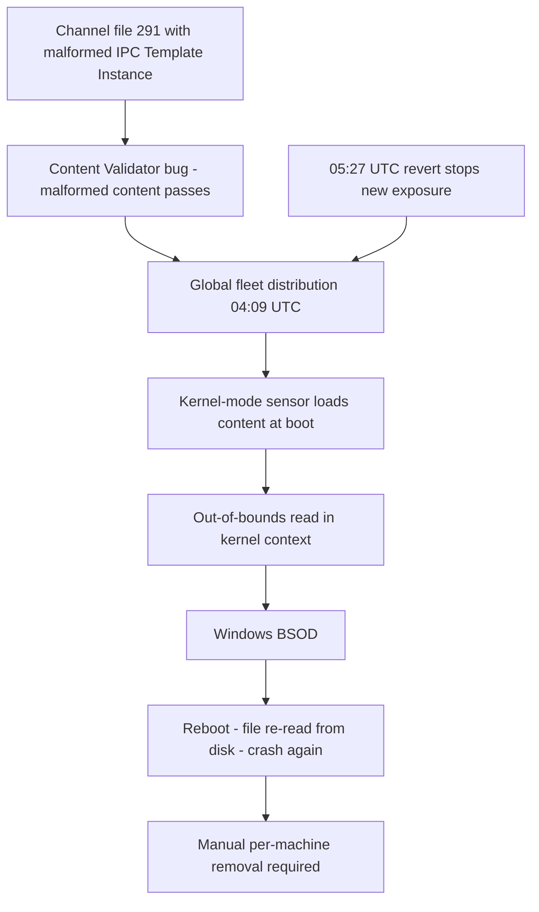

# CrowdStrike, July 19, 2024: A Content Update That Crashed the Kernel

## Overview

At 04:09 UTC on July 19, 2024, CrowdStrike released a sensor configuration update — a "Rapid Response Content" channel file, known as channel file 291 — for the Windows version of its Falcon sensor. The file contained malformed content: of two newly deployed IPC Template Instances, one passed CrowdStrike's content validation despite containing problematic data, due to a bug in the Content Validator [1][2]. When the Falcon sensor's Windows kernel-mode agent loaded and processed that content, it dereferenced invalid input — the resulting out-of-bounds memory access crashed the Windows kernel — and affected machines displayed a Blue Screen of Death, rebooted, loaded the same file from disk, and crashed again [1][2]. The result was a boot loop on every Windows host that received the update, and a global operational crisis: Microsoft estimated the faulty update affected **8.5 million Windows devices, less than one percent of all Windows machines**, but noted the disruption was significant "due to the prevalence of CrowdStrike among enterprise environments" [3]. Microsoft was explicit that "this was not a Microsoft incident" — the fault was entirely in third-party content [3].

CONFIRMED (per the vendor's own accounts): the defect was reverted at 05:27 UTC on July 19, 2024 — a roughly 78-minute exposure window — but hosts that had already received the file kept crashing on every boot until it was manually removed [2]. Remediation was per-machine: safe-mode or recovery boot, delete the channel file, reboot — assisted by "manual remediation guides and scripts" published by Microsoft and automation built with CrowdStrike [3]. The event grounded flights, disrupted hospital systems, and interrupted banking and retail operations worldwide, per contemporaneous reporting [4].

## System Context

- **The Falcon sensor** is CrowdStrike's endpoint agent. On Windows, its sensor process is supplemented by a kernel-mode driver (`csagent.sys`); the kernel agent is what gives Falcon its visibility and interception capability — and what makes any defect in it a system-crashing defect rather than a process-crashing one [1].
- **Rapid Response Content (RCDATA)** is configuration content the sensor loads and acts on — as distinct from code binaries. Channel files (numbered, e.g., 291) are delivered to the fleet continuously as threat intelligence and detection logic evolve; channel 291 is used for gathering telemetry on named-pipe-based IPC message execution on Windows hosts [1].
- **IPC Template Instances** are the unit of that telemetry configuration: a template defines a structure for describing IPC messages, and template instances bind matching criteria to it [1].
- **Content Validator** is CrowdStrike's validation system through which content passes before deployment. On July 19 it contained a bug: it let a malformed instance through [2].
- **The update model matters:** this content is not "software you download monthly" — it is high-frequency configuration pushed to millions of endpoints, parsed by privileged code, with the fleet as the distribution fabric. The design premise is that content is safer than code. July 19 showed that premise has a boundary: unsafe *content* can crash an *unsafe content parser*, with the same authority as a bad driver.

## What Happened

| Time (UTC, July 19, 2024) | Event | Source |
|---|---|---|
| 04:09 | CrowdStrike releases the sensor configuration update (channel file 291, two new IPC Template Instances) for Windows hosts | [1][2] |
| 04:09 onward | Windows hosts that receive the file crash with a kernel crash (BSOD) when the sensor loads it — immediately for hosts already running, and on next boot for hosts that power on or reboot after the file lands | [1][2][4] |
| Crashing hosts | Each reboot re-loads the defective file from disk and crashes again: a boot loop that cannot self-heal | [2][4] |
| 05:27 | CrowdStrike reverts the defective content update — ending new exposure, ~78 minutes after release | [2] |
| Hours–days | Remediation requires per-machine action: boot to safe mode/recovery, remove the channel file, reboot; Microsoft and CrowdStrike publish manual remediation guides and scripts, and large-scale automated workarounds are developed with cloud providers | [3][4] |
| July 24 / Aug 6, 2024 | CrowdStrike publishes a preliminary post-incident report and a detailed root cause analysis | [1][2] |

Not affected: the incident was not a cyberattack or security breach — it was a quality failure in content validation [1][3]. Mac and Linux hosts were not affected [4]. Non-Windows operations of the Falcon platform continued; the failure was specific to the Windows sensor's handling of this content [4].

## Technical Mechanism

### 1. Privileged parsing of vendor-supplied content

The defining property of the mechanism is that the input was trusted. Heartbleed-class bugs come from hostile input; this was CrowdStrike's own configuration, produced by its own pipeline. The chain was:

```text
Content pipeline writes 2 new IPC Template Instances into channel file 291
  → Content Validator has a bug; malformed instance passes
  → file distributed to ~8.5M Windows hosts
  → kernel-mode sensor driver loads file, evaluates matching criteria
  → malformed criterion indexes input the template never declared
  → out-of-bounds memory read in kernel context
  → Windows terminates the OS: BSOD
  → reboot → driver re-loads same file from disk → BSOD again
```

The RCA describes the malformed instance as introducing a non-wildcard matching criterion for a 21st input value in a template instance whose declared structure did not provide for that input — the sensor, trusting the declared structure, accessed memory beyond it [1]. In user space this is a process crash; the sensor runs where the consequences of a bad read are a kernel termination. The boot loop follows from the architecture: content files are loaded at sensor start-up, so a file that crashes the parser guarantees a crash on every boot until an administrator intervenes [2][4].

### 2. The validator gap

CrowdStrike's preliminary report states the cause plainly: "Due to a bug in the Content Validator, one of the two template instances passed validation despite containing problematic content" [2]. The RCA adds the structural reason: validation of this content type had not been required to the standard now shown to be necessary — the validator checked what the content format had historically contained, and the new instance exercised a combination (a 21st input with non-wildcard semantics) that the validator's checks did not cover [1]. This is the recurring signature of validator bugs: the validator is correct against the *previous* grammar, and the failure arrives with the grammar's first new corner.

### 3. Global propagation in minutes

A single malformed file reached millions of machines in roughly an hour because the distribution model is designed for exactly that: continuous, fast, fleet-wide content delivery, with sensors sharing content peer-to-peer. The same property that makes Rapid Response Content an effective threat-defense mechanism — a new detection rule reaches the world before the threat does — makes it a common-mode failure mechanism when the content is wrong. There was no canary ring holding back this content type: the staged-deployment controls CrowdStrike had built were not applied to this update [1].

### 4. Why remediation could not be centralized

Reverting the file stopped *new* infections of the fleet, but every host that had already received it stored it locally and re-read it at boot [2][4]. No remote fix could run, because the machine could not stay up long enough to receive one — and the very agent whose update pipeline would deliver a fix was the thing crashing the machine. Recovery therefore crossed the out-of-band boundary: boot the machine into safe mode or a recovery environment where the sensor does not load, delete the file from the driver directory, reboot. At 8.5M-host scale, with many hosts requiring BitLocker recovery keys and physical access for disk-encryption-protected machines (reported widely in contemporaneous coverage [4]; the encryption complication is not detailed in our primary vendor posts), remediation became a logistics exercise measured in days.



## Trigger vs Contributing Factors

**Trigger (CONFIRMED):** deployment of channel file 291 containing the malformed IPC Template Instance at 04:09 UTC, and its parsing by the Windows kernel sensor [1][2].

**Contributing factors (CONFIRMED, per vendor accounts):** a bug in the Content Validator that passed malformed content [2]; a template-instance format whose declared structure did not cover the criterion the new instance introduced [1]; execution of content parsing in kernel mode, where a read fault crashes the host OS [1]; boot-time loading of the defective file, producing an unrecoverable-without-manual-intervention loop [2][4]; content distribution to the full fleet without staged rollout for this content type [1].

**Contributing factors (INTERPRETATION):** the systemic tension is reaction speed versus blast radius. Rapid Response Content exists so defenses can move at threat speed; every mechanism that would have contained this bug (staged rings, canary holds, delayed boot-load of new content, user-mode parsing with recovery semantics) trades minutes of defensive latency for days of incident risk. CrowdStrike's 8.5M-host fleet made the trade global; the same defect at 500-host scale would have been a bad Tuesday. The lesson is not "never ship fast content" — it is that the blast radius of content is a function of deployment architecture, and kernel-privileged parsers remove the last safety margin.

## Why Safeguards Didn't Prevent It

- **Content validation.** The dedicated safeguard failed through its own bug — it validated the historical content grammar, and the malformed instance exercised a newly introduced combination (21 inputs against a 20-slot structure) outside the validator's coverage [1][2].
- **Kernel-mode separation.** Windows's driver model assumes third-party kernel code is crash-safe because a fault is unrecoverable; there is no lower layer to catch it. The safeguard here is *testing*, and the content was parsed in the one context where any runtime error is terminal.
- **The speed of the content channel.** Falcon's content pipeline is engineered for minutes-scale global propagation — a strength for defense that eliminated the natural containment a slow channel would have provided. No canary applied to this content type [1].
- **The revert worked; the recovery did not follow from it.** Reverting at 05:27 UTC fixed the pipeline, not the fleet: hosts had persisted the file, and the persistence is what turned a 78-minute content bug into a multi-day remediation campaign [2].
- **No user-mode fallback.** The sensor had no mode in which malformed content could be quarantined and the machine kept running. Failure-handling for bad content was, effectively, "crash and wait for a human."

## Lessons & Mitigations

1. **Privilege and parsing must be budgeted like any other risk.** Code that parses anything in kernel mode must treat content as hostile regardless of source — bounds-check every declared count against actual data, and fail closed into a "skip this file" state, never a crash.
2. **Validators rot with the grammar.** A content validator is correct only against the format it was written for. New template fields, new matching semantics, new corners of the format require validator updates *in the same release* — and the validator itself needs testing (including fuzzing) as a first-class component.
3. **Canary rings for content, not just binaries.** High-frequency configuration channels need staged deployment with automatic rollback criteria (crash rates on early ring). The absence of staging for this content type is the single control whose presence would most plausibly have reduced 8.5M machines to thousands [1].
4. **Design for persistent-bad-state recovery.** If a component loads state at boot and can crash on it, the system needs an out-of-band recovery path: last-known-good content, automatic rollback on repeated boot failure, or a recovery mode that skips optional content. A revert that cannot reach the fleet is a revert of the pipeline only.
5. **Memory safety in privileged code is a language problem too.** The kernel agent was C/C++. Memory-safe parsing (bounds-checked access that returns an error instead of faulting) is the structural fix CrowdStrike itself committed to for content parsing — the general argument is made in [static vs dynamic typing](../why-not-handbook/static-vs-dynamic-typing.md): in memory-unsafe languages, a missing check is a crash; in memory-safe ones, it is an exception you can catch and log.
6. **Fleet heterogeneity is remediation friction.** The per-machine recovery was simple; the scale, encryption, and physical-access realities made it brutal. Recovery-time engineering (what fraction of the fleet can be fixed automatically, in what order) belongs in the deployment design, not in the incident.

## Connection to This Repository

- [Static vs dynamic typing](../why-not-handbook/static-vs-dynamic-typing.md) — memory safety in privileged code: the language-level root of out-of-bounds crashes and the shape of the structural fix.
- [Fuzz testing](../../testing/fuzz-testing.md) — treating the validator and parser as first-class fuzz targets for privileged content consumers.
- [Canary releases](../../sre/canary-releases.md) — staged rollout mechanics and why "content" deserves them as much as code.
- [Incident management](../../sre/incident-management.md) — coordinating a fleet-wide, per-machine remediation with external dependencies and public communication.
- [Common failure modes](../../failure-modes/common-failures.md) — the "unvalidated update amplified by global propagation" pattern in generic form.

## Interview Questions

1. Your product ships security-relevant configuration content to millions of endpoints continuously, parsed by privileged code. Design the deployment and parsing architecture that bounds the blast radius of malformed content to a canary subset — without making your defenses meaningfully slower.
2. A content validator passes a malformed update because the format just grew a new corner. How do you prevent validator-grammar drift as a *class*, given that validators are themselves buggy software?
3. Contrast remediation for a bad binary deployment (rolling back via the same channel) with CrowdStrike's channel file 291 case. What property of the failure made out-of-band recovery mandatory, and what would have changed that?
4. The faulty update ran on 8.5 million machines but is "less than one percent of Windows." What does that statistic teach about common-mode failures in concentrated third-party dependencies, and how would you measure your organization's exposure to them?
5. CrowdStrike committed to memory-safe content parsing, staged content deployment, and validator stress-testing. Map each commitment to the specific link in the failure chain it severs — and identify the link that remains even if all three land.

## Key Takeaways

- Two new IPC Template Instances shipped in channel file 291 at 04:09 UTC; one was malformed; a Content Validator bug let it through; the kernel-mode sensor crashed Windows on parse — and on every reboot until the file was manually removed [1][2].
- The revert landed 78 minutes later, but persistence is what turned a short content bug into a multi-day, per-machine remediation campaign [2][3].
- Blast radius is a deployment-architecture property: minutes-scale global content propagation with no canary for this content type converted a single validation miss into 8.5 million crashed hosts — under one percent of Windows, but concentrated in exactly the enterprises that run EDR everywhere [1][3].
- Kernel-mode parsing has no failure mode except "crash the host." Content must be bounds-checked like attacker input even when it comes from your own vendor — especially when it comes from your own vendor.
- The incident reignited the memory-safety debate for privileged code: CrowdStrike's own remediation plan includes memory-safe parsing for content — the same structural lesson as Heartbleed, one layer lower [1][2].

## Sources

1. CrowdStrike, "Channel File 291 Incident — External Technical Root Cause Analysis," August 6, 2024 (PDF). https://www.crowdstrike.com/wp-content/uploads/2024/08/Channel-File-291-Incident-Root-Cause-Analysis-08.06.2024.pdf (URL verified via search result; PDF not full-text fetchable at time of writing — key facts cross-checked against verbatim mirrors of the official text)
2. CrowdStrike, "Falcon Content Update Preliminary Post Incident Report," July 24, 2024. https://www.crowdstrike.com/en-us/blog/falcon-content-update-preliminary-post-incident-report (URL verified via search result; page not fetchable at time of writing — the 04:09/05:27 UTC times, the Content Validator bug, and the revert time are per the official text as mirrored verbatim in public coverage)
3. Microsoft (Official Blog), "Microsoft's Response to the Global CrowdStrike Outage," July 20, 2024. https://blogs.microsoft.com/blog/2024/07/20/helping-our-customers-through-the-crowdstrike-outage/ (fetched and quoted: 8.5M devices, <1% of Windows machines, manual remediation guides and scripts, "not a Microsoft incident")
4. "2024 CrowdStrike-related IT outages," Wikipedia (secondary source, accessed at time of writing). https://en.wikipedia.org/wiki/2024_CrowdStrike-related_IT_outages (URL verified via search result; used only for sector-impact context and boot-loop corroboration — all mechanism claims rest on [1][2])

## Cross-References

- [Heartbleed, 2014](./heartbleed-2014.md) — trusting input to a privileged parser; the network-service counterpart to a kernel agent trusting vendor-supplied content.
- [Fastly, June 2021](./fastly-june-2021.md) — a valid-but-unusual configuration amplified globally by fast propagation systems.
- [Knight Capital, 2012](./knight-capital-2012.md) — deployment-completeness failures and the cost of acting without a global-kill discipline.
- [Static vs dynamic typing](../why-not-handbook/static-vs-dynamic-typing.md) — memory safety as the structural fix for out-of-bounds crashes in privileged code.
- [Canary releases](../../sre/canary-releases.md) — the missing control whose absence defined this incident's blast radius.
