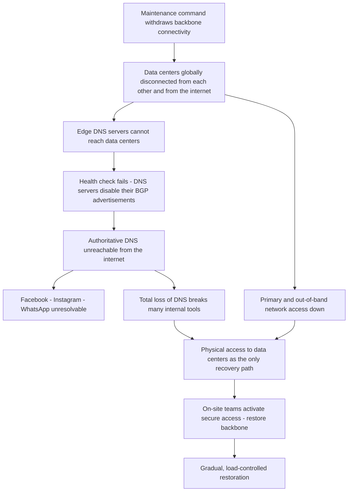

# Facebook, October 4, 2021: When the Backbone Went Down, the DNS Followed, and the Tools Followed the DNS

## Overview

On October 4, 2021, during routine maintenance on Facebook's global backbone network, a command issued "with the intention to assess the availability of global backbone capacity" unintentionally disconnected Facebook's data centers from each other and from the internet. A bug in the audit tool designed to catch exactly this kind of mistake "prevented it from properly stopping the command" (all quotes CONFIRMED from Facebook's engineering post [1]).

The second-order effect did the public-facing damage: Facebook's edge DNS servers are designed to withdraw their BGP advertisements when they cannot reach the data centers behind them. With the backbone gone, they declared themselves unhealthy and withdrew — making Facebook's authoritative DNS unreachable from the entire internet while the servers themselves kept running. Facebook, Instagram, and WhatsApp became unresolvable. Externally observed timings (Cloudflare's measurement post [3]): route changes peaked at ~15:40 UTC; facebook.com stopped resolving around 15:50 UTC and returned around 21:20 UTC — roughly six hours.

Recovery was slow for a reason that has become the incident's signature: the outage destroyed the paths engineers needed to respond to it. Primary *and out-of-band* network access were down; the total loss of DNS broke many internal tools; data centers are deliberately hard to enter and their hardware deliberately hard to modify, so Facebook flew teams on-site and activated secure access protocols before the backbone could be brought back. The final restoration had to be gradual — data centers had gone from tens of megawatts of power draw toward idle, and flooding them back with traffic risked a second, self-inflicted collapse.

## System Context

- **The backbone.** Facebook operates a private global backbone: "tens of thousands of miles of fiber-optic cables crossing the globe and linking all our data centers." Edge facilities connect the backbone to the broader internet; requests from apps travel across the backbone to large data centers and back [1].
- **Edge DNS.** The smaller edge facilities answer DNS queries. Facebook's authoritative name servers sit at well-known IP addresses, "advertised to the rest of the internet via … the border gateway protocol (BGP)" [1].
- **The health-check design.** "To ensure reliable operation, our DNS servers disable those BGP advertisements if they themselves can not speak to our data centers, since this is an indication of an unhealthy network connection" [1]. Under normal operation this design protects users: if an edge site loses data-center connectivity, it stops advertising, and resolvers fail over to healthy sites.
- **The command-audit design.** Backbone maintenance commands are audited by an automated tool intended to stop dangerous ones [1].

## What Happened

| Time | Event | Source |
|---|---|---|
| Oct 4, ~15:40 UTC | Cloudflare observes a peak of BGP routing changes from Facebook's network — "That's when the trouble began" | [3] |
| ~15:51 UTC | Cloudflare opens an internal incident: "Facebook DNS lookup returning SERVFAIL" | [3] |
| ~15:58 UTC | Facebook stops announcing routes to its DNS prefixes, as observed by Cloudflare | [3] |
| ~15:50 → 21:20 UTC | facebook.com unavailable on Cloudflare's 1.1.1.1 resolver (measured) | [3] |
| During outage | Backbone disconnected globally (Facebook's account). Primary and out-of-band network access down. Total loss of DNS broke many internal tools. Engineers sent on-site to data centers; physical/system security and secure-access activation added time | [1] |
| ~21:00 UTC | Renewed BGP activity from Facebook's network, peaking 21:17 UTC | [3] |
| ~21:20 → 21:28 UTC | facebook.com resolves again; Facebook appears reconnected to the global internet; services restored gradually under controlled load | [3][1] |

Facebook's own posts [1][2] confirm the mechanism and the recovery narrative but do not publish UTC timestamps; the timestamps above are Cloudflare's contemporaneous measurements [3] and are attributed as such. Facebook's Oct 4 statement confirms there was "no malicious activity" and no evidence of user-data compromise [2].

## Technical Mechanism

### 1. The trigger: one command, one broken audit

"During one of these routine maintenance jobs, a command was issued with the intention to assess the availability of global backbone capacity, which unintentionally took down all the connections in our backbone network, effectively disconnecting Facebook data centers globally. Our systems are designed to audit commands like these to prevent mistakes like this, but a bug in that audit tool prevented it from properly stopping the command" [1].

Read that carefully as an architecture statement. Two defenses existed in principle: the command should have been scoped to a *check*, and the audit tool should have stopped a destructive one. Both failed at once — and Facebook's backbone, like every backbone, executes control-plane instructions globally and quickly. INTERPRETATION: this is the same shape as the [AWS S3 2017](./aws-s3-us-east-1-2017.md) command incident — a tool whose authority (disconnect the backbone) vastly exceeded the task's blast radius (assess capacity), with the safeguard being software that was itself buggy. Defensive tooling is code, and code has bugs; a safeguard layer with a single implementation is not defense-in-depth.

### 2. BGP withdrawal: the health check that worked too well

The propagation chain, entirely from [1]:

Each step is individually *sensible design*: BGP advertisements route traffic to reachable services; a DNS server that cannot reach the data stores behind it should stop answering, because answers would be lies (empty pages, failed logins); withdrawal lets global resolvers route around a broken site. The failure is in the composition: the health check's failure signal was coupled to the *entire backbone*, so every edge site failed its check simultaneously and the withdrawal was global. INTERPRETATION: this is a classic negative-feedback loop with a common-mode failure — the safety mechanism had no independence from the thing it guarded. Sound designs for this pattern require the liveness signal to be multi-path (e.g., out-of-band confirmation) so that one broken network does not silence every announcer.

BGP itself behaved exactly as specified — see [BGP](../../networks/routing/bgp.md) and [BGP internals](../../networks/routing/bgp-deep.md) for announcement/withdrawal mechanics. Withdrawals propagate as fast as announcements; the internet simply forgot how to reach AS32934 (Facebook's network, as identified in Cloudflare's measurement post [3]).

### 3. DNS dependence of internal tooling

"The total loss of DNS broke many of the internal tools we'd normally use to investigate and resolve outages like this" [1]. This deserves emphasis: DNS is a *dependency of the dependency graph*. Every internal dashboard, runbook host, and communication tool that resolves names through the failed authoritative infrastructure went dark together. INTERPRETATION: incident-response tooling inherits the availability of the platform it monitors unless deliberately decoupled — an internal DNS cache, pinned IP fallbacks, or a tooling stack on separate infrastructure are the standard countermeasures, and their absence is invisible until a day like this.

### 4. Slow manual recovery: security, physics, and load

Three compounding recovery frictions, all confirmed [1]:

- **Access.** "It was not possible to access our data centers through our normal means because their networks were down," and — notably — "our primary and out-of-band network access was down." The remaining path was physical: send engineers on-site.
- **Deliberate hardening.** Data centers "are designed with high levels of physical and system security … hard to get into, and once you're inside, the hardware and routers are designed to be difficult to modify even when you have physical access." Activating the secure access protocols to let people work on servers took extra time. Facebook's reflection is worth keeping: hardening slowed recovery from an outage "caused not by malicious activity, but an error of our own making," and the trade-off was still judged worth it [1].
- **Load physics.** Bringing the backbone back was not a switch-flip: data centers had reported power-usage dips "in the range of tens of megawatts," and reversing that suddenly "could put everything from electrical systems to caches at risk." Restoration was gradual, informed by Facebook's long-running "storm" drills — though no prior storm had simulated the *global backbone* going offline [1].

### Trigger vs Contributing Factors

**Trigger (CONFIRMED):** the maintenance command that disconnected the backbone; the audit-tool bug that failed to stop it.

**Contributing factors (CONFIRMED):** DNS servers' BGP health check keyed to data-center reachability (single common-mode signal); internal tooling dependent on the failed DNS; both primary and out-of-band network access tied to the failed infrastructure; high-friction physical access (intentional); restore-surge risk from power/cache state; no prior drill simulating global backbone loss.

**Contributing factors (INTERPRETATION):** global concentration of advertising, resolution, and internal control on one self-operated infrastructure stack means the design offered few independent planes to fail back to. The incident did not break "a server"; it broke a *layer*, and every dependency of that layer fell with it.

## Why Safeguards Didn't Prevent It

- **The audit tool was a single, buggy implementation.** A safety check is software; without a second, independent check (different code, different assumptions), one bug defeats it [1].
- **The DNS health check optimized for the wrong failure.** It protects the internet from Facebook's broken edges; it had no mode for "the edges are fine, the backbone is not" — the common-mode case withdrew everything.
- **Out-of-band shared fate with in-band.** OOB access exists precisely for "the network is gone" days; here it was down too [1], leaving physical access as the only plane — and physical access is intentionally slow.
- **Drills covered smaller explosions.** "Storm" exercises simulated service, data-center, and region loss — not global backbone loss [1]. The failure scenario had never been rehearsed, so its recovery path was discovered live.

## Lessons & Mitigations

1. **Audit dangerous commands with independent, layered checks.** Two implementations with different failure modes beat one perfect-looking one. Rate-limit and stage irreversible infrastructure changes, as in the [S3 2017 case](./aws-s3-us-east-1-2017.md).
2. **Decouple liveness signals from common modes.** A health check that withdraws global advertisements should require multiple independent signals (in-band plus out-of-band) before acting, so one broken plane cannot silence the world.
3. **Give internal tooling its own survival kit.** Cached resolver configuration, pinned IPs for critical internal services, and tooling on independent infrastructure — the generic pattern is catalogued in [DNS outage prevention](../../failure-modes/common-failures.md).
4. **Keep an OOB plane that is truly out of band.** Test it by failing the primary plane on purpose. If OOB shares any component with primary, it is not OOB.
5. **Rehearse layer-scale failures.** Drill "entire backbone offline," not just server and region loss; include the human path (badge queues, secure-access activation) in the timing.
6. **Plan re-entry like an evacuation in reverse.** Restoration under load is a controlled ramp: caches are cold, electrical systems are at unusual state, and a hard-on risks a second crash — the storm-drill discipline Facebook credits [1].

## Connection to This Repository

- [BGP](../../networks/routing/bgp.md) and [BGP internals](../../networks/routing/bgp-deep.md) — announcement/withdrawal propagation, the protocol at the center of this incident.
- [DNS resolution](../../networks/dns/resolution.md) and [DNS caching](../../networks/dns/caching.md) — why unresolvable means unreachable, and how resolvers fail over.
- [Anycast and geo-routing](../../networks/cdn/anycast-and-geo-routing.md) — the advertising model these DNS servers relied on.
- [Chaos engineering](../../sre/chaos-engineering.md) — the missing drill: global backbone loss.
- [Incident management](../../sre/incident-management.md) — coordinating a response when the response tools are down.
- [Common failure modes](../../failure-modes/common-failures.md) — the DNS-outage and coupled-dependency patterns.
- [Datacenter topology](../../networks/advanced/datacenter-topology.md) — backbone/fabric context for the physical layer.

## Interview Questions

1. Your authoritative DNS servers withdraw their BGP announcements when they cannot reach the data center behind them. Explain why this is good design, then explain how the same design produced a global outage on October 4, 2021 — and propose the minimal change that keeps both properties.
2. An audit tool is supposed to block dangerous backbone commands, and it has a bug. What does defense-in-depth look like for infrastructure-automation commands? Give two independent mechanisms and explain their differing failure modes.
3. All of your internal tools resolve DNS through infrastructure that just failed. Design the "incident-response survival kit": what is pinned, what is cached, what lives elsewhere, and how do you test it?
4. Why is out-of-band access only as good as its weakest shared component? Audit a typical OOB design (serial console over management VLAN, cellular, physical) and identify shared-fate risks.
5. After a global outage, why can't you just "turn everything back on"? Describe the electrical, cache, and traffic-surge considerations of a load-controlled restoration.

## Key Takeaways

- A single maintenance command — incompletely audited — disconnected Facebook's global backbone; the DNS health-check design then withdrew every BGP advertisement, removing the company from the internet in minutes.
- The health checks were individually correct and collectively catastrophic: a common-mode failure signal turned a safety mechanism into a global off-switch.
- Recovery took hours because every response path — in-band, out-of-band, DNS-dependent internal tools — shared fate with the failure; the remaining path was physical access, deliberately slow by security design.
- Restoration was a controlled ramp, not a flip: tens of megawatts of idled capacity cannot take full traffic instantly — and no drill had ever simulated this scale of failure before it happened.

## Sources

1. Santosh Janardhan, "More details about the October 4 outage," Engineering at Meta, October 5, 2021. https://engineering.fb.com/2021/10/05/networking-traffic/outage-details/ (fetched and quoted; URL verified at time of writing)
2. Santosh Janardhan, "Update about the October 4th outage," Engineering at Meta, October 4, 2021. https://engineering.fb.com/2021/10/04/networking-traffic/outage/ (fetched and quoted)
3. Celso Martinho and Tom Strickx, "Understanding how Facebook disappeared from the Internet," Cloudflare Blog, October 4, 2021. https://blog.cloudflare.com/october-2021-facebook-outage/ (fetched; used only for externally observed timings and ASN identification)

## Cross-References

- [AWS S3 us-east-1, 2017](./aws-s3-us-east-1-2017.md) — a single command with a broken safeguard, and a status system coupled to the failing platform.
- [Cloudflare regex, 2019](./cloudflare-regex-2019.md) — internal authentication and tooling unreachable behind the failing edge; the same shared-fate pattern.
- [GitHub, October 2018](./github-october-2018.md) — control-plane automation amplifying a brief network event into a long incident.
- [BGP](../../networks/routing/bgp.md) — the protocol mechanics of global route withdrawal.
- [DNS resolution](../../networks/dns/resolution.md) — what "unresolvable" means for every layer above.
- [Chaos engineering](../../sre/chaos-engineering.md) — rehearsing layer-scale failure before it rehearses you.
