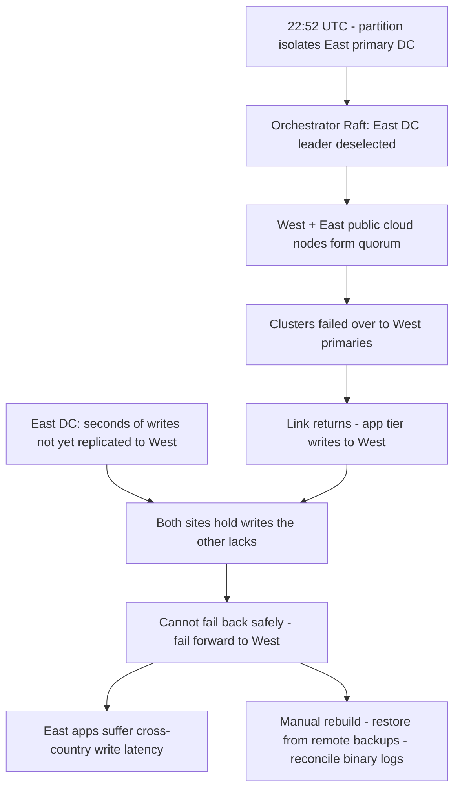

# GitHub, October 21–22, 2018: A 43-Second Partition, Cross-Region Failover, and 24 Hours of Rebuilding Trust in the Data

## Overview

At 22:52 UTC on October 21, 2018, routine maintenance to replace failing 100G optical equipment caused a loss of connectivity between GitHub's US East Coast network hub and its primary US East Coast data center. Connectivity was **restored in 43 seconds**. In that window, GitHub's Orchestrator — its MySQL failover automation, built on Raft — lost leadership in the East, formed a quorum among nodes elsewhere, and failed over write traffic to the US West Coast data center. When the link returned, the application tier immediately wrote to West primaries — while the East still held a brief period of writes that had never replicated to the West. Both sites now contained writes the other lacked, and no safe automated path back existed.

CONFIRMED (per GitHub's post-incident analysis by Jason Warner [1]): the decision was to **fail forward** — keep West as primary to protect the ~30+ minutes of West writes — accepting that East applications could not tolerate cross-country write latency. GitHub spent the next **24 hours and 11 minutes** in degraded service: multi-terabyte restores from remote backups, dozens of replicas hours behind their primaries, and a backlog of over five million webhook events and 80,000 Pages builds. No user data was lost; a small number of writes (954 on one of the busiest clusters) required manual reconciliation, and ~200,000 queued webhook payloads were dropped after outliving an internal TTL.

This is the definitive public case study in **automatic failover without regional quorum discipline**: every component did what it was configured and designed to do, and the composition produced a split-brain that only manual, integrity-first recovery could resolve.

## System Context

- **Topology.** Most user-facing services run in GitHub's own data centers, fronted by an edge network; the East Coast facility is the primary site, with additional East Coast public-cloud capacity and a West Coast data center [1].
- **MySQL usage.** GitHub stores *non-Git metadata* (pull requests, issues, authentication, background processing) in MySQL clusters, functionally sharded, from hundreds of gigabytes to nearly five terabytes each, with up to dozens of read replicas per cluster. Applications write to each cluster's primary and read almost always from replicas [1]. Git object storage itself is separate — see [Git internals](../../git/internals.md).
- **Orchestrator.** GitHub uses Orchestrator to manage MySQL topologies and perform automated failover; it is built on Raft for its own consensus. Crucially, the analysis notes: "It's possible for Orchestrator to implement topologies that applications are unable to support, therefore care must be taken to align Orchestrator's configuration with application-level expectations" [1].
- **Backups.** MySQL backups run every four hours, are retained for years, and are stored **remotely in a public-cloud blob storage service** [1]. The normal recovery tools were *delayed replicas* — which is why a full backup-restore rebuild had never been exercised end-to-end before this incident [1].

## What Happened

| Time (UTC) | Event | Source |
|---|---|---|
| Oct 21, 22:52 | Maintenance to replace failing 100G optical equipment → loss of connectivity between East Coast network hub and primary East Coast data center. Restored in **43 seconds** | [1] |
| 22:52+ | Orchestrator, active in the primary data center, begins Raft leadership deselection. US West Coast and US East Coast **public cloud** nodes establish quorum and start failing clusters over to the **US West Coast**. When connectivity returns, the application tier immediately directs write traffic to the new West primaries | [1] |
| 22:54 | Internal monitoring begins generating fault alerts; engineers triage | [1] |
| 23:02 | First responders determine topologies for numerous clusters are in an unexpected state: querying Orchestrator shows a replication topology containing **only West Coast servers** | [1] |
| 23:07 | Deployment tooling manually locked to prevent further changes | [1] |
| 23:09 | Site placed in yellow status; incident coordinator alerted; 23:11 status red | [1] |
| 23:13 | Database engineering paged. West has been ingesting writes for nearly 40 minutes; East holds several seconds of writes never replicated West. Manual rebuild of replication topology begins | [1] |
| 23:19 | Webhook delivery and GitHub Pages builds paused — deliberate partial degradation to protect data integrity | [1] |
| Oct 22, 00:05 | Plan set: restore from backups, synchronize replicas in both sites, fall back to stable topology, resume queued jobs. Status updated | [1] |
| 00:41 | Backup-restores of all affected clusters underway. Multi-TB restore: transfer from remote blob storage, then decompress, checksum, prepare, and load onto newly provisioned servers — "the process … takes the majority of time" | [1] |
| 06:51 | Several clusters restored in East and replicating from West; larger clusters still restoring. Status page sets a two-hour ETA "linearly interpolated from replication telemetry" | [1] |
| 07:46 | Public blog post published — GitHub Pages builds were paused, so even publishing the update took extra effort | [1] |
| 11:12 | **All database primaries re-established in East.** Writes are local again; but dozens of read replicas are hours behind, so users see inconsistent data. Recovery of replication turns out to follow a power-decay, not linear, function as user traffic grows | [1] |
| 13:15 | Approaching peak traffic; replication delays growing. Additional East public-cloud read replicas spread read load, letting replication catch up | [1] |
| 16:24 | Replicas in sync; failover to original topology completed. Status stays red while backlog is processed | [1] |
| 16:45 | Backlog: **5M+ hook events, 80k Pages builds**. ~200,000 webhook payloads that outlived an internal TTL are dropped; processing paused, TTL increased | [1] |
| 23:03 | All pending webhooks and Pages builds processed; systems verified; status green. Total: 24h 11min degraded | [1] |

## Technical Mechanism

### 1. Quorum without regional discipline

Orchestrator nodes ran in three places: the primary East data center, the East Coast public cloud, and the West Coast data center. Orchestrator coordinates itself with Raft — a majority quorum is required for a leader to act [1]. The partition isolated only the primary East data center; the other two locations still formed a **majority**, elected a leader, and proceeded to fail clusters over to West.

This is textbook-correct Raft behavior and, simultaneously, the failure. Raft guarantees the tool's *own* consistency, not the fitness of the topology the tool imposes. GitHub's phrasing is precise: "Orchestrator's actions behaved as configured, despite our application tier being unable to support this topology change," and "Leader-election within a region is generally safe, but the sudden introduction of cross-country latency was a major contributing factor" [1]. INTERPRETATION: the missing property was a **regional failure-domain constraint** on promotion — failover automation for a WAN-distributed database needs to know that promoting across the country is not a failover but a *relocation*, with consequences (write latency, divergence handling) the application tier had never been designed to bear.

### 2. Divergence: the anatomy of the split-brain writes

Two divergent write sets existed:

- **East's writes:** a "brief period of writes" (seconds) from before/during the partition that had not replicated to West [1].
- **West's writes:** ~40 minutes of application writes accepted by West primaries after promotion [1].

Neither is "wrong." The problem is purely ordinal: with both sides holding writes the other lacks, replication in either direction would refuse or corrupt — the standard non-convergence of two primaries after a partition. The safe options collapse to: discard one side's writes (unacceptable to GitHub: data integrity over availability), or merge manually via binary-log analysis (what they did: 954 writes on one of the busiest clusters, some since repeated by users, others reconciled or escalated to users [1]).

This is the concrete, physical shape of the theory in [CAP](../../distributed/fundamentals/cap.md): the partition forced a choice between consistency of user data and availability of the write path, and GitHub chose consistency — explicitly, in writing, in the middle of the night.

### 3. Fail-forward meant degradation by design

Keeping West as primary had a mechanical consequence: "applications running in the East Coast that depend on writing information to a West Coast MySQL cluster are … unable to cope with the additional latency introduced by a cross-country round trip for the majority of their database calls. This decision would result in our service being unusable for many users" [1]. The failure mode was not just "slower" — East application tiers had been built on the assumption of same-facility database writes, and cross-country round trips broke latency budgets and timeouts across the platform. INTERPRETATION: this is why cross-region promotion belongs to a different class than intra-region failover — it invalidates an entire class of application assumptions at once.

### 4. Recovery duration: the cold-path surprise again

The recovery plan — restore backups, sync, fail back — was correct but slow for reasons the incident made famous:

- Backups were **remote** (public-cloud blob storage): multi-TB transfer dominated the clock [1].
- Then decompress, checksum, prepare, load onto newly provisioned servers [1].
- The procedure was *tested daily* — but only as a drill; "until this incident we have never needed to fully rebuild an entire cluster from backup and had instead been able to rely on other strategies such as delayed replicas" [1]. The tested thing and the needed thing were different scopes.
- Later, the published two-hour ETA assumed linear catch-up; replication actually followed a **power decay** under growing user load, and only stopped falling behind after read replicas were added in the East to cut load [1]. Recovery-time estimation under load recovery is its own hard problem.

### 5. The backlog tail

Pausing webhook delivery and Pages builds at 23:19 protected the databases; it also created a queue that outlived the outage. Five million hook events and 80,000 builds had to drain; 200,000 payloads were dropped for exceeding a TTL, and the TTL was raised as a mitigation [1]. Integrity-first triage converts an outage into a *drain-rate* problem, and drain rate needs its own engineering (and its own TTL semantics).

### Trigger vs Contributing Factors

**Trigger (CONFIRMED):** the 43-second partition during routine optical-equipment replacement.

**Contributing factors (CONFIRMED):** Orchestrator quorum spanning regional boundaries; promotion allowed across regions while the application tier could not support the resulting topology; no prior partition of this magnitude to learn from; delayed replicas as the only tested recovery strategy; remote multi-TB backups; paused subsystems accumulating TTL-bounded queues; status-page granularity (green/yellow/red) misrepresenting partial availability.

**Contributing factors (INTERPRETATION):** the coupling between "network maintenance window" and "failover automation's view of the world" is a systemic blind spot: a 43-second maintenance flap is *expected* in a network sense but *unprecedented* in the failover system's history. Testing (or gating) failover automation during planned network work is the cheap missing control.

## Why Safeguards Didn't Prevent It

- **Consensus protected the wrong scope.** Orchestrator's Raft quorum made the automation's decisions consistent among Orchestrator nodes, but nothing constrained *which region* a promotion could cross.
- **The guardrail was convention, not configuration.** "Care must be taken to align Orchestrator's configuration with application-level expectations" [1] — alignment by convention fails silently the first time an unusual partition changes which nodes can talk to each other.
- **Redundancy assumptions were scope-limited.** Delayed replicas and intra-site failover covered single-server and even single-cluster failures; nothing covered "both sites hold divergent writes."
- **Backups existed; restore-at-scale did not.** Four-hour backup cadence with years of retention is meaningless if restoring five terabytes takes most of a day — and the full-rebuild path had never been exercised for real.
- **Status reporting was too coarse.** Green/yellow/red could not express "writes are consistent but reads are hours stale" — users could not tell what was safe, and GitHub says so directly [1].

## Lessons & Mitigations

1. **Constrain automated promotion to within a failure domain.** Cross-region promotion should require human authorization or an explicit, tested mechanism. GitHub's own first initiative: adjust Orchestrator configuration to prevent promotion of primaries across regional boundaries [1].
2. **Treat divergence, not downtime, as the expensive failure.** A 43-second partition cost 24 hours because recovery required proving data consistency. Design primaries with fencing and quorum discipline (see [fencing tokens](../../distributed/fundamentals/fencing-tokens.md) and [quorum replication](../../distributed/replication/quorum.md)) so that "both sides wrote" is structurally impossible, not merely unlikely.
3. **Rehearse the recovery you will actually need.** Full-cluster rebuild from remote backup — with transfer, checksum, prepare, load — must be a timed drill, not an untested plan. The gap between "tested daily" and "needed once" is where the hours live.
4. **Plan drain rates for paused subsystems.** Anything you pause (webhooks, builds, email) needs a bounded queue, a TTL policy you can defend, and a drain plan that does not stampede downstream partners.
5. **Communicate component-level status.** GitHub's initiative: per-component status instead of a single site color [1] — the same lesson the [S3 2017 status-page coupling](./aws-s3-us-east-1-2017.md) teaches from the operator side.
6. **Add chaos engineering for partitions at scale.** GitHub's organizational conclusion: "tighter operational controls or improved response times are insufficient safeguards … we will also begin a systemic practice of validating failure scenarios before they have a chance to affect you," explicitly naming fault injection and chaos engineering [1]; the methodology is in [chaos engineering](../../sre/chaos-engineering.md) and [Jepsen-style testing](../../distributed/testing/jepsen.md).

## Connection to This Repository

- [MySQL InnoDB internals](../../dbms/internals/mysql-innodb-internals.md) and [replication](../../dbms/distributed/replication.md) — the replication mechanics underneath the failover.
- [Raft](../../distributed/consensus/raft.md) — what Orchestrator's Raft does and does not guarantee.
- [Quorum](../../distributed/replication/quorum.md) and [fencing tokens](../../distributed/fundamentals/fencing-tokens.md) — the theory of preventing two live primaries.
- [CAP theorem](../../distributed/fundamentals/cap.md) — the explicit consistency-over-availability decision.
- [Failure detectors](../../distributed/fundamentals/failure-detectors.md) — how a 43-second partition looks to automation.
- [Log-based recovery](../../dbms/transactions/log-recovery.md) — the binary-log reconciliation that resolved divergence.
- [Jepsen and Maelstrom](../../distributed/testing/jepsen.md) — the testing discipline that catches this class of bug before production.
- [Multi-region](../../sre/multi-region.md) and [datacenter fabrics](../../networks/advanced/datacenter-fabrics.md) — the topology and network context.

## Interview Questions

1. Your failover orchestrator runs Raft across three sites. A partition isolates the site hosting the current database primaries. Walk through exactly what happens next, and design the configuration that prevents cross-region promotion without disabling automatic failover entirely.
2. Two data centers each hold writes the other lacks after a partition. Enumerate every recovery option (fail forward, fail back, merge, discard), and for each state what it costs and what must be true for it to be safe.
3. GitHub's recovery plan was "tested daily" but the real rebuild had never been done. What is the difference between testing a procedure and testing a *scope*, and how do you close that gap for backup restores?
4. A paused subsystem accumulates five million queued events with a TTL. How do you design the queue, the TTL policy, and the drain-rate limiter so that recovery does not become a second incident?
5. You must publish an ETA for replication catch-up. Why did GitHub's linear estimate fail, and what model would you use instead when the system recovers under returning user load?

## Key Takeaways

- A 43-second maintenance partition triggered an automated cross-region promotion that was Raft-consistent, configuration-compliant, and application-fatal — the automation behaved as configured; the configuration was the defect.
- Divergent writes turned seconds of unavailability into 24 hours of integrity-first recovery: fail-back was impossible, so the team rebuilt primaries from remote backups and reconciled 954 writes on one busy cluster by hand.
- Fail-forward to a distant primary silently degraded the entire East application tier; cross-country write latency is not "slower failover," it is a different operating regime applications were never built for.
- GitHub's closing lesson is the casebook's thesis: controls and speed are not enough — validate failure scenarios (fault injection, chaos engineering) before they happen to you.

## Sources

1. Jason Warner, "October 21 post-incident analysis," GitHub Blog, October 30, 2018. https://github.blog/news-insights/company-news/oct21-post-incident-analysis/ (fetched and quoted; URL verified at time of writing)

## Cross-References

- [Facebook BGP, 2021](./facebook-bgp-2021.md) — the other "control plane did its job, topology did not survive it" incident.
- [Failure detectors](../../distributed/fundamentals/failure-detectors.md) — how a 43-second partition looks to automation, and why detection and diagnosis differ.
- [AWS S3 us-east-1, 2017](./aws-s3-us-east-1-2017.md) — long, cold-path recoveries and their duration surprises.
- [Raft](../../distributed/consensus/raft.md) — consensus for the orchestrator, and its scope limits.
- [Primary-backup replication](../../distributed/replication/primary-backup.md) — the model whose failure mode this is.
- [Postmortem culture](../../sre/postmortem-culture.md) — GitHub's PIA is frequently cited as a model of public, integrity-first incident writing.
