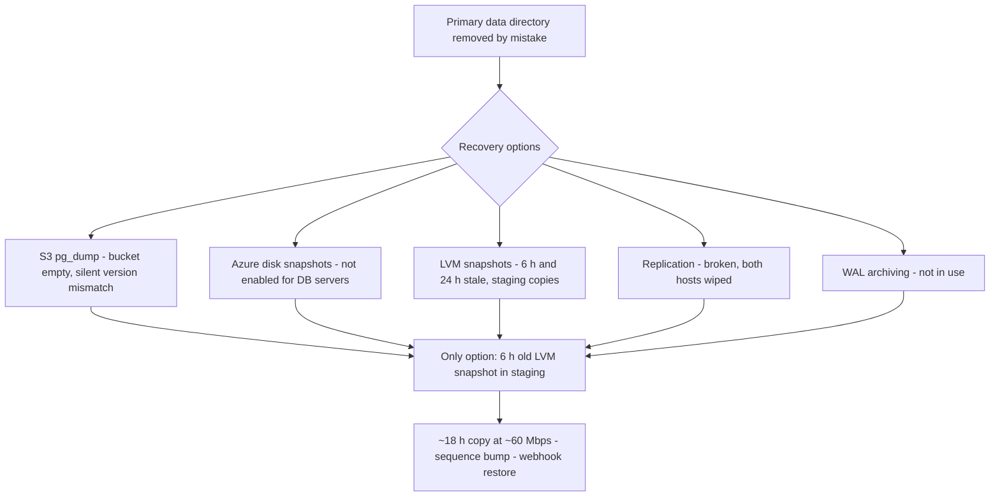

# GitLab.com, January 31, 2017: Deleting the Wrong Directory and the Night Every Backup Failed

## Overview

On the evening of January 31, 2017 UTC, an engineer troubleshooting database replication on GitLab.com removed the PostgreSQL data directory of the **primary** database host, believing they were working on the secondary. The process was terminated a second or two after the mistake was noticed, but by then roughly **300 GB** of production database data had already been removed [1].

What turned a human error into an 18-hour outage with permanent data loss was everything that happened next. GitLab had four recovery procedures on paper — 24-hour `pg_dump` backups uploaded to S3, 24-hour LVM snapshots, Azure disk snapshots, and PostgreSQL replication [1]. CONFIRMED (per the [postmortem][1]): every one of them was unusable that night. The `pg_dump` backups had been failing silently for some time (a version-mismatch bug, with failure notifications rejected by the receiving mail server); Azure disk snapshots were not enabled for the database servers at all; the LVM snapshots were hours-to-a-day stale and staging-oriented; and replication, already broken, had just consumed the data on both hosts. The recovery ran from a six-hour-old LVM snapshot sitting in staging and took about 18 hours, partly because the disks involved were throttled to around 60 Mbps [1]. Modifications to projects, comments, user accounts, issues, and snippets made between 17:20 and 00:00 UTC were lost — GitLab's estimate is roughly 5,000 projects, 5,000 comments, and 700 user accounts [1]. Git repositories and wikis, stored separately on NFS, were unavailable during the outage but not themselves affected by the data loss [1].

In the spirit of transparency, GitLab tracked the recovery in a publicly visible Google document and streamed it on YouTube — peak viewership around 5,000, briefly the #2 live stream on the platform [1]. The case is now the canonical demonstration that a backup you have not restored from is a hypothesis, not a capability.

## System Context

- **Topology:** GitLab.com ran a single PostgreSQL primary (`db1.cluster.gitlab.com`) and a single secondary in hot-standby (`db2.cluster.gitlab.com`), with the standby used only for failover — meaning one database handled all load, and the primary was a known single point of failure with a history of prior incidents [1].
- **Backup and recovery procedures in place** [1]:
  1. Every 24 hours, a `pg_dump` logical backup uploaded to Amazon S3, with old backups automatically removed.
  2. Every 24 hours, an LVM snapshot of the disk holding production database data, loaded into staging for safe testing; direct staging-database access was restricted like production.
  3. Azure disk snapshots (full-disk, once per 24 hours) — used for various servers such as the NFS servers storing Git data.
  4. PostgreSQL replication between hosts — "primarily used for failover purposes and not for disaster recovery."
- **The omnibus packaging detail that later mattered:** GitLab's Omnibus package supports both PostgreSQL 9.2 and 9.6 and picks binaries by reading the cluster's `PG_VERSION` file from the data directory — defaulting to 9.2 on hosts without one, such as application servers [1].
- **The load-balancing experiment:** on January 31 an engineer was setting up multiple PostgreSQL servers in staging to trial `pgpool-II` query load balancing. To get an up-to-date staging copy for accurate load testing, they took a manual LVM snapshot of production at ±17:20 UTC, outside the usual 01:00 UTC automatic schedule [1].

## What Happened

| Time (UTC, Jan 31 – Feb 1, 2017) | Event | Source |
|---|---|---|
| ±17:20 | Engineer takes a manual LVM snapshot of the production database and loads it into staging for load testing (normally automated at 01:00 UTC) | [1] |
| ±19:00 | Database load rises, suspected spam; users unable to post comments. Part of the load is later attributed to a background job hard-deleting an employee account flagged for abuse by a troll report | [1] |
| ±23:00 | The secondary's replication lags; the WAL segments it needs have already been removed on the primary. GitLab.com was **not using WAL archiving**, so the secondary must be re-synchronized manually: wipe the secondary's data directory, then run `pg_basebackup` from the primary | [1] |
| ±23:00–23:30 | `pg_basebackup` hangs silently (later understood to be normal, undocumented behavior); engineers bump `max_wal_senders` 3 → 32; PostgreSQL refuses to restart over semaphores (`max_connections` had been 8,000 for a year); value reduced to 2,000; `strace` shows only a `poll` call. The secondary's data directory is wiped as part of resync attempts | [1] |
| ±23:30 | An engineer, intending to wipe the **secondary's** data directory before a retry, executes the wipe **on the primary**. The process is stopped within a second or two of the mistake; ~300 GB is already gone. Both primary and secondary now have no data | [1] |
| Shortly after | Engineers search for backups; "the process of both finding and using backups failed completely" — S3 bucket empty, Azure snapshots not enabled for DB hosts, LVM snapshots stale, both DB hosts wiped | [1] |
| Recovery (next ~18 h) | Restore from the ~6-hour-old manual LVM snapshot held in staging: copy the staging PostgreSQL data directory to production over Azure network disks throttled to ~60 Mbps; restore webhooks from a second database built from the snapshot; increment all database sequences by 100,000; gradually re-enable GitLab.com | [1] |
| Feb 1, 17:00 / ~18:00 | GitLab.com database restored without webhooks; final restoration steps (webhooks, verification) complete | [1] |

Data-loss impact (CONFIRMED): projects, issues, snippets, comments, user accounts, and similar database data created between 17:20 UTC and ~00:00 UTC January 31 — estimated at least 5,000 projects, 5,000 comments, and roughly 700 users; self-managed and GitHost instances were unaffected [1]. Projects created after 17:20 whose details lived only in the database were later re-created in basic form from their Git repositories on NFS, without associated issues or merge requests [1].

## Technical Mechanism

### 1. The command on the wrong host

The resync procedure for a failed secondary is: remove the secondary's existing data directory, then `pg_basebackup` from the primary [1]. Late in a long, frustrating troubleshooting session — a hung tool, a rejected restart, an obscure semaphore error — an engineer ran the wipe on the wrong one of the two hosts. Two design facts made this maximally dangerous:

- **Both hosts were equally accessible and equally trusted.** The engineer had production superuser access to the primary, and nothing about the primary's shell distinguished it from the secondary's. (One of GitLab's listed follow-up fixes — update PS1 across all hosts to clearly differentiate hosts and environments — acknowledges exactly this [1].)
- **The operation was irreversible by construction.** A recursive delete does not move data to a trash location; it unlinks it. The postmortem records the process being stopped "a second or two" after the mistake was noticed — enough to remove ~300 GB, because a recursive delete of a large tree runs at disk speed.

**INTERPRETATION:** the error required no exotic failure — a wrong `cd` or a stale shell on the wrong host is the classic pattern. What made it catastrophic was the surrounding architecture: one primary, one secondary, both wiped within an hour of each other, no third copy, and no host-level guardrail that would have made the delete of a *primary* data directory unusual or slow.

### 2. Why every recovery mechanism failed

The postmortem's own diagnosis of each mechanism is the heart of the incident [1]:

- **S3 `pg_dump` backups — failing silently for weeks.** The backup ran `pg_dump` 9.2 against a PostgreSQL 9.6 database; a major-version difference makes `pg_dump` error out. The procedure ran on an application server, where no `PG_VERSION` exists, so Omnibus defaulted to 9.2. Failure notifications were emailed, but the emails were unsigned for DMARC and rejected — so "we were never aware of the backups failing, until it was too late." When the team finally looked, "the S3 bucket was empty."
- **Azure disk snapshots — never enabled for the databases.** Snapshots existed for NFS servers storing Git data, but "were not enabled for any of the database servers as we assumed that our other backup procedures were sufficient enough."
- **LVM snapshots — real but stale and staging-oriented.** Two existed: one ~24 hours old (the automated staging feed) and one ~6 hours old (the engineer's own manual snapshot from 17:20, taken for the load-balancing experiment). Their designed purpose was copying production into staging, "not really meant to be used for disaster recovery." The 17:20 manual snapshot — created to make a *test* more accurate — became the only recoverable copy.
- **Replication — not a backup, and now broken.** Replication was for failover, not disaster recovery, and it was already in its failure mode; the secondary's directory had been wiped as part of resync, and minutes later the primary's was too.
- **No WAL archiving.** Because GitLab.com did not archive WAL, the lagging secondary could not simply catch up; the only recovery was the destructive manual resync that set the whole incident in motion.

### 3. Why recovery itself took 18 hours

The chosen restore path copied the PostgreSQL data directory from staging to the production host. Staging ran on Azure classic without Premium Storage to save cost; the disks were network-backed and "throttled to a really low number (around 60Mbps)" with no way to upgrade mid-incident — so ~300 GB took around 18 hours, with the drives as the sole bottleneck [1]. The restoration was *staged*: bring up production from the snapshot without webhooks (to prevent thousands of stale webhooks from firing), rebuild webhooks separately from a second copy of the snapshot, increment all database sequences by 100,000 so pre-outage IDs could not be re-used, then gradually re-enable the site [1].

### 4. Recovering in public

Progress was tracked in a publicly visible Google document; the recovery was streamed on YouTube (peak ~5,000 viewers, #2 live stream for several hours); status went out via Twitter [1]. The postmortem also records a name-redaction lesson: the document initially contained the engineer's name, added by the engineer themselves — GitLab committed to redacting names in future incidents regardless [1].

## Trigger vs Contributing Factors

**Trigger (CONFIRMED):** the data-directory wipe executed on the primary instead of the secondary at ±23:30 UTC [1].

**Contributing factors (CONFIRMED, per the postmortem):** replication lag caused by a load spike (spam plus a runaway abuse-system deletion of an employee account); no WAL archiving, forcing a destructive manual resync; undocumented `pg_basebackup` silent-wait behavior; `max_connections` at 8,000 for a year; a version-mismatched, silently failing `pg_dump` backup whose email alerts were DMARC-rejected; Azure snapshots not enabled for database hosts; no ownership of backup testing ("nobody was responsible for testing this procedure"); staging on slow throttled disks; single primary + single secondary topology [1].

**Contributing factors (INTERPRETATION):** the incident's deeper shape is that recovery was *assumed* rather than *engineered* — each mechanism existed to satisfy an audit-shaped question ("do we have backups?") rather than the operational question ("can we restore, today, within a stated time?"). The postmortem itself chooses durability-over-prevention: its "main focus is to improve disaster recovery... instead of preventing production engineers from running certain commands," arguing an alias on `rm` would only guard one failure mode while "an ideal environment is one in which you can make mistakes but easily and quickly recover from them with minimal to no impact" [1].

## Why Safeguards Didn't Prevent It

- **The S3 backup existed as a process, not as a capability.** It had been failing silently, and its failure signal (email) was itself broken by DMARC rejection. A safeguard that cannot report its own absence is decoration.
- **Azure snapshots were scoped to the wrong hosts.** The Git data (NFS) was protected; the database was not, on the assumption that other procedures sufficed [1].
- **LVM snapshots were a staging convenience.** Snapshots aged into uselessness by design (24-hour cadence) and lived on the same hosts they snapshotted, sharing fate with the workload they were meant to survive.
- **Replication was mis-categorized as safety margin.** It existed for failover; both replicas were in the same failure domain, and the secondary's recovery procedure could be executed on the primary with no friction.
- **No automated restore testing.** The 5-Whys answer is blunt: the backup procedure was not tested regularly because "there was no ownership" [1]. Every failure above would have surfaced in a quarterly restore drill.
- **On-call without guardrails.** The troubleshooting path that ended in a recursive delete on production was unremarkable in its steps, and no step required confirmation that the target host was not the primary. The absence of a second-person check or a host-mismatch abort was invisible until 23:30 UTC.

## Lessons & Mitigations

1. **A backup is defined by its restore, not its schedule.** Automate restore drills with measured time-to-recover and data-loss bounds; the GitLab follow-up list includes exactly this ("automated testing of recovering PostgreSQL database backups") plus "assign an owner for data durability" [1].
2. **Monitor the backups out-of-band.** Silence is the failure mode of automated pipelines: the `pg_dump` failures were known to no one because the failure channel (email) shared fate with a mail-policy change. Push backup success and failure into monitored metrics and alert on *staleness*, not just error — GitLab's follow-ups include Prometheus monitoring for backups and a public backup dashboard [1].
3. **Separate blast radii for production data paths.** Primary, secondary, snapshots, and backups must not share a single failure domain — not a host, not a storage account, not a region. GitLab's data that night lived in two rooms of the same building.
4. **Make destructive operations on production require friction.** GitLab deliberately chose recoverability over command blocking [1]; the general design space includes both: confirmation prompts for destructive commands on production roles, hostname-pinned SSH configurations, and read-only replicas for work that does not need write access. Whichever you choose, the check must be mechanical, not vigilance.
5. **Degraded environments become recovery environments.** Staging existed to *test* safely, and its economics (cheap, slow disks) were chosen for that job. When staging becomes your recovery source, its constraints become your outage duration. Tier recovery sources for restore speed, not just existence.
6. **Small operational debts compound into incident complexity.** `max_connections: 8000`, undocumented tool behavior, a hung `pg_basebackup` — none caused the data loss, but together they built the confusing 23:00–23:30 window in which the fatal command was chosen. Keep runbooks current with observed tool behavior.

## Connection to This Repository

- [Storage durability assumptions hunt](../assumptions-hunt/storage-durability.md) — the assumptions behind "we have backups": freshness, restorability, independence, and ownership of each copy.
- [Filesystem durability assumptions hunt](../assumptions-hunt/filesystem-durability.md) — what a recursive delete actually does to data on disk, and why irreversibility is a filesystem property worth designing around.
- [Write-ahead logging](../../storage/wal.md) — WAL archiving is the mechanism whose absence forced the destructive manual resync at the center of this incident.
- [Replication](../../dbms/distributed/replication.md) — replication as failover mechanism versus backup, and the shared-fate analysis of replicas.
- [Disaster recovery](../../cloud/disaster-recovery.md) — RPO/RTO thinking, restore testing, and tiering of recovery sources.
- [On-call](../../sre/on-call.md) — the operating conditions under which a routine runbook step became a company-defining event.

## Interview Questions

1. Design a backup system for a ~300 GB production database such that the GitLab.com failure mode — every mechanism unusable simultaneously — is structurally impossible. What independence properties must the copies have, and how do you verify them continuously?
2. Your nightly backup job has been silently failing for a month because its alert emails are being rejected. What design changes to the job, its alerting, and its ownership would have caught this in week one?
3. An engineer must wipe a replica's data directory to rebuild replication. Enumerate the guardrails you could place between the human and the primary's data directory, and trade them off against GitLab's stated philosophy of recoverability over prevention.
4. Your restore path runs through staging because that is where copies live. What does that imply about how you provision and tier staging, and how would you price the risk of GitLab's ~60 Mbps restore bottleneck before the incident?
5. GitLab chose to stream the recovery publicly. What are the operational and organizational consequences of recovering in public, and which incident-communication mechanisms does it replace or complement?

## Key Takeaways

- A two-second-old mistake on the wrong host removed ~300 GB; the outage lasted ~18 hours and lost roughly 5,000 projects, 5,000 comments, and 700 accounts because *every* recovery mechanism was independently broken or unusable [1].
- The S3 backup bucket was empty: `pg_dump` had been failing silently on a version mismatch, with failure emails DMARC-rejected. Backup failure you cannot see is indistinguishable from backup success.
- The only fresh copy was a 6-hour-old manual LVM snapshot — created for a load test, not for recovery. Recovery capability comes from copies you can actually restore, at a speed you can tolerate.
- Replication is failover, not backup; when the resync procedure for one host can be executed on the other with no friction, both hosts share one blast radius.
- GitLab's postmortem deliberately optimizes for "an ideal environment is one in which you can make mistakes but easily and quickly recover" — and backs it with automated restore testing, backup monitoring, host-differentiating prompts, and a named owner for data durability [1].

## Sources

1. GitLab, "Postmortem of database outage of January 31," about.gitlab.com, February 10, 2017. https://about.gitlab.com/blog/2017/02/10/postmortem-of-database-outage-of-january-31/ (fetched and quoted; URL verified at time of writing; canonical URL: https://about.gitlab.com/blog/postmortem-of-database-outage-of-january-31/)
2. GitLab, "GitLab.com Database Incident" (the day-of announcement post referenced by the postmortem), February 1, 2017 (cited by title; URL not verified at time of writing)

## Cross-References

- [AWS S3 us-east-1, 2017](./aws-s3-us-east-1-2017.md) — a destructive tool invocation against the wrong target in the same year; the command-execution counterpart to this host-mistake case.
- [GitHub, October 2018](./github-october-2018.md) — recovery by backup-restore after failed failover, and the operational cost of restoring under load.
- [Knight Capital, 2012](./knight-capital-2012.md) — unverifiable state across a fleet; here, unverifiable backups across a recovery plan.
- [Storage durability assumptions hunt](../assumptions-hunt/storage-durability.md) — the general treatment of backup independence, freshness, and restore verification.
- [Filesystem durability assumptions hunt](../assumptions-hunt/filesystem-durability.md) — the mechanics of irreversible deletes.
- [Postmortem culture](../../sre/postmortem-culture.md) — a blameless, publicly streamed postmortem and what it commits the organization to.
