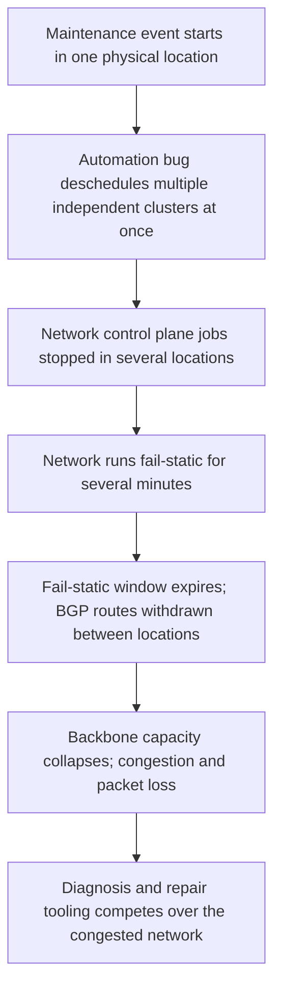

# Google Cloud, June 2, 2019: A Maintenance Bug That Descheduled the Network Control Plane

## Overview

On Sunday, June 2, 2019, Google Cloud projects running services in multiple US regions experienced elevated packet loss caused by network congestion, in an event Google's own post-incident report describes as "a major outage, both in its scope and duration" [1]. The proximate mechanism reads almost like a riddle: two individually benign configuration choices and one software bug in Google's datacenter maintenance automation combined to deschedule the instances of the cluster management software that run the network control plane — simultaneously, in several physical locations. The network was designed to "fail static" and keep forwarding without a control plane, and it did, "for a short period - several minutes." Then BGP routing between the impacted physical locations was withdrawn, backbone capacity collapsed, and congestion spread across regions [1].

The incident window per Google's summary banner was 11:45 to 15:40 US/Pacific (with the banner noting the issue "has been resolved for all affected users as of 4:00pm US/Pacific"), and Google states packet loss lasted "between 3 hours 19 minutes, and 4 hours 25 minutes" depending on region [1]. The affected set was broad: us-central1, us-east1, us-east4, us-west2, northamerica-northeast1, and southamerica-east1, while us-west1 and all European and Asian regions "did not experience regional network congestion" [1]. Google Compute Engine, App Engine, Cloud Endpoints, Cloud Interconnect, Cloud VPN, Cloud Console, Stackdriver Metrics, Cloud Pub/Sub, BigQuery, regional Cloud Spanner instances, and regional Cloud Storage buckets were affected, as were G Suite services and "several non-Cloud Google services" [1]. The report is Google's own, published June 6, 2019 on the Cloud Service Health dashboard (incident #19009), and it is unusually candid: it names the bug, quantifies the damage per service, and admits its own recovery tooling competed for the congested network.

| Field | Value (per Google's incident report) |
|---|---|
| Date | Sunday, June 2, 2019 |
| Duration | 11:45–15:40 US/Pacific per summary header; packet loss 3h19m–4h25m by region; "full service was resumed at 16:10 US/Pacific" per narrative |
| Regions impacted | us-central1, us-east1, us-east4, us-west2, northamerica-northeast1, southamerica-east1 |
| Unaffected | us-west1 regional traffic; all European and Asian regions |
| Peak damage | Up to 33% packet loss (us-east1, 11:38–12:17); 50–100% loss on Interconnect attachments in four regions |
| Primary source | Google Cloud Service Health, "Google Cloud Networking Incident #19009" (Jun 6, 2019) |

## System Context

Google's production architecture, as described in the report, separates concerns in two dimensions [1]. Within a physical datacenter, machines are "segregated into multiple logical clusters which have their own dedicated cluster management software, providing resilience to failure of any individual cluster manager." The network control plane — the software that programs backbone routing — runs under "different instances of the same cluster management software," and in any single location multiple instances are used, "so that failure of any individual instance has no impact on network capacity" [1].

Google's cluster management software also automates maintenance: at Google's scale, "maintenance events are globally common, although rare in any single location." Jobs declare how they behave when maintenance arrives: "typically jobs are either moved to a machine which is not under maintenance, or stopped and rescheduled after the event" [1]. Two configuration settings on the network control plane jobs turned this machinery hostile: they were configured to be *stopped* on a maintenance event (rather than moved), and the instances running the network control plane "were marked as eligible for inclusion in a particular, relatively rare maintenance event type" [1]. Neither setting is wrong in isolation. The third ingredient was a bug in "the software initiating maintenance events, allowing it to deschedule multiple independent software clusters at once, crucially even if those clusters were in different physical locations" [1].

## What Happened

The sequence below is drawn from Google's report [1]; all times are US/Pacific on June 2, 2019, as stated there.

| Time (US/Pacific, Jun 2, 2019) | Event | Source |
|---|---|---|
| 11:45 | Maintenance event starts in a single physical location; automation deschedules in-scope clusters, including network control plane jobs in multiple locations | [1] |
| ~11:45–11:47 | Network runs normally "for a short period - several minutes" (fail-static) | [1] |
| 11:47–11:49 | End-user impact begins as BGP routing between specific impacted physical locations is withdrawn | [1] |
| ~11:47 | Google engineers alerted ("two minutes after it began"); major-incident protocols engaged | [1] |
| 13:01 | Incident root-caused; the automation software responsible is halted | [1] |
| 14:03 | Rebuilt network control plane configuration begins rolling out | [1] |
| 15:19 | Recovery of network capacity starts | [1] |
| 15:40 | Incident "ended" per the summary header | [1] |
| 16:10 | "Full service was resumed" per the report narrative | [1] |

CONFIRMED details around the main timeline: debugging was "significantly hampered by failure of tools competing over use of the now-congested network"; even Google's backup plans — secure facilities, deprioritized traffic classes — "added to the time spent debugging" [1]. After the automation was halted, recovery faced a second problem: with all control-plane instances descheduled in several locations, configuration data "had been lost and needed to be rebuilt and redistributed," which "proved to be time-consuming" [1]. In parallel, "multiple teams within Google applied mitigations specific to their services, directing traffic away from the affected regions" [1].

CONFIRMED per-service impact figures, from the report's "Detailed Description of Impact" section [1]: us-east1 instance traffic saw up to 33% packet loss from 11:38 to 12:17, then up to 8% from 12:17 to 14:50; us-central1 spiked to 9%; us-west1 saw initial spikes of 20% and 8.6% toward us-east1 and us-central1, below 0.1% by 12:55. Compute Engine instances in us-east4, us-west2, northamerica-northeast1 and southamerica-east1 "were inaccessible for the duration," and GCE admin operations averaged 1.2% errors. App Engine in us-central1 saw a 23.2% drop in requests per second. Cloud Interconnect attachments in the four worst-hit regions saw 50–100% packet loss from 11:45 to 16:10, with some BGP sessions dropping; west-coast attachments riding east-coast interconnects saw 10–50%. Cloud VPN gateways in the four regions were unreachable, the last recovering at 16:30 after manual intervention to move their control plane "out of a fail-safe state." Cloud Pub/Sub subscribe error rates averaged 25% (us-east4), 36% (southamerica-east1), and 31% (northamerica-northeast1), with a 27% global drop in successful publish/subscribe requests. Stackdriver Monitoring saw a 5–10% RPS drop and 8.4% frontend login failures. Cloud Endpoints spiked to 4.4% errors initially, and 50% of its service-configuration push workflows failed from June 2, 12:00 until June 4, 11:30. G Suite services in the affected regions were also impacted, and the incident banner names YouTube among the affected consumer services [1].

## Technical Mechanism

The failure mechanism is a designed-for-independence system whose independence was silently removed by configuration, then finished off by a bug. Google states the composition plainly: "Two normally-benign misconfigurations, and a specific software bug, combined to initiate the outage" [1]. The arithmetic of the design assumed the failure modes were disjoint: an individual cluster manager can fail, a single location can lose its control plane instances, a maintenance event can take jobs down. The bug collapsed all three layers into one action: "The automation then descheduled each in-scope logical cluster, including the network control jobs and their supporting infrastructure in multiple physical locations" [1].

Two mechanisms then stretched the event. First, the fail-static line of defense: "the network is designed to 'fail static' and run for a period of time without the control plane being present as an additional line of defense against failure" — and it worked as designed, several minutes of normal running before BGP withdrawal turned capacity loss into user impact [1]. INTERPRETATION: fail-static converts a control-plane failure from instantaneous to deferred; the design question is whether the recovery path can win the race against the expiry, and here it could not. Second, recovery-state loss: because *all* control-plane instances in several locations were descheduled at once, configuration data "had been lost and needed to be rebuilt and redistributed" — the redundant copies were all colocated in the same failure domain the bug had just erased. Google's fix for this is to persist configuration "so that the configuration does not need to be rebuilt and redistributed in the event of all jobs being descheduled," which it expects will "reduce recovery time by an order of magnitude" [1].

## Trigger vs Contributing Factors

The trigger was "a specific software bug" in the maintenance automation that "allow[ed] it to deschedule multiple independent software clusters at once" — and, on June 2, a rare maintenance event type that exercised it [1]. A routine, globally common operation is the spark.

The contributing factors are the two misconfigurations and the surrounding architecture:

- **Stop-on-maintenance semantics** for network control plane jobs, rather than move-then-stop — a choice that converts any successful descheduling into a full outage of those jobs [1].
- **Eligibility for a rare maintenance event type** marked on the very instances running the network control plane, so the "rare in any single location" event could include them [1].
- **Cross-location descheduling capability** in the automation, which defeated the physical-location boundary that the rest of the design leans on [1].
- **Non-persistent control plane configuration**, which made recovery require rebuild-and-redistribute rather than restart [1].
- **A bounded fail-static window** — several minutes — after which the designed fallback expired into BGP withdrawal [1].
- **Diagnosis-by-network dependencies**: the tools needed to debug a capacity failure shared that network; Google's robust backup plans were used and "added to the time spent debugging" [1].

INTERPRETATION: the pattern is the same one the [AWS Kinesis 2020](./aws-kinesis-2020.md) case shows inside AWS — an automation designed for steady-state efficiency meets a state (control-plane jobs, front-end fleet) where its blast-radius assumptions do not hold, and the safety margin that exists (fail-static, multi-instance) is sized for the failure modes that were designed for, not for the bug that arrived.

## Why Safeguards Didn't Prevent It

- **Logical cluster segregation** protected against failure of "any individual cluster manager" — but the bug descheduled multiple clusters at once, so the redundancy unit was not the failure unit [1].
- **Multiple control-plane instances per location** protected against any individual instance failing — and were all descheduled together because the bug ignored the location boundary [1].
- **Fail-static network operation** worked exactly as designed for "several minutes" and then expired into BGP withdrawal between impacted locations; the safeguard bought minutes, not hours, and recovery could not complete inside the window [1].
- **Maintenance move-or-reschedule semantics** were neutralized by the jobs' own stop-on-maintenance configuration: the safeguard offered a safe mode, and the configuration declined it [1].
- **Alerting** was fast — engineers engaged "two minutes after it began" — but speed of detection did not translate into speed of diagnosis, because the debugging tooling itself competed for the congested network and the fallback procedures added time [1].
- **Google-wide tooling redundancy** existed, yet the report is explicit that using the backups extended the timeline — the safeguard had its own cost curve that only an incident of this scale revealed [1].

## Lessons & Mitigations

1. **Never deschedule critical infrastructure at scale automatically without a location guard.** Google's first action was to halt the automation entirely: "We will re-enable this software only when we have ensured the appropriate safeguards are in place to avoid descheduling of jobs in multiple physical locations concurrently," plus a hardening so cluster management "rejects such requests regardless of origin" [1]. The lesson: automation needs a denied-operations list for classes of jobs, not just per-job behavior hints.
2. **Persist the state your recovery depends on.** The longest phase of the incident was rebuilding lost control-plane configuration. Google's remedy — persisting configuration at each location to "reduce recovery time by an order of magnitude" [1] — generalizes: recovery speed is bounded by how much state must be recreated versus restored.
3. **Sized fallbacks expire.** Fail-static held for several minutes by design. Any "run without X for a while" mechanism needs its window sized against a realistic repair timeline, and needs monitoring on how much of the window is left — the same arithmetic as any other [graceful degradation](../followup-tree/graceful-degradation.md) budget.
4. **Assume your diagnostic plane shares fate with the incident plane.** Out-of-band management paths, offline procedure drills, and pre-staged runbooks are the mitigations; Google committed to reviewing "Google's emergency response tooling and procedures ... to ensure that they are robust to network failures of this kind," including the tooling for communicating with customers [1].
5. **Publish per-service quantified impact.** The report's "Detailed Description of Impact" gives error rates and packet-loss percentages per service and region [1]. This is the [postmortem culture](../../sre/postmortem-culture.md) ideal: blast radius as measurement, not narrative.
6. **Test the catastrophic case continuously.** Google committed to extend "our continuous disaster recovery testing regime to include this and other similarly catastrophic failures" [1] — the acknowledgment that the combination (bug + rare event + configuration) lives below the detection threshold of component testing.

## Interview Questions

1. Two benign misconfigurations plus one bug caused the outage. How would you design configuration review or validation so that individually-reasonable settings cannot compose into a region-spanning failure?
2. Google's network ran fail-static for several minutes before BGP withdrawal. How would you decide how long a control-plane-less forwarding system should survive, and what telemetry tells you the window is being consumed?
3. Recovery was slow because configuration had to be rebuilt and redistributed. Which state in your systems is recreated rather than restored, and what would it cost to persist it?
4. The debugging tools shared fate with the broken network. Design an incident-response tooling layout for a network company: what runs in-band, what runs out-of-band, and what is pre-staged offline?
5. Google halted the descheduling automation entirely pending safeguards. When is the right call to disable automation wholesale versus adding checks incrementally, and what risks does each path carry?

## Key Takeaways

- On June 2, 2019, a bug allowed Google's maintenance automation to deschedule network control plane clusters across multiple physical locations at once, enabled by two benign misconfigurations (stop-on-maintenance semantics; eligibility for a rare event type) [1].
- The fail-static design held for several minutes, then BGP withdrawal between impacted locations collapsed backbone capacity; end-user impact began 11:47–11:49 US/Pacific, with packet loss lasting 3h19m–4h25m by region [1].
- Damage was broad and quantified: up to 33% packet loss in us-east1, 50–100% loss on Interconnect attachments in four regions, a 23.2% RPS drop in App Engine us-central1, and a 27% global drop in successful Pub/Sub requests [1].
- Recovery was dominated by lost configuration that had to be rebuilt and redistributed; Google's fixes — persistence, location guards on descheduling, hardened cluster management, longer fail-static windows, hardened emergency tooling, broader DR testing — all attack the same coupling [1].
- The incident is the canonical modern example that the control plane is load-bearing infrastructure, and that automation touching it must be bounded as carefully as the data plane it configures.

## Sources

1. Google Cloud Service Health, "Google Cloud Networking Incident #19009 — post-incident summary," status.cloud.google.com (report dated June 6, 2019; incident of June 2, 2019). https://status.cloud.google.com/incident/cloud-networking/19009 — fetched in full this session; the issue summary, root cause narrative, timeline, all per-service impact figures, and the prevention list are quoted or closely paraphrased from this report. Google's summary banner and its narrative give slightly different end times (15:40 in the header, 16:10 for "full service" in the narrative); both are reported as stated. No third-party measurements or estimates are used.

## Cross-References

- [AWS us-east-1, 2021](./aws-us-east-1-2021.md) — the closest sibling in recovery shape: internal automation misbehaving inside a hyperscaler's own fleet, with retry amplification and shared substrate prolonging the event.
- [AWS DynamoDB, 2015](./aws-dynamodb-2015.md) — a control-plane/metadata cascade degrading a data service and its dependents, Google 2019's mirror inside AWS five years earlier.
- [AWS Kinesis, 2020](./aws-kinesis-2020.md) — a small capacity change meeting an untested limit in shared infrastructure; both cases turn "routine operation" into the trigger.
- [Load balancing](../followup-tree/load-balancing.md) — the traffic-distribution theory that congestion destroys, and the capacity math that failed here.
- [BGP](../../networks/routing/bgp.md) — the routing protocol whose withdrawal turned control-plane loss into capacity loss.
- [Network and distributed assumptions](../assumptions-hunt/network-distributed.md) — the assumption inventory for networks that this incident falsifies: tooling paths, capacity margins, control-plane independence.
