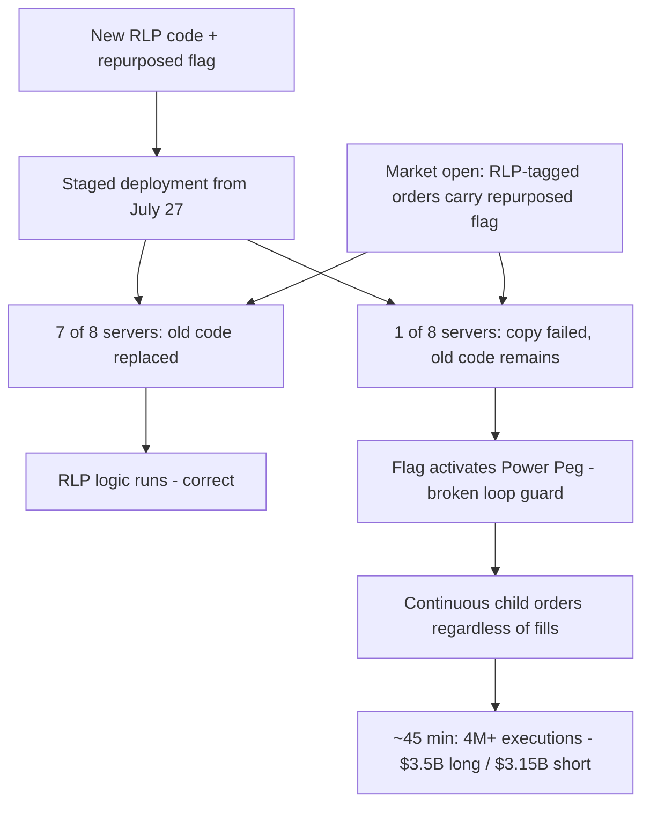

# Knight Capital, August 1, 2012: Dead Code, a Repurposed Flag, and $460 Million in 45 Minutes

## Overview

On August 1, 2012, Knight Capital Americas LLC — then one of the largest handlers of US equity order flow — deployed new code for the NYSE Retail Liquidity Program (RLP) into its SMARS automated order router. The deployment was supposed to replace unused code and repurpose an old flag. It was incompletely deployed: one of eight SMARS servers still ran the old code. When the market opened, RLP-tagged orders sent the repurposed flag to that server, which reactivated "Power Peg" — a dormant, defective order-routing function that kept sending child orders without checking whether the parent order had been filled.

CONFIRMED (per the [SEC order][1]): over a period of approximately 45 minutes, 212 incoming parent orders produced millions of child orders, over 4 million executions in 154 stocks totaling more than 397 million shares. Knight accumulated an approximately $3.5 billion net long position in 80 stocks and an approximately $3.15 billion net short position in 74 stocks, and ultimately realized a **$460 million loss** [1]. Knight's own 8-K, filed five days later, reported a **pre-tax loss of approximately $440 million** [3]. The SEC order also records that Knight "experienced net capital problems" as a result — the firm's survival was in question until it was recapitalized [1].

The incident is the canonical case study for four compounding defects: dead code left in production, a flag whose meaning was repurposed without removing the old behavior, a partially failed deployment with no verification, and no effective kill switch for the aberrant system.

## System Context

- **SMARS** is Knight's automated, high-speed, algorithmic router. Its core function is to receive "parent" orders from other components of Knight's trading platform and, based on available liquidity, send one or more representative "child" orders to external execution venues [1].
- **Power Peg** was an older SMARS feature. When Knight used it, a cumulative-quantity function counted how many shares of a parent order had been executed and instructed the code to *stop* sending child orders once the parent order was filled. Knight discontinued Power Peg in **2003** [1].
- In **2005**, Knight moved the cumulative-shares tracking function to an earlier point in the SMARS code sequence. It **did not retest** the Power Peg code afterward to determine whether it would still function correctly if called [1]. The Power Peg code remained present and callable.
- The **NYSE Retail Liquidity Program** was scheduled to commence on August 1, 2012. To participate, Knight developed and deployed new software code in SMARS, intended to replace the unused Power Peg-era code in the relevant portion of the router [1].
- The new RLP code **repurposed the flag** formerly used to activate Power Peg. Knight's intent was to delete the Power Peg code so that when the flag was set to "yes," the new RLP functionality — not Power Peg — would be engaged [1].

## What Happened

| Time (ET, Aug 1, 2012) | Event | Source |
|---|---|---|
| Jul 27 – Jul 31, 2012 | New RLP code deployed to SMARS in stages, "on a limited number of servers in SMARS on successive days" | [1] |
| Jul 27+ (deployment) | A technician **did not copy the new code to one of the eight SMARS servers**. No second technician reviewed the deployment; no written procedures required one. Nobody realized the eighth server still had Power Peg code and lacked the new RLP code | [1] |
| ~8:01 a.m. | Knight's internal system begins generating automated "BNET reject" emails referencing SMARS with an error described as "Power Peg disabled". 97 such emails are sent to a group of personnel **before the 9:30 a.m. open**. They were not designed as system alerts and were generally not reviewed | [1] |
| 9:30 a.m. | Market opens. The seven servers with the new code process RLP orders correctly. Orders sent with the repurposed flag to the eighth server trigger the defective Power Peg code | [1] |
| 9:30 a.m. → ~45 minutes | The eighth server continuously sends child orders for each incoming parent order **without regard to shares already executed**, because the cumulative-quantity function had been relocated in 2005. One part of Knight's order-handling system knew parent orders were filled; that information was **not communicated to SMARS**. Knight's technology staff work to identify and resolve the issue while SMARS remains connected to the markets | [1] |
| ~45 minutes after start | By the time Knight stopped sending the orders: 4M+ executions, 154 stocks, 397M+ shares; ~$3.5B net long / ~$3.15B net short | [1] |
| Afterward | Knight realizes a $460M loss on the positions [1]; discloses ~$440M pre-tax loss on Aug 6 [3]; SEC later charges the firm under the market access rule; Knight pays a $12M penalty and retains an independent consultant [2] | [1][2][3] |

The SEC order also documents the market footprint: for 75 of the 154 stocks, Knight's executions comprised more than 20 percent of trading volume and contributed to price moves greater than five percent [1].

## Technical Mechanism

The failure is a chain of three software defects and one process defect, each necessary — remove any one and the outcome changes.

**1. Dead code that was still callable.** Power Peg was discontinued in 2003 but never deleted. In 2005, Knight moved its cumulative-quantity function to an earlier point in the code sequence — which broke Power Peg's ability to know when a parent order was complete — and did not retest the function after the move [1]. From 2005 to 2012, the code was inert only because its activation flag was never set. Dead-but-callable code is not dead in any meaningful sense; it is a loaded weapon with the safety off.

**2. Flag reuse without removal of the old behavior.** The RLP project repurposed the Power Peg activation flag for the new retail-liquidity logic. On seven of eight servers this was safe, because the new code that replaced the old behavior was present. On the eighth server, the flag retained its *old* meaning. This is a semantic aliasing failure: the same bit pattern mapped to different behaviors depending on which binary received it. In distributed deployments, "the meaning of a flag" is a contract between the control plane and every replica of the data plane — and that contract was enforced only by the hope that all replicas were identical.

**3. The broken loop-guard.** Power Peg's defining safety property — stop after the parent order is filled — depended on the cumulative-quantity function. The 2005 relocation broke that property. So on August 1, for each of the 212 RLP-tagged parent orders, the eighth server did the following, forever, at machine speed:

```text
on parent order with RLP flag set:
    emit child order(s) to execution venues
    (no cumulative-quantity check: the function was moved away in 2005)
    loop until externally stopped
```

Note the shape: this is not a "typo" that computes a wrong number. It is a **missing loop-exit condition**, executed concurrently with real market activity. The position grew at the rate of the router, not the rate of the customers' intent. Downstream, one part of Knight's order-handling system did recognize that parent orders were filled — but that information was not communicated to SMARS [1]. A safety-relevant fact existed in the system and was not plumbed to the component that needed it.

**4. The deployment failure.** The new code was staged across servers on successive days starting July 27. One technician failed to copy the new code to one of eight servers; there was no second-technician review and no written procedure requiring verification [1]. For a week, the fleet was silently heterogeneous — and heterogeneity was invisible until the flag was exercised on August 1.



### Why Safeguards Didn't Prevent It

The SEC order enumerates the controls that existed and why each was insufficient [1]:

- **Pre-deployment email signal (BNET rejects).** 97 automated emails naming SMARS and "Power Peg disabled" arrived before the open. They were not designed as alerts and were generally not reviewed. A warning existed but was routed to nowhere.
- **Limit-price cap.** SMARS capped child-order prices at 9.5% away from the NBBO at the time the parent order was received. The erroneous orders were individually well-formed; only the aggregate behavior was aberrant, so a per-order price check passed everything.
- **No output-side control.** Knight had no control comparing orders leaving SMARS with those entering it. The child-order storm would have been detected instantly by an out-vs-in ratio.
- **No self-aberration halt.** Knight "did not have procedures in place to halt SMARS's operations in response to its own aberrant activity" — there was no kill switch. Staff worked to identify the issue while SMARS stayed connected and kept sending orders [1].
- **Financial risk controls were not wired to the problem.** Executions accumulated in an account (the "33 Account") that was not linked to automated, firm-wide capital thresholds; the pre-set thresholds could not automatically stop orders exceeding Knight's capital limits [1].

## Trigger vs Contributing Factors

**Trigger (CONFIRMED):** the combination of RLP-flagged orders reaching the one server that still had the old code, at market open on the RLP launch day.

**Contributing factors (CONFIRMED, per the SEC order):** dead Power Peg code left callable for nine years; the 2005 relocation of the cumulative-quantity function without retesting; flag repurposing without code deletion; an unverified, partially failed deployment; no written procedures for deployment review; no kill switch; no output-side order comparison; execution account not linked to firm-wide capital limits; 97 warning emails not treated as alerts.

**Contributing factors (INTERPRETATION):** the incentive that makes "leave the dead code, just flip the flag" attractive — avoiding a riskier refactor of a latency-critical system — is a common pattern in trading and other performance-sensitive software. The SEC order records the outcome of that choice, not the deliberation; we present the pattern, not a claim about Knight's internal decisions.

## Why Safeguards Didn't Prevent It (synthesis)

Every safeguard in place guarded the *wrong layer*: per-order price sanity (instead of aggregate behavior), pre-market email traffic (instead of paging), financial thresholds on an account graph that did not include the execution account, and a deployment process whose verification was "the technician believes he copied it." The failure was an *aggregate, fleet-heterogeneity* failure, and no control operated at the fleet or aggregate level. This is the recurring signature of incidents where each component check passes while the composition is broken — the same shape as the missing CPU-utilization test in the [Cloudflare 2019 case](./cloudflare-regex-2019.md).

## Lessons & Mitigations

1. **Delete dead code.** Code that is not exercised by tests is not "harmless" — it is unverified. If a flag can reach it, it can run. Deleting Power Peg entirely was Knight's stated intent; the case shows the cost of deferring it.
2. **Never repurpose a flag's meaning without a fleet-wide atomic cutover.** A flag's meaning is a cross-binary contract. Either ship the new behavior to every replica before the flag is ever emitted, or give the new meaning a new name.
3. **Deployments must be verified as complete and atomic.** Eight-server staging across days with no second-person verification is a distributed deployment in name only. Modern equivalents: immutable artifacts, checksummed manifests, deploy-time reconciliation ("all replicas report revision N or fail loudly"), and second-person or automated review — the general principle behind [canary releases](../../sre/canary-releases.md), applied here to *deployment completeness* rather than behavior.
4. **Build kill switches against your own aberrant behavior.** A component that can generate unbounded external actions needs a circuit-level control that halts *it*, quickly, operable independently of the component. Knight's own abnormality was detectable (child orders vastly exceeded parent volume) — the missing piece was an automated reaction, not information.
5. **Wire financial exposure controls to the execution path.** Aggregate position and order-flow limits must be evaluated on the account that actually receives executions, with an automatic stop. This is now codified in the SEC's market access rule, Rule 15c3-5 — this was the first enforcement action under it [2].
6. **Alerts must be designed as alerts.** 97 emails referencing the exact failing subsystem by name is a signal-to-noise tragedy: the information existed pre-open. If a message would matter during an incident, it must page, aggregate, and escalate — the operational mechanics covered in [incident management](../../sre/incident-management.md).

## Connection to This Repository

- [Canary releases](../../sre/canary-releases.md) — staged rollout discipline; Knight's staged deployment had the *shape* of canarying without the verification that makes it meaningful.
- [Feature flags](../../sre/feature-flags.md) — flag lifecycle, naming, and retirement; the repurposed Power Peg flag is the anti-pattern.
- [CI/CD pipelines](../../cloud/cicd/pipelines.md) — why deployment completeness and artifact consistency are pipeline properties, not technician habits.
- [Common failure modes](../../failure-modes/common-failures.md) — the "runaway automation" pattern in generic form.
- [Architecture overview](../../arch/overview.md) — where safety controls belong in a layered architecture (component, aggregate, fleet).
- [Postmortem culture](../../sre/postmortem-culture.md) — the SEC order reads as a regulatory postmortem; compare its structure with the blameless template.

## Interview Questions

1. A flag in your system once enabled feature A. A new feature B now reuses that flag. The fleet deploys in stages and one node missed the new binary. Walk through what can happen and design the deployment mechanism that makes this class of failure impossible.
2. Your order router (or any high-rate action generator) begins emitting far more actions than its inputs justify. What control would detect this fastest, and why is a per-item validation insufficient? Relate to Knight's missing out-vs-in comparison.
3. What is the difference between dead code and disabled code? Give the mechanical properties (reachability, test coverage, activation path) that make "disabled" code dangerous.
4. Design a kill switch for a latency-critical trading component. Requirements: operators must be able to trigger it without the component's cooperation; it must fail closed; it must not add latency to the hot path. What are the trade-offs?
5. Knight received 97 emails naming the failing subsystem before the open. How should a system escalate *repeated identical errors* into a paging signal without drowning on-call in noise?

## Key Takeaways

- 212 parent orders became 4M+ executions in ~45 minutes because a loop-exit condition had been silently moved away nine years earlier — the loss rate was set by machine speed, not human intent.
- The incident required a conjunction: dead code + repurposed flag + partial deployment + no kill switch + no aggregate control. Every element is independently preventable.
- The SEC fined Knight $12M for control failures, not for the bug: the violation was the *absence* of safeguards (order-flow comparison, capital-threshold linkage, halt procedures), a legal recognition that incident prevention is an architecture problem.
- Pre-open evidence existed (97 "Power Peg disabled" messages). Detecting incidents is often cheap; reacting to detections is the hard, unpracticed part.

## Sources

1. U.S. Securities and Exchange Commission, *In the Matter of Knight Capital Americas LLC*, Administrative Proceeding File No. 3-15570, Release No. 34-70694, October 16, 2013. https://www.sec.gov/litigation/admin/2013/34-70694.pdf (fetched and quoted; URL verified at time of writing)
2. SEC Press Release 2013-222, "SEC Charges Knight Capital With Violations of Market Access Rule," October 16, 2013. https://www.sec.gov/newsroom/press-releases/2013-222
3. Knight Capital Group, Inc., Form 8-K, August 6, 2012 (pre-tax loss of approximately $440 million). https://www.sec.gov/Archives/edgar/data/1060749/000119312512336167/d392288d8k.htm (URL verified via search result; not full-text fetched)

## Cross-References

- [AWS S3 us-east-1, 2017](./aws-s3-us-east-1-2017.md) — a destructive command with insufficient guardrails; the control-plane counterpart to Knight's data-plane runaway.
- [Cloudflare regex, 2019](./cloudflare-regex-2019.md) — global kill switch under duress; what "staged rollout" means for configuration rather than binaries.
- [GitHub, October 2018](./github-october-2018.md) — automation (Orchestrator) acting exactly as configured with catastrophic results.
- [Postmortem culture](../../sre/postmortem-culture.md) — the reporting discipline this casebook applies to historical incidents.
- [Common failure modes](../../failure-modes/common-failures.md) — generic patterns, including runaway automation and failed deployments.
