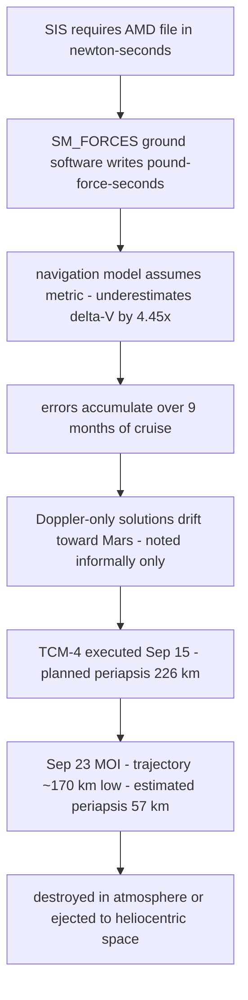

# Mars Climate Orbiter, 1999: Pound-Seconds vs Newton-Seconds, and the Systems Failure Behind a "Units Bug"

## Overview

Mars Climate Orbiter (MCO) was launched on December 11, 1998, to become the first interplanetary weather satellite and to serve as a communications relay for the Mars Polar Lander. On September 23, 1999, at 09:00:46 UTC, the spacecraft began its Mars Orbit Insertion (MOI) burn. All systems performed nominally until the planned pass behind Mars; the carrier signal was lost at 09:04:52 UTC — 49 seconds earlier than predicted — and never reacquired after the 21-minute occultation interval ended. Exhaustive recovery attempts continued through September 25 and failed [1].

The root cause, determined by NASA's Mishap Investigation Board (MIB), has become the most quoted sentence in spacecraft software lore: "the failure to use metric units in the coding of a ground software file, 'Small Forces,' used in trajectory models" [1]. Ground software called SM_FORCES wrote thruster impulse data into an Angular Momentum Desaturation (AMD) file in pound-force seconds (lbf-s); the Software Interface Specification (SIS) required Newton-seconds (N-s); JPL's navigation software consumed the file assuming metric units, and therefore underestimated the effect of the thruster firings on the trajectory by a factor of 4.45 — the pound-to-Newton conversion factor [1]. Small trajectory errors accumulated across the nine-month cruise. The spacecraft arrived at Mars approximately 170 kilometers lower than planned; post-mortem navigation with corrected data put the periapsis — the closest approach — at 57 kilometers, against a minimum survivable altitude of 80 kilometers and a planned 226 kilometers [1]. MCO was either destroyed in the Martian atmosphere or ejected into heliocentric space [1].

What makes the case enduring is not the arithmetic. The Board listed one root cause and eight contributing causes — spanning mismodeling, team unfamiliarity, an unprepared contingency maneuver, a development-to-operations transition nobody managed, broken communications, thin staffing, inadequate training, and a verification process that never exercised the ground software end to end [1]. The units error was the spark; the systems engineering was the fuel. This page treats it as the canonical case that "software error" is usually a systems engineering error wearing a software costume.

## System Context

- **Program structure.** Under the Mars Surveyor Program '98, JPL was lead center, retaining overall project management, system engineering, mission and navigation design, and mission assurance. Lockheed Martin Astronautics (LMA) of Denver was prime contractor: it designed and built both spacecraft and performed all spacecraft operations functions, including real-time command and monitoring, from Denver. Navigation belonged to JPL's operations navigation team [1].
- **Angular Momentum Desaturation.** MCO stabilized attitude partly with reaction wheels, which accumulate angular momentum — particularly from solar radiation pressure — and must be periodically "desaturated" by thruster firings. Each event's telemetry was processed on the ground by SM_FORCES, which computed thrust performance and wrote the AMD file. The JPL navigation team used that file to model the forces on the spacecraft; modeling these "small forces" is critical to accurate orbit determination [1].
- **The interface contract.** The MSOP Project Software Interface Specification (SIS) defined both the format and the units of the AMD file: impulse bits in Newton-seconds [1]. This document is the entire contract between the firings and the trajectory model.
- **A spacecraft unlike its predecessor.** MCO's solar array was asymmetric relative to its body, unlike Mars Global Surveyor's symmetric arrays. The asymmetry significantly increased solar-pressure-induced momentum buildup, so AMD events occurred 10–14 times more often than the operations navigation team expected [1]. A baselined daily 180-degree "barbecue mode" flip that would have canceled part of the buildup had been deleted from the operations plan after later trade studies — a decision whose trajectory impact was never communicated to the navigation team [1].

## What Happened

| Date / Time | Event | Source |
|---|---|---|
| Dec 11, 1998 | Launch from Cape Canaveral on a Delta II | [1] |
| First 4 months of cruise | Ground AMD files unusable — multiple file format errors and incorrect quaternion specifications. The navigation team instead used email from the contractor announcing AMD event times and modeled perturbations manually | [1] |
| Apr 1999 | Correctly formatted AMD files enter use; within a week the files indicate anomalous data — underestimation of trajectory perturbations from desaturation events | [1] |
| Spring–summer 1999 | Working-level concerns exist over discrepancies between navigation solutions; residuals between expected and observed Doppler signatures of the more frequent AMD events are noted but only informally reported; Doppler-only solutions consistently indicate a flight-path insertion closer to the planet. The discrepancies are not resolved | [1] |
| Sep 8, 1999 | Final planned interplanetary Trajectory Correction Maneuver TCM-4 computed, targeting a first periapse of 226 km | [1] |
| Sep 15, 1999 | TCM-4 executed as planned | [1] |
| Sep 16–22, 1999 | Orbit determination during the week after TCM-4 indicates the first periapse has decreased to 150–170 km | [1] |
| ~1 hour before MOI | Final tracking data processed: periapse calculated as low as 110 km — still above the 80 km survivability floor | [1] |
| Sep 23, 09:00:46 UTC | MOI engine start | [1] |
| Sep 23, 09:04:52 UTC | Loss of signal at occultation, 49 seconds earlier than predicted; no reacquisition after the 21-minute occultation; attempts through Sep 25 fail | [1] |
| Sep 27, 1999 | Operations navigation team meets spacecraft engineers to discuss ΔV modeling discrepancies | [1] |
| Sep 29, 1999 | Discovery: small-forces ΔVs were low by a factor of 4.45 (1 lbf = 4.45 N) — AMD impulse-bit data delivered in lb-sec instead of the specified Newton-sec | [1] |
| Post-mortem | Navigation re-estimate with corrected small-forces data: initial periapsis 57 km — too low for survival. The trajectory was ~170 km lower than planned at insertion | [1] |

All rows are CONFIRMED against the MIB Phase I report [1]; the Board's charter focused Phase I on the safety of the upcoming Mars Polar Lander landing, with program-level process recommendations deferred to Phase II [1].

## Technical Mechanism

### 1. The unit mismatch, mechanically

An impulse bit is force multiplied by time; pound-force-seconds and Newton-seconds differ by the factor 4.45 [1]. The SM_FORCES ground software reported impulse bits in lbf-s. The navigation software, "per the requirements," assumed N-s. Every AMD contribution to the trajectory model was therefore underestimated by 4.45× — the model believed the spacecraft had been nudged far less than it had. The report is precise about scope: the AMD software on the spacecraft itself computed in metric units and was correct; "mismodeling only occurred in the ground software" [1]. INTERPRETATION: the two sides of the interface each embodied a units convention, and nothing — test, audit, or runtime check — ever forced them to meet.

### 2. Why nine months of silence

Three confirmed factors hid the accumulating error. First, observability geometry: the navigation team can directly observe only the thrust component along the Earth–spacecraft line of sight (via Doppler), and MCO's dominant AMD thrust component was perpendicular to it, so the systematic error was present but not directly detectable in the measurements [1]. Second, that same thrust was also perpendicular to the flight path, which meant the perturbation manifested mainly as a lower arrival altitude — exactly the parameter that drifts quietly during cruise and matters fatally at arrival [1]. Third, the first four months of AMD files were unusable due to format errors and bad quaternions, and the team fell back to email notifications and hand-modeling; by the time real files flowed in April 1999, the anomalous signal competed with a history of files that had never worked cleanly [1].

### 3. An unrelated ops decision multiplied the error

AMD events occurred 10–14 times more often than the navigation team expected, because the asymmetric solar array increased solar-pressure momentum buildup and the baselined barbecue-mode mitigation had been deleted after trade studies — a decision never communicated to the navigation team [1]. INTERPRETATION: each desaturation was a chance for the 4.45× error to enter the model, so the AMD frequency multiplied the rate at which the units error accumulated. No single decision was catastrophic; the composition was.

### 4. The missed detection opportunities

The error came close to being caught repeatedly. Within a week of April 1999, the AMD files were "indicating underestimation" — the anomaly was visible in the data [1]. Doppler-only solutions consistently ran closer to the planet all summer; the residuals were noted at working level but only informally reported [1]. The spacecraft itself calculated and transmitted its own velocity-change data for desaturation events — a comparison of spacecraft-generated data against the ground-derived values might have exposed the mismatch — but the navigation team did not learn such data existed until long after launch [1]. None of these signals reached a formal problem-resolution process; the team relied on email instead of the Incident, Surprise, Anomaly (ISA) reporting procedure, which the Board says contributed to the problem "slipping through the cracks" [1].

### 5. The last safety net that was never rigged

TCM-5 existed as a contingency maneuver to raise periapsis, usable even shortly before MOI as an emergency correction. A request to perform it was discussed verbally shortly before the MOI onboard procedure was initiated — and never executed. The analysis, tests, and procedures needed to commit to a TCM-5 had not been completed, nor attempted; the MOI timeline took priority; and the maneuver's criticality was not fully understood by the spacecraft-operations or navigation personnel [1]. INTERPRETATION: a contingency that has never been analyzed, tested, or rehearsed is not a safeguard — it is a document.

## Trigger vs Contributing Factors

**Trigger (CONFIRMED):** the delivery of AMD impulse-bit data in lbf-s instead of the specified N-s, and its ingestion into the trajectory models from April 1999 onward, accumulating a trajectory error that left the spacecraft ~170 km low at arrival [1].

**Contributing causes (CONFIRMED — the Board's list of eight [1]):**
1. Undetected mismodeling of spacecraft velocity changes.
2. Navigation team unfamiliarity with the spacecraft (the team came onboard shortly before launch and never participated in ground-software testing or design reviews).
3. TCM-5 not performed — never prepared, never executed despite verbal discussion.
4. The systems-engineering process did not adequately address the transition from development to operations.
5. Inadequate communications between project elements.
6. Inadequate operations navigation staffing (MSOP ran three missions simultaneously — MGS, MCO, MPL; MCO navigation was handled by a team lead plus a single navigator).
7. Inadequate training (including on following the SIS and on end-to-end testing of the small-forces software).
8. The verification and validation process did not adequately address ground software.

**Contributing factors (INTERPRETATION):** the geographically distributed partnership model — LMA in Denver operating the spacecraft, JPL in Pasadena navigating it — is not itself a defect, but the report's own findings (email instead of ISA reporting, critical momentum-control knowledge never passed to navigation, no end-to-end interface audit) describe an interface that existed contractually but not operationally. Program-level process recommendations were deferred to the Phase II report; even so, the Board's Phase I language locates the failure in organizational seams, not arithmetic.

## Why Safeguards Didn't Prevent It

- **The SIS existed but was never enforced.** The report states the SIS "was not followed" and that the specification "was developed but not properly used in the small forces ground software development and testing" [1]. A written interface contract without a verification step is a preference, not a control.
- **No end-to-end test.** "End-to-end testing to validate the small forces ground software performance and its applicability to the specification did not appear to be accomplished," and it was unclear that independent V&V of the ground software occurred at all [1]. The interface between two organizations — precisely where a units mismatch lives — was never exercised as a whole.
- **Anomaly handling ran on email.** Doppler residuals and solution discrepancies were real, observed, and discussed — informally. The ISA procedure existed; the team was not trained to use it [1]. Escalation paths that are not habitual do not carry bad news.
- **The navigation team was structurally new to the vehicle.** Onboard shortly before launch, absent from design reviews, unfamiliar with the attitude-control system, and unaware the spacecraft downlinked its own ΔV data [1] — the people best positioned to notice a trajectory anomaly lacked the context to interpret it.
- **The contingency was never prepared.** TCM-5 had no completed analysis, tests, procedures, or commitment criteria [1]; when the periapse estimates sagged to 110 km — 30 km above survivability — the organization had no rehearsed move left except to burn as planned.
- **Margins were not used as risk currency.** The Board observed that propellant reserves and aerobraking schedule margins were not applied against closest-approach uncertainty, and that analyses of trajectory dispersions were inadequate [1].

## Lessons & Mitigations

1. **Units are part of the interface contract, and contracts need tests.** A unit is a type. Whether enforced by typed quantities in code, schema-validated files, or contract tests at the boundary, the units of every cross-component data artifact must be checked mechanically at integration time — every time. The Board's own MPL recommendation is the template: "Conduct software audit for specification compliance on all data transferred between JPL and Lockheed Martin Astronautics" [1].
2. **Test the seam, not just the sides.** The spacecraft software was correct; the ground software was wrong; the system failed. End-to-end tests across organizational boundaries are the only tests that can catch a mismatch both sides consider the other's problem.
3. **"Software error" is usually a systems engineering error.** The Board named one root cause and eight contributing causes, and the causes are organization, staffing, communication, training, and V&V. When a report's contributing-cause list dwarfs its root cause, the root cause is the visible tip of a process iceberg — the same structure as Therac-25 and Ariane 5 in this casebook.
4. **Formalize anomaly escalation before you need it.** Working-level concerns about navigation discrepancies existed for months. A lightweight, mandatory anomaly-reporting habit — the ISA the Board cites — converts scattered observations into a trackable signal with an owner and a deadline.
5. **A contingency you haven't rehearsed is a wish.** TCM-5 required completed analysis, tested procedures, and pre-agreed commitment criteria to be real. Reserve margins (propellant, schedule, altitude) should be explicitly allocated against identified risks, as the Board's trajectory-margin observation demands [1].
6. **Onboard the operators into the design.** The navigation team's absence from PDR/CDR and from ground-software testing left them unable to interpret the anomalies they saw. Knowledge transfer to operations teams is a verification activity, not a courtesy.

## Connection to This Repository

- [Ariane 5, 1996](./ariane-5-1996.md) — code reused outside its validated envelope; MCO is the same pattern with the seam drawn between organizations instead of between rockets.
- [Therac-25, 1985–87](./therac-25.md) — a software defect allowed to exist because process safeguards were assumed rather than tested; both accidents were "software errors" that investigations reclassified as systems failures.
- [Knight Capital, 2012](./knight-capital-2012.md) — deployment and verification as systems properties; the operational cousin of MCO's unverified interface.
- [API contracts](../assumptions-hunt/api-contracts.md) — the assumption audit for machine-to-machine agreements; units, ranges, and encodings are exactly the contract terms that fail silently.
- [Contract testing](../../testing/contract-testing.md) — the modern mechanism for the audit the Board demanded: verifying that both sides of an interface agree without human goodwill.
- [Floating point and numerics](../assumptions-hunt/floating-point.md) — numeric conventions, conversions, and the assumptions hidden inside "just a number."
- [FMEA and fault trees](../../sre/fmea-fault-trees.md) — the systematic failure-mode analysis that would have ranked an unverified units interface as a mission-critical risk.

## Interview Questions

1. Two teams exchange a binary data file whose format specifies one unit convention; one producer writes a different unit. Design the three cheapest mechanisms that would have caught this at integration time, and explain why each would (or would not) have survived organizational boundaries.
2. Your system showed anomalous telemetry for months; engineers noticed and discussed it informally. What makes formal anomaly reporting actually get used, rather than existing as a process nobody follows?
3. Explain the difference between a root cause and contributing causes using MCO: why did the Board name a units error as root cause while calling the mishap a systems engineering failure? What does that distinction change about how you fix a system?
4. A contingency recovery path exists on paper but has never been analyzed, tested, or rehearsed. How do you audit a system for "paper safeguards," and what evidence would convince you a contingency is real?
5. The spacecraft downlink contained data that could have exposed the mismatch, but the navigation team didn't know it existed. How do you design knowledge transfer from development to operations so that redundancy in the data is actually exploitable during operations?

## Key Takeaways

- A ground software file wrote thruster impulse data in pound-force-seconds where the interface specification required Newton-seconds; navigation underestimated each desaturation's effect by 4.45×, and the spacecraft arrived ~170 km low, with an estimated periapsis of 57 km against an 80 km survivability floor.
- The error survived nine months: the thrust geometry hid it from Doppler, the first usable files arrived only in April, 10–14× more desaturation events multiplied it, and the warnings stayed in informal conversation instead of formal anomaly reporting.
- The Board's one root cause and eight contributing causes make the real lesson explicit: verification and validation never exercised the ground software end to end, and the systems-engineering process never managed the development-to-operations transition.
- The last safeguard — contingency maneuver TCM-5 — was discussed verbally but never prepared, tested, or executed; an unprepared contingency is not a safeguard.
- The fix is not "remember metric": it is typed or contract-tested interfaces, mandatory end-to-end audits across organizational seams, formal anomaly escalation, and margins allocated against identified risks.

## Sources

1. Mars Climate Orbiter Mishap Investigation Board, *Mars Climate Orbiter Mishap Investigation Board Phase I Report*, NASA, November 10, 1999. https://llis.nasa.gov/llis_lib/pdf/1009464main1_0641-mr.pdf (fetched and quoted this session; all CONFIRMED facts above trace to this report)
2. NASA Lessons Learned Information System, "Mars Climate Orbiter Mishap Investigation Board," lesson entry LLIS-641. https://llis.nasa.gov/lesson/641 (NASA's distillation of the report's root cause and recommendations; existence and content consistency verified this session)

## Cross-References

- [Ariane 5, 1996](./ariane-5-1996.md) — reuse of code outside its validated envelope; the sibling space-systems case in this casebook.
- [Therac-25, 1985–87](./therac-25.md) — software defects surviving because the surrounding safety process was assumed rather than verified.
- [Knight Capital, 2012](./knight-capital-2012.md) — verification, deployment, and kill switches as system properties rather than individual virtues.
- [API contracts](../assumptions-hunt/api-contracts.md) — units, ranges, and encodings as contract terms that fail silently when unaudited.
- [Contract testing](../../testing/contract-testing.md) — mechanizing the interface audit the MIB recommended.
- [Floating point and numerics](../assumptions-hunt/floating-point.md) — numeric-convention assumptions in computation.
- [Postmortem culture](../../sre/postmortem-culture.md) — how a mishap board's causal structure maps onto modern blameless postmortem practice.
