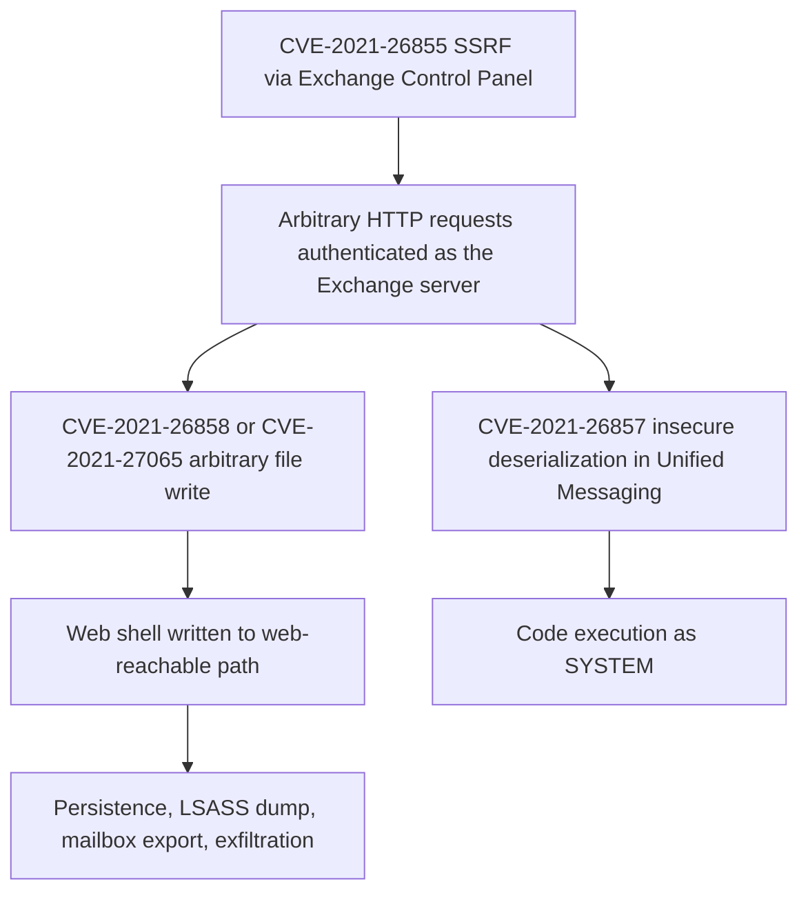

# Microsoft Exchange Server, March 2021: Four Zero-Days, Web Shells, and the Patch Race

## Overview

On March 2, 2021, Microsoft published a security blog post, "HAFNIUM targeting Exchange Servers with 0-day exploits," disclosing that "Microsoft has detected multiple 0-day exploits being used to attack on-premises versions of Microsoft Exchange Server in limited and targeted attacks" [1]. In the observed attacks, the actor used the vulnerabilities "to access on-premises Exchange servers which enabled access to email accounts, and allowed installation of additional malware to facilitate long-term access to victim environments." Microsoft Threat Intelligence Center attributed the campaign "with high confidence to HAFNIUM, a group assessed to be state-sponsored and operating out of China, based on observed victimology, tactics and procedures" [1]. Four CVEs were named and patched the same day in an MSRC release: CVE-2021-26855, CVE-2021-26857, CVE-2021-26858, and CVE-2021-27065. "Exchange Online is not affected" [1].

The case is instructive because the vulnerability chain has a clean two-stage grammar — an unauthenticated server-side request forgery that lets an attacker "authenticate as the Exchange server," followed by post-authentication file-write or deserialization flaws that yield web shells and code as SYSTEM — and because the incident's real story is the race that followed the patch. Microsoft's own dated updates document that race: by March 5 it observed "increased use of these vulnerabilities in attacks targeting unpatched systems by multiple malicious actors beyond HAFNIUM" [1]. CISA's alert AA21-062A tells defenders what that implies: any organization that finds exploitation "should assume network identity compromise," and even organizations that find nothing must patch and mitigate immediately [2]. Where the term "ProxyLogon" appears today, it is the community shorthand for this chain; the primary sources themselves name the CVEs, and the Microsoft-authored detection script CISA urges is literally named `Test-ProxyLogon.ps1` [2].

| Field | Value (per Microsoft MSRC post [1] and CISA AA21-062A [2]) |
|---|---|
| Disclosure date | March 2, 2021 (MSRC post + security updates released same day) |
| Vulnerabilities | CVE-2021-26855 (SSRF), CVE-2021-26857 (insecure deserialization), CVE-2021-26858 and CVE-2021-27065 (post-auth arbitrary file write) |
| Scope | On-premises Exchange Server only; "Exchange Online is not affected" |
| Attribution | HAFNIUM (MSTIC, high confidence, state-sponsored, operating out of China); July 19, 2021 US Government attribution to actors affiliated with the PRC Ministry of State Security [2] |
| Impact mechanism | Unauthenticated access to mailboxes, web shell installation for persistence, credentials and data exfiltration; DearCry ransomware exploitation observed by March 12 [2] |
| Primary sources | Microsoft Security Blog (Mar 2, 2021); CISA Alert AA21-062A (initial version Mar 3, 2021; last revised Jul 19, 2021) |

## System Context

On-premises Exchange Server is an internet-facing enterprise application: it exposes HTTP endpoints (including the Exchange Control Panel) that accept requests from the outside world, it holds an organization's mail, and it sits inside the corporate identity fabric with domain-joined privileges. Microsoft's post describes what the exploited code paths expose: the SSRF flaw in CVE-2021-26855 "allowed the attacker to send arbitrary HTTP requests and authenticate as the Exchange server" — that is, the application itself vouches for the attacker's request because the request appears to originate from trusted internal plumbing [1]. Once authenticated "as the server," the post-authentication flaws give file writes "to any path on the server," and writing into web-reachable paths yields a web shell — "Web shells potentially allow attackers to steal data and perform additional malicious actions that lead to further compromise" [1].

The defensive context matters as much as the code. Many organizations running on-prem Exchange do not deploy Microsoft's own detection stack; Microsoft acknowledged this when it released a feed of observed indicators of compromise "to aid defenders in investigating these attacks where Microsoft security products and tooling may not be deployed" [1]. Detection therefore leaned on Exchange's own logs and Windows event logs, with Microsoft publishing exact queries per CVE [1]. The reporting chain also matters: Microsoft thanked "our industry colleagues at Volexity and Dubex for reporting different parts of the attack chain," noting "Volexity has also published a blog post with their analysis" [1] — the vulnerability disclosure reached the public through the vendor's advisory rather than through the researchers' posts alone.

## What Happened

The sequence below is assembled from the dated updates in Microsoft's post [1] and the revision history in CISA's alert [2]; dates are 2021.

| Date (2021) | Event | Source |
|---|---|---|
| Mar 2 | MSRC blog publishes "HAFNIUM targeting Exchange Servers with 0-day exploits"; four CVEs named; security updates released; resource center at aka.ms/ExchangeVulns established | [1] |
| Mar 3 | CISA alert AA21-062A initial version | [2] |
| Mar 4 | Exchange team releases a script for checking HAFNium indicators of compromise ("Scan Exchange log files for indicators of compromise") | [1] |
| Mar 5 | Microsoft sees "increased use of these vulnerabilities in attacks targeting unpatched systems by multiple malicious actors beyond HAFNIUM"; MSRC publishes additional mitigation guidance | [1] |
| Mar 8 | Microsoft releases a TLP:WHITE feed of observed IOCs (malware hashes, malicious file paths) in JSON and CSV "where Microsoft security products and tooling may not be deployed" | [1] |
| Mar 10 | CISA update: investigate for compromise "from at least January 1, 2021 through present"; strongly encourages running Microsoft's Test-ProxyLogon.ps1 scan script | [2] |
| Mar 12 | CISA update: DearCry ransomware exploiting compromised on-premises Exchange servers observed (per Microsoft Security Intelligence) | [2] |
| Mar 15 | Microsoft releases the one-click "Microsoft Exchange On-Premises Mitigation Tool" for customers "who do not have dedicated security or IT teams" | [1] |
| Mar 16 | Microsoft releases updated responder guidance: "Investigating and remediating on-premises Exchange Server vulnerabilities" | [1] |
| Apr 12–14 | CISA identifies 10 webshells associated with the activity (China Chopper variants) with malware analysis reports and YARA rules; technical details updated | [2] |
| Jul 19 | CISA records the US Government attribution of the activity to malicious cyber actors affiliated with the PRC Ministry of State Security | [2] |

CONFIRMED details on the attack itself, per Microsoft [1]: after initial access, "HAFNIUM operators deployed web shells on the compromised server"; post-exploitation activity included "Using Procdump to dump the LSASS process memory," "Using 7-Zip to compress stolen data into ZIP files for exfiltration," "Adding and using Exchange PowerShell snap-ins to export mailbox data," use of the Nishang `Invoke-PowerShellTcpOneLine` reverse shell, downloading PowerCat from GitHub to open connections to remote servers, and downloading the Exchange offline address book, "which contains information about an organization and its users." HAFNIUM "primarily targets entities in the United States across a number of industry sectors, including infectious disease researchers, law firms, higher education institutions, defense contractors, policy think tanks, and NGOs," has "used legitimate open-source frameworks, like Covenant, for command and control," typically exfiltrates data "to file sharing sites like MEGA," and "operates primarily from leased virtual private servers (VPS) in the United States" [1].

## Technical Mechanism

The chain is a study in how one request-forgery primitive converts an application's internal trust into an attacker's foothold. Microsoft's post defines each flaw [1]:

- **CVE-2021-26855** — "a server-side request forgery (SSRF) vulnerability in Exchange which allowed the attacker to send arbitrary HTTP requests and authenticate as the Exchange server." CISA's alert adds the location: "The vulnerability exploits the Exchange Control Panel (ECP) via a Server-Side Request Forgery," and notes the payoff — access to mailboxes and sensitive information [2].
- **CVE-2021-26857** — "an insecure deserialization vulnerability in the Unified Messaging service." Microsoft defines the class precisely — "untrusted user-controllable data is deserialized by a program" — and the outcome: "Exploiting this vulnerability gave HAFNIUM the ability to run code as SYSTEM on the Exchange server. This requires administrator permission or another vulnerability to exploit" [1].
- **CVE-2021-26858 and CVE-2021-27065** — "post-authentication arbitrary file write vulnerability in Exchange"; either lets the attacker "write a file to any path on the server" after authenticating "by exploiting the CVE-2021-26855 SSRF vulnerability or by compromising a legitimate admin's credentials" [1].

The second mechanism is detection, because the whole chain leaves unusually legible evidence, and Microsoft's post is effectively a log-analysis syllabus [1]: CVE-2021-26855 exploitation appears in HttpProxy logs (`%PROGRAMFILES%\Microsoft\Exchange Server\V15\Logging\HttpProxy`) as entries where "the AuthenticatedUser is empty and the AnchorMailbox contains the pattern of ServerInfo~*/*"; CVE-2021-26858 shows in OABGeneratorLog because "Files should only be downloaded to" the OAB temp directory and exploitation writes elsewhere; CVE-2021-26857 creates Application event log errors sourced `MSExchange Unified Messaging` containing `System.InvalidCastException`; CVE-2021-27065 appears in ECP server logs because "All Set-\<AppName\>VirtualDirectory properties should never contain script." CISA's contribution is the operational wrapper: run `Test-ProxyLogon.ps1`, assume identity compromise if exploitation is found, and investigate from at least January 1, 2021 [2].

INTERPRETATION: the deep lesson of the chain is that SSRF here is not a low-severity request bug — against a monolithic application whose components trust each other by origin, being able to speak as the server *is* authentication. Every internal trust boundary in Exchange collapsed into "whoever can make the server issue requests."

## Trigger vs Contributing Factors

The trigger for the public emergency is twofold and precisely dated: attackers (initially HAFNIUM) were already exploiting the chain in the wild when Microsoft disclosed and patched on March 2, 2021 [1], and the disclosure itself widened exploitation — by March 5 Microsoft "see[s] increased use of these vulnerabilities in attacks targeting unpatched systems by multiple malicious actors beyond HAFNIUM" [1]. Patch release and attacker recruitment happened in the same days.

The contributing factors are structural:

- **Internet-facing monolith with internal trust.** The ECP SSRF plus file-write primitives let an unauthenticated outsider manufacture the credentials of the application itself; there was no per-request identity boundary between internal components [1].
- **Patch latency at fleet scale.** CISA's guidance assumes unpatched servers will remain available targets for weeks (its investigation window reaches back to January 1, 2021, and its mitigation tooling exists for organizations with no security team at all) [2]. The exploit kit's audience is exactly the patch-latency distribution.
- **Privileged placement.** A compromised Exchange server yields LSASS memory, mailbox data, the offline address book, and — per CISA — a path toward "the Active Directory environment" including downloading the Active Directory database [1][2].
- **Divergent tooling estates.** Microsoft explicitly released IOCs for environments "where Microsoft security products and tooling may not be deployed" [1]; the detection floor across the fleet was heterogeneous.
- **Criminal adoption of a state actor's exploit.** DearCry ransomware arrived within ten days of disclosure [2]. INTERPRETATION: a zero-day chain disclosed by patch is a chain *handed to every lesser actor*, with the patch serving as the exploit's documentation.

## Why Safeguards Didn't Prevent It

- **Authentication** held everywhere it was designed to hold: the attacker never guessed a password. The failure was that CVE-2021-26855 forges the authentication surface itself — "authenticate as the Exchange server" [1]. Identity safeguards cannot vouch for a request the application issues on the attacker's behalf.
- **Patch management**, the nominal control for this class, is a race-time safeguard: it works only for systems patched before exploitation reaches them. The evidence of March 5–12 [1][2] shows the race was being lost across the installed base even with same-day vendor patches.
- **Network segmentation** was partially effective in principle — the attack starts at an internet-facing endpoint, so perimeter controls that remove or shield ECP exposure would have starved the chain of its entry point. CISA's alert frames mitigation in exactly these terms for organizations that cannot patch immediately [2]. INTERPRETATION: the safeguard was absent or unenforced on the exploited population, which is why CISA had to publish it.
- **Logging** existed and was decisive — but only after Microsoft told the world what to look for on March 2 and in the March 4 script [1]. The evidence sat in HttpProxy, OABGenerator, Unified Messaging, and ECP logs unread; detection content lagged the vulnerability's exploitability by the disclosure interval.
- **The assumption "cloud is affected too"** — the exact opposite held: "Exchange Online is not affected" [1]. Safeguards migrated to the cloud service, and the incident is a measurement of what remained on-premises.
- **Assume-breach doctrine** was absent in most victim environments until CISA mandated its consequence: "If an organization discovers exploitation activity, they should assume network identity compromise and follow incident response procedures" [2]. INTERPRETATION: organizations that treated the server as a mail box rather than a domain-credential holder under-reacted; LSASS dumps and AD access make credential hygiene the real casualty list.

## Lessons & Mitigations

1. **Treat SSRF on a privileged monolith as an authentication bypass.** The chain's first stage is "authenticate as the Exchange server" [1]. Design reviews should ask what a forged server-originated request can do in this application — the question generalizes far beyond Exchange and connects directly to [auth, identity, and session design](../connection-atlas/auth-identity-session.md).
2. **Patch latency is a security parameter you can measure.** Microsoft shipped the fix on day zero and still had to ship a one-click mitigation tool on March 15 for organizations without dedicated IT staff [1]. Fleet patch velocity, not patch availability, is the binding constraint; this is the operational face of [vulnerability management](../../security/advanced/vulnerability-management.md).
3. **Build detection content before the CVE, where possible.** Every exploited behavior was already logged [1]. The gap was mapping logs to detection rules. Contracts that require log coverage for privileged endpoints (and periodic red-team validation of that coverage) close the interval between exploitability and detectability.
4. **Assume identity compromise, then verify.** CISA's directive [2] is the correct default for any server that held domain credentials: LSASS dumps and mailbox export [1] mean rotation and session invalidation, not just malware removal. This is [incident response](../../security/incident-response.md) scoped to the identity plane.
5. **Expect exploit convergence after disclosure.** A state-actor chain on March 2 became a ransomware vector by March 12 [2]. Disclosure planning should include the criminal-adoption curve: accelerated rollout windows, temporary exposure reductions, and IOC sharing on day one, as Microsoft's TLP:WHITE feed did [1].
6. **Vendor guidance is part of the product.** The MSRC post's log queries, the scan script, the mitigation tool, and the responder guide [1] were load-bearing defenses during the race. Design your own products with the assumption that day-zero guidance will be consumed by teams under attack.

## Interview Questions

1. Explain the four-CVE chain as a dependency graph: why does the SSRF alone matter so little for code execution, and so much for the chain as a whole?
2. CVE-2021-26855 let attackers "authenticate as the Exchange server." In your current stack, which internal components would trust a request that appears to originate from the application itself, and how would you bound that trust?
3. Microsoft released patches on March 2 and a one-click mitigation tool on March 15. What does that interval tell you about the real-world distribution of patch velocity, and how would you instrument it in your own fleet?
4. CISA says organizations finding exploitation should "assume network identity compromise." Walk through the first 48 hours of that response: what gets rotated, in what order, and what evidence do you preserve first?
5. The exploited behaviors were logged all along, yet detection required vendor-supplied queries. How would you design logging so that a new exploitation pattern is derivable from your logs without the vendor telling you what to search for?

## Key Takeaways

- Microsoft disclosed four exploited Exchange Server zero-days and shipped patches on March 2, 2021, attributing the campaign with high confidence to HAFNIUM, assessed as state-sponsored and operating out of China; on-premises only, "Exchange Online is not affected" [1].
- The chain: CVE-2021-26855 SSRF (authenticate as the Exchange server) → CVE-2021-26858/27065 arbitrary file write (web shells) or CVE-2021-26857 insecure deserialization (code as SYSTEM); post-exploitation included LSASS dumps, mailbox export via PowerShell snap-ins, 7-Zip-compressed exfiltration, and reverse shells [1].
- The patch race was immediate: multiple actors beyond HAFNIUM exploiting unpatched systems by March 5, DearCry ransomware by March 12, and a mitigation tool plus responder guidance by mid-March [1][2].
- CISA's operational doctrine: run the log-scan script, investigate back to at least January 1, 2021, treat any finding as network identity compromise, and expect the US Government attribution (July 19, 2021) to name the PRC MSS [2].
- The durable engineering lessons: SSRF against a privileged monolith is an authentication bypass; patch velocity is the real control; identity rotation outranks malware cleanup; and disclosure of a working chain recruits criminals at the same time as it arms defenders.

## Sources

1. Microsoft (Microsoft 365 Security and Microsoft Threat Intelligence), "HAFNIUM targeting Exchange Servers with 0-day exploits," Microsoft Security Blog, March 2, 2021 (with dated updates through March 16, 2021). https://www.microsoft.com/en-us/security/blog/2021/03/02/hafnium-targeting-exchange-servers/ — fetched in full this session; the disclosure language, CVE definitions, attack details, detection queries, HAFNIUM victimology, and all dated updates are quoted or closely paraphrased from this post.
2. Cybersecurity and Infrastructure Security Agency, Alert AA21-062A, "Mitigate Microsoft Exchange Server Vulnerabilities" (initial version March 3, 2021; last revised July 19, 2021). https://www.cisa.gov/news-events/cybersecurity-advisories/aa21-062a — full text retrieved this session via an automated reader service; cisa.gov returns HTTP 403 to direct curl from this sandbox, which is recorded here rather than papered over. The advisory's summary, CVE descriptions, TTP section, dated updates (Test-ProxyLogon.ps1, the January 1, 2021 investigation window, DearCry, the ten China Chopper webshell analysis reports), the Emergency Directive 21-02 reference, and the July 19, 2021 attribution are drawn from it.

Naming note: the community shorthand "ProxyLogon" for this chain does not appear in either primary source as the name of the attack; both name the four CVEs. The name's most defensible anchor in these sources is the Microsoft-authored scan script CISA recommends, `Test-ProxyLogon.ps1` [2]. This page uses the CVEs for all technical claims and reserves "ProxyLogon" for the file's title slug, matching the casebook's index naming.

## Cross-References

- [Equifax, 2017](./equifax-2017.md) — the sibling patching failure: a known, fixed vulnerability left unpatched due to inventory and process gaps; Exchange 2021 is the same race observed from the vendor's side of the finish line.
- [Heartbleed, 2014](./heartbleed-2014.md) — a vulnerability whose disclosure reshaped exploitation at internet scale; both cases study what the days after patch release actually look like.
- [CrowdStrike, 2024](./crowdstrike-july-2024.md) — the inverse fleet-update case: a legitimate security content update causing global failure; read together they bracket the risk profile of pushing security content at fleet scale.
- [Auth, identity, and session management](../connection-atlas/auth-identity-session.md) — the atlas map of the identity plane whose trust model the SSRF-forged requests defeated.
- [Vulnerability management](../../security/advanced/vulnerability-management.md) — the book chapter for the patch-velocity, exposure-inventory, and scan-discipline practices this incident stresses.
- [Incident response](../../security/incident-response.md) — the response doctrine behind CISA's "assume network identity compromise" directive.
