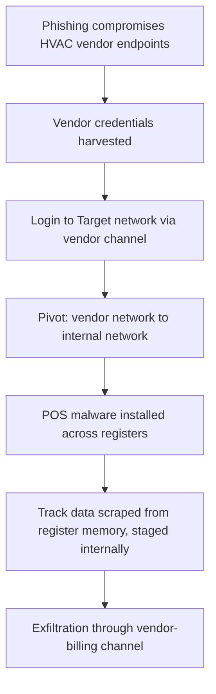

# Target, November 27–December 15, 2013: HVAC Credentials, a Flat Network, and 40 Million Cards Lifted from POS Memory

## Overview

In the holiday season of 2013, attackers stole payment-card data from the point-of-sale (POS) systems inside nearly all of Target's U.S. stores. Target publicly confirmed that approximately **40 million debit and credit card accounts** were exposed between **November 27 and December 15, 2013**, and in January 2014 disclosed that contact and personal information of **up to 70 million additional customers** had also been taken [2][3]. The entry path was not a zero-day against Target's infrastructure: per the U.S. Senate Committee on Commerce, Science, and Transportation's staff report, Target had given network access to a **third-party vendor — a small Pennsylvania HVAC company** — and the attackers used credentials from that relationship to reach Target's environment [1]. From there, the Senate report's account traces a straightforward pivot into the payment-card network, installation of **memory-scraping malware on POS registers**, and exfiltration through the same vendor-access channel [1].

The most instructive part of this case is not the entry, but the middle: Target had modern security tooling in its network, and it fired. The Senate report records that **FireEye intrusion-detection alerts were raised on November 30 and December 2, 2013**, that Target's security personnel identified a suspicious binary and confirmed an internal emergency — and that the malware still ran, scraped, and exfiltrated for roughly two more weeks [1]. The case therefore belongs beside [Knight Capital, 2012](./knight-capital-2012.md) in this casebook: in both, the warning signal existed in advance, was received by humans, and did not trigger action at machine speed.

## System Context

Target operated approximately 1,800 U.S. stores with POS terminals that read magnetic-stripe cards. In 2013 the U.S. payment infrastructure was still stripe-dominated: the card's track data was read at the register and, during the authorization window, existed **unencrypted in the POS process memory**. Chip-and-PIN deployment had barely begun in the United States, so the register memory was, for a few hundred milliseconds per transaction, the most concentrated source of reusable card data in the country. The malware families later associated with this breach (publicly named in press reporting on the forensics) worked precisely there: watching register memory for sequences matching track-data structure, validating candidates with the Luhn checksum, buffering batches, and shipping them to an internal staging point before exfiltration [1][2].

Target's relationship with the HVAC vendor existed for a mundane business reason — refrigeration and HVAC systems generate billing, contracts, and project-management paperwork, and the vendor was connected to Target's network to move that paperwork electronically [1]. This is the structural fact of the case: **a trust relationship of enormous sensitivity existed for convenience-tier traffic**. The vendor's own endpoint security was, per KrebsOnSecurity's reporting, running a free trial version of a malware scanner when its credentials were harvested by a phishing email — reported by press from forensic interviews; the Senate report's role in the story is the enterprise side of the handshake [1][2]. Target was compliant with **PCI DSS**, the payment-card industry's mandatory security standard, at the time of the breach — the Senate report treats this compliance as real and simultaneously as insufficient, which is the honest reading of any checklist standard [1].

## What Happened

| Time (2013) | Event | Source |
|---|---|---|
| Pre-November | Attackers compromise Fazio Mechanical (HVAC vendor) via phishing and steal its Target network credentials | [1][2] |
| Nov 27 – Dec 15 | Breach window Target publicly confirmed: ~40M card accounts exposed | [2][3] |
| Nov 30 | First FireEye alert indicating malicious activity in the network | [1] |
| Dec 2 | Second, critical FireEye alert; Target security team identifies a "binary" file of concern and confirms an emergency; malware is not fully eradicated | [1] |
| Early–mid December | Memory-scraping malware active on POS registers across stores; batches of track data staged internally | [1] |
| Mid December | Stolen data exfiltrated out of Target's network through the vendor-billing channel | [1] |
| Dec 15 | Exfiltration window closes (end of the confirmed Nov 27–Dec 15 exposure period) | [2] |
| Dec 19 | Target publicly confirms unauthorized access to payment card data | [3] |
| Jan 10, 2014 | Target discloses up to 70 million additional customer records | [3] |
| Mid 2014 | Verizon's forensic report — never publicly released — is described in press reporting after KrebsOnSecurity obtains it | [4] |

CONFIRMED (per the Senate report [1]): the kill-chain reconstruction above and the central finding that Target had opportunities at multiple stages to disrupt the attack and did not take them. INTERPRETATION: the exact hour-by-hour sequencing between November 27 and December 15 varies across secondary accounts; where accounts conflict, this page keeps only what the Senate report or Target's own disclosures state, and keeps dates at day granularity.

## Technical Mechanism

The attack is best read as a chain of six links, each of which was breakable by a control Target partially possessed:

**1. Credential theft at the weakest endpoint.** The attackers never had to defeat Target's edge. They phished a refrigeration vendor whose endpoints were, per press reporting of the forensics, protected by a trial-grade scanner, and harvested the credentials that Target's vendor-access system would honor [1][2]. Authentication converts one company's compromise into another company's breach; the credential is the carrier.

**2. The pivot.** The Senate report's central architectural criticism is here: the vendor-access network — the segment that existed to move billing paperwork — was not separated from the networks that mattered. From the vendor channel, the attackers reached Target's internal environment and, ultimately, the payment-card network [1]. This is a segmentation failure in the exact sense GAO later used for Equifax: the tier exposed to lower-trust traffic and the tier holding high-value assets shared trust.

**3. POS memory scraping.** The malware's design targets the one instant the card data must exist in plaintext: between the magnetic-stripe read and the encryption performed for authorization. It watches process memory for track-data-shaped sequences, filters with the Luhn checksum to reduce noise, and accumulates results [1][2]. Note what this implies: transport encryption and database encryption were both irrelevant, because the plaintext existed at the capture point. Protection has to be applied at the earliest possible point (point-to-point encryption from the pinpad) or the register memory is the database you didn't know you had.

**4. Staging and exfiltration.** Batches moved to internal staging hosts and then out through the vendor-billing channel — the same door the attackers came in [1]. Egress traffic looked structurally normal: authenticated channel, business-shaped connection, modest volumes spread over days. Nothing on the outbound path asked "why is billing data flowing in bulk from the payment network?"

### Trigger vs Contributing Factors

**Trigger (CONFIRMED):** use of stolen HVAC-vendor credentials to enter Target's network in the November 27 – December 15 window [1][2].

**Contributing factors (CONFIRMED):** vendor network connectivity to the internal network [1]; FireEye alerts on November 30 and December 2 that identified malicious activity but did not result in eradication [1]; POS malware able to read unencrypted track data from register memory [1]; exfiltration through the vendor channel without egress controls catching it [1]; PCI DSS compliance coexisting with all of the above [1].

**Contributing factors (INTERPRETATION):** the incentive that makes vendor convenience links cheap and segmentation expensive is an organizational pattern, not a technical one — the Senate report documents the connectivity, not the budget meeting that preserved it. Similarly, the gap between "analyst confirms an emergency" and "systems react automatically" is a tooling-and-authority gap this page interprets from the report's narrative rather than from any quoted decision.

## Why Safeguards Didn't Prevent It

- **FireEye detected the malware — detection was not coupled to action.** The Senate report documents the alerts and the internal escalation, including the team confirming an emergency, and still the malware survived and operated [1]. A detection product raises events; containment requires an enforcement decision wired to those events. Without automated quarantine or a pre-authorized kill path, alert-to-action latency is measured in org charts, and two weeks is within that scale.
- **Segmentation was assumed, not enforced.** The vendor network existed because it was useful, and it connected to things it should never have touched [1]. PCI DSS scope had drawn a boundary around the cardholder data environment, but the path from vendor to POS did not cross an enforced boundary — compliance defined where controls had to exist, and the attackers routed around the map [1].
- **Credentials were the only factor of authentication on the vendor path.** Nothing in the reported chain suggests the vendor logins were challenged by device posture, source constraints, or narrow entitlements. A credential stolen by phishing is reusable by anyone, from anywhere, until someone notices — there was no per-vendor rate, route, or scope to notice.
- **The capture point was unencrypted by design.** Stripe-era authorization flows put track data in register memory; the malware needed no kernel privilege and no vulnerability, only the ability to read a process [1][2]. Safeguards focused on the network perimeter and the cardholder data environment in storage and transit — the register's own memory was unguarded.
- **Egress had no model of "normal."** Data left through an authenticated business channel, which is the hardest exfiltration path to flag generically. Without per-channel volume baselines or an out-of-band comparison of billing traffic versus billing activity — the same out-vs-in reasoning Knight Capital lacked — nothing distinguished the exit from ordinary use.

## Lessons & Mitigations

1. **Treat third-party access as a first-class attack surface.** Vendor tunnels deserve the same engineering as production services: unique credentials, scoped entitlements, network allowlists, time-boxed sessions, and revocation that is actually exercised. The general discipline is covered in [supply chain security](../../security/supply-chain-security.md); Target shows why the *billing* integration is part of the threat model, not just the code dependency.
2. **Segment for blast radius, not for compliance scope.** Draw boundaries around what would hurt if the neighbor is compromised, and enforce them with deny-by-default routing. A zero-trust posture ([security: zero trust](../../security/zero-trust.md)) would have forced the vendor session to negotiate access to specific services rather than inherit reachability.
3. **Wire detection to containment.** An alert confirmed as an emergency by humans, with no automatic response, is a blog post waiting to happen. Define, in advance, which detections trigger automated isolation, who can pull the plug, and what the escalation path is — the operational mechanics live in [incident management](../../sre/incident-management.md) and [on-call](../../sre/on-call.md).
4. **Encrypt at the earliest point of plaintext existence.** For payment data this is point-to-point encryption from the pinpad; the general principle is that any buffer where a secret exists in the clear is an API surface for whoever can read process memory. The same reasoning underlies the [Heartbleed](./heartbleed-2014.md) case: memory that holds secrets is part of the security boundary.
5. **Model egress per channel.** Bulk data leaving through the billing channel should have been as anomalous as orders leaving a router without parent orders. Baseline per-channel volumes and alert on deviations; the kill-chain framing the Senate report borrowed from Lockheed Martin is, operationally, a request to place sensors at every link of the chain rather than at the perimeter [1].
6. **Compliance is the floor.** The Senate report's structure makes the point that Target passed its audit requirements while every link of the chain held [1]. Interviews should treat "we were compliant" as the start of a question: which outcomes was the compliance scope never asked to prevent?

## Interview Questions

1. A facilities vendor needs to submit invoices into your network. Design the access: credentials, network path, entitlements, monitoring, and revocation. Which single property of your design would have prevented the Target breach?
2. Your EDR raises a high-confidence alert; an analyst confirms malware is active on 500 registers, but incident response takes two weeks to remove it. Propose the enforcement architecture that makes confirmation-to-containment a property of the system rather than of the shift schedule.
3. Explain POS RAM scraping to a systems engineer who has never worked on payments: what data, in which memory, for how long, and what designs eliminate the plaintext window?
4. How do you build a per-channel egress baseline for a network with hundreds of business integrations? What statistics distinguish "grew because business grew" from "grew because someone is exporting a database"?
5. The Senate report applies Lockheed Martin's kill-chain framework stage by stage. Pick any production system you have operated and enumerate its kill chain; at which stages did you have sensors, and at which did you have only hope?

## Key Takeaways

- 40 million card accounts exposed over roughly two and a half weeks, plus up to 70 million records [2][3] — entered through the least sensitive integration the company had.
- The chain held because every safeguard was real but disconnected: detection fired without enforcement, compliance drew scope without containment, credentials authenticated without scoping, and egress flowed without a model of normal.
- The Senate report's kill-chain analysis is the reusable artifact: identify every link, then ask which links break automatically when the humans are asleep [1]. Target had sensors at several links and an enforcement mechanism at none of them.
- The register's memory was the real card database. Wherever plaintext must briefly exist, that buffer defines your true boundary — and whoever can read process memory is inside it.
- Third-party convenience integrations are production attack surface. The billing tunnel deserves the same design scrutiny as the checkout flow, because an attacker sees one flat graph where the org chart sees two companies.

## Sources

1. U.S. Senate Committee on Commerce, Science, and Transportation, *A "Kill Chain" Analysis of the 2013 Target Data Breach*, majority staff report for Chairman Rockefeller, March 26, 2014. https://www.commerce.senate.gov/wp-content/uploads/media/doc/2014%200325%20Target%20Kill%20Chain%20Analysis.pdf (URL and title verified via search and fetch — 18-page PDF; full text not machine-extractable at writing; HVAC-vendor access, 40M-card confirmation, and FireEye alert narrative from the report's indexed text)
2. Brian Krebs, "Target Hackers Broke in Via HVAC Company," KrebsOnSecurity, February 5, 2014. https://krebsonsecurity.com/2014/02/target-hackers-broke-in-via-hvac-company/ (URL and title verified via search; Target's Nov 27 – Dec 15, 2013 window and ~40M figure as stated by Target; vendor endpoint-security details from Krebs's forensic reporting)
3. Target Corporation, press statements of December 19, 2013 (confirming unauthorized access to payment card data) and January 10, 2014 (disclosing up to 70 million additional records). Cited by title+org+year; URLs not verified this session.
4. Verizon Enterprise Solutions, forensic investigation report on the Target breach (2014) — not publicly released; obtained and described by KrebsOnSecurity in June 2014. Cited by title+org+year; no URL.

## Cross-References

- [Knight Capital, 2012](./knight-capital-2012.md) — warning signals received by humans before the damage, in both cases: 97 unreviewed emails there, confirmed-but-unacted FireEye alerts here.
- [Heartbleed, April 2014](./heartbleed-2014.md) — the mirror image of RAM scraping: one case reads secrets out of memory deliberately, the other disclosed them accidentally; both make process memory part of the boundary.
- [GitLab.com data loss, 2017](./gitlab-2017-data-loss.md) — multiple safeguards that existed but failed in sequence; the conjunction structure of preventable incidents.
- [CrowdStrike, July 2024](./crowdstrike-july-2024.md) — security tooling itself as the vector or the bystander; endpoint agents shape what registers and fleets can and cannot see.
- [Supply chain security](../../security/supply-chain-security.md) — third-party access, vendor trust, and the engineering of integrations that outlive their risk review.
- [Zero trust](../../security/zero-trust.md) — deny-by-default segmentation; the architecture answer to "the vendor network could reach the payment network."
- [Incident management](../../sre/incident-management.md) — wiring detection to containment with pre-authorized response, the gap the December 2 alert exposed.
