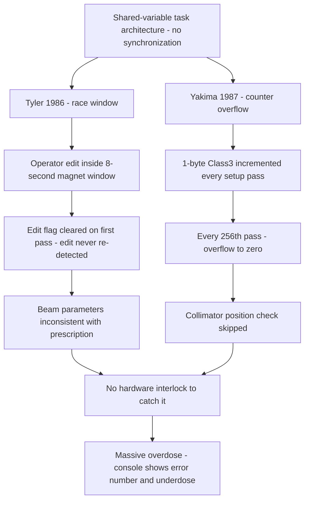

# Therac-25, 1985–1987: Race Conditions, Software-Only Interlocks, and Six Radiation Overdoses

## Overview

The Therac-25 was a computer-controlled radiation therapy machine (a medical linear accelerator) built by AECL (Atomic Energy of Canada Limited). Between June 1985 and January 1987, **six known accidents** involved massive radiation overdoses delivered by the Therac-25, causing deaths and serious injuries. Investigators Nancy Leveson and Clark Turner, writing in *IEEE Computer* in 1993, called them "the worst series of radiation accidents in the 35-year history of medical accelerators" [1].

The machine was recalled in 1987 for extensive design changes — "including hardware safeguards against software errors" [1]. The investigation identified two distinct software defects behind different accidents, from the same architectural roots:

- A **data-entry race condition** involving concurrent tasks communicating through shared memory variables with no synchronization — in which an operator's quick edit within an ~8-second window left the machine's beam settings inconsistent with the prescription on screen (the Tyler, Texas accidents).
- A **one-byte shared counter that overflowed to zero**, silently skipping a safety check every 256th pass through the setup code — so the beam fired with the turntable in the wrong position (the second Yakima, Washington accident).

Around both defects sat three systemic failures (CONFIRMED per [1]): the Therac-25 **relied on software for safety functions** that its predecessors enforced with independent hardware interlocks; its software **reused earlier-generation code** whose flaws carried over; and the manufacturer's response to early accidents was denial and patching rather than investigation. Related problems were later found in the Therac-20's software — harmless there *only because* the Therac-20 had hardware protection [1].

This is the founding case study of software safety engineering: "the software worked before" is not a safety argument.

## System Context

- **The machines.** AECL and the French company CGR had built the Therac-6 (X-ray only) and Therac-20 (dual mode) — versions of older CGR machines augmented with a DEC PDP-11 computer, with "industry-standard hardware safety features and interlocks in the underlying machines … retained" [1].
- **The Therac-25's design break.** Using AECL's new "double-pass" accelerator concept, the Therac-25 was designed to take advantage of computer control from the outset — not built on a stand-alone machine. "The Therac-25 relies more on software for these functions… AECL took advantage of the computer's abilities to control and monitor the hardware and decided not to duplicate all the existing hardware safety mechanisms and interlocks" [1]. It delivered either 25 MeV X-ray photons or electron beams at various energies.
- **Code reuse.** AECL's quality assurance manager wrote: "The same Therac-6 package was used by the AECL software people when they started the Therac-25 software" — and investigation later showed some Therac-20 routines were also used in the Therac-25 [1].
- **The 1983 safety analysis.** AECL's fault-tree analysis "apparently excluded the software." Its stated assumptions included: "Programming errors have been reduced by extensive testing… Any residual software errors are not included in the analysis," and "Program software does not degrade due to wear, fatigue, or reproduction process" [1].
- **The task architecture.** The control software ran as cooperating tasks on the PDP-11 — a treatment monitor task ("Treat") with eight subroutines, a concurrently running keyboard handler, a hardware-positioning task ("Hand"), and a housekeeping task ("Hkeper") performing interlock checks — coordinating through **shared variables**: the data-entry completion flag, the 2-byte mode/energy offset (MEOS), the treatment-phase variable (Tphase), the malfunction variable (F$mal), and the 1-byte Class3 counter [1].

## What Happened

| Date | Accident | Reported dose estimate | Source |
|---|---|---|---|
| Jun 3, 1985 | Kennestone Regional Oncology Center, Marietta, GA. Patient felt "a tremendous force of heat… this red-hot sensation" during a 10-MeV electron treatment. Manufacturer denied causation; injury investigated only much later | 15,000–20,000 rad across one or two doses (hospital physicist estimate); typical therapeutic dose ~200 rad | [1] |
| Jul 26, 1985 | Ontario Cancer Foundation, Hamilton. Machine shut down with "H-tilt," displayed "no dose"; operator re-proceeded four times per standard practice. Patient reported burning | 13,000–17,000 rad (AECL technician estimate) | [1] |
| Dec 1985 | First Yakima, WA incident. Patient developed striped erythema matching the blocking-tray slots; staff could find no cause. AECL wrote (Feb 24, 1986): "this damage could not have been produced by any malfunction of the Therac-25 or by any operator error." Attributed to "cause unknown" | (not established at the time) | [1] |
| Mar 21, 1986 | East Texas Cancer Center, Tyler. Operator's quick mode edit (X-ray → electron) within the ~8-second setup window; "Malfunction 54" displayed; operator pressed "P" to proceed as trained. Patient felt like his arm "was being shocked by electricity" | 16,500–25,000 rad in under 1 second over ~1 cm² (post-incident simulation) | [1] |
| Apr 11, 1986 | Tyler, second accident. Patient saw a flash of light and heard a sizzling sound; died May 1, 1986 (three weeks later) from acute high-dose radiation injury | (fatal) | [1] |
| Jan 17, 1987 | Second Yakima incident. Beam fired with turntable in field-light position; striped burn pattern again | 4,000–5,000 rad per attempt; 8,000–10,000 rad total vs 86 rad prescribed | [1] |

Outcomes (CONFIRMED, per [1]): the first Tyler patient died five months later from overdose complications; the second Tyler patient died three weeks after the accident; the second Yakima patient died in April 1987 from overdose complications. In March 1986, after the first Tyler accident, AECL sent users a letter recommending a temporary procedural fix allowing continued clinical use. The FDA declared the Therac-25 defective, and the final corrective action plan — more than 20 changes to hardware and software — "was not complete until more than two years after the Tyler accidents" [1].

## Technical Mechanism

### 1. The task architecture: cooperation without synchronization

The control software was a set of concurrently running tasks exchanging state through **shared memory variables**. Leveson and Turner's reconstruction (from AECL's own description to the FDA) shows the pattern [1]:

- The keyboard handler parses mode/energy and writes the 2-byte **MEOS** variable; its low-order byte drives the collimator/turntable via the Hand task, while its high-order byte is read later by the data-entry subroutine (**Datent**) to select calibration parameters.
- The keyboard handler sets a shared **data-entry completion flag** when the operator reaches the command line. But "the Data-entry completion variable by itself is not sufficient since it does not ensure that the cursor is located on the command line" — data-entry can be exited before all edits are applied.
- Bending-magnet setting takes **about 8 seconds**. During it, a delay routine (**Ptime**) checks a shared edit-request variable — but only if the bending-magnet flag is set, and Ptime clears that flag on its first execution, so **any edit made after the first pass is never recognized**.

INTERPRETATION (mechanism framing): each of these hand-offs is an unsynchronized read/write pair across tasks — a shared-memory hazard of the kind catalogued in [the concurrency memory-model page](../../concurrency/memory-model.md). There is no lock, no atomic test-and-set, no single-owner discipline; correctness depends entirely on the *wall-clock timing of human input* relative to an 8-second hardware operation.

### 2. The Tyler race window (March 21, 1986)

The operator's actions were routine: type the prescription, notice the mode was wrong ("x" instead of "e"), fix it with the cursor-up key, return to the command line, press "B" for beam — **all within 8 seconds**. Because the edit happened inside the magnet-setting window and Ptime had already cleared the flag that would have re-recognized it, "the editing had been completed by the return to Datent, which never detected that it had occurred" [1]. The machine proceeded with beam parameters for one mode/energy while other hardware was positioned for another — producing a concentrated, unscanned high-energy electron beam. The console reported "Malfunction 54" and an *underdose*; the sheet on the machine identified it only as a "dose input 2" error, and no hospital documentation explained it further [1]. The operator, accustomed to frequent benign malfunctions, pressed "P" to proceed — the worst possible action, and the one the interface trained her to take.

INTERPRETATION: the error-message design failure deserves its own line in the casebook — the console displayed a numbered malfunction and a dose reading that contradicted physical reality, while the instruments capable of catching the overdose were saturated. An interface that numbers its failure modes without exposing their meaning turns operators into random-number generators on the P key.

### 3. The Yakima counter overflow (January 17, 1987)

A different defect, same architectural family. During setup, the **Set-Up Test** subroutine executes "several hundred times" as it reschedules itself waiting for events. On each pass it **increments** the 1-byte shared variable **Class3**; nonzero means "inconsistent — do not treat." A concurrently running housekeeping task performs the upper-collimator position check **only if Class3 is nonzero**:

```text
Set-Up Test (each pass):
    Class3 = Class3 + 1          -- 1-byte variable, wraps at 256
    if F$mal == 0:               -- machine reports ready
        proceed to treatment setup

Hkeper -> Lmtchk:
    if Class3 != 0:
        run Chkcol               -- verify upper collimator position
    else:
        skip the check entirely  -- this is the bug
```

"On every 256th pass through Set-Up Test, the variable overflows and has a zero value. That means that on every 256th pass through Set-Up Test, the upper collimator will not be checked and an upper collimator fault will not be detected" [1]. The overdose occurred "when the operator hit the 'set' button at the precise moment that Class3 rolled over to zero": the software turned on the full 25 MeV beam "without the target in place and without scanning," concentrated by the stainless-steel mirror in the beam path [1]. AECL's fix was as simple as the bug: assign a fixed nonzero value each pass instead of incrementing [1].



### 4. Why the same bug was fatal on one machine and a nuisance on another

After the accidents, a physicist found the *same class of software defect* in the Therac-20 — it blew fuses when students edited parameters creatively. On the Therac-20 "the software error is just a nuisance… because this machine has independent hardware protective circuits for monitoring the electron-beam scanning. The protective circuits do not allow the beam to turn on" [1]. The Therac-25 "relies largely on software" where the Therac-20 relied on mechanical interlocks [1]. One design decision — which layer owns safety — is the entire difference between a blown fuse and a death.

### 5. The excluded software

The 1983 fault-tree analysis — the machine's formal safety case — excluded software errors by assumption, assigning probabilities like 10⁻¹¹ to "Computer selects wrong energy" with "no justification of either number" [1]. INTERPRETATION: this is the belief "software does not fail like hardware does," written into a safety document. Every subsequent organizational failure — the denials after Yakima I, the five-orders-of-magnitude claim after Hamilton, the retry-limit reduction (5 → 3) instead of the mandated suspend behavior, the two-year corrective-action timeline — follows from an architecture that moved safety into software and then declared software outside the safety analysis.

### Trigger vs Contributing Factors

**Triggers (CONFIRMED):** an operator edit inside the 8-second magnet-setting window (Tyler); the operator's "set" action coinciding with the 256th setup pass (Yakima II).

**Contributing factors (CONFIRMED):** shared-variable task coordination with no synchronization; a completion flag that did not mean what its name said; a counter used as a flag; software-only safety (no hardware interlocks); reused Therac-6/Therac-20 code; a fault-tree safety analysis that excluded software; an interface that trained operators to proceed through "Malfunction" messages; inadequate incident follow-up by the manufacturer (documented across the 1985–87 accidents).

**Contributing factors (INTERPRETATION):** operators' adaptation to frequent benign malfunctions ("operators had become accustomed to frequent malfunctions that had no untoward consequences" [1]) is a systemic factor, not a human one — the machine's normal behavior eroded the correct response to abnormal behavior. This is the everyday mechanism by which alarm fatigue becomes lethal in any alerting system.

## Why Safeguards Didn't Prevent It

- **The interlocks were removed by design.** The Therac-25's central architectural decision — software-only enforcement of safety functions — meant no independent layer could catch a software state error. Compare [defense-in-depth reasoning](../../arch/overview.md): a safety argument with one layer is not an argument.
- **The "flag" abstractions lied.** A completion flag that didn't mean completion; a counter whose zero meant both "consistent" and "I overflowed." Naming and typing failed at exactly the seams where tasks met.
- **Reuse spread the defect family.** Code from the Therac-6/Therac-20 lineage was inherited without the safety context that made it survivable there [1].
- **The safety analysis assumed the problem away.** Software errors were excluded from the fault tree by assumption [1]; the formal artifact then *certified* an unexamined risk.
- **Organizational responses suppressed signal.** Denial letters, unreproduced faults, procedural band-aids, and no mechanism to aggregate reports across sites [1] meant six accidents were needed to converge on two bugs — each, in code, a few lines.

## Lessons & Mitigations

1. **Synchronize every shared variable between concurrent tasks.** The Tyler race is a textbook unsynchronized hand-off; the primitives and their guarantees are in [atomic primitives](../../concurrency/atomic-primitives.md) and the [readers-writers problem](../../concurrency/readers-writers.md). In safety-critical settings, prefer one-writer ownership and deterministic sequencing.
2. **Never let a counter double as a flag.** Counters overflow; flags should be set, tested, and cleared with explicit invariants. Any variable whose *wrap-around* changes program behavior is a defect even if it "usually" works.
3. **Keep safety enforcement in a layer the software cannot corrupt.** Hardware interlocks, mechanical limiters, and analog monitors catch software state errors precisely because they do not share the software's state. Removing them saves cost until the day they are the only thing between a bug and a person.
4. **Treat reuse as a safety decision.** Inherited code carries inherited assumptions. The Therac-25 inherited the Therac-20's flaw *and* lost the Therac-20's protection.
5. **Design interfaces for the abnormal day.** Error messages must expose meaning and severity; proceeding-through-errors must not be the trained response to noise. Alarm fatigue is an interface defect with a body count.
6. **Investigate the first anomaly as if it were the last.** The paper's meta-lesson: "To attribute a single cause to an accident is usually a serious mistake" [1]. Failure to reproduce, aggregate, and escalate turned two small bugs into six accidents — the exact discipline [postmortem culture](../../sre/postmortem-culture.md) exists to institutionalize.

## Connection to This Repository

- [Concurrency overview](../../concurrency/overview.md) and [memory model](../../concurrency/memory-model.md) — shared-memory hazards and happens-before reasoning; the Tyler race is the canonical motivation.
- [Atomic primitives](../../concurrency/atomic-primitives.md) and [readers-writers](../../concurrency/readers-writers.md) — the synchronization the Therac-25 hand-offs lacked.
- [Architecture overview](../../arch/overview.md) — defense-in-depth and where safety enforcement belongs in a layered system.
- [Common failure modes](../../failure-modes/common-failures.md) — the generic "silent state corruption" pattern; compare with production-software echoes of these bugs.
- [Postmortem culture](../../sre/postmortem-culture.md) — what a real accident investigation requires, and what its absence cost here.
- [Operating systems overview](../../os/overview.md) — task scheduling and IPC models behind "cooperating tasks sharing memory."

## Interview Questions

1. Two tasks share a completion flag with no synchronization; a rare input-timing window causes one task to miss the other's update. Explain this as a memory-model problem, and give three designs (lock, atomic flag with correct semantics, single-writer ownership) that eliminate the window.
2. A 1-byte counter incremented once per loop iteration is also used as a consistency check. What is the failure mode, how often does it fire, and what naming/invariant discipline would have prevented the design?
3. Your product replaces a hardware-enforced safety mechanism with a software check to save cost. Construct the safety argument you would demand before approving that change — and explain why "we test extensively" does not satisfy it.
4. Therac-20 had the same software defect class and harmed no one; Therac-25 killed. What does this pair tell you about where reliability actually lives in a system, and how would you apply that in a design review?
5. A hospital reports "the machine burned a patient." The vendor's tests show no malfunction. Design the incident process — reporting, reproduction, aggregation across sites, regulator engagement — that converges on the truth in months, not years.

## Key Takeaways

- Two small defects — an unsynchronized shared-flag hand-off and a counter used as a flag that overflowed every 256th pass — produced six massive overdoses and multiple deaths, because there was no independent layer left to catch software state errors.
- The decisive architectural decision was *moving safety into software*: the same bug was a nuisance on the hardware-protected Therac-20 and fatal on the Therac-25.
- Reused earlier-generation code imported the defect family while the new design removed the protection that had contained it.
- The formal safety analysis excluded software by assumption — a reminder that a safety case is only as honest as its assumptions, and that "residual software errors are not included in the analysis" is a sentence that should stop any review.
- Interfaces matter at the moment of failure: a numbered "Malfunction 54," an underdose reading, and trained reflexes to press "P" turned operator behavior into an amplifier of the bug.

## Sources

1. Nancy G. Leveson and Clark S. Turner, "An Investigation of the Therac-25 Accidents," *IEEE Computer*, Vol. 26, No. 7, July 1993, pp. 18–41. Reprinted with permission in four parts at MIT: https://web.mit.edu/6.033/2004/wwwdocs/papers/Therac_1.html (part I), …/Therac_2.html, …/Therac_3.html, …/Therac_4.html (all four parts fetched and quoted; URLs verified at time of writing)

## Cross-References

- [Concurrency memory model](../../concurrency/memory-model.md) — the theory of the race windows described here.
- [Atomic primitives](../../concurrency/atomic-primitives.md) — the synchronization the Therac-25 lacked.
- [Knight Capital, 2012](./knight-capital-2012.md) — dead code and stale safety assumptions in a trading system; the production-software echo of "the code worked before."
- [Cloudflare regex, 2019](./cloudflare-regex-2019.md) — a removed protective layer with no test to notice; the modern echo of removing hardware interlocks.
- [Postmortem culture](../../sre/postmortem-culture.md) — the institutional discipline whose absence prolonged this crisis across two years and six accidents.
- [Architecture overview](../../arch/overview.md) — layered safety and defense-in-depth.
