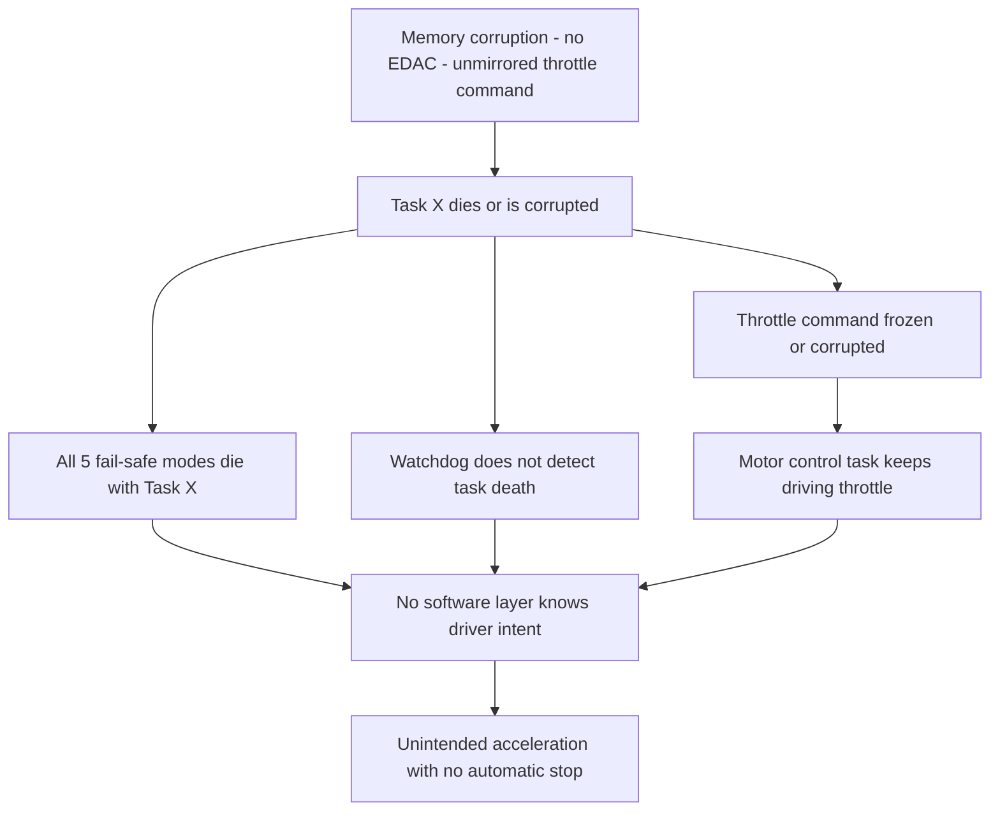

# Toyota Unintended Acceleration, 2009–2011: Two Mechanical Recalls, a Cleared-Then-Contested Throttle Controller, and What the Source Code Showed Later

## Overview

Between August 2009 and early 2010, Toyota became the center of the largest vehicle-safety crisis in modern US history. A fatal crash near San Diego on August 28, 2009 — an off-duty California Highway Patrol officer and three family members killed when their loaner Lexus ES 350 could not be stopped — triggered recalls covering nearly eight million vehicles for two mechanical defects: accelerator pedals that could become trapped by floor mats, and a "sticky" accelerator pedal [3][5]. Allegations that the electronic throttle control system itself could open the throttle without driver input dominated congressional hearings in February 2010 and led Congress to direct NHTSA to investigate [3].

CONFIRMED (per the US Department of Transportation): a ten-month NHTSA–NASA study released in February 2011 analyzed more than 280,000 lines of software code, tested vehicles against electromagnetic interference, and "found no electronic flaws in Toyota vehicles capable of producing the large throttle openings required to create dangerous high-speed unintended acceleration incidents"; the two mechanical defects "remain the only known causes" [3]. Toyota paid $48.8 million in civil penalties for recall-timeliness failures [3].

The story does not end there, and this page labels the contested part as contested. In October 2013, in *Bookout v. Toyota*, embedded-software expert Michael Barr presented a source-code analysis of the 2005 Camry throttle controller: a ~94%-full stack with recursion, over 11,000 global variables, no error-detecting memory, critical variables left unmirrored, all five fail-safe modes living in the same task as throttle control, and a watchdog incapable of detecting most task deaths [4]. The jury found for the plaintiffs [5]. NASA's clearance and Barr's findings are not simply contradictory — a regulator cleared the system of *causing* the accidents, while expert review exposed an architecture that could not *survive* the faults its designers had assumed away.

## System Context

- **Electronic throttle control (ETCS).** Toyota replaced cable-driven throttles with drive-by-wire: an electronic control module (ECM) reads the accelerator pedal sensors and commands an electric motor that opens the throttle. NASA's report described Toyota's ETCS-i as "an example of a safety-critical hard real-time system" — quoted in Barr's analysis [4]. The definition of the problem under study, shared by NHTSA, NASA, and Barr, was "any degree of acceleration that the vehicle driver did not purposely cause" [2][4].
- **The hardware.** The 2005 Camry L4 ECM contained a main CPU (a NEC V850) running the throttle control software, plus a separate monitor chip (the Denso ESP-B2) running independent checks [4][5]. The monitor chip implements a "brake echo check" and "system guards" intended to catch main-CPU misbehavior [4].
- **The software.** The main CPU ran 24 concurrently scheduled tasks ("apps") on a Toyota-specific OSEK-style operating system [4]. OSEK is the automotive industry's standard real-time OS API, designed so that suppliers can build certifiable, compatible kernels; Toyota's version was non-standard and never certified as OSEK-compliant, although certified OSEK products for the same CPU existed by 2002 [4].
- **The regulator's study.** NASA's Engineering and Safety Center team was enlisted by NHTSA at Congress' request in spring 2010 [3]. The published artifacts are NASA's *Technical Assessment Report: Toyota Unintended Acceleration Investigation* [1] and NHTSA's *Technical Assessment of Toyota Electronic Throttle Control* [2].

## What Happened

| Date | Event | Source |
|---|---|---|
| Sep 2007 | First floor-mat recall (fasten mats); the mechanical defect class was already known | [5] |
| Aug 28, 2009 | Saylor crash, San Diego: Lexus ES 350 loaner with an incompatible floor mat trapping the pedal; all four occupants killed; 911 call from the passenger; vehicle exceeded 100 mph; brake-rotor damage consistent with prolonged braking | [5] |
| Oct–Nov 2009 | Wider floor-mat entrapment recall after the Saylor crash | [3][5] |
| Jan 2010 | "Sticky pedal" recall (pedal armature friction), expanding the recalls to ~8 million vehicles in the US for the two mechanical defects | [3][5] |
| Feb 2010 | Toyota's president testifies to US Congress; electronic-throttle allegations take center stage | [5] |
| Spring 2010 | NHTSA, at Congress' request, enlists NASA's Engineering and Safety Center for a 10-month study of electronic causes | [3] |
| Dec 2012 | Toyota settles the economic-loss class action for $1.6 billion (Toyota denied the claims; the settlement included brake-override firmware updates for some models) | [5] |
| Feb 2011 | NHTSA and NASA release their reports: no electronic flaw found capable of dangerous high-speed UA; mechanical defects remain the only known causes; NHTSA announces rulemakings (brake override, keyless ignition, event data recorders) and research into ECU reliability and security | [3] |
| Oct 2013 | *Bookout v. Toyota* (Oklahoma): after Barr's source-code testimony, the jury finds Toyota liable for a fatal 2007 crash of a 2005 Camry; $3 million compensatory award; Toyota settles before punitive damages | [4][5] |

INTERPRETATION (framing): every row above is traceable to a cited source. What the table cannot show is the interpretive fight that followed 2011: NASA's "no electronic flaw found" was widely reported as exoneration, while NASA's own principal engineer worded it more narrowly — "NASA found no evidence that a malfunction in electronics caused large unintended accelerations" [3]. Koopman, who testified as a plaintiff expert, observes that NASA "didn't find a smoking gun" and "did not exonerate the system" [5]. Both statements can be true at once; the distinction matters and is revisited below.

## Technical Mechanism

### 1. One task owned both the throttle and the fail-safes

Barr's review of the 2005 Camry L4 source code found that the throttle angle command — the global variable that the motor-control task reads and drives to the physical throttle — was recalculated every 8 ms by a central task ("Task X"), and that **all five** of Toyota's fail-safe modes (limp-home modes, idle fuel cut, engine off) lived in that same task [4]. A diagnostic system that must report faults also needs Task X. INTERPRETATION (mechanism framing, from [4]'s data): this collapses the fault-containment boundary. If memory corruption kills Task X, the vehicle loses not only correct throttle control but every software mechanism designed to *notice* that throttle control is lost. This is the same single-layer safety architecture the [Therac-25 case](./therac-25.md) documented — safety enforcement and the code it supervises in one failure domain.

### 2. Memory corruption had unblocked paths

Barr identified, in the actual 2005 Camry source, every corruption class he tested for: buffer overflows, invalid pointer arithmetic, race conditions between tasks, nested scheduler unlocks, unsafe casting, and stack overflow [4]. Three specifics stand out:

- **Critical variables were not mirrored.** Toyota's engineers knew about corruption and mirrored many critical variables in a second location for cross-checking — but the OSEK internal data structures and the target throttle angle itself were among the variables left unmirrored [4]. A corrupted throttle command is *indistinguishable from a driver pressing the pedal* [4].
- **No error-detecting memory.** The main CPU's RAM had no EDAC/ECC protection against single-bit flips. Critically, NASA had been told EDAC was present and credited it in its analysis; Toyota's representations to NASA were wrong on this point [4][5].
- **Stack overflow was plausible, not theoretical.** Toyota's own worst-case stack analysis had told NASA the stack was under half used [4]. Barr's re-analysis, accounting for calls through function pointers, library and assembly functions (~350 functions Toyota's analysis ignored), operating-system stack use during context switches, and recursion in the code, put worst-case stack usage at approximately **94%** [4]. Recursion violated MISRA-C rules of the era, and the cheaper 2005 Corolla ECM included a runtime stack monitor that the 2005 Camry lacked [4].

### 3. The watchdog could not do a watchdog's job

A watchdog's reason to exist in a 24-task system is to detect the death of tasks. Barr's findings about Toyota's watchdog supervisor: it was "incapable, ever, of detecting death of majority of tasks"; it allowed vehicle misbehavior from CPU overloads lasting up to 1.5 seconds; it reset the watchdog hardware from a timer-tick ISR unconditionally; and it explicitly ignored and discarded most operating-system error codes [4]. The independent monitor chip's checks fared no better: the "brake echo check" depends on the driver pressing the brake — after the unintended acceleration has already begun — and Toyota had never reviewed the monitor chip's source code at all (Toyota did not receive or review it; NASA did not review it either) [4]. Barr Group's own review of the Denso ESP-B2 source found the monitor's "system guards" all useless after Task X death, because none of them knew the driver's intent [4].

### 4. The chain NASA had hypothesized is the chain Barr demonstrated

NASA's report contained a fault-condition table seeking the combination "single memory corruption results in UA," "fault escapes detection," "no EDAC error," "idle fuel cut not active," "watchdog serviced," and monitor-CPU "does not detect failure," with throttle "openings up to wide open throttle" [4, quoting NASA report p. 78]. Barr's summary of his own findings: each condition NASA listed held in the 2005 Camry — there is no EDAC, the fail-safes share Task X, the watchdog services itself, and the monitor CPU was not designed to detect this failure class [4]. In vehicle testing commissioned for the litigation, a task-death condition produced ~30 seconds of unintended acceleration with no fail-safe acting, and when the driver's foot was on the brake at the moment of task death, the acceleration persisted until the driver fully removed the foot — confirmed in tests [4]. Braking against a wide-open throttle is unforgiving: NHTSA test data presented by Koopman shows required pedal force rising from roughly 15–44 pounds with vacuum assist to an average of about 175 pounds once vacuum is depleted [5].

### Trigger vs Contributing Factors

**Triggers (CONFIRMED):** the two mechanical causes NHTSA identified — floor-mat entrapment of the pedal and the sticky-pedal armature — are the only causes established for the recall population [3]. Whether ETCS software faults caused specific UA accidents is **contested**: NASA found no electronic cause for the dangerous incidents it examined [1][3]; the *Bookout* jury found on Barr's and Koopman's evidence that ETCS defects caused the 2007 Bookout crash [5]; Toyota disputes to this day that its ETCS is flawed [5]. This page holds both positions and attributes each.

**Contributing factors (CONFIRMED, from the source-code analysis [4]):** >11,000 global variables and 67 functions with cyclomatic complexity above 50 (the throttle angle function scored over 100) — NASA's own metrics, quoted by Barr; more than 80,000 MISRA-C rule violations counted by Barr (NASA reported over 7,000 violations of a subset); a non-standard, uncertified OS; unenforced internal coding standards; no bug-tracking system and untracked peer reviews; no EDAC; unmirrored critical variables; shared-task fail-safes; a weak watchdog; an unreviewed monitor CPU.

**Contributing factors (INTERPRETATION):** Barr characterized the result as a "house of cards" safety architecture [4] — each layer presupposed the layers below it worked, so a single fault could defeat all of them simultaneously. That is an engineering judgment, but it follows mechanically from the architecture documented above and matches NASA's own wish-list of conditions that should have been impossible [1][4].

## Why Safeguards Didn't Prevent It

- **The safety layers were not independent.** Mirroring, fail-safe modes, the watchdog, and the monitor chip were each supposed to catch what the previous layer missed, but they shared code, state, and in one case the very task they were guarding [4]. Defense-in-depth with shared failure modes is a diagram, not a defense (see [architecture overview](../../arch/overview.md)).
- **The watchdog was serviced by the thing it watched.** Resetting the watchdog timer from the tick ISR regardless of task health converts a supervisory mechanism into a self-congratulation loop [4].
- **The regulator worked from unverified inputs.** NASA's analysis credited EDAC that did not exist and a stack margin that was not real, because it was told so [4][5]. Claims about one's own system ("the stack is less than half used", "RAM has EDAC") must be measured, not attested.
- **The monitor chip was outside the review perimeter.** Toyota did not review its supplier's monitor software; NASA's review covered the main CPU only [4][5]. The safety boundary stopped exactly where organizational responsibility stopped — the Therac-25 pattern again.
- **No memory protection.** All 24 tasks ran in one address space with no MMU-enforced isolation, so any task's bug could corrupt any other task's state, including the throttle command [4]. There was not even a hardware fence between components.
- **"We tested and found nothing" was treated as an argument.** Barr's test-space analysis shows over 16 million task-death combinations, each reachable in thousands of internal states [4]; a test campaign that samples this space cannot certify its complement. This exhaustive-testing fallacy recurs in the [Ariane 5 case](./ariane-5-1996.md).

## Blast Radius and Impact

- **Vehicles:** nearly 8 million recalled in the United States for the two mechanical defects [3], across multiple models and generations.
- **Penalties and litigation:** $48.8 million in US civil penalties for recall-timeliness failures — then-record amounts [3]; a $1.6 billion economic-loss class settlement (December 2012) [5]; the *Bookout* verdict and subsequent mass settlements [5].
- **Institutional:** congressional hearings [5]; a NHTSA rulemaking agenda on brake override, keyless ignition, and event data recorders [3]; a National Academy of Sciences study of automotive electronics commissioned alongside the NASA work [3][7].
- **Human:** the Saylor crash killed all four occupants [5]. NHTSA's reports do not enumerate UA fatality totals, and this page does not either — complaint-based fatality figures circulating in press coverage were not verified against a primary source.

## What Changed — Operator and Industry

**Toyota (CONFIRMED elements):** brake-override firmware — which makes the brake override the accelerator — shipped for some recent models in the $1.6 billion settlement [5] and became the subject of NHTSA's proposed rulemaking [3]. NHTSA also announced standardization work on keyless ignition and event data recorders, plus research programs on the reliability and security of electronic control systems and on pedal placement and misapplication [3].

**Industry:** the crisis landed the same year the automotive functional-safety standard ISO 26262, "Road vehicles — Functional safety", was first published (2011) [8], and the case became a standing exhibit in its argument: safety-relevant software needs enforced coding rules, worst-case resource analysis, independent supervision, and an auditable process. The National Academies' 2012 study of automotive electronics [7] institutionalized the lesson that electronics inspection is a core regulator competence. Koopman's post-case assessment: "the bar is raised, at least for now" — Toyota's aftermath became the reference point other manufacturers were measured against [5].

INTERPRETATION: the deepest change was rhetorical. Before 2009, "the electronics were tested" could end a defect investigation. After a jury read 94% of a stack and 11,000 globals in open court, claims about embedded software quality became auditable, adversarial, and expensive.

## Lessons for Engineers

1. **Put fail-safes in a different fault domain from the thing they guard.** All five limp-home modes sharing the throttle task meant corruption of one region defeated every safety response at once [4]. Containment boundaries must be enforced by structure (separate tasks, separate memory, separate hardware), not by good intentions — the [bulkheads](../../sre/bulkheads.md) principle in its hardest form.
2. **A watchdog must supervise health, not heartbeat.** Servicing the timer unconditionally from an ISR while discarding OS error codes [4] means the mechanism exists in hardware only. Design watchdogs around task-aliveness checks with independent authority to reset or fail safe.
3. **Measure what you were told.** NASA built on two false attestation (EDAC present; stack under half used) [4][5]. In any review, re-measure claimed invariants: stack watermarking, memory-protection registers, and mirroring checks are all mechanically verifiable.
4. **Resource headroom is a safety property.** A 94% worst-case stack with recursion and no runtime monitoring [4] leaves zero margin for the unexpected. Budgets (stack, CPU, interrupt latency) need margin policy, not just measurement.
5. **Absence of evidence is narrow.** "No electronic flaw found" meant exactly that [3]. When your system's safety case depends on the complement of a test set, say so explicitly — and let others see what was *not* tested (the monitor chip [4][5]).
6. **Code quality is a safety argument.** Six-figure MISRA violation counts, five-figure global-variable counts, and unmaintainable functions [4] are the statistical substrate from which the *next* memory-corruption bug is drawn. Enforce the standards you publish — Toyota's own coding rules were violated in the very code they governed [4].
7. **Reproduce, then argue.** The litigation advanced because vehicle tests reproduced UA behavior from task death [4], converting plausibility into an artifact. An incident claim without a reproduction is a hypothesis — the discipline [postmortem culture](../../sre/postmortem-culture.md) institutionalizes.

## Connection to This Repository

- [Therac-25](./therac-25.md) — the founding case for software-only safety and reused code; Toyota repeats the pattern with a watchdog twist.
- [Ariane 5 Flight 501](./ariane-5-1996.md) — reused code operating outside its validated assumptions; both cases turned on unvalidated inputs to the safety case.
- [Knight Capital, 2012](./knight-capital-2012.md) — dormant code and stale state in a latency-critical system; both incidents price technical debt in absolute dollars.
- [CrowdStrike, 2024](./crowdstrike-july-2024.md) — a safety-relevant kernel agent whose parser was not memory-safe; the modern production echo of throttle-controller defects.
- [Real-time systems](../../embedded-systems/real-time-systems.md) — scheduling, watchdogs, and worst-case execution in embedded control loops.
- [RTOS fundamentals](../../embedded-systems/rtos.md) — the task/OS model (OSEK included) whose misuse is catalogued above.
- [Common failure modes](../../failure-modes/common-failures.md) — the generic patterns: shared-fate safeguards, unverified attestations, runaway actuation.
- [Architecture overview](../../arch/overview.md) — defense-in-depth and where enforcement layers belong.

## Interview Questions

1. Your 24-task embedded controller has a watchdog serviced from the timer ISR. Which failure classes can it not detect, and how would you redesign it so task death is caught within one supervision period?
2. A supplier attests that "the stack is less than half used" and "RAM has EDAC." What measurements would you require before building a safety case on those claims, and why did this question decide the Toyota litigation?
3. All fail-safe modes of your throttle controller live in the same task as throttle control. Describe the failure sequence that defeats every limphome mode at once, and give two architectural changes with their trade-offs.
4. NASA found "no electronic flaws capable of producing large throttle openings"; later litigation found stack overflows, recursion, and unmirrored throttle commands. Reconcile the two findings — what did each party actually measure?
5. Your team's coding standard has 11 rules and the code violates 5 of them. Construct the engineering argument (not the compliance argument) that unenforced standards predict memory-corruption defects, using the Toyota numbers (>11,000 globals, >80,000 violations) as evidence.

## Key Takeaways

- Two mechanical defects were the confirmed causes of the recall wave, but the deeper lesson survived every appeal: the throttle software could not detect or contain its own faults — no EDAC, unmirrored commands, fail-safes in the dying task, a watchdog blind to task death [3][4].
- The stack told the story in one number: reported under 50% used; measured worst case with recursion, function pointers, library code, and OS context switches was ~94% [4]. Reported margins are hypotheses until measured.
- NASA's clearance was narrow and honest — "no evidence that a malfunction in electronics caused large unintended accelerations" [3] — but the review perimeter stopped at the main CPU and was fed unverified attestations [4][5]. Reviews inherit the blind spots of their inputs.
- Safety architecture fails at its shared assumptions: every layer Barr examined presupposed the others worked [4] — the Therac-25 pattern, recurring wherever "monitoring" shares state with the monitored.
- The aftermath — $48.8M penalties, a $1.6B settlement, brake-override rulemaking, ISO 26262's rise [3][5][8] — converted a litigation record into requirements; embedded software quality became a matter of public record.

## Sources

1. NASA Engineering and Safety Center, *Technical Assessment Report: Toyota Unintended Acceleration Investigation* (prepared for NHTSA; released February 2011, report version 1.0 dated April 2011). https://www.nhtsa.gov/sites/nhtsa.gov/files/nasa-ua_report.pdf (URL fetched live this session; PDF metadata confirms NESC/Langley authorship; content quoted via [3][4][5])
2. NHTSA Office of Defects Investigation, *Technical Assessment of Toyota Electronic Throttle Control* (EA11-001 report, February 2011). https://www.nhtsa.gov/sites/nhtsa.gov/files/nhtsa-ua_report.pdf (URL verified via search; not full-text fetched; quoted definition of UA reproduced in [4])
3. U.S. Department of Transportation, "U.S. Department of Transportation Releases Results From NHTSA-NASA Study of Unintended Acceleration in Toyota Vehicles" (press release accompanying the February 2011 report release). https://www.transportation.gov/briefing-room/us-department-transportation-releases-results-nhtsa-nasa-study-unintended-acceleration (fetched and quoted; page carries a later re-publication date, quoted text is the original release)
4. Michael Barr, *Bookout v. Toyota — 2005 Camry L4 Software Analysis*, presentation slides (Barr Group, October 2013). Mirror fetched in full: https://homepage.cs.uiowa.edu/~tinelli/classes/181/Fall14/Papers/Barr13.pdf (also distributed at https://www.safetyresearch.net/Library/BarrSlides_FINAL_SCRUBBED.pdf)
5. Philip Koopman, *A Case Study of Toyota Unintended Acceleration and Software Safety* (Carnegie Mellon University, September 2014). https://cps-vo.org/sites/cps-vo.org/files/cpsvo_file_nodes/A_Case_Study_of_Toyota_Unintended_Acceleration_and_Software_Safety.pdf (fetched and quoted)
6. IEEE Spectrum, "NASA Can't Find Unintended Acceleration Causes in Toyota's Electronic Throttle Control System" (February 9, 2011). https://spectrum.ieee.org/nasa-cant-find-unintended-acceleration-causes-in-toyotas-electronic-throttle-control-system- (URL verified via search; contemporaneous corroboration of the February 2011 release)
7. National Research Council, *The Safety Challenge and Promise of Automotive Electronics: Insights from Unintended Acceleration* (National Academies Press, 2012). Cited by title (no URL used)
8. ISO 26262, *Road vehicles — Functional safety* (first edition, 2011). Cited by title (no URL used)

## Cross-References

- [Therac-25, 1985–87](./therac-25.md) — software-only interlocks and reused code; the original template for the safety-architecture failures documented here.
- [Ariane 5 Flight 501, 1996](./ariane-5-1996.md) — inherited code run outside its validated envelope; unvalidated assumptions reaching the safety case.
- [Knight Capital, 2012](./knight-capital-2012.md) — stale code and repurposed state in a money-critical real-time system.
- [CrowdStrike, July 2024](./crowdstrike-july-2024.md) — memory-unsafe parsing in a privileged agent; the fleet-scale echo of single-controller fragility.
- [Real-time systems](../../embedded-systems/real-time-systems.md) — watchdog supervision, scheduling, and resource budgets for control systems.
- [RTOS fundamentals](../../embedded-systems/rtos.md) — the OSEK-style task model and where its assumptions break.
- [Concurrency memory model](../../concurrency/memory-model.md) — shared-state hazards when tasks cooperate without synchronization or protection.
- [Common failure modes](../../failure-modes/common-failures.md) — generic patterns including shared-fate safeguards and unbounded actuation.
- [Postmortem culture](../../sre/postmortem-culture.md) — how a regulator's report and a courtroom expert report compare with blameless postmortems.
- [Architecture overview](../../arch/overview.md) — defense-in-depth, containment boundaries, and layered safety.
