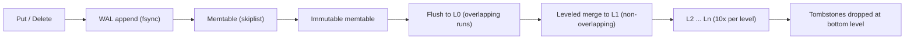

# Follow-up Tree: LSM Trees and Compaction

## Overview

"Why does a write-optimized database like Cassandra, RocksDB, or many time-series stores use an LSM tree?" is the storage-engine opener that escalates directly into the numbers senior candidates are expected to carry: write amplification, read amplification, and space amplification — the three-way budget that every compaction strategy spends. The ladder here runs from the write path (WAL, memtable, immutable SSTables — the mechanism that converts random writes into sequential ones), through compaction strategies (leveled, tiered, FIFO, time-window — each a different place to hide the merge cost), into the amplification triangle itself, where bloom filters, tombstones, and write stalls make the trade-offs concrete, and ends at the judgment: which amplification your workload can afford. The thread tying every rung together is *immutability deferred*: an LSM tree never edits data in place, so every read and every deletion becomes a question of which immutable files have been merged lately — and compaction is the background industry that pays that debt. This chain deliberately does not cover generic indexing: the B+tree ladder, clustered-versus-secondary indexes, and column-order questions are owned by [Database Indexes](./database-indexes.md), and the structure-to-mechanism map is the atlas page [DB Indexes & Data Structures](../connection-atlas/db-indexes-data-structures.md). The book-level deep dives are [LSM Trees](../../dbms/internals/lsm-trees.md) and [Compaction](../../dbms/internals/compaction.md); the primary implementation sources are RocksDB's [Leveled Compaction](https://github.com/facebook/rocksdb/wiki/Leveled-Compaction) and [Tuning Guide](https://github.com/facebook/rocksdb/wiki/RocksDB-Tuning-Guide) wikis and [ScyllaDB's compaction docs](https://docs.scylladb.com/stable/cql/compaction.html), with the original design in O'Neil et al., "The Log-Structured Merge-Tree" (1996, cited by title). Each level states what a weak answer sounds like, what the strong answer adds, and the follow-up that escalates.

## The Opening Question

**"Why do write-heavy databases use LSM trees instead of B+trees?"**

The expected core answer: because the cheapest I/O a disk does is sequential, and an LSM tree is an architecture for making every write sequential. A write appends to a write-ahead log for durability, lands in an in-memory memtable (typically a skiplist), and when the memtable fills it is flushed *as-is, sorted* — an immutable SSTable on disk. Nothing in place is ever edited: an update is a newer entry in a newer file, a delete is a tombstone marker. Reads, then, may consult several sorted runs (memtable, newest files down to oldest level), so the engine adds per-run bloom filters and per-file index blocks to skip runs that cannot contain the key, and merges results from newest to oldest. Over time, background *compaction* merges runs together, dropping shadowed versions and satisfied tombstones. The punchline: the LSM tree trades read simplicity for write throughput — writes are sequential appends and merges; reads pay to learn which of several files holds current truth.

A weak answer recites "it's a tree optimized for writes" without the WAL→memtable→SSTable pipeline or the word *immutable*. The strong answer names the path, states the invariant (sorted runs, newest shadows oldest), and volunteers the bill: reads and compaction I/O are the price of the write path. The follow-up that escalates: **"You never edit files — so when does the mess of overlapping runs get cleaned up, and who pays?"** — which moves the ladder from write path to compaction.

## Level 2: The Write Path and the Shape of the Data

**What it tests:** whether the memtable-to-SSTable pipeline is a mechanism with named components and invariants — WAL semantics, flush behavior, file layout — or two buzzwords.

**Weak answer:** "Writes go to memory, then to disk in sorted files" — no WAL (so the durability story is missing), no immutable-memtable step, no idea what is *inside* an SSTable or why L0 files overlap.

**Strong answer:** walks the pipeline with its invariants: the WAL record is fsynced before the memtable insert is acknowledged (crash recovery replays the log); the full memtable becomes an immutable in-memory buffer, then a flush writes it as one SSTable; an SSTable is sorted *blocks* with an index block, usually a bloom filter and per-block compression, so a lookup is one bloom check, one index search, one block read; and L0 exists precisely because flushed files are *not* merged with each other — they overlap in key range, which is why L0 lookups may check every L0 file in newest-first order.

**Escalation trigger:** "Why are tombstones dangerous in an LSM tree? Delete a key and tell me exactly when its disk space comes back."

**Answer.** The tombstone is just another entry — a marker in a newer run asserting the key is dead — and its cleanup has *two* preconditions: a compaction must reach the key, and the merge must know no older run anywhere below still holds the live version. In leveled compaction, when the tombstone's level merges with the next one down, the old value is discarded; but the tombstone itself usually survives the merge until it reaches the *bottommost* level, because only there can the engine prove nothing older exists. So a delete's space returns only after the marker migrates to the bottom — a long trip for a cold key, during which the marker occupies space, participates in reads, and enlarges every run it passes through. The failure mode: *millions of tombstones from a mass delete or churn-heavy workload* — reads slow because every run must be checked for the dead key, and space grows while usage falls. The operational answers: bound and spread bulk deletions, let TTL data (time-window compaction) drop whole expired windows instead of per-key tombstones, and watch snapshots — a long-lived snapshot pins the visibility horizon, forcing compaction to preserve data older reads may need. The senior sentence: in an LSM tree, a delete is a write that requests a future cleanup, and the cleanup schedule *is* the compaction policy.

The design twist the strong candidate volunteers: *immutability is what makes compression and caching honest* — blocks are never updated, so checksums are stable, page caches hold immutable bytes, and merges are the only mutation, which is why LSM files survive crashes without in-place corruption recovery. The follow-up that escalates: **"There are several compaction strategies. What does each buy, and what does each cost?"**

## Level 3: Compaction Strategies — Leveled, Tiered, and Their Kin

**What it tests:** whether compaction is a policy space you can reason about — per-strategy read/write/space amplification — or one word meaning "background merging."

**Weak answer:** "Compaction merges files in the background" — cannot name two strategies, cannot say why Cassandra defaults differ from RocksDB, and has no number for what compaction costs in writes.

**Strong answer:** names the spectrum. *Leveled* (RocksDB default, per [Leveled Compaction](https://github.com/facebook/rocksdb/wiki/Leveled-Compaction)): each level is non-overlapping and about 10x the level above; when a level exceeds its target, one range of files is merged into the next — low read amplification (a key lives in at most one file per level) at high write amplification (each byte is rewritten once per level it descends). *Tiered* (classic Cassandra STCS): runs of similar size are merged into bigger runs — cheap writes (fewer rewrites) but many overlapping runs, so reads may open many files and space roughly doubles during merges. *FIFO*: drop or archive the oldest beyond a threshold — no compaction machinery, only for tiny caches. *Time-window*: bucket by time and merge within a window — the time-series answer, where expiry replaces deletion.

**Escalation trigger:** "Your write-heavy workload sees p99 write latency spikes every few minutes. Where in the LSM engine do you look first?"

**Answer.** At the boundary where foreground writes meet background merging: the *write stall*. The engine must bound its own resource use, so it throttles or blocks writes when compaction falls behind — L0 file count past a threshold slows writes (more overlapping runs to check on read, more work per merge), memtable pile-up forces flush waits, and pending-compaction-bytes limits stop new writes entirely until the backlog drains. The stall is not a bug; it is the engine converting a compaction-energy deficit into backpressure. The diagnosis path: check backlog and L0 counts against flush rate; usual causes are a flush rate the compaction threads cannot match (undersized background jobs, CPU saturation), a size-tiered strategy that accumulated overlapping runs, or bursty ingestion that outruns steady-state merge capacity — where rate-limiting *ingestion* is the correct fix, since the LSM tree can only merge at disk speed. The numbers that make the rung senior: leveled compaction typically costs roughly 10–30x the live data volume in rewrite traffic over a key's descent (one rewrite per level, fanout ~10 per level), which is why write amplification is measured as bytes-written-per-byte-logical — and why the same write load a B+tree pays as random-page dirt, an LSM pays as sequential rewrites plus merges — a different tail-latency shape ([Compaction](../../dbms/internals/compaction.md) walks the scheduler view).

The design twist: *tiered and leveled are two points on one dial* — how aggressively you merge to preserve read/space efficiency at the price of rewrites. RocksDB's universal and ScyllaDB's incremental compaction are midpoints on this dial ([ScyllaDB's strategy docs](https://docs.scylladb.com/stable/cql/compaction.html) list the knobs). The follow-up that escalates: **"Name the three amplifications and how a change to one moves the other two."**

## Level 4: The Amplification Triangle and Tuning Judgment

**What it tests:** the expert rung — the R/S/W amplification budget as a quantitative design tool: bloom-filter sizing, compression choices, and the workload-driven verdict that ends the ladder.

**Weak answer:** can name "read, write, and space amplification" but cannot derive how a bloom filter's false-positive rate buys back read amplification, or why compressing harder can *worsen* compaction.

**Strong answer:** works the triangle. *Read amplification:* the number of files a lookup may touch — bounded by levels (one per level in leveled) times bloom-filter misses; a bloom filter at ~10 bits/key gives roughly a 1% false-positive rate, converting memory directly into skipped file reads. *Write amplification:* bytes written per byte logical — dominated by level fanout in leveled, reduced by bigger memtables or a move to tiered. *Space amplification:* live bytes plus shadowed versions plus unsatisfied tombstones plus merge transient copies — tiered's weakness, leveled's managed one, and the reason block-level compression interacts with compaction (compressed blocks merge less surgically: rewriting one entry rewrites its compressed block).

**Escalation trigger:** "Design the storage engine choice and tuning for: (a) a write-once metrics store, (b) a read-mostly OLTP table, (c) a churny KV cache with 30-second TTLs. Justify with amplification."

**Answer.** (a) *Write-once, never-updated, TTL-expires:* LSM with time-window or tiered compaction — writes are appends, reads are point lookups that bloom filters make cheap, and expiry drops whole windows without tombstone storms; minimizing write amplification matters because ingest dominates the disk budget. (b) *Read-mostly OLTP:* B+tree — updates happen in place within pages, so read amplification is one page traversal with a warm buffer pool, and the LSM's background merge I/O would compete with the read workload it serves; if the engine is LSM anyway, tune toward leveled with aggressive bloom filters and a big block cache. (c) *Churny short-TTL cache:* FIFO or time-window LSM — data is written, read a few times, and expires whole; the wrong answer is leveled, which would pay write amplification repeatedly to preserve order for data that death is about to retire. The judgment that ends the chain: the engine choice is not "LSM vs B+tree, which is better" but *which amplification the workload has headroom for* — write-heavy and append-like forgives read complexity; read-heavy and update-heavy forgives write complexity; everything else is tuning the dial between them ([LSM/B+tree Hybrid Engines](../../dbms/internals/lsm-btree-hybrid-engines.md) covers the engines that split the workload by temperature). The senior coda: measure the triangle — bytes-written per logical byte, files-touched per lookup, live-versus-physical ratio — because vendor defaults guess at a workload that is not yours.

## How to Approach Unfamiliar Variations

The template for storage-engine variations — "add upsert-heavy traffic," "the compaction backlog keeps growing," "why is disk usage 3x the data":

1. **Locate the write on the pipeline first.** WAL → memtable → flush → merge: every symptom (slow put, growing disk, slow get) maps to one stage. Slow puts are stalls; growing disk is uncompacted shadow data; slow gets are read amplification across runs.
2. **Answer strategy questions in amplification, not adjectives.** "Leveled is good for reads" means low read amplification, high write amplification — say the direction and roughly why (fanout rewrites per level).
3. **Treat deletion as a scheduled cleanup, not an operation.** Any delete-heavy variation asks: when does the tombstone reach the bottom, and what pins it (snapshots, low compaction priority, TTL vs explicit delete)?
4. **Question the cost model before trusting defaults.** Leveled defaults assume mixed workloads; NVMe, huge memtables, and TSDB workloads all move the dial — name what you would measure (W-amp ratio, files-per-lookup, live/physical space) before changing anything.

## Interview Questions

**Q: A batch job deletes 50 million rows at midnight; by 6 a.m. reads on that table are slow and disk usage is *up*. Explain.**
A: The deletes wrote 50 million tombstones into new runs — space grew immediately, and every lookup for affected keys must now check newer runs for markers before older runs for data, raising read amplification. Space returns only as compaction merges the tombstones down to the bottom level. Mitigate: spread mass deletes, use TTL or partition-drop semantics where the model allows, raise compaction priority for affected ranges, and check that snapshots are not pinning the visibility horizon.

**Q: Why does a bloom filter let you trade memory for read latency, and how would you size it?**
A: Before opening an SSTable to check for a key, the filter answers "possibly present / definitely absent"; only false positives cost a file read. Bits-per-key sets the false-positive rate — roughly 10 bits per key gives about 1%, so with F files per level, expected file reads per lookup approach 1 + F×0.01. Size from the read budget: if p99 shows too many wasted block reads, raise bits-per-key on the levels reads miss into.

**Q: Your RocksDB-backed service shows periodic p99 write-latency spikes. Give the three most likely engine-level causes.**
A: Write stalls from L0 accumulation (flush rate exceeds merge rate — check level0 file counts against triggers), memtable flush backpressure (too many memtables awaiting flush or undersized background jobs), and pending-compaction-bytes throttling (the backlog limiter pausing writes). All three are "compaction behind ingestion"; fixes differ — more background threads, larger memtables, or rate-limiting ingest to the provable merge capacity.

**Q: When is tiered compaction the *right* choice despite its read amplification?**
A: When writes dominate and reads are few or pre-filtered: high-ingest workloads (metrics, logs, event streams) whose queries hit recent data or are served by bloom filters, and where rewrites are the scarce resource. Tiered minimizes write amplification by merging rarely and in bulk; accept many overlapping runs in exchange. The moment ad-hoc point reads on old data appear, the read amplification bill arrives and the dial moves toward leveled.

## Key Takeaways

- The LSM tree buys sequential writes with WAL → memtable → immutable SSTable runs, and pays with read fan-out and background merge I/O — immutability deferred, compaction as the cleanup industry.
- Tombstones are delete *requests*: they cost space and read time until compaction carries them to the bottom level, and snapshots can pin them there.
- Leveled compaction minimizes read and space amplification by rewriting each byte per level (high write amplification); tiered minimizes rewrites at the price of overlapping runs — one dial, two extremes, time-window for expiry-driven data.
- Write stalls are the engine's backpressure: L0 counts, memtable pile-up, and pending-compaction bytes are the first three gauges for p99 write spikes.
- Judge engines by the amplification triangle — write amp, read amp, space amp — measured on your workload; "LSM vs B+tree" is a headroom question, not a fashion question.

## Cross-References

- [Database Indexes](./database-indexes.md) — the sibling chain that owns B+tree internals, clustered/secondary indexes, and the write-amplification comparison from the index side.
- [DB Indexes & Data Structures](../connection-atlas/db-indexes-data-structures.md) — the map connecting in-memory structures to the storage engines that embed them.
- [LSM Trees](../../dbms/internals/lsm-trees.md) — the book-level deep dive: SSTable layout, bloom filters, and engine internals beyond this ladder.
- [Compaction](../../dbms/internals/compaction.md) — the book-level treatment of compaction scheduling, backpressure, and strategy selection.
- [LSM/B+tree Hybrid Engines](../../dbms/internals/lsm-btree-hybrid-engines.md) — the engines that route hot and cold data to different structures.
- [Redis Caching](./redis-caching.md) — the eviction-policy ladder: the in-memory cousin of the space-amplification budget.
- [RocksDB Leveled Compaction wiki](https://github.com/facebook/rocksdb/wiki/Leveled-Compaction), [RocksDB Tuning Guide](https://github.com/facebook/rocksdb/wiki/RocksDB-Tuning-Guide), [ScyllaDB Compaction Strategies](https://docs.scylladb.com/stable/cql/compaction.html) — the implementation references for levels, stalls, and strategy knobs.
- O'Neil et al., "The Log-Structured Merge-Tree" (1996) — the original paper; cited by title, no verified public link this session.
