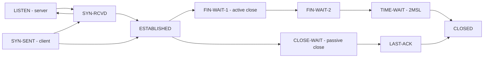

# Follow-up Tree: TCP Lifecycle

## Overview

"What happens when a TCP connection opens?" sounds like a knowledge question, but its follow-up ladder runs through protocol design reasoning (why three messages and not two or four), kernel resource accounting (TIME_WAIT), network modeling (congestion control), and distributed-systems liveness (heartbeats). This page walks that ladder. The repo already documents each mechanism — the three-way handshake, the state machine, the timers — in [TCP Three-Way Handshake](../../networks/tcp/three-way.md), [TCP States](../../networks/tcp/states.md), and [TCP Timers](../../networks/tcp/timers.md); this chain's job is the escalation *reasoning* between them, plus how to handle variations like "why not a 4-way handshake?"

## The Opening Question

**"Walk me through what happens when a TCP connection opens."**

The expected core answer: the client sends SYN with its initial sequence number (ISN); the server responds SYN-ACK carrying its own ISN and the ACK of the client's ISN; the client ACKs the server's ISN and both sides enter ESTABLISHED. Three messages, each carrying both a sequence-number commitment and an acknowledgment of the peer's commitment. Both sides also exchange window sizes, MSS, and options (SACK, timestamps, window scale) during the handshake.

Why this answer is correct: the handshake's job is not "saying hello" — it is establishing synchronized, independent sequence-number spaces in both directions with protection against delayed duplicates from earlier connections. If you state the handshake in terms of *what each message establishes* rather than the acronym SYN-SYN-ACK-ACK, every later follow-up ("why not 2-way?", "why not 4-way?", "what does SYN flooding attack?") becomes answerable by the same reasoning. The full segment-level detail lives in [TCP Three-Way Handshake](../../networks/tcp/three-way.md); the state machine is worth having in your head, compressed:

Simplifications to admit proactively if pressed: FIN-WAIT-1 can also transition via CLOSING on simultaneous close, and the client's final ACK can be lost, which is exactly why TIME_WAIT exists (Follow-up 2).

## Follow-up 1: Why Three Messages and Not Two?

**What it tests:** protocol-design reasoning — whether you can derive the handshake's message count from its failure model instead of reciting it.

**How to reason:** for each candidate message, ask *which invariant it establishes and who is protected*. A two-way handshake (SYN, then SYN-ACK) leaves exactly one party's state unacknowledged — work out which, and what stale segment could then exploit it.

**Answer.** In a two-way handshake the server commits state (allocates buffers, picks an ISN) upon receiving SYN, but nothing the server sends is ever acknowledged: the server cannot know the client received its SYN-ACK and ISN. Two failures follow. First, the *stale duplicate*: a SYN from a long-dead connection (retransmitted by the network, delayed by minutes) makes the server open a connection the client knows nothing about — the server waits for data that never comes, holding state. Second, the *unsynchronized ISN*: if the client never sees the SYN-ACK, the two sides may disagree about sequence numbers, and sequence numbers are what make TCP reliable and duplicate-proof. The third message — client ACK of the server's ISN — closes that gap: the server now commits state only after *both* directions' commitments are acknowledged. This is the same argument RFC 9293 ([https://datatracker.ietf.org/doc/html/rfc9293](https://datatracker.ietf.org/doc/html/rfc9293)) makes when discussing half-open connections, and it generalizes: a handshake needs enough messages for each side's commitment to be acknowledged by the peer — symmetric reliability costs an odd number of exchanges. Bonus signal: three messages also handle *simultaneous open* (both sides SYN at once, both go through SYN-RCVD) without a fourth message type.

## Follow-up 2: What Is TIME_WAIT and Why Does It Bite Servers?

**What it tests:** whether you know that closing is a protocol too, and that the kernel bills you for protocol correctness.

**How to reason:** TIME_WAIT is entered by the *active closer* — the side that sends the first FIN. Ask why it waits 2×MSL (maximum segment lifetime) after receiving the peer's FIN, then ask what that costs at scale.

**Answer.** Two reasons, and naming both is the point. (1) *Acknowledge the peer's FIN reliably*: the final ACK can be lost; if the passive closer retransmits its FIN, the TIME_WAIT socket re-ACKs it — without the wait, the peer would get an RST and could not distinguish "FIN lost" from "connection reset." (2) *Let old segments die*: holding the 4-tuple for 2×MSL ensures delayed segments from this connection cannot corrupt a *new* connection reusing the same ports. Linux uses MSL = 30 s, so TIME_WAIT = 60 s (the historic RFC 793 recommendation of a 2-minute MSL gives the textbook 4-minute figure — [TCP Timers](../../networks/tcp/timers.md) tabulates both).

The cost: an outbound-heavy service (a proxy, a scraper, a microservice client) that actively closes burns one *ephemeral port* per TIME_WAIT socket; against a single (server IP, server port) destination the tuple space is the local port range (~28k default on Linux, tunable via `ip_local_port_range`), so sustained connect rates above ~500/s to one destination exhaust it — connect() starts failing with EADDRNOTAVAIL. Mitigations, in the order you should say them: **make the client the passive closer** (server closes first — servers on a listening port don't exhaust "their" port, tuple uniqueness is what matters), **connection pooling / keep-alive** so connections are reused rather than churned (the real fix), `tcp_tw_reuse` for *outbound* connections only (timestamp-based, safe with PAWS), and only as trivia: `SO_REUSEADDR` lets a *listener* rebind through lingering TIME_WAIT sockets. The kernel-side knobs are documented in [ip-sysctl](https://docs.kernel.org/networking/ip-sysctl.html). A CLOSE_WAIT pile-up, by contrast, is not a protocol problem — it is your application forgetting to `close()` after the peer's FIN. Distinguishing "TIME_WAIT = normal, tune or pool" from "CLOSE_WAIT = bug, fix the code" is a classic seniority tell.

## Follow-up 3: How Does TCP Start Sending Fast — and What Escalates After "Slow Start"?

**What it tests:** the mechanism-vs-model distinction: slow start and AIMD are *mechanisms*; the loss model behind them is what modern variants replace.

**How to reason:** separate flow control (protects the *receiver*, advertised window) from congestion control (protects the *network*, cwnd). Then, for each congestion-control variant, ask what signal it trusts.

**Answer.** Slow start: cwnd begins at the initial window (10 segments per [RFC 6928](https://datatracker.ietf.org/doc/html/rfc6928)) and doubles per RTT — exponential — until it hits ssthresh or loss. Congestion avoidance: AIMD, +1 MSS per RTT, halving on loss; the sawtooth. This is safe but badly suited to high-bandwidth long-delay paths: at 100 Gbps with a 100 ms RTT, halving from full window takes many RTTs to refill the pipe, and classic loss-based behavior interprets a full buffer's *dropped* packets as the signal — which is exactly the wrong signal on deep buffers (bufferbloat). Escalations follow the signal they trust: **CUBIC** ([RFC 9438](https://datatracker.ietf.org/doc/html/rfc9438), Linux default) replaces the linear increase with a cubic function of time since the last congestion event — fast probe growth after a cut, long stable plateau — scaling window growth to the RTT rather than per-ACK, so long-fat networks converge fairly ([TCP CUBIC](../../networks/tcp/cubic.md)). **BBR** (Cardwell, Cheng, Gunn, Yeganeh, Jacobson, "BBR: Congestion-Based Congestion Control," ACM Queue 2016) abandons loss as the primary signal entirely: it estimates bottleneck bandwidth and minimum RTT, keeps in-flight data near the computed BDP, and paces accordingly — robust where loss is uncorrelated with congestion (random loss on wireless cripples CUBIC's window) and where buffers are oversized ([TCP BBR](../../networks/tcp/bbr.md) and the deeper [BBR Deep Dive](../../networks/protocols/bbr-deep.md)). The one-sentence senior summary: Reno/CUBIC *react to loss as a congestion symptom*; BBR *estimates congestion directly*; the difference is what each assumes the network is telling it.

## Follow-up 4: TCP Keepalive vs Application-Level Heartbeats — When Do You Need Which?

**What it tests:** whether you can reason about *liveness detection* as a design problem — what a mechanism can and cannot detect — rather than a settings question.

**How to reason:** for each option ask: what failure does it detect, at what granularity, with what latency, and through what middleboxes?

**Answer.** TCP keepalive ([RFC 1122](https://datatracker.ietf.org/doc/html/rfc1122); stack defaults in [TCP Keepalive](../../networks/tcp/keepalive.md)) sends empty probes on an idle connection — defaulting to *2 hours* idle, then ~9 probes 75 s apart. It detects: dead peer host, broken path, half-open connection where the peer crashed. It does not detect: an application that is alive at the TCP layer but wedged (event loop blocked, deadlocked — the process will happily ACK probes); and it carries no payload, so it cannot signal readiness state. Default timers also lose to NAT/firewall idle timeouts (often 5–60 minutes), which silently drop the mapping long before the first probe. Application-level heartbeats — ping frames on WebSockets, gRPC keepalive pings, health-check RPCs — fix all three: application-chosen intervals (tuned to the middlebox timeout), payload (can carry load/shard/state), and *end-to-end* semantics (a wedged app stops heartbeating even though its kernel ACKs). The design trade: heartbeats cost bandwidth and wakeups, so tune the interval to detection-latency needs — detection time is roughly interval × missing-ping threshold. Rule of thumb worth stating: kernel keepalive for long-lived *idle* connections you want preserved cheaply; application heartbeats whenever "the peer is healthy" means "the peer's *application* is making progress."

## Follow-up 5: Handle the Variation — "Why Not a 4-Way Handshake?"

**What it tests:** rung-5 judgment on a question that has no memorized answer. This is the reasoning-template payoff for the whole chain.

**How to reason (template):** return to Follow-up 1's invariant analysis. List what each of the three messages establishes; ask what a fourth message would add; if it adds nothing, explain why three is *sufficient*, and identify what the interviewer's variant is actually probing.

**Answer.** The three messages already achieve the invariant: client's ISN acknowledged (message 2), server's ISN acknowledged (message 3), both sides ESTABLISHED with full-duplex state. A fourth message would only re-acknowledge an acknowledgment — the third ACK is *informationally redundant*, which is why data can ride on it immediately and why the handshake terminates. Where the "extra message" intuition *does* apply, say so: the *teardown* is four messages (FIN and ACK in each direction) because either side may still have data to send after the other finishes — half-close. Connection setup is symmetric *from the start*; teardown is only symmetric *eventually*. If the twist is instead "why not two?" you are back at Follow-up 1; if it is "what if SYN is lost?" you reason from retransmission (SYN retries with exponential backoff, [TCP Timers](../../networks/tcp/timers.md)); if it is "what does an attacker do with an open handshake?" the answer is SYN flooding — the server allocates state at message 1, so an attacker sends SYNs without ACKs; SYN cookies ([TCP SYN Cookies](../../networks/tcp/syn-cookies.md)) defend by encoding the would-be server state into the SYN-ACK's sequence number and allocating nothing until the final ACK validates it. Every variation resolves the same way: name the invariant, name the message that carries it, ask what the proposed change does to it.

## How to Approach Unfamiliar Variations

1. **Recount the handshake in invariants, not messages.** "SYN announces my ISN; SYN-ACK announces yours and acknowledges mine; ACK confirms yours." Variations ("2-way? 4-way? piggybacked?") become arithmetic on who-is-acknowledging-whom.
2. **Separate the three windows of the protocol:** sequence space (correctness — duplicates, ISNs), receive window (flow control — the receiver), congestion window (network protection — the sender's guess). Most confusion between "window" questions is confusion between these.
3. **For liveness questions, ask "alive at which layer?"** Kernel ACKs, application progress, and path validity are three different properties with three different detectors; keepalive, heartbeats, and retransmission each cover one.
4. **For cost questions at scale, count what the kernel holds.** Buffers, ports, timers, TIME_WAIT slots — every protocol correctness has a resource bill, and the interview follow-up "what breaks at 10k connections?" is asking for that bill.

## Interview Questions

**Q: A service sees thousands of sockets stuck in CLOSE_WAIT. Diagnose.**
A: The peers closed (FIN arrived, kernel ACKed and moved the socket to CLOSE_WAIT) but the application never called close() — a leaked connection object, a missing handler on some error path, or a thread pool that died holding sockets. It is an application bug, not a kernel tuning problem; find the code path that drops the connection without closing it (heap dumps / socket-to-fd correlation make this quick).

**Q: Why does the actively closing side bear TIME_WAIT instead of the passive side?**
A: By symmetry either side could, and the protocol picks the active closer because it is the side that *finished first*: it must keep state just long enough to (a) retransmit the final ACK if the peer's FIN retransmission arrives, and (b) prevent delayed segments from a reused 4-tuple leaking into a new connection. The passive closer already has nothing left to acknowledge after its FIN is ACKed.

**Q: Your long-lived WebSocket connections silently die behind a corporate firewall every ~10 minutes, but TCP keepalive is on. Explain and fix.**
A: Default keepalive idle time is 2 hours (RFC 1122 legacy), so the first probe fires long after the firewall's idle mapping expired (~10 min here) — the probes go into a black hole. Fixes: application-level ping interval below the middlebox timeout, or lower the stack's keepalive timers per-socket (TCP_KEEPIDLE et al.). The general lesson: liveness timers must be shorter than the shortest state-expiry timer on the path.

**Q: CUBIC is default on Linux; when would you still want BBR, and when is BBR the wrong tool?**
A: BBR wins where loss is a poor congestion signal: high random-loss links (wireless), deep-buffer paths (bufferbloat), or long-RTT fat pipes where loss-based halving wastes throughput. It is the wrong tool where fairness matters against loss-based flows on shallow buffers (BBR v1 could take more than its share), and it needs pacing support; on shallow-buffer paths with well-behaved peers, CUBIC is simpler and battle-tested.

## Key Takeaways

- Describe the handshake by what each message *establishes* — ISN commitments acknowledged in both directions — and variations like "why not 2-way/4-way" become derivable instead of memorized.
- TIME_WAIT is the active closer paying for protocol correctness (final-ACK retransmission + duplicate-segment expiry); TIME_WAIT piles are tunable, CLOSE_WAIT piles are bugs.
- Congestion-control variants differ in the signal they trust: loss-as-symptom (Reno/CUBIC) vs estimated congestion (BBR); flow control protects the receiver, congestion control protects the network.
- Keepalive detects dead *kernels*; application heartbeats detect dead *applications*; middlebox idle timeouts set the floor for any liveness interval.
- Every TCP mechanism has a kernel resource bill (state, ports, timers); the "what breaks at scale" follow-up is asking for that bill.

## Cross-References

- [TCP Three-Way Handshake](../../networks/tcp/three-way.md) — segment-by-segment setup mechanics, ISN selection, options.
- [TCP States](../../networks/tcp/states.md) — the full state machine including CLOSING and simultaneous close.
- [TCP Timers](../../networks/tcp/timers.md) — RTO, persist, keepalive, TIME_WAIT timers with Linux values.
- [TCP Keepalive](../../networks/tcp/keepalive.md) — probe mechanics and per-socket tuning.
- [TCP Slow Start](../../networks/tcp/slow-start.md) and [Congestion Avoidance](../../networks/tcp/congestion-avoidance.md) — the classical AIMD mechanisms.
- [TCP CUBIC](../../networks/tcp/cubic.md) and [BBR](../../networks/tcp/bbr.md) — the modern escalations; deeper treatment in [BBR Deep Dive](../../networks/protocols/bbr-deep.md).
- [TCP SYN Cookies](../../networks/tcp/syn-cookies.md) — stateless defense for the SYN-flood follow-up.
- [Sockets: TCP](../../networks/sockets/tcp.md) — the syscall-level view of the same lifecycle.
- [QUIC Connection Migration](../../networks/protocols/quic-connection-migration.md) — how QUIC answers the same liveness and mobility problems without kernel state.
- [TCP Guarantees Delivery](../misconceptions/tcp-guarantees-delivery.md) — what TCP does and does not promise (the misconception behind many lifecycle questions).
- [TCP and Distributed Failure](../connection-atlas/tcp-distributed-failure.md) — sibling project connecting the lifecycle to failure detection in distributed systems.
- [Networks Overview](../../networks/overview.md) — the parent hub for all protocol pages.
