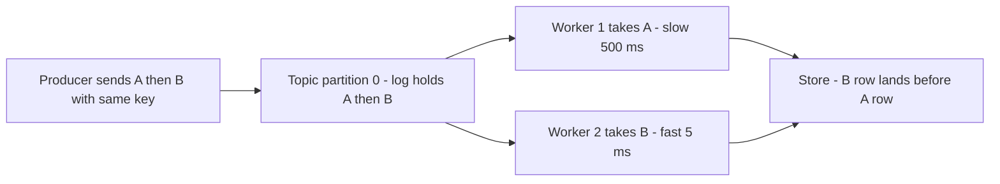

# "The queue guarantees ordering — A published before B is processed before B"

## Overview

This page audits the guarantee teams believe they bought with their message
broker: publish event A, then event B, and every consumer will process A
before B — so downstream state (a row insert, a cache update, a derived
projection) can rely on message order. The claim is a compression of a real
guarantee into an unreal one. Brokers really do preserve order, but within
a defined *scope*: Kafka preserves record order within a partition for a
single producer, Amazon SQS preserves order within a message group in FIFO
queues, and RabbitMQ preserves order in a queue served by a single
consumer. Outside that scope — across partitions, across producers, across
competing consumers — no ordering exists, and even inside it, the guarantee
ends at first delivery: retries, consumer concurrency, redelivery after a
crash, dead-letter replay, and offset resets all reorder work after the
broker has done its part. This page states the claim fairly, gives the
exact scopes where each popular broker's guarantee holds, and works three
reorder scenarios with timings that show the downstream state diverging
while the broker's logs are perfectly ordered.

## The Claim, Stated Fairly

The strongest common form is: "Our events go through Kafka, which
guarantees ordering, so the `user.updated` events will always be applied in
the order they were produced; the projection can safely do last-write-wins
by arrival." Stated this way, the claim is not a strawman. It appears in
design documents that picked a broker specifically for its ordering
semantics, in onboarding notes that say "the topic is ordered", and in the
reasoning of engineers whose first broker was a single-partition
development topic — where the guarantee genuinely held end to end.

The kernel is real and standardized. Kafka's documentation states that
records within a partition are ordered, and that per-key ordering holds
when producers route by key. SQS FIFO queues guarantee exactly-once
processing within a message group. RabbitMQ's queue is FIFO by design.
The audit question is what fraction of a production topology any one of
those scopes covers — and whether "ordered in the broker" honestly
compresses to "processed in order downstream".

## Verdict

**Incomplete.** The claim is true in the regime it deletes: one ordering
scope (partition, message group, or single-consumer queue), one producer
writing it (with idempotence enabled where retries can reorder), and one
consumer applying records sequentially. Production topologies violate each
precondition routinely: topics run 30 partitions for throughput, producers
run retries with in-flight batches, consumer groups run one worker per
core, slow records redeliver after crashes, and dead-letter replay pours
old messages into a stream of new ones. The broker's per-scope FIFO is
genuine at every step of all of it — which is exactly what makes the
failure silent: the logs are ordered, the delivery per partition is
ordered, and the database rows land out of order anyway.

## Why People Believe It

Three forces keep this claim alive. First, the guarantee exists and is
documented — quoting it feels like diligence, and the deleted quantifier
("within a partition") is invisible in the sentence "Kafka guarantees
ordering". Second, the development topology is the degenerate case: one
partition, one producer, one consumer loop — end-to-end order holds, all
tests pass, and the property is generalized from a setup that production
throughput requirements will forbid.

Third, the refuting evidence is invisible at the failure point. When two
workers apply B before A, each worker sees a normal, ordered stream; the
reorder exists only in the interleaving between workers, which no
single-consumer log records. The symptom surfaces as stale rows, wrong
balances, or "the last update didn't stick" — data bugs that get patched
downstream (version columns, reconciliation) rather than traced to the
ordering assumption, so the claim survives every incident it causes.

## The Correct Formulation

| Claim component | Correct form |
|---|---|
| "The queue guarantees ordering" | Each broker preserves order within a declared scope: Kafka per partition (per producer, idempotence on), SQS FIFO per message group, RabbitMQ per queue with a single consumer |
| "Kafka is ordered" | Ordered within a partition; across partitions of a topic there is no order, and per-key order holds only if every producer routes that key to one partition |
| "With retries, order survives" | With `enable.idempotence=false` and in-flight batches above one, a retried earlier batch can land after a later one — inside a single partition |
| "Consumers process in order" | Concurrency reorders application of work: delivery order is per partition, completion order is whatever the worker pool does |
| "Redelivery keeps order" | At-least-once redelivery after a crash re-interleaves already-processed records with new ones; offset resets and dead-letter replay reorder wholesale |
| "So use one partition" | Global order is purchasable at the price of parallelism — one partition means one consumer's throughput; the honest design serializes per key, not globally |

The correct sentence: "The broker preserves the order of records within
the ordering scope it defines — Kafka partition, SQS message group,
RabbitMQ queue served by one consumer — up to first delivery. Everything
after first delivery (worker concurrency, retries, redelivery, replay)
reorders application of the work, so downstream correctness must come from
per-key design, idempotent application, or explicit versioning — never
from arrival order."

## Where It Breaks

**The producer-retry reorder, inside one partition.** A producer sends
record A (order created), then record B (order paid), with
`retries=5`, `max.in.flight.requests.per.connection=5`, and
`enable.idempotence=false` — a configuration that existed by default in
pre-3.x clients. Batch A hits a transient timeout; the client retries it
while batch B proceeds. The broker appends B, then the retried A: the
partition log — the thing the claim calls ordered — now holds B before A.
The idempotent producer (sequence numbers per producer-partition) exists
precisely to close this hole, and Kafka's documentation says so; the
claim's failure is asserting the guarantee while deleting the flag that
delivers it.

**The concurrency reorder, with a perfectly ordered log.** One partition,
guarantee intact: A arrives at time 0 and takes 500 ms (an enrichment
call); B arrives 1 ms later and takes 5 ms. Eight workers poll the
partition. Worker 1 holds A; worker 2 finishes B at 6 ms and commits its
row; worker 1 commits A's row at 500 ms. The projection now believes the
payment happened before the order was created. Every layer the claim named
did its job: the producer sent in order, the log holds order, delivery
was in order — and the rows are wrong, because "delivery order" and
"application order" are different properties separated by a worker pool.
This is the most common production instance of the claim failing, and it
leaves no error in any log.

**The redelivery reorder.** Worker 1 applies A's side effects, then dies
before committing its offset. The record redelivers — after B and C have
already been delivered and applied by other workers. A is now processed
twice and out of sequence; the at-least-once contract that made the
delivery reliable is the same contract that made the reorder possible.
RabbitMQ shows the same law from the broker side: a queue with competing
consumers hands records to whichever worker is free, and a requeued or
nacked message returns to be redelivered after newer work has already
gone out — even the broker's own FIFO stops being observable order the
moment there are two consumers or one retry. The defense is idempotent
application (deduplication by event ID, conditional writes) and per-key
serialization so that re-execution is a no-op rather than a reordering.
Without them, the system's correctness depends on a crash never happening
between apply and commit — the exact window reliability engineering
exists to cover.

**The replay and dead-letter reorder.** A schema bug is fixed, and the
team resets the consumer group to reprocess 48 hours of history while new
traffic continues. Old records now interleave with new ones in
application order: a user's reprocessed update lands after a newer live
update, reverting it. Dead-letter replay has the same shape — replayed
batches re-enter the stream behind or beside current traffic (see the
replay-sequencing discussion in the connection atlas). The broker's
guarantee was never violated by any of this; the guarantee simply never
mentioned anything that happens after first delivery.

**What survives the audit.** The kernel remains valuable and worth
engineering around rather than discarding. Per-key ordering is real and
cheap: route all events for an entity by its key to one partition, apply
them through one serialized consumer per partition (or per key), and
order holds for that entity — which is almost always the order that
matters. The costs are explicit: hot keys concentrate load, and global
order across all entities is purchasable only with a single partition,
which caps throughput at one consumer's rate and makes the partition a
failure and scaling boundary. The honest design statement replaces the
claim: "events for the same key are processed in order; events for
different keys are concurrent by design."

The diagram is the whole verdict in one picture: the log is ordered, the
pool is not, and the store reflects the pool.

## Practical Implications

- State the ordering scope in every design that depends on it: which
  partition key, which producer, which consumer serialization — and write
  the sentence "in order per key, concurrent across keys" where "the
  queue is ordered" would otherwise go.
- Enable idempotent producers wherever retries exist; audit
  `max.in.flight` and idempotence settings as ordering-relevant
  configuration, not just performance tuning.
- Make application idempotent by event ID and version — redelivery is a
  certainty at scale, and arrival-order correctness dies on the first
  worker crash.
- For projections, carry monotonic versions or event timestamps from the
  source and reject stale application (`WHERE version < incoming`), so a
  redelivered or replayed event cannot revert state.
- Treat dead-letter replay as a reordering event: sequence replays behind
  live traffic per key, or merge them through the same versioning rule as
  live events.

## Interview Questions

### Does Kafka guarantee that event A sent before event B is processed before B?

No — it guarantees A precedes B *in the partition log* (per producer,
with idempotence enabled where retries could reorder). Processing order
then depends on consumer concurrency: a worker pool delivers and applies
records in whatever order completion allows, so a slow A can be applied
after a fast B even though the log is perfectly ordered. Per-key
serialization is the honest way to get processing order for an entity.

### A consumer crashes after applying a record's side effects but before committing its offset. What happens to ordering and correctness?

The record redelivers, after any records other workers applied in the
meantime: processed twice and out of sequence. Ordering downstream cannot
depend on delivery, so correctness needs idempotent application —
deduplication by event ID, conditional writes by version — turning
re-execution into a no-op rather than a reordering.

### Why does a single partition buy global ordering, and why is it usually the wrong purchase?

One partition makes the log the single serialization point, so per-key
order and global order coincide, and one consumer can apply records
sequentially. The cost is that one partition is also the throughput and
availability ceiling — a single consumer's rate, a single broker's
bottleneck, a single failure domain. Real systems pay for parallelism
with partitions and recover order per key instead.

### SQS standard vs FIFO queues: what ordering does each actually promise?

Standard queues offer best-effort ordering and at-least-once delivery —
order is approximate and duplicates are possible. FIFO queues preserve
order within a message group (messages with the same group identifier)
with exactly-once processing within the retention period and a
content-based deduplication window; different groups run concurrently.
The design decision is which entities need serialization — those share a
group — and the throughput per group must fit the queue's limits.

## Key Takeaways

- Broker ordering is real, per-scope, and ends at first delivery: Kafka
  per partition (idempotent producer), SQS FIFO per message group,
  RabbitMQ per single-consumer queue.
- Retries without idempotence can reorder within a partition; worker
  concurrency reorders application with a perfectly ordered log; crash
  redelivery and replay reorder it further.
- Correctness downstream must be engineered, not inherited: per-key
  serialization, idempotent application, and version checks against
  stale writes.
- Global order is purchasable with one partition at the price of all
  parallelism; per-key order is the design that scales.
- The failure is log-silent: every ordered layer looks ordered in its own
  logs; only the interleaved output store shows the reorder.

## Cross-References

- [Follow-up Tree: Message Queues](../followup-tree/message-queues.md) —
  the interview escalation chain on queue semantics that starts where this
  claim ends.
- [Connection Atlas: Queue Dead-Letter Replay](../connection-atlas/queue-dead-letter-replay.md)
  — replay sequencing, poison quarantine, and why replayed batches are a
  reordering event.
- [Misconception: "TCP guarantees the application receives the data"](./tcp-guarantees-delivery.md)
  — the transport twin: TCP's ordered bytes stop at the socket buffer the
  way broker order stops at first delivery.
- [Distributed Messaging: Kafka](../../distributed/messaging/kafka.md) —
  partitions, producer idempotence, and consumer groups as the machinery
  behind each deleted quantifier.
- [Backend Patterns: Idempotency](../../backend/patterns/idempotency.md) —
  the application-side defense that makes redelivery a no-op instead of a
  reorder.
- [Misconceptions index](./index.md) — the taxonomy used for this verdict.

## References

- Apache Software Foundation. *Apache Kafka Documentation* — producer
  idempotence, per-partition ordering, and consumer group semantics, the
  primary statement of each scope this claim deletes.
  <https://kafka.apache.org/documentation/>
- Amazon Web Services. *Amazon SQS Developer Guide: FIFO queues* —
  message-group ordering, deduplication, and throughput characteristics.
  <https://docs.aws.amazon.com/AWSSimpleQueueService/latest/SQSDeveloperGuide/FIFO-queues.html>
