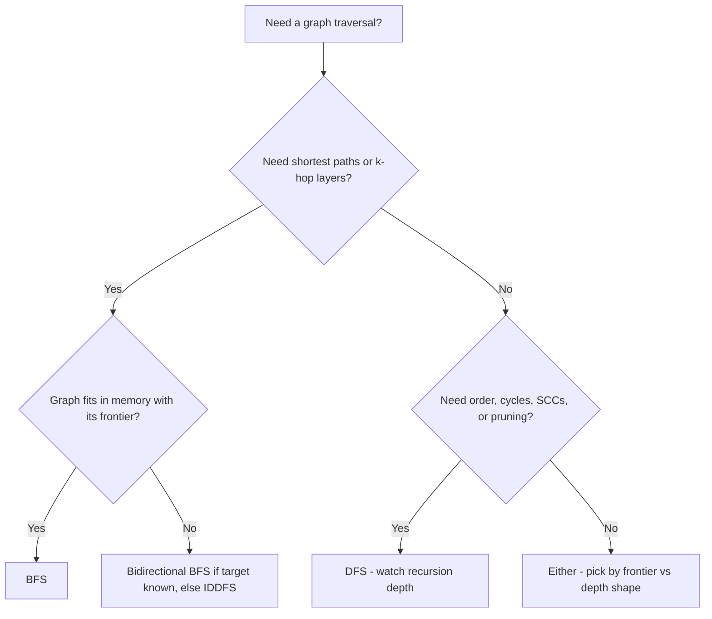

# BFS vs DFS

## Overview

Breadth-first search (BFS) and depth-first search (DFS) both visit every reachable vertex of a graph in O(V + E) time, and both are complete — they find a target if one exists. That equality of headline complexity is exactly why "just use either" is such a common mistake. The traversal *order* determines what each algorithm can guarantee, what it remembers, and how it fails. BFS expands the frontier layer by layer and therefore discovers shortest paths in unweighted graphs; DFS commits to one path to its end before backtracking and therefore gives you structural information (topological order, cycles, strongly connected components) that BFS does not naturally produce.

This page applies the [handbook framework](./index.md): mechanisms, memory behavior, guarantees and failure modes, winning conditions, the edge cases where each loses unexpectedly, and a decision framework.

## Mechanisms

**BFS.** Maintain a FIFO queue and a visited set. Dequeue a vertex, enqueue every unvisited neighbor, mark them visited *at enqueue time* (not at dequeue time — marking late re-enqueues vertices and can blow up memory). The queue holds the "frontier": all vertices at distance *d* and *d+1* from the source. Because the queue is FIFO, vertices are dequeued in non-decreasing order of distance from the source, which is precisely the property that yields shortest paths. In pseudocode terms the whole algorithm is: queue, mark, dequeue, relax neighbors, repeat (CLRS, Chapter 22.2).

**DFS.** Maintain a stack — either explicitly or as the call stack via recursion. Pop a vertex, push an unvisited neighbor, and only mark vertices visited when first encountered. The stack holds a single root-to-current *path* plus the not-yet-finished branches. The algorithm dives deep, hits a dead end, and backtracks. Assigning discovery and finish times during DFS produces the pre/post-order structure that topological sorting (post-order on DAGs), cycle detection (back edges), and strongly connected components (Kosaraju's and Tarjan's algorithms, [ch81](../../dsa/chapters/ch81-scc-bridges.md)) are built from.

The one-sentence difference: **BFS remembers a wavefront, DFS remembers a path.**

## Memory: Frontier vs Depth

This is the most important practical difference and the one interviewers probe hardest.

| Property | BFS | DFS |
|----------|-----|-----|
| Stack/queue holds | All vertices at distance d and d+1 (the frontier) | One path (depth *k* vertices) + unexplored siblings |
| Worst-case auxiliary space | O(V) — the frontier can contain almost every vertex | O(V) in general graphs with a visited set; O(depth) for the path itself |
| Typical case | Frontier size = graph *width* | Stack depth = graph *depth* |
| On a star graph (1 center, n−1 leaves) | Frontier = O(n) after one expansion | Path = O(1) |
| On a long path graph (n vertices in a line) | Frontier = O(1) | Recursion depth = O(n) |

Neither wins categorically: each uses O(width) or O(depth), whichever is larger for the graph at hand. Trees that are wide and shallow punish BFS; trees that are deep and narrow punish recursive DFS. The visited set (O(V) bits or hash set) is common to both on explicit graphs and is usually the smaller term — but on *implicit* graphs (game states, puzzles) the visited set is the memory problem, and there DFS's shallow footprint is a genuine advantage.

## Complexity and Guarantees

| Guarantee | BFS | DFS |
|-----------|-----|-----|
| Time (explicit graph, visited set) | O(V + E) | O(V + E) |
| Shortest path, unweighted graph | **Yes** — provably, by induction on levels: when a vertex is first dequeued its recorded distance is minimal | No — returns *a* path, possibly far from shortest |
| Shortest path, weighted graph | No (Dijkstra generalizes BFS with a priority queue, [ch26](../../dsa/chapters/ch26-shortest-paths.md)) | No |
| Topological order (DAG) | Not naturally | **Yes** — post-order reversal |
| Cycle detection | Yes, but awkward (cross/level edges) | **Yes** — a back edge to an in-progress vertex is a cycle |
| Completeness (finite graphs) | Yes | Yes (with a visited set; on infinite-depth trees only iterative deepening is complete) |
| Finding "anything reachable" | Yes | Yes |

BFS's shortest-path guarantee deserves the one-line proof since interviews ask for it: every vertex at distance *k* is dequeued before any vertex at distance *k+1* because the queue is FIFO and neighbors of distance-*k* vertices enter the queue only after all distance-*k* vertices. Since a vertex's distance is finalized when first discovered, and discovery happens in non-decreasing distance order, recorded distances are optimal. DFS offers no such ordering argument — its first found path to a target can be arbitrarily longer than the shortest one.

## When BFS Wins

- **Unit-weight shortest paths** — the canonical case: social-network degrees of separation, unweighted mazes, minimum number of moves in puzzles, word ladders.
- **Multi-source BFS**: seed the queue with all sources at distance 0 (rotting oranges, fire spread, minimum distance from any hospital). This is BFS-only; DFS has no layer notion to generalize.
- **Level-by-level processing**: anything defined by "distance from source ≤ k" — influence radius, k-hop neighborhoods, broadcast rounds in distributed algorithms.
- **When the answer is the nearest target**: BFS stops at the first occurrence, which is guaranteed nearest; DFS must exhaust to be sure.

## When DFS Wins

- **Topological ordering** of DAGs (build systems, dependency resolution, scheduling). BFS gives no equivalent without extra machinery.
- **Cycle detection and structural properties**: back edges find cycles; discovery/finish times power SCCs, bridges, and articulation points ([ch81](../../dsa/chapters/ch81-scc-bridges.md)).
- **Memory-bounded deep graphs**: when the frontier would be huge but the depth is manageable — DFS needs O(depth), not O(width).
- **Exhaustive search with pruning** (backtracking, constraint satisfaction): DFS explores a branch fully and abandons it, which pairs naturally with feasibility checks that prune whole subtrees.
- **Connectivity on implicit state spaces**: maze generation, game-tree search, anything where you want *a* solution or full enumeration, not the shortest one.

## Edge Cases and Counterexamples

**DFS recursion depth overflow.** Recursive DFS on a path graph with 10⁶ vertices makes 10⁶ nested calls. CPython's default recursion limit is 1,000; a typical 8 MiB Linux thread stack with ~100 bytes per frame overflows near 10⁴–10⁵ frames. The failure is not theoretical — competitive programmers hit it constantly on tail-shaped trees, and production code hits it on deeply nested JSON or DOM structures. The fixes are mechanical but must be deliberate: convert to an explicit stack, or run an iterative DFS with a state machine (push vertex, mark grey, process children, mark black). An interview answer that says "DFS, obviously" without mentioning the stack-depth failure mode is incomplete.

**BFS frontier blowup on grid and lattice graphs.** BFS's memory is the frontier, and on grids the frontier grows linearly with the radius: an n×n grid BFS'd from a corner has a frontier of Θ(n) vertices — Θ(√V) — which sounds fine until the graph is a d-dimensional lattice where the frontier is Θ(radius^(d−1)), or a high-degree graph where layer 2 alone can be nearly all the vertices. The extreme published example: Leiserson et al. ("There's Plenty of Room at the Top", *Science* 2020) report that on a large power-law graph, a single BFS frontier held roughly 15% of all vertices — tens of millions of nodes in flight at once. On a star graph, BFS stores all n−1 leaves while DFS stores one. If memory is the binding constraint and you do not need shortest paths, DFS or iterative deepening is the right call even though "BFS = shortest path" is the sentence everyone remembers.

**DFS "shortest path" is wrong, not just slow.** A subtle trap: on an unweighted graph, running DFS and stopping at the target returns a path whose length can be arbitrarily worse than optimal (imagine DFS wandering a long wrong branch first). Teams have shipped "BFS-like" code built on recursion and passed tests on trees — where every path is unique so any traversal is "shortest" — then failed on graphs with cycles. The guarantee comes from the queue discipline, not from the act of traversing.

**Bidirectional BFS — the hybrid that wins big.** Search from both the source and the target simultaneously and stop when the frontiers meet. With branching factor b and depth d, unidirectional BFS expands O(b^d) nodes; bidirectional expands O(2·b^(d/2)) — for b = 10, d = 6 that is a million nodes versus about two thousand. This is the standard optimization for word ladders and shortest-path interviews. Two caveats: the graph must be undirected (or edges must be reversible), and you must check frontier intersection every level, not only when a node is "seen from both sides" at exactly equal depth — meeting at unequal depths is valid and common.

**Iterative deepening DFS (IDDFS) — the other hybrid.** Run depth-limited DFS with limits 1, 2, 3, … until found. It sounds wasteful (upper levels re-expanded) but the re-expansion cost is geometrically dominated: with branching factor b, total work is O(b^d) — asymptotically the same as BFS — while memory stays O(d). IDDFS is therefore complete *and* optimal for unit-cost search trees *and* memory-frugal, which is why it is the default uninformed search strategy in AI search literature. Use it when the frontier is the problem and the branching factor is moderate; use bidirectional BFS when the target state is known and reversible.

## Decision Framework

| If your workload needs… | Choose | Because |
|--------------------------|--------|---------|
| Shortest path, unweighted edges | BFS | FIFO queue ⇒ non-decreasing distance ⇒ first arrival is optimal |
| Topological order, SCCs, bridges, cycle structure | DFS | Post-order and back edges carry the structural information |
| k-hop neighborhoods, multi-source distance fields | BFS (multi-source) | Levels are native; DFS has no distance notion |
| Full enumeration with pruning | DFS | Abandon-and-backtrack matches subtree pruning |
| Bounded memory on wide graphs | DFS / IDDFS | O(depth) vs O(width) |
| Bounded memory on deep graphs + shortest path | Bidirectional BFS or IDDFS | O(b^(d/2)) time or O(d) memory with BFS-like guarantees |
| Deep graphs + recursive implementation | Iterative DFS with explicit stack | Default stacks overflow at 10⁴–10⁵ frames |
| Unknown target on infinite-depth tree | IDDFS | Only BFS-like complete-and-optimal option with O(depth) memory |

Ordered checklist for interviews: (1) weighted edges? — neither; go to Dijkstra; (2) shortest path or layers needed? — BFS family; (3) structure (order/cycles/components) needed? — DFS; (4) memory-bound? — pick by frontier-vs-depth shape or use a hybrid; (5) implementing DFS recursively? — state the depth limit and the fix.

## Interview Questions

1. **Both are O(V+E). Name a graph where BFS uses ~n times more memory than DFS, and one where the reverse holds.** Star graph: BFS's frontier holds all n−1 leaves, DFS's path holds 2. A long path graph (or a tree of depth n): recursive DFS's call stack holds n frames while BFS's frontier holds O(1). The visited set is the same for both; the difference is frontier vs path.
2. **Why must BFS mark vertices visited at enqueue time, not dequeue time?** Marking at dequeue allows the same vertex to be enqueued multiple times (once per incoming edge processed before it is dequeued), inflating queue memory from O(V) toward O(E) and duplicating work. Marking at enqueue makes each vertex enter the queue once.
3. **Prove that BFS finds shortest paths in unweighted graphs.** By induction on distance k: all distance-k vertices are dequeued before any distance-(k+1) vertex (FIFO discipline, and distance-(k+1) vertices are only enqueued via distance-k vertices). Each vertex's distance is set once, at first discovery, which happens in non-decreasing distance order — hence recorded distances are minimal.
4. **Your recursive DFS passes locally but crashes in production on one input shape. Diagnose.** The input is a deep, narrow structure (a path-like graph or nested chain) that drives recursion depth past the thread stack limit (~1,000 frames in CPython by default; ~10⁴–10⁵ in 8 MiB native stacks). Fix: explicit-stack iterative DFS, or increase the stack only as a stopgap while noting it converts a crash into an OOM risk at larger scale.
5. **When is IDDFS strictly better than BFS?** On search trees (implicit state spaces) with unit edge costs and moderate branching: same asymptotic time O(b^d), but O(d) memory instead of O(b^d) frontier, and no visited-set blowup on state spaces too large to memoize.

## Key Takeaways

- Identical O(V+E) complexity hides opposite memory profiles: BFS pays for the *frontier* (width), DFS pays for the *path* (depth) — and on any given graph those can differ by orders of magnitude.
- Guarantees follow from queue discipline: FIFO gives shortest unweighted paths; DFS's stack gives post-order structure (topological sort, SCCs, cycles). Neither can substitute for the other.
- The two classic failure modes are DFS stack overflow on deep graphs and BFS frontier blowup on wide graphs/lattices — both are interview litmus tests.
- Hybrids dominate the hard middle ground: bidirectional BFS for known targets, IDDFS for memory-bounded optimal search with BFS-like guarantees.
- "Just use either" is only true when you need no ordering guarantee, no shortest paths, and have memory to spare for the visited set — which is rarer than it sounds.

## Cross-References

- [DFS chapter](../../dsa/chapters/ch23-dfs.md) — tutorial coverage of DFS mechanics, pre/post ordering, and back edges.
- [BFS chapter](../../dsa/chapters/ch24-bfs.md) — tutorial coverage of level BFS, multi-source variants, and 0-1 BFS.
- [Topological Sort](../../dsa/chapters/ch25-topological-sort.md) — the DFS-native application in depth.
- [Shortest Paths](../../dsa/chapters/ch26-shortest-paths.md) — where weighted graphs take over from BFS (Dijkstra, Bellman-Ford).
- [SCCs, Bridges, Articulation Points](../../dsa/chapters/ch81-scc-bridges.md) — structural properties only DFS's finish times provide.
- [DSA](../../dsa/README.md) — the main algorithms track.
- [Why-Not Handbook](./index.md) — the framework this page follows and its sibling comparisons.
