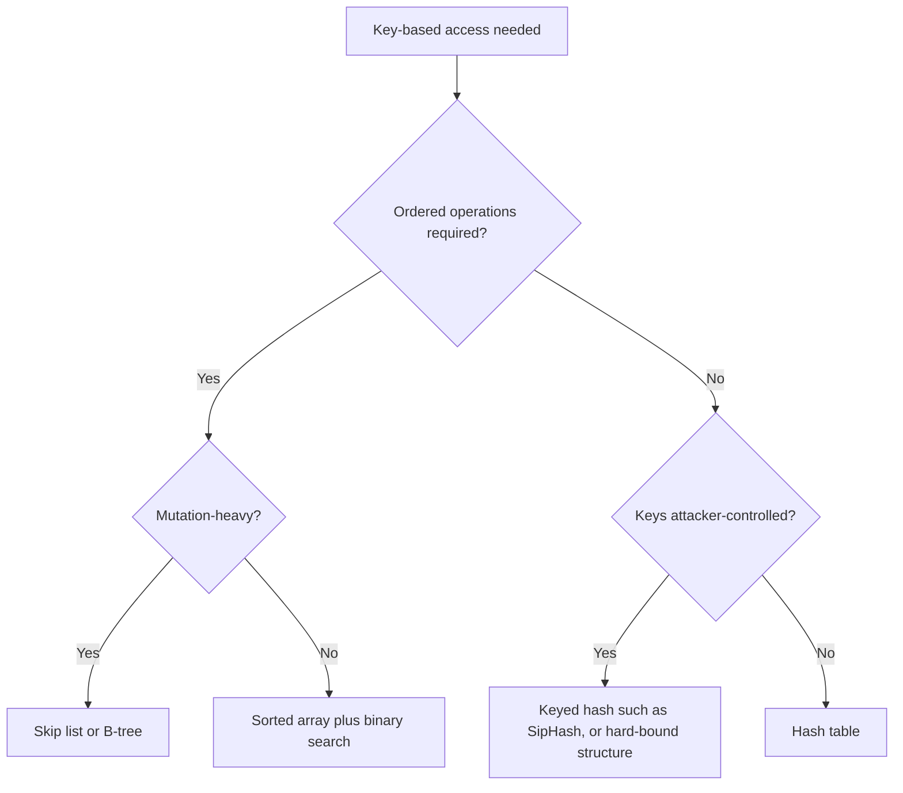

# Binary Search vs Hashing

## Overview

Both binary search over a sorted array and a hash table answer the same abstract question — "is this key present, and where?" — with superficially similar speed: O(log n) versus "O(1)". On paper the hash table wins, which is why "why not just use a hash map?" is a reflex. It is also the wrong question. The two mechanisms sign very different contracts: binary search gives you a *total order* — range scans, predecessors, successors, ordered iteration — with a worst-case bound no input can break; hashing gives you near-constant *point* access and nothing else, with an average case that assumes friendly keys and a resize behavior that occasionally stalls. Choosing between them is choosing which contract you need, not which exponent looks better.

This page applies the [handbook framework](./index.md): mechanisms, complexity and guarantees, failure modes, winning conditions, edge cases, and a decision framework.

## Mechanisms

**Binary search.** The array is kept sorted. Each probe compares the target against the middle element and discards half the remaining interval, so the search space shrinks from n to 1 in ⌈log₂ n⌉ comparisons — about 20 probes for a million elements. All probes land inside one contiguous block of memory, so every comparison after the first few is an L1-cache hit, and the access pattern (middle, quarter, eighth…) is at least somewhat predictable to the prefetcher. The cost is paid at write time: inserting or deleting in the middle shifts O(n) elements (memmove is fast, but it is O(n)), and keeping the array sorted under mutation is the real maintenance burden.

**Hashing.** A hash function maps the key to a bucket index in a table of m slots; collisions (two keys, one bucket) are resolved by chaining (linked lists per bucket) or open addressing (probe sequences: linear, quadratic, Robin Hood). Lookup costs O(1) *expected*, under two assumptions stated explicitly in CLRS Chapter 11: the hash function distributes keys uniformly (simple uniform hashing), and the load factor α = n/m stays bounded (tables resize, typically at α ≈ 0.7–0.9 for open addressing). Each assumption is a mechanism with failure modes: a known, unseeded hash function can be fed adversarial keys; resizing is a full re-table of every element.

The subtle practical cost of hashing is memory behavior: unlike binary search's contiguous probes, a hash probe jumps to a pseudo-random location. Each lookup touches at least one cold cache line, often several in a probe sequence. The constant behind "O(1)" is dominated by cache misses, not by the hash computation.

## Complexity, Guarantees, and Failure Modes

| Property | Sorted array + binary search | Hash table |
|----------|------------------------------|------------|
| Point lookup | O(log n), **worst case, guaranteed** | O(1) **expected/average**; O(n) worst case |
| Insert / delete | O(n) (element shift) | O(1) expected, amortized (rehash) |
| Ordered iteration | O(n), sorted order — native | O(n), arbitrary order; sorting separately costs O(n log n) |
| Range queries, predecessor, successor | O(log n) + O(k) output | Not supported without augmenting the structure |
| Min / max / k-th smallest | O(1) at array ends; O(log n) with augmentation | O(n) scan |
| Memory layout | Contiguous, prefetch-friendly, no per-element overhead | Scattered probes; load-factor slack; per-node pointers if chaining |
| Adversarial input | Immune — same ⌈log₂ n⌉ path regardless of keys | **Hash flooding**: all keys to one bucket ⇒ O(n) per op |
| Amortization spikes | None (no structural rebuilds) | Rehash: one insert pays for re-tableing all n elements |

Three failure modes deserve mechanism-level detail:

- **Adversarial collisions.** If the attacker knows the hash function, they can construct keys that collide — for strings under weak multiplicative hashing this is a small offline computation. The result is the classic *hash-flooding denial of service*: a request with 10⁵ crafted parameters degrades one hash-table operation to O(n), and the 2011–2012 wave of advisories (oCERT-2011-003) hit PHP, Java, Python, Ruby, and more because web frameworks put attacker-controlled keys into hash maps. The industry fix is keyed hashing — SipHash (Aumasson & Bernstein, 2012), now the default in Python, Rust, Redis, and others — which makes collision construction depend on a per-process secret seed. Note what this buys: it converts worst-case O(n) into "worst-case O(n) computationally infeasible", i.e., an average-case guarantee made robust, not a worst-case guarantee.
- **Rehash storms.** Amortized O(1) insertion hides a latency spike: crossing the load-factor threshold triggers a resize that re-hashes every element (often with allocation of a new table). For a table of 10⁸ entries that is a multi-second stall in the wrong thread. Mitigations are themselves mechanisms: incremental rehashing (Redis migrates buckets gradually across subsequent operations, keeping a two-table overlap), pre-sizing the table when n is known, or using extendible/linear hashing in storage engines. "Amortized O(1)" is a statement about *sums*, not about *deadlines* — a real-time or tail-latency-sensitive workload must not ignore the variance (see [Assumptions Hunt](../assumptions-hunt/complexity-claims.md)).
- **Degenerate chains without adversaries.** Even honest keys cluster when the hash is weak relative to the data — timestamps with low-entropy low bits, sequential IDs multiplied by a power-of-two table size. Linear probing then produces primary clustering: long probe runs that further worsen locality. Modern open-addressing designs (Robin Hood ordering, Google's SwissTables with SIMD group probing) exist precisely because the naive mechanism degrades ungracefully; Java's HashMap treeifies long chains into red-black trees (JEP 180) to cap the damage at O(log n).

## Memory Locality and Probe Costs

The hardware story is where the textbook exponents mislead. A cache line is 64 bytes; main-memory access costs roughly two orders of magnitude more than an L1 hit (Drepper, "What Every Programmer Should Know About Memory"). Binary search does ⌈log₂ n⌉ comparisons, each a load from the same hot region — for n ≤ ~10⁵ with 8-byte elements the entire array is ~800 KB, mostly cache-resident under repeated queries, and for small n (tens to hundreds of elements) a linear or branching scan of a contiguous array beats a hash table outright because the hash table pays an unavoidable cold-miss plus hashing arithmetic for a lookup the CPU can do with a handful of SIMD-compared cache lines. Conversely, for large n the hash table touches one to two cache lines per lookup while binary search touches ~log₂ n spread across the array — but its top levels stay hot, and layout tricks (the Eytzinger/van Emde Boas implicit layouts of Khuong & Morin, "Array Layouts for Comparison-Based Searching", JEA 2019) push binary search to hash-table-competitive constant factors by making the probe tree cache-friendly. The honest summary: **at small n and under caching effects, the practical gap is far smaller than the exponents suggest, and at small n it can invert.**

## Dynamic Workloads

Mutation rate is the second axis the "O(1) beats O(log n)" reflex ignores. A sorted array under heavy mixed insert/delete pays O(n) shifts and memmove traffic per mutation; a hash table pays expected O(1) plus occasional rehash spikes. Under a churn-heavy workload (frequent inserts *and* frequent deletes), open-addressing tables accumulate tombstones that inflate probe sequences until a rehash cleans them — another hidden maintenance cost. If the data is *write-once, read-many* (config tables, vocabularies, symbol tables after startup), the sorted array's fragility under mutation is irrelevant and its guarantees are all upside. If it is *highly dynamic and lookup-only by key*, the hash table's mechanism is purpose-built. The middle ground for dynamic workloads *with* ordering is a tree family — skip lists and B-trees — discussed next.

## Sorted Structures as the Middle Ground

When you need both ordered access and fast mutation, the field offers hybrid contracts:

| Structure | Point lookup | Ordered ops | Insert/delete | Notable deployment |
|-----------|--------------|-------------|---------------|--------------------|
| Skip list | O(log n) expected | Native, cheap iteration | O(log n) expected | Redis sorted sets ([Redis data structures](../../redis/data-structures.md)); chosen over red-black trees for simpler concurrency and range-scan ergonomics |
| Balanced BST (red-black, AVL) | O(log n) worst | Native | O(log n) worst | Language standard libraries; in-memory indexes |
| B-tree / B+-tree | O(log n) worst, high fan-out ⇒ 3–4 levels for billions of keys | Native, sequential on disk | O(log n) with page splits | Every database storage engine ([B-tree index](../../dbms/indexing/b-tree.md)) |
| Sorted array + binary search | O(log n) worst | Native | O(n) — poor under churn | Static sets, small n, analytics column chunks |

B-trees matter because they move the comparison up a level: a B+-tree node sized to one disk page or one cache-line bundle gives you binary search's ordering contract with a shallow, IO-optimal structure. If your "hash table" question is really about database indexes, the answer is usually "B-tree" — see [Database Choices](./database-choices.md) for the index-structure comparison in depth.

## When Each Wins

**Binary search / sorted array wins when:** you need range queries, predecessor/successor, ordered iteration, min/max, or percentile access; keys may be adversarial and you want a hard worst-case bound without trusting hash-function hardening; n is small enough that cache effects dominate (tens to thousands of elements); the dataset is static or rebuilt wholesale, so insertion cost is irrelevant; or the values are already being produced in sorted order (merge outputs, time series).

**Hashing wins when:** access is purely by exact key; lookups vastly outnumber mutations; average-case latency is acceptable but per-operation ordering is not needed; n is large and the workload is lookup-heavy (hash touches O(1) cache lines vs binary search's log); or you need set/membership semantics with O(1) expected inserts (caches, dedup, symbol tables).

## Decision Framework

Ask, in order:

1. **Do you need ordering — ranges, predecessors, sorted iteration, top-k?** Yes ⇒ the hash family is out; choose sorted array (static), skip list/BST (dynamic, in-memory), or B-tree (persistent/on-disk).
2. **Are keys attacker-controlled?** Yes ⇒ either a keyed hash (SipHash-class) or a structure with hard worst-case bounds (sorted array, BST). A plain known hash function is a denial-of-service vector.
3. **Is n small (≲ 1,000) and static-ish?** Prefer the sorted (even unsorted, linearly scanned) contiguous array; cache effects beat the hash table's constants.
4. **Does the workload have latency SLOs per operation (no amortized spikes allowed)?** Beware rehash storms: pre-size the table, use incremental rehashing, or pick a tree.
5. **Pure point lookups, large n, lookup-dominated?** Hash table — this is its home turf; the O(1)-vs-O(log n) difference is real here.
6. **Dynamic *and* ordered?** Skip list or B-tree; or LSM on the write-heavy end — see [Database Choices](./database-choices.md).

## Interview Questions

1. **A hash map is O(1) and binary search is O(log n) — give two concrete situations where binary search is the right answer anyway.** (a) The workload needs range scans or predecessor/successor queries, which hashing cannot answer without augmenting the structure with an ordered index — at which point you have built a tree anyway. (b) The keys are attacker-controlled and the hash function is known: hash flooding turns lookups into O(n) denial of service, while binary search's ⌈log₂ n⌉-probe bound holds for any input.
2. **What two assumptions make hash-table lookup O(1), and how does each fail?** Uniform key distribution (fails under weak/known hash functions and adversarial keys — hash flooding; fails benignly under clustered keys with weak hashes) and bounded load factor (fails when resize is deferred: tombstones in open addressing inflate probes; memory pressure prevents rehash). Resizing itself reintroduces O(n) spikes that amortized analysis hides.
3. **Why can a sorted array beat a hash table for lookups on small datasets?** Every binary-search probe lands in the same contiguous region that is resident in cache after the first query; with n in the hundreds the whole array is a handful of cache lines and comparisons are branch-predictable. The hash table pays hash computation plus at least one cold-cache probe to scattered memory — the constants dominate the exponents at small n.
4. **Your service shows periodic multi-hundred-millisecond latency spikes correlated with insert volume. Hypothesize.** Load-factor-triggered rehash storms: the table periodically re-buckets every element (allocation + rehash + old-table free). Confirm with allocation tracing; fix by pre-sizing, incremental rehashing (Redis-style), or switching to a structure without global rebuilds.
5. **Why did Redis choose skip lists over red-black trees for sorted sets?** Comparable asymptotics, but the skip list's implementation is simpler, its range scans are natural (the linked level structure is already an ordered list), and it is easier to make concurrency-friendly — a reminder that the middle-ground structures differ in engineering ergonomics, not just big-O.

## Key Takeaways

- The comparison is a contracts question: binary search sells a hard O(log n) worst case plus a total order; hashing sells expected O(1) point access with no ordering and adversarial caveats.
- "O(1)" is an average-case claim resting on hash-function quality and bounded load factor; both assumptions have named failure modes — hash flooding and rehash storms.
- Cache behavior narrows the real-world gap: sorted arrays are prefetch- and locality-friendly, small-n linear/binary scans often win outright, and layout-optimized binary search approaches hash constants at large n.
- The middle ground is real and heavily engineered: skip lists, balanced BSTs, and B-trees combine ordering with fast mutation; B-trees are the persistent-world answer.
- Ask about ordering, adversarial keys, dataset size, churn, and latency SLOs — in that order — before choosing.

## Cross-References

- [Hashing chapter](../../dsa/chapters/ch07-hashing.md) — tutorial mechanics of hash functions, chaining, and open addressing.
- [Hashing Deep Dive](../../dsa/chapters/ch94-hashing-deep-dive.md) — advanced hash design including perfect and consistent hashing.
- [Searching chapter](../../dsa/chapters/ch06-searching.md) — binary search variants and lower-bound mechanics.
- [Memory Hardware](../../dsa/chapters/ch52-memory-hardware.md) — the cache-line and prefetching model behind the locality arguments here.
- [Hash Index](../../dbms/indexing/hash-index.md) — where hashing fits (and does not) in database indexing.
- [B+ Tree](../../dbms/indexing/b-plus-tree.md) — the ordered, disk-optimized middle ground.
- [Hash Tables: Follow-up Tree](../followup-tree/hash-tables.md) — the interview escalation ladder for hash-table questions.
- [Complexity Claims: Assumptions Hunt](../assumptions-hunt/complexity-claims.md) — the hidden assumptions inside average-case complexity claims.
- [Hash Lookup is O(1): Misconception](../misconceptions/hash-lookup-o1.md) — the false-belief treatment of the average-case claim.
- [Arrays vs Linked Lists](./arrays-vs-linked-lists.md) — sibling comparison on contiguity, locality, and pointer chasing.
- [Why-Not Handbook](./index.md) — the framework and sibling comparisons.
