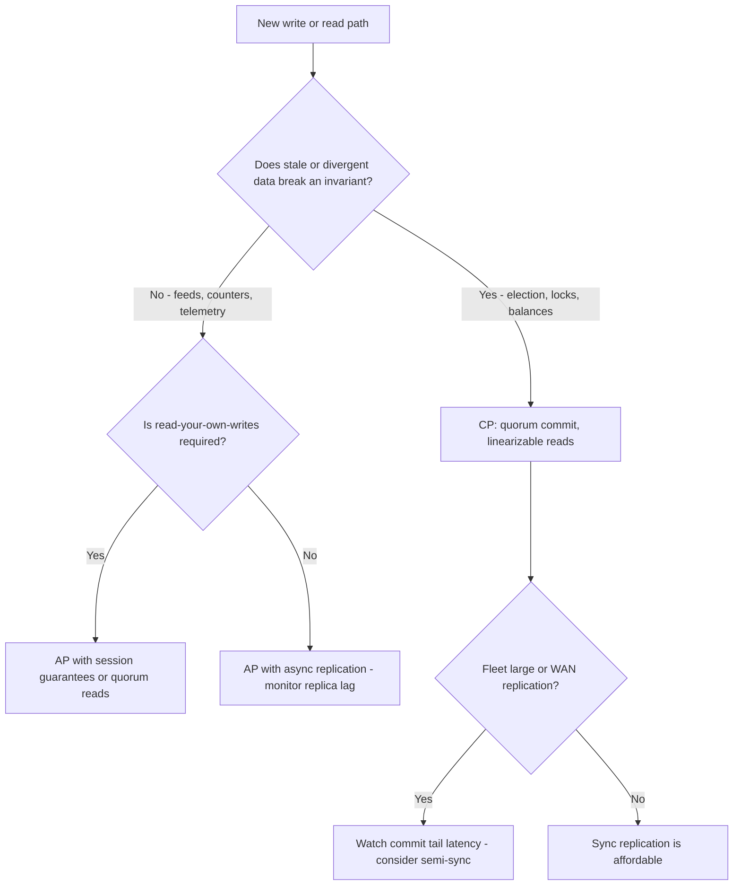

# Caching vs Recomputation, Consistency vs Availability vs Latency

## Overview

Caching is the most-used and least-audited optimization in software; distribution is where its hidden bill arrives. This page runs the [handbook framework](./index.md) on two coupled comparisons. First, cache vs recompute: when does a cache actually pay, and why is invalidation — the part everyone waves at — the real cost center? Second, the consistency/availability/latency triangle: what CAP does and does not let you choose, what PACELC adds, and why the durable insight is that these are *per-operation* choices, not system-wide labels. The quick-scan versions of both live in [Trade-offs](../../trade-offs/README.md); here we go to mechanisms.

## Comparison A: Caching vs Recomputation

### Mechanisms

A **cache** is a key → (value, metadata) store consulted before the source: memoization for pure functions, buffer pools for pages ([buffer pool](../../dbms/caching/buffer-pool.md)), CDNs and HTTP caches for responses. Its metadata encodes the two decisions every cache makes: *when to forget* (TTL, LRU/LFU eviction, explicit purge) and *when to revalidate* (validators like ETag/Last-Modified). **Recomputation** is the null cache: derive the result from the source on every request. The mechanism comparison is therefore a three-way cost accounting — lookup cost + miss cost + invalidation cost vs the recomputation cost on every request.

### When recomputation wins

No strawmen: recomputing is the correct design in identifiable regimes.

- **Cheap pure compute.** If the computation costs less than the cache machinery — hash lookup, memory footprint, eviction pressure — the cache is net negative. A cache entry that saves 50 µs but costs invalidation code, monitoring, and an extra failure mode is a bad trade. Rule of thumb: cache what costs milliseconds or more, or what is *semantically expensive* (external calls, DB round trips), not what merely costs microseconds.
- **Freshness is the product.** Stock prices, rate-limit counters, feature-flag checks: recomputing from source is the freshness guarantee. A cache converts "read the truth" into "read a possibly-stale copy" — if staleness is unacceptable, the cache must be so aggressively invalidated that it degenerates into an expensive pass-through.
- **Invalidation complexity is unbounded.** One derived value cached under one key is easy; a dependency *graph* of derived values (build outputs, aggregated dashboards, ML feature stores) turns invalidation into a correctness problem with no cheap solution — this is the point behind the aphorism attributed to Phil Karlton: "There are only two hard things in Computer Science: cache invalidation and naming things."
- **The CI example.** Recompiling a large monorepo from scratch takes hours; [Bazel remote caching](https://bazel.build/remote/caching) shares build-action outputs by content hash, and cache hits turn hours into minutes. The counter-side is instructive: a *correctness bug in the cache* (uncaptured input, poisoned artifact, flaky action marked successful) silently produces wrong binaries — worse than slow. Teams respond with content-addressing everything, verifying actions, and treating cache hits from unverified sources as misses. Caching bought the build system a new failure mode that did not exist before, and the design is precisely about bounding that risk.

### HTTP conditional requests: the middle path

ETags (`If-None-Match`) implement *revalidate-on-use*: the client asks, the server checks the validator, and either sends the full body (changed) or `304 Not Modified` (RFC 9111, HTTP caching). Compared with "no-cache, refetch everything", this keeps freshness semantics while skipping the expensive payload — recomputation of the *validity check*, amortized caching of the *body*. Compared with unconditional caching, it never serves stale content. It is the standard illustration that the cache-vs-recompute axis is continuous, and that the interesting designs (stale-while-revalidate, soft TTLs) place themselves explicitly between the poles.

### Failure modes and the stampede

- **Cache stampede / thundering herd**: when a hot key expires (or is purged), N concurrent requests all miss and all hit the source simultaneously — the load spike lands exactly when the system is least able to absorb it. Mitigations: request coalescing (one flight, many waiters), probabilistic early expiration (the XFetch idea from "Scaling Memcache at Facebook", NSDI 2013 — refresh slightly before expiry with probability proportional to cost/remaining-TTL), and per-key locks.
- **Negative caching**: queries for *absent* keys bypass most caches (nothing to store) and hammer the source — cache the absence itself (short-TTL null markers) or use a bloom filter in front.
- **Unbounded growth**: every cache needs an eviction policy and a size bound; "it's only temporary" caches become the memory leak of record.
- **Staleness monitoring**: a cache without hit-rate and age metrics is a correctness risk operating in the dark — see the operational playbook in [cache patterns](../../sre/cache-patterns.md).

### Decision framework: cache or recompute?

| Ask | If yes → | If no → |
|-----|----------|---------|
| Does computing cost meaningfully more than caching (ms-scale, external calls, DB)? | Cache | Recompute |
| Can staleness be tolerated or bounded for this value? | Cache (with explicit TTL) | Recompute |
| Is the invalidation dependency graph small and mechanical? | Cache | Recompute — or cache only the leaves |
| Is the key space bounded and hot (few keys dominate)? | Cache | Recompute (cache thrash risk) |
| Is the source able to absorb a synchronized miss spike? | Either | Cache *with* coalescing/early-expiry, or don't cache |

## Comparison B: Consistency vs Availability vs Latency

### CAP, precisely

CAP (Brewer's PODC 2000 conjecture; Gilbert & Lynch's 2002 formalization) is a statement about *partitions*: when the network splits, a distributed system must choose between linearizable consistency (reject/timeout operations that cannot reach a quorum) and availability (serve locally, accepting possibly-stale answers) — see [CAP](../../distributed/fundamentals/cap.md). Two corrections to the folk version matter here. First, partitions are rare; between them, the binding constraint is not C-vs-A but *latency*: PACELC (Abadi, IEEE Computer, 2012) formalizes it — **if Partition, choose C or A; Else, choose latency or consistency**, because synchronous replication pays replication round-trips on every write even in happy times. Second, the choice is not a system-wide constant: real systems make it *per operation* (see [the partition misconception](../misconceptions/consistency-availability-partition.md) for the false "CP vs AP system" binary).

### Concrete systems

- **CP: ZooKeeper and etcd.** Writes go through a leader and commit with majority quorum (ZAB for ZooKeeper; Raft for etcd — see [Raft](../../distributed/consensus/raft.md)); during a minority partition, the minority side refuses writes — and quorum-dependent linearizable reads — rather than risk divergence. Availability is sacrificed for a single, ordered, always-agreed state. This is the correct trade for coordination data: locks, leader election, configuration, service registry ([ZooKeeper](../../distributed/fundamentals/zookeeper.md), [etcd docs](https://etcd.io/docs/)). The nuance most answers miss: **ZooKeeper serves reads from the local replica by default** — fast and eventually consistent — and only `sync()` forces a quorum read. Even the canonical CP system is per-operation CP: linearizable writes, tunably-consistent reads ("ZooKeeper: Wait-free Coordination for Internet-Scale Systems", USENIX ATC 2010).
- **AP: Cassandra and Dynamo.** The Dynamo design (DeCandia et al., SOSP 2007 — [the Dynamo paper](https://www.allthingsdistributed.com/2007/10/amazons_dynamo.html)) optimizes for always-writable: any replica accepts writes, conflicts are reconciled later (version vectors, siblings), and consistency is *tunable* by quorum parameters R and W against N. With sloppy quorum and hinted handoff, even the quorum guarantee degrades gracefully during failures — availability first, divergence tracked and healed. Correct for shopping carts, feeds, telemetry; incorrect for "what is my account balance".
- **The latency dimension (the "E" in PACELC).** Synchronous replication (Raft majority ack, semi-sync MySQL) makes every write wait for a follower — the price is per-write latency and, nastily, *tail* amplification: with k synchronous replicas, write latency is the max of k network hops, and the tail grows with the fleet ("The Tail at Scale", Dean & Barroso, 2013 — see [tail latency](../../distributed/fundamentals/tail-latency.md)). Asynchronous replication returns immediately and pays in RPO: a leader crash can lose the last writes (see [primary-backup](../../distributed/replication/primary-backup.md) and [quorum](../../distributed/replication/quorum.md)). Sync-vs-async is the concrete, per-database instantiation of consistency-vs-latency.

### Per-operation consistency needs — the framework that survives interviews

| Operation class | Requirement | Typical choice |
|------------------|-------------|----------------|
| Leader election, locks, config/registry | Linearizable; stale reads cause split-brain | CP store (etcd/ZooKeeper), quorum reads/writes |
| Account balances, inventory decrements | Serializable or quorum-serializable transactions | Primary-replica with sync/semi-sync, or CP |
| Session state, profiles, carts | Read-your-writes; tolerate divergence across users | AP with session stickiness or versioned writes |
| View counts, likes, telemetry rollups | Eventually consistent is fine | AP, async replication |
| Read-after-write on your own data in an AP system | Session guarantees | Sticky reads, version stamps, quorum reads with R+W>N |

The design habit: list the operations, assign each a consistency requirement, and let the *storage per operation class* follow — rather than declaring the whole system CP or AP.

### Edge cases and counterexamples

- **Quorum is not a guarantee by itself.** R + W > N gives strict overlap only when the read and write quorums *intersect on live nodes*. Dynamo's sloppy quorum deliberately violates this during failures (writes land on unrelated nodes as hints), trading the guarantee for availability — teams that cite "we use quorums" while running hinted handoff have AP semantics with extra steps.
- **Sync replication converts one slow follower into global write latency**: a single degraded replica inflates the max-of-k commit wait for every write — the [tail latency](../../distributed/fundamentals/tail-latency.md) mechanism. Semi-sync (ack from *any* one of several replicas) is the standard softening.
- **Split-brain is what CAP's C prevents**: two partitioned sides both accepting writes and both serving "authoritative" answers is the AP failure that coordination systems exist to prevent; fencing tokens and lease-based designs are the countermeasures when a CP store fronts an AP store.
- **Latency is a consistency mechanism too**: many "eventual" inconsistencies are simply read-path latency — a read replica lagging seconds converts async replication into visible staleness. Monitoring replica lag *is* monitoring your consistency level (see [consistency](../../distributed/fundamentals/consistency.md)).

## Interview Questions

1. **"Cache everything" — give two regimes where recomputing is the right answer.** (a) Cheap pure compute: the lookup + memory + invalidation cost exceeds the recomputation cost, so the cache is net negative. (b) Freshness-critical values: the cache converts truth into a stale copy, and invalidating it aggressively enough to stay fresh degenerates into a pass-through. Also name the CI corollary: a build cache whose correctness is compromised produces wrong artifacts — worse than slow builds.
2. **What does a hot-key expiry do to your database, and name two mitigations.** A stampede: all concurrent readers miss at once and hit the source simultaneously. Mitigate by coalescing (single-flight), probabilistic early expiration (XFetch-style), or per-key locks; and cache negative results so absent keys stop bypassing the cache.
3. **ZooKeeper is called CP, yet its default reads are not linearizable. Explain.** Writes commit via majority quorum through the leader (linearizable, CP). Reads are served from the local replica for latency, which can be stale — a per-operation choice; `sync()` upgrades a read to quorum-acknowledged. CAP applies to the write path's partition behavior, not as a blanket per-read label.
4. **A team runs Cassandra with "quorum reads and writes" plus hinted handoff during node failures. What guarantee do they actually have?** In normal operation, R+W>N gives read-write overlap. During failures, sloppy quorum routes writes to temporary, unrelated nodes, so read and write quorums no longer necessarily intersect — semantics degrade to eventually-consistent AP. Quorum is a mechanism with preconditions, not a switch that guarantees anything.
5. **Your multi-region writes use fully synchronous replication to three followers and p99 write latency is degrading. Diagnose and list the honest options.** Commit wait is max-of-k network round trips; one degraded or far follower inflates every write's tail. Options: semi-sync (ack from any of the followers), reduce the sync set, move a follower closer, or accept async replication with its RPO loss — each is an explicit re-trade of consistency for latency, which is exactly PACELC's point.

## Key Takeaways

- Caching vs recomputation is cost accounting across three terms — lookup, miss, invalidation — and recomputation wins for cheap compute, freshness-critical values, and unbounded invalidation graphs.
- Invalidation is the hidden cost center; the cache's real price is a new failure mode (staleness, stampedes, poisoning) that must be monitored and bounded.
- Conditional requests (ETag/304) show the middle path: revalidate cheaply, cache the expensive payload — the axis is continuous, not binary.
- CAP constrains behavior *during partitions*; PACELC adds the everyday cost — sync replication pays latency on every write, async pays potential data loss.
- CP (ZooKeeper/etcd) for coordination data, AP (Cassandra/Dynamo) for always-writable scale — but the durable insight is per-operation: even ZooKeeper's default reads are eventually consistent, and Dynamo's quorums are tunable down to sloppy.
- Assign consistency per operation class — election/locks, balances, sessions, counters — and monitor replica lag as your de facto consistency level.

## Cross-References

- [Distributed Systems](../../distributed/overview.md) — the full distributed track: failure models, replication, and consensus beyond what this page compares.
- [Cache Patterns](../../sre/cache-patterns.md) — the operational playbook: TTLs, stampedes, hot keys, eviction.
- [Caching Strategy](../../interview/system-design/hld/caching-strategy.md) — system-design-level cache placement and patterns.
- [Redis](../../dbms/caching/redis.md) — the cache server's own mechanisms, persistence, and eviction.
- [Buffer Pool](../../dbms/caching/buffer-pool.md) — the database's internal cache, where invalidation is page management.
- [CAP Theorem](../../distributed/fundamentals/cap.md) and [Consistency Models](../../distributed/fundamentals/consistency.md) — formal background for Comparison B.
- [ZooKeeper](../../distributed/fundamentals/zookeeper.md) and [Raft](../../distributed/consensus/raft.md) — the CP mechanisms concretely.
- [Quorum Replication](../../distributed/replication/quorum.md) and [Primary-Backup](../../distributed/replication/primary-backup.md) — replication topologies and their latency costs.
- [Tail Latency](../../distributed/fundamentals/tail-latency.md) — why max-of-k waits dominate p99.
- [Consistency-Availability-Partition: Misconception](../misconceptions/consistency-availability-partition.md) — the false "system is CP" binary.
- [Backpressure: Connection Atlas](../connection-atlas/backpressure.md) — what happens when the write path is overloaded instead of stale.
- [Database Choices](./database-choices.md) — sibling page: the consistency mechanisms *inside* the database.
- [Why-Not Handbook](./index.md) — the framework and sibling comparisons.
