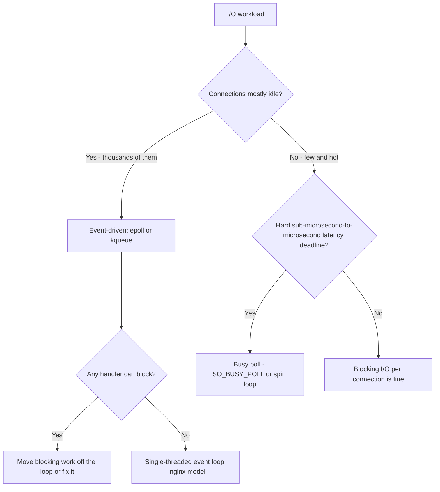

# Concurrency Primitives: Mutex vs Semaphore, Processes vs Threads, Polling vs Event-Driven I/O

## Overview

Three comparisons account for a disproportionate share of concurrency interview questions, and all three suffer from the same disease: memorized one-liners ("use a semaphore for producer-consumer", "threads are cheaper than processes", "epoll scales better than select") without the mechanisms that produce the answers. This page runs the [handbook framework](./index.md) three times. The comparisons are related — they all concern *how work waits* — but each has its own axis: (a) ownership and signaling semantics, (b) isolation versus sharing, (c) CPU burn versus wakeup latency.

## Comparison A: Mutex vs Semaphore vs Condition Variable / Monitor

### Mechanisms

**Mutex.** A lock with *ownership*: exactly the thread that acquired it must release it, which the runtime can (and RTOSes do) enforce and support with priority inheritance. Its only job is mutual exclusion over a critical section. Waiting threads sleep in a queue keyed by the mutex; there is no memory of "why" they wait.

**Semaphore** (Dijkstra, 1965). A counter with atomic `wait()` (P: decrement, block if zero) and `post()`/`signal()` (V: increment, wake a waiter) — and crucially, **no ownership**: any thread may post, so a semaphore can carry information between threads, not just serialize them. A semaphore initialized to N is a resource counter (N connections, N buffer slots); initialized to 0 it is a signaling primitive ("event happened"). A *binary* semaphore (max 1) looks like a mutex but is not one: no ownership, no priority inheritance, and it is meant for signaling/signposting, not for guarding critical sections.

**Condition variable / monitor.** A condvar is a wait queue *plus* an atomically released mutex: `wait(cv, m)` releases m, sleeps, and re-acquires m before returning — the atomicity is the entire trick, because it closes the lost-wakeup window between "check the predicate" and "go to sleep". A **monitor** (Hoare, 1974) bundles the mutex and condvars into the object itself — Java's `synchronized`/`wait`/`notify` is a monitor. The condvar carries the *predicate* ("queue not empty") rather than a count.

### The bounded producer-consumer problem, three ways

This is the sharpest way to see the difference:

| Design | Mechanism | Catch |
|--------|-----------|-------|
| Mutex + two condvars (`not_full`, `not_empty`) | Producers/consumers wait on the predicate they care about; notify the opposite side after state change | Must recheck predicate in a `while` loop (spurious wakeups; multiple consumers), or you get bugs |
| Two counting semaphores (`empty_slots = N`, `filled = 0`) + one mutex for the buffer itself | Semaphores *are* the slot counters; no predicate logic needed | Easy to deadlock by grabbing mutex and semaphore in inconsistent order; signal-before-release discipline matters |
| Naive single mutex, no condvar | Busy-wait or sleep-poll the queue length | Burns CPU, adds latency, misses wakeups — listed because juniors propose it |

### Guarantees and failure modes

- **Lost wakeup**: signaling a condvar *outside* the mutex, or checking the predicate with `if` instead of `while`, loses wakeups when the state changed between check and sleep. POSIX explicitly permits spurious wakeups, so the `while (predicate) wait();` loop is not optional style — it is the contract.
- **Using a mutex to wait for an event**: a mutex can only say "resource busy"; it cannot say "resource now available" to a specific waiter. Threads that lock-sleep on a mutex to await events busy-wait or deadlock. If the wait is *for a condition*, you need a condvar (or semaphore as a count).
- **Semaphore misuse as a lock**: a binary semaphore held as a mutex has no ownership discipline — any thread can release it, so a bug in one component silently "fixes" another component's locking. Ownership is a feature; semaphores trade it away for signaling power.
- **Deadlock vs starvation**: condvar designs deadlock on inconsistent lock ordering; semaphore-based resource pools starve when post() is missed on an error path (the classic "exception skips the release" leak). RAII/scope guards are the mitigation in both cases.

### When each wins

| Condition | Right primitive |
|-----------|-----------------|
| Guard a critical section; same thread acquires/releases | Mutex (with priority inheritance if real-time) |
| Count resources; signal capacity across threads | Counting semaphore |
| Wait until an arbitrary predicate becomes true | Condition variable inside a monitor |
| One-shot "event happened" notification | Binary semaphore (or futures/promises — see [Futures](../../concurrency/futures.md)) |
| Producer-consumer with bounds | Monitor with two condvars (readable) or semaphore pair (compact) |

## Comparison B: Processes vs Threads

### Mechanisms

A **process** owns a private virtual address space, file descriptors, and kernel bookkeeping; `fork()` copies it (copy-on-write pages make the copy lazy) and `exec()` replaces the image. A **thread** is an execution context *inside* a process: private stack and registers, shared heap, code, and file descriptors. The isolation/sharing trade is the definition: processes share nothing by default and communicate via the kernel (pipes, sockets, shared memory — see [IPC](../../os/processes/ipc-shared-memory.md)); threads share everything by default and coordinate with the primitives of Comparison A.

**Context-switch cost.** Switching threads costs a register/stack pointer swap and kernel bookkeeping (~microseconds). Switching processes additionally swaps the page-table root, which invalidates TLB entries — on x86-64 historically a full flush, mitigated by PCID/ASID tags but still measurably costlier (see [context switching](../../os/processes/context-switching.md)). The deeper cost is cache: a process switch often changes the entire working set, so TLB warmth and cache warmth are lost; two threads switching frequently inside one hot data structure share that warmth.

### Isolation, blast radius, and the flagship examples

Threads trade safety for cheapness; the industry's biggest systems chose deliberately:

- **Chrome's multi-process architecture** ([design doc](https://www.chromium.org/developers/design-documents/multi-process-architecture/)) puts each site (and the GPU, and extensions) in its own OS process. The reasoning is blast radius and security: a renderer crash takes down one tab, not the browser; a renderer exploit is contained by the process sandbox — separate address spaces are the hardware-enforced boundary that threads cannot offer. The price is real: multi-process Chrome famously raised memory overhead, and every cross-process interaction is IPC with serialization latency.
- **nginx's worker model** ([inside nginx](https://www.nginx.com/blog/inside-nginx-how-we-designed-for-performance-scale/)) is the opposite corner chosen deliberately: one single-threaded, event-driven worker *process* per core, no threads at all. With no per-connection thread, there is no thread-switch overhead and no shared-state locking in the request path; each worker is effectively a single-threaded epoll loop, and the OS scheduler balances cores. The lesson: processes + event-driven I/O can outcompete threads by *avoiding* concurrency inside a worker (see Comparison C).
- **The middle ground exists**: Erlang/Elixir BEAM "processes" are cheap, isolated actors with supervised failure handling ([actor model](../../concurrency/actor-model-deep.md)) — proof that isolation does not require heavyweight OS processes, only disciplined message passing and per-actor heaps.

### Failure modes

- **Threads**: one segfault or runaway allocation kills every thread in the process; data races corrupt shared state in ways that are non-reproducible ([memory model](../../concurrency/memory-model.md)); oversubscription (more CPU-bound threads than cores) adds switching overhead with zero throughput gain — the core of the [more-threads-faster misconception](../misconceptions/more-threads-faster.md).
- **Processes**: IPC becomes the bottleneck — anything requiring high-frequency shared data must use shared memory plus its own synchronization, at which point you have rebuilt threads' problems inside process boundaries; fork-heavy designs pay page-table and COW-fault costs; per-process memory overhead multiplies.

### When each wins

| Condition | Choose |
|-----------|--------|
| Components need fault isolation or a security boundary | Processes (Chrome's reasoning) |
| CPU-parallel numeric work over shared read-only data | Threads (zero-copy sharing) |
| Many mostly-idle connections, per-connection state small | Either, if I/O model is right (see Comparison C); nginx: processes+epoll |
| Frequent fine-grained shared mutation | Threads + locks (IPC per operation would dominate) |
| Plugin/extension code you cannot trust | Process sandbox |

## Comparison C: Polling vs Event-Driven I/O

### Mechanisms

**Busy polling**: the application loop checks for readiness (`read()` returning EAGAIN, or a status word) in a tight loop. Zero wakeup latency — data is noticed the moment it arrives — at the cost of one core burning at 100%. **Blocking I/O per connection**: simplest model, one thread (or process) per connection; fine at tens of connections, catastrophic at thousands because memory and scheduler overhead grow per thread. **`select`/`poll`**: one thread waits on a set of fds; the kernel wakes it when any is ready. Both rescan and copy the *entire* fd set on every call — O(n) per wakeup — which is the historical wall behind the [C10K problem](http://www.kegel.com/c10k.html). **`epoll`/`kqueue`/IOCP**: interest sets are *registered once* in the kernel; the readiness list is maintained incrementally and the syscall returns only ready fds ([epoll(7)](https://man7.org/linux/man-pages/man7/epoll.7.html)). epoll/kqueue are readiness-based (fd ready for I/O); Windows IOCP is completion-based (I/O finished, here is the buffer) — a deeper integration with overlapped I/O. **Kernel-assisted busy polling**: `SO_BUSY_POLL` (Linux) lets a socket's busy-poll loop spin in the kernel/driver receive path instead of sleeping, buying back most wakeup latency for a bounded CPU burn ([socket(7)](https://man7.org/linux/man-pages/man7/socket.7.html)).

### Latency vs CPU: the real trade

Event-driven I/O minimizes *idle* CPU: a server with 50,000 mostly-idle connections pays nothing for the 49,990 that are silent. But it maximizes *wakeup latency*: packet arrives → interrupt/NAPI → softirq → mark fd ready → wake the epoll waiter → scheduler runs the thread — several microseconds of machinery. Busy polling collapses that chain to a memory read, which is why low-latency trading systems, NFV data planes, and latency-tuned kernels (busy_poll/busy_read sysctls, `SO_BUSY_POLL`) deliberately burn CPU to shave microseconds. The trade is quantitative, not ideological: at low connection counts and hard latency deadlines, poll; at high connection counts with utilizable CPU elsewhere, event-driven.

### Failure modes

- **Thundering herd**: multiple workers epoll-waiting on the same listening fd all wake on one connection; `EPOLLEXCLUSIVE`, `SO_REUSEPORT` per-worker listeners, or accept-one-then-reschedule mitigate it.
- **Level- vs edge-triggered confusion**: edge-triggered epoll requires draining until EAGAIN or you wedge the fd; level-triggered is safer but re-notifies, adding loop overhead. The bug class is "works with 1 connection, starves with 10".
- **The event loop's single-threaded trap**: one slow handler (blocking disk read, CPU-heavy parse) stalls every connection in that loop — node.js's canonical footgun. nginx sidesteps it by keeping handlers non-blocking and delegating heavy work; thread pools re-enter the design ([thread pools](../../concurrency/thread-pools.md)).
- **Polling starvation and energy**: a busy-poll thread competes with real work on the same core; on battery-powered devices, spinning is a thermal/battery failure mode even when latency improves.

### When each wins

| Condition | Choose |
|-----------|--------|
| Thousands of mostly-idle connections | epoll/kqueue (event-driven) |
| Few connections, simplest correct code | Blocking I/O per connection |
| Hard microsecond-level latency budget, cores to spare | Busy polling / `SO_BUSY_POLL` |
| Completion-centric APIs (overlapped file/network I/O) | IOCP-style completion ports |
| Mixed: many idle + a few latency-critical flows | Event-driven baseline + busy-poll hot path |

## Interview Questions

1. **Why is a binary semaphore not a mutex, even though both have two states?** Ownership. A mutex must be released by its acquirer, enabling runtime error detection and priority inheritance on the holding thread; a binary semaphore has no owner — any thread can post it, which is exactly what makes it a signaling tool and a locking hazard. Different contracts, similar API surface.
2. **Your producer-consumer code wakes up with an empty queue. What happened, and what are the two fixes?** A spurious wakeup, or a wakeup for a predicate that another consumer already consumed — POSIX condvars permit both. The fix is architectural: wait in a `while (predicate) wait();` loop and use one condvar per predicate (not_full/not_empty). The semaphore-pair design avoids predicate rechecking because slots are counted, not inferred.
3. **Chrome chose processes; nginx chose single-threaded processes with no threads at all. What guarantee or cost drove each?** Chrome: hardware-enforced isolation — a renderer crash or exploit is contained to one tab by the address-space boundary, worth the IPC and memory overhead. nginx: at scale, per-connection threads cost memory and switching; a per-core single-threaded epoll worker handles tens of thousands of connections with no locks in the request path — concurrency without threads.
4. **Why does `select` collapse at C10K while `epoll` does not?** `select`/`poll` pass and rescan the entire fd set on every call — O(total fds) per wakeup, with set copies across the kernel boundary. epoll registers interest once and returns only the ready list — O(ready fds) — turning the per-wakeup cost into a function of activity, not fleet size.
5. **When is burning 100% of a core on polling the *correct* engineering choice?** When the tail-latency value of eliminating the wakeup chain (interrupt → softirq → wake → schedule, several microseconds) exceeds the value of that core's idle capacity — e.g., a market-data feed handler or NFV fast path. `SO_BUSY_POLL` formalizes it, bounding the spin to the kernel receive path; the honest costs are power/thermal and one core removed from the general-purpose pool.

## Key Takeaways

- Mutex = owned exclusion; semaphore = unowned counting/signaling; condvar = sleeping on a predicate with atomic lock release. The producer-consumer problem exposes the differences better than any definition.
- The `while (predicate) wait()` loop is a contract, not style — spurious wakeups are permitted by POSIX and consumed-by-another-thread wakeups are certain.
- Processes vs threads is isolation-vs-sharing: blast radius and security boundaries need address spaces (Chrome); fine-grained shared mutation needs threads; nginx shows the third path — one event-driven thread per process, no locks at all.
- Process switches cost TLB/page-table work beyond register swaps; thread oversubscription costs cache warmth for zero throughput ([more threads is faster — misconception](../misconceptions/more-threads-faster.md)).
- The I/O model axis is idle-CPU vs wakeup latency: select/poll rescan everything; epoll pays O(1) registration and returns only readiness; busy polling trades a core for microseconds — sometimes the right trade.
- Event loops have their own failure modes: thundering herd on shared listeners, edge-triggered drain bugs, and one blocking handler stalling thousands of connections.

## Cross-References

- [Mutex](../../os/synchronization/mutex.md), [Semaphores](../../os/synchronization/semaphores.md), and [Monitors](../../os/synchronization/monitors.md) — OS-level mechanics of each primitive.
- [Producer-Consumer](../../concurrency/producer-consumer.md) — the canonical worked problem with code.
- [Readers-Writers](../../concurrency/readers-writers.md) — the next classic problem after producer-consumer.
- [Thread Models](../../os/threads/models.md) and [User vs Kernel Threads](../../os/threads/user-vs-kernel.md) — what "a thread" costs at each layer.
- [Context Switching](../../os/processes/context-switching.md) — the measured cost model behind Comparison B.
- [Advanced I/O](../../network-programming/advanced-io.md) — select/poll/epoll/io_uring mechanics with code.
- [Concurrency Overview](../../concurrency/overview.md) — the full concurrency track.
- [Mutex to Lock-Free: Follow-up Tree](../followup-tree/mutex-to-lock-free.md) — where "why not just a mutex" escalates next.
- [More Threads is Faster: Misconception](../misconceptions/more-threads-faster.md) — the false claim this page's oversubscription analysis debunks.
- [Backpressure: Connection Atlas](../connection-atlas/backpressure.md) — what happens when the bounded queue fills.
- [Why-Not Handbook](./index.md) — the framework and sibling comparisons.
