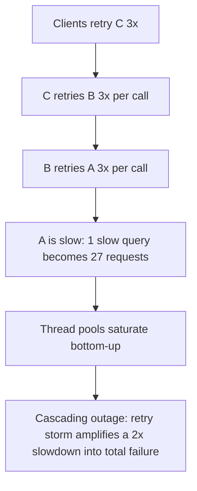

# Monolith vs Microservices: The Mechanisms of Failure Each Buys You

## Overview

The monolith-vs-microservices question is usually argued in aesthetics ("clean boundaries" vs "big ball of mud"). This page — the mechanism-depth companion to the quick-reference tables in [Architecture Trade-offs](../../trade-offs/architecture-tradeoffs.md) — argues it in failure mechanics instead. Deployed as a monolith, your failure surface is *one process*: a bad deploy lands everywhere at once, but a method call either happens or throws, and one transaction spans your whole domain. Deployed as microservices, you purchase deployment independence and team autonomy by **promoting the network from an implementation detail to a first-class failure layer** — partial failure, retry cascades, distributed transactions, and an observability bill become permanent residents of your design.

Neither architecture is the "modern" one. The honest framing, following Lewis & Fowler's original definition ([Microservices](https://martinfowler.com/articles/microservices.html)) and Fowler's sequencing argument ([MonolithFirst](https://martinfowler.com/bliki/MonolithFirst.html)): microservices trade *unknown* domain boundaries for *known* operational costs — and are usually premature when the boundaries are unknown.

## Step 1: The Problem and Its Constraints

A system will be built and operated by *T* engineers shipping to *S* services (or one). The constraints that actually decide:

- **Team size and cognitive load.** Conway's law — organizations ship architectures that mirror their communication structure (Conway, *"How Do Committees Invent?"*, 1968) — is not a joke to be defeated but a force to be aligned: service boundaries that match team boundaries decouple those teams' fates ([Team Topologies](../../trade-offs/architecture-tradeoffs.md) formalizes this as team cognitive load per service).
- **Deployment coupling tolerance.** Can the business tolerate "all teams release together on a train", or do different parts genuinely need different cadences (a fraud model updated weekly vs a checkout fix now)?
- **Domain boundary confidence.** Do you *know* where the seams are? Wrong seams in a monolith cost a refactor; wrong seams in microservices cost a decade of cross-service compensation.
- **Scaling asymmetry.** If one component needs 100× the capacity of the rest, independent scaling is a real argument — the same reasoning as [scale-up vs scale-out](./scaling-up-vs-out.md), applied to code.
- **Operational maturity.** Whoever adopts microservices adopts distributed-systems operations: tracing, canaries, per-service on-call, infrastructure teams. This is a hiring-and-organization decision before it is an architecture one.

## Step 2: The Mechanisms

### Monolith: one process, one deployable

In-process function calls, one memory space, one transaction manager, one log file, one debugger story. The mechanism that dominates everything else: **locality**. A checkout that calls pricing, inventory, and payment via method calls shares the caller's failure semantics — if the method throws, the exception propagates *inside one transaction boundary*, and rollback is the database's job (see [ACID locally](../followup-tree/acid-transactions.md)). Deployment is atomic: the whole system ships as one artifact, so version skew is impossible by construction — and so is independence.

The monolith's costs at scale are also mechanisms, not aesthetics:

- **Deploy-train coupling.** With hundreds of engineers, every release is a negotiated event: change freezes, coordination meetings, a regression in module A holding hostage the urgent deploy of module B. Lead time grows with headcount because the *release unit* is the whole system.
- **Blast radius.** A memory leak in a rarely used admin module takes down checkout — one runtime, shared resources, one failure domain.
- **Organizational load-bearing walls.** Adding engineers to one codebase eventually *reduces* throughput: merge conflicts, review queues, ownership ambiguity scale superlinearly — the same mechanism that caps threads per core ([more-threads-faster](../misconceptions/more-threads-faster.md)). The code is fine; the communication graph is not.

### Microservices: the network promoted to a design layer

Each service owns its data (the database-per-service rule) and communicates over the network. The real payoff is a *deployment* mechanism: each service ships, scales, and fails independently, and Conway's law is satisfied by construction — one team, one service, one on-call rota. The real costs are the failure mechanisms the network imports:

- **Partial failure as the normal case.** A method call either runs or throws; a network call can *succeed, fail, or hang* — and a hang is indistinguishable from silence until a timeout fires. Every inter-service call needs a timeout, a retry policy, and a fallback decision ([timeouts and retries](../assumptions-hunt/timeouts-and-retries.md)).
- **Distributed transactions become sagas.** Checkout spanning orders, payments, and inventory services cannot share one database transaction (2PC across services is a locking nightmare across failure domains — see [2PC](../../dbms/transactions/two-phase-commit.md)). The replacement is a saga: local transactions with compensating actions ([saga pattern](../../dbms/transactions/saga.md)) — which moves every invariant from "the database enforces it" to "application code and design reviews enforce it".
- **Retry cascades — the failure mechanism microservices own.** Retries, added per-service for resilience, multiply: a downstream slowdown triggers retries at every layer, and each layer's retry load multiplies the layer below's.

A 2× slowdown in A becomes a 27× request load through three layers of 3× retries — the mechanism behind many "we added retries and everything fell over" outages. Countermeasures are known and mandatory: circuit breakers to stop calling a failing dependency ([circuit breakers](../../distributed/microservices/circuit-breakers.md)), retry budgets and jitter, bulkheads to partition thread pools (Nygard, *"Release It!"*), and fail-fast defaults ([backpressure](../connection-atlas/backpressure.md) for the pacing mechanics).

- **Observability becomes infrastructure.** One request crosses eight services; debugging "why is checkout slow" needs distributed tracing, per-service dashboards, and correlated logs ([observability](../../distributed/microservices/observability.md)) — a permanent engineering investment a monolith approximates with a profiler and one log.

## Step 3: Complexity, Guarantees, and Failure Modes

| Property | Monolith | Microservices |
|----------|----------|---------------|
| Call semantics | Method call: runs or throws | Network: success / failure / **hang** — three outcomes, one protocol per dependency |
| Transaction scope | One ACID boundary across the domain | Per-service; cross-service = sagas + compensation |
| Deploy unit | One artifact, atomic, version-skew-free | Per-service, independent — with API versioning and compatibility discipline |
| Failure isolation | None (shared runtime) — blast radius = whole system | Per-service by design; **but** cascades re-couple via retries and shared dependencies |
| Consistency story | Database-enforced invariants | Application-enforced (sagas, eventual consistency, reconciliation jobs) |
| Observability cost | Profiler + structured logs | Tracing, meshes, per-service SLOs — a platform team's worth |
| Team scaling ceiling | Communication graph bottlenecks (~dozens) | Aligns with team topology (hundreds) — that alignment is the payoff |
| Signature failure | Deploy train gridlock; whole-system outage from one module | Retry storm; saga stuck mid-compensation; wrong-boundary redesign |

The guarantee asymmetry mirrors [scale-up vs scale-out](./scaling-up-vs-out.md) exactly: **the monolith preserves every transactional and locality guarantee and couples fates; microservices decouple fates and downgrade every guarantee to an application-level implementation.** Choosing microservices is choosing to reimplement, in code and process, what the monolith got from sharing a runtime.

## Step 4: When Each Wins

**Monolith wins** when: the team is small enough to share context (roughly: one team, one pizza); domain boundaries are unproven and still moving; transactional integrity across the domain is core value; operational maturity is low. Most products start here because most products do not yet *know* their seams — Fowler's MonolithFirst argument is precisely that you cannot cut boundaries you have not discovered.

**Microservices win** when: team count has outgrown shared-context communication (Conway forces a split anyway — the question is whether the split is deliberate); components have genuinely different scaling/cadence/security profiles; independent deployment is a measured business constraint (deploys blocked by coordination, not by code); and — the non-negotiable — the organization can fund the platform (tracing, deploy pipelines, per-service on-call). The architecture choice is really a team-topology choice ([microservices operations](../../distributed/microservices/README.md)).

**The modular monolith — the middle path that often dominates.** One deployable, but with *enforced* internal module boundaries: package visibility rules, explicit interfaces between modules, separate schemas-per-module, and a build that fails when a module reaches across. This buys most of the monolith's guarantees (local transactions, no network in the hot path, atomic deploys) while preserving the *option* to cut along the module seams later — the seams already exist and are exercised. It dominates when boundaries are becoming clear but team count has not yet forced independent deployment.

## Step 5: Edge Cases and Counterexamples

- **Microservices at 5 engineers — the honest version.** Five engineers adopting microservices inherit: N deploy pipelines, N dashboards, N on-call rotas, inter-service API versioning, and distributed debugging — with a headcount that cannot staff even one platform rotation. The typical outcome is the *worst of both*: services that all deploy together anyway (version-locked), share one database (per-service data ownership too expensive), and require cross-service sagas nobody owns. Framed honestly: at 5 engineers, "microservices" usually means "a distributed monolith with the costs of both architectures and the benefits of neither". The defensible exception is one genuinely separable compute-heavy subsystem (model serving, media encoding) with its own scaling profile — one seam, not twenty.
- **Monolith at 500 engineers — release gridlock by mechanism.** Not a style problem, a coordination problem: the deploy train is a *serialized global lock* on shipping. At that scale, weekly coordinated releases, hundreds of merge conflicts, and a test suite measured in hours are the mechanism by which lead time explodes — and Conway's law guarantees the organization will shadow-split into fiefdoms whose boundaries the *code* does not honor. At this scale the monolith's "atomic deploy" guarantee has inverted: atomicity of shipping is now the bottleneck of the whole company.
- **The retry storm that was added for resilience.** Each team, acting locally rationally, adds 3 retries with 5-second timeouts to *their* dependency; no one owns the global retry graph; a moderate downstream slowdown multiplies 27× through three layers and saturates thread pools bottom-up (the diagram in Step 2). The counterexample's lesson: resilience mechanisms compose multiplicatively, not additively — retry budgets, breakers, and a *global* view of the call graph are part of the architecture, not per-service polish ([circuit breakers](../../distributed/microservices/circuit-breakers.md)).
- **The saga stuck mid-compensation.** An order saga completes payment, then fails inventory reservation; the compensation (refund) fails because the payment service is down. Now two services disagree about a user's money until an operator intervenes. Monoliths cannot have this failure (one transaction); microservices must design for it: compensations themselves need retries, dead-letter queues, and human workflow — the cost of *every* invariant is now an operational runbook.
- **The modular monolith that ate the migration.** A team, told "you'll need microservices eventually", skips modularization and shards the *codebase* into services immediately; five years later the boundaries are wrong and unfixable. The inversion of the same mistake: teams that built a disciplined modular monolith often *never needed* to split — the load they feared showed up as one hot module, which they scaled out with the database techniques of [scaling-up-vs-out](./scaling-up-vs-out.md). Modularity-first preserves the choice; service-first spends it.

## Step 6: Decision Framework — Via Conway and Team Topology

1. **Count teams, not services.** The unit of architecture is the team: one team (up to ~8–10) → monolith or modular monolith; several teams with distinct ownership domains → align service boundaries to *those* boundaries (Conway's law aligned deliberately, per Team Topologies).
2. **Audit deployment coupling as measured, not felt.** If deploys are blocked by coordination *today*, that is evidence for decoupling; if the pain is hypothetical, keep the deploy unit atomic.
3. **Verify seam confidence before cutting.** Boundaries with stable, long-lived data ownership → safe to make remote calls across. Boundaries still moving → keep them in-process (module boundaries) until they stop moving.
4. **Budget the platform as a precondition.** Tracing, per-service pipelines, on-call rotation, saga tooling: if these cannot be funded and staffed, microservices are unaffordable *regardless of domain fit*.
5. **Design the failure layer explicitly:** every inter-service edge gets timeout, retry budget, breaker, and fallback *before* production traffic — the retry-storm mechanism is prevented at design review, not at 3 a.m.
6. **Prefer the reversible move:** modular monolith → extract services along existing seams (reversible, incremental); premature service grid → re-merge (expensive, rare). Choose the architecture that keeps the next decision cheap.

## Interview Questions

1. **What exactly does the network change about failure semantics vs a method call — and what three mechanisms must sit on every inter-service edge?** A method call runs or throws; a network call can also *hang*, and partial failure means callers succeed while callees did not. Every edge needs a timeout (bounded waiting), a retry policy with jitter and a *budget* (bounded amplification), and a circuit breaker with fallback (bounded blast radius). Without them, retries cascade multiplicatively.
2. **Why does "database per service" turn invariants into application code? Give the checkout example.** With data split across services, no single ACID transaction can span orders, payments, and inventory — so the invariant "no order without payment or reserved stock" is implemented as a saga: local transactions plus compensations, with the saga's own failure modes (stuck compensations, reconciliation jobs). The monolith enforced it in one commit; the microservice design must *operate* it forever.
3. **Frame the 5-engineer microservices decision honestly.** The costs (N pipelines, N on-calls, distributed transactions, tracing platform) scale with service count while the team that operates them does not; the typical result is version-locked services sharing a database — a distributed monolith. The defensible cut is one seam with a genuinely different scaling profile, not a grid of services.
4. **Use Conway's law to explain both the 500-engineer monolith's gridlock and the microservices payoff.** Architecture mirrors communication structure: at 500 engineers the communication graph cannot share one deploy unit, so release coordination becomes a serialized global lock (gridlock) and shadow orgs diverge from code boundaries. Deliberately cutting services along real team boundaries makes the code's structure *match* the communication graph — that alignment, not the HTTP calls, is the payoff.
5. **Why is the modular monolith often the dominant strategy rather than a compromise?** It preserves the monolith's guarantees (locality, ACID, atomic deploys) while enforcing seams that keep future extraction cheap; it delays the network's failure-layer costs until boundaries are proven — and often indefinitely, because the seam that exists is the one that can be cut if ever needed. Premature services spend the option; modules preserve it.

## Key Takeaways

- Microservices' real product is **deployment independence and team autonomy**; their real price is promoting the network to a failure layer: partial failure, retry cascades, sagas, and observability as permanent infrastructure.
- Monoliths' real costs at scale are **release coupling and blast radius** — mechanisms that invert the "atomic deploy" guarantee into a bottleneck as headcount grows.
- Retry storms are the signature microservices failure: locally rational resilience multiplies globally; timeouts, budgets, and breakers are architecture-level requirements, not polish.
- The modular monolith usually dominates when boundaries are unproven or teams are few: it preserves transactional guarantees and keeps extraction reversible — cut along seams only when measured deployment coupling and real team boundaries demand it.
- The decision is a **team-topology decision** (Conway's law), not a code-aesthetics decision; budget the platform before choosing the architecture that needs it.

## Cross-References

- [Architecture Trade-offs](../../trade-offs/architecture-tradeoffs.md) — the quick-reference tables; this page is their mechanism-depth companion.
- [Microservices](../../distributed/microservices/README.md) — the operational pattern catalog behind this comparison.
- [Circuit Breakers](../../distributed/microservices/circuit-breakers.md) — the retry-cascade countermeasure in depth.
- [Observability](../../distributed/microservices/observability.md) — the tracing/dashboards platform microservices require.
- [Service Discovery](../../distributed/microservices/discovery.md) and [API Gateways](../../distributed/microservices/api-gateways.md) — the plumbing the network layer imports.
- [Saga Pattern](../../dbms/transactions/saga.md) and [Two-Phase Commit](../../dbms/transactions/two-phase-commit.md) — the transactional story across service boundaries.
- [Distributed Transactions](../../distributed/advanced/distributed-transactions.md) — the general theory behind sagas and compensation.
- [Scaling Up vs Out](./scaling-up-vs-out.md) — sibling page: the same guarantee-for-capacity trade at the data layer.
- [Backpressure: Connection Atlas](../connection-atlas/backpressure.md) — the pacing mechanics under retry storms.
- [Timeouts and Retries: Assumptions Hunt](../assumptions-hunt/timeouts-and-retries.md) — the assumption audit behind every retry policy.
- [Why-Not Handbook](./index.md) — the framework and sibling comparisons.
