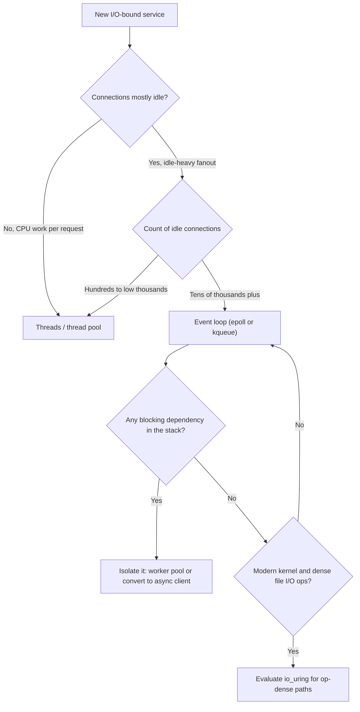

# Sync vs Async I/O: Thread-per-Connection vs Event Loops vs io_uring

## Overview

Blocking I/O with a thread per connection, epoll/kqueue event loops, and io_uring are three answers to one question: **what does the program do while waiting for the kernel?** A blocking read parks the thread — simple, and the scheduler hides the wait. An event loop registers interest and reacts to readiness — one thread multiplexes thousands of sockets, and the program becomes a state machine. io_uring replaces "ask-then-wait" with submission and completion queues: the program describes work, the kernel does it, and completions arrive asynchronously through shared memory.

The choice is usually framed as performance, but its sharpest trade is **complexity versus concurrency**: blocking code keeps the call stack as the source of truth (a stack trace shows the whole request), while event-driven code shatters the request across callbacks or suspended coroutines, buying scale with debuggability. This page runs the [handbook framework](./index.md) over the three-way comparison; the syscall-level mechanics of `select`/`poll`/`epoll` live in [I/O multiplexing](../../networks/sockets/io-multiplexing.md) and the [advanced I/O](../../network-programming/advanced-io.md) chapter, with [io_uring](../../os/kernel/io-uring.md) treated separately — here the focus is the systems decision. The sibling page [concurrency primitives](./concurrency-primitives.md) covers the polling-vs-event-driven fork at the primitive level; this page extends it to fleet-scale architecture and the file-I/O asymmetry most async narratives get wrong.

## Step 1: The Problem and Its Constraints

The workload: a server accepts connections and does work for each — parse, compute, call a database, write a response. Constraints that decide the I/O model:

- **Concurrency profile.** How many connections exist, and what fraction are *active* right now? 200 connections at 100% CPU is a compute problem; 50,000 connections at 0.1% activity is a waiting problem — and only the second is an I/O-model problem at all (see the [more threads myth](../misconceptions/more-threads-faster.md) for why threads do not make the first case faster).
- **Memory per idle connection.** A thread costs a stack — megabytes of virtual address space, tens of kilobytes resident, plus scheduler structures. An event-loop connection state is a struct. At C10K-and-beyond scale, this arithmetic decides before performance does.
- **Per-request CPU work.** Heavy CPU per request amortizes setup and rewards simple models; a single-threaded event loop stalled by one CPU-bound handler stalls *every* connection.
- **Blocking dependencies.** A blocking database driver inside an event loop freezes the loop. The model is only as async as its slowest dependency.
- **Debuggability and team norms.** Can the team read reentrancy-heavy code? Is a stack trace per request a debugging requirement?
- **The file I/O reality.** Are the waits sockets (kernel can notify on readiness) or regular files (Linux says: they are always ready)? This asymmetry reshapes the whole comparison — see Step 5.

## Step 2: The Mechanisms

### Option 1: Blocking I/O with thread-per-connection

- **The mechanism is scheduling.** `read()` on an empty socket parks the thread; the kernel wakes it when data arrives. Concurrency comes from the scheduler multiplexing *threads*, each of which runs blocking code as if it were alone.
- **The call stack is the request context.** Locals, error propagation, and the debugger's stack trace all map one-to-one to the logical request. No state machine, no reentrancy: the model's clarity is not nostalgia, it is a property of one stack per flow of control.
- **The cost curve.** Cost per connection is a thread: stack pages, kernel scheduling structures, context-switch time on every preemption. Tens of thousands of mostly-idle threads pay mostly for existing; the C10K problem (Dan Kegel's name for the 1999-era wall) was exactly this arithmetic meeting 4 GB RAM boxes. Context-switch overhead also degrades latency tails when active threads outnumber cores.
- **Where it genuinely wins.** Modest concurrency (hundreds to low thousands), meaningful CPU work per request, blocking drivers and ORM ecosystems, and teams that value stack-shaped debugging. The default server that handles 500 concurrent requests on a thread pool is not a design failure — it is the correct point on this curve.

### Option 2: Readiness event loops (epoll/kqueue)

- **The mechanism is readiness notification.** Register sockets with `epoll` (Linux) or `kqueue` (BSD/macOS); the kernel maintains a ready list; `epoll_wait` returns the sockets with pending events in O(ready), not O(registered) as legacy `poll` did (the mechanism contrast is drawn in [I/O multiplexing](../../networks/sockets/io-multiplexing.md)). One thread (or a few) runs handlers for ready sockets — nginx's architecture, per its [design documentation](https://nginx.org/en/docs/), is exactly this: one worker per core, event-driven, no thread-per-connection tax.
- **The program becomes a state machine.** A request's progress lives in per-connection state, not on a stack: "sent request headers, waiting for DB reply." Callbacks or coroutines arrange the continuations. Coroutines and async/await (see [async-await](../../concurrency/async-await.md), [coroutines](../../concurrency/coroutines.md)) exist to recover sequential-looking code over this machinery — the "colored functions" tax is the price of that reconstruction.
- **Single-threaded handlers eliminate a race class.** Within one loop iteration, a handler runs without preemption from sibling handlers — no locks around per-connection state. The cost is the flip side: one blocking call or one CPU-heavy handler stalls every connection on the loop.
- **Edge vs level triggering** changes who manages the buffer: level-triggered re-notifies while data remains (simpler); edge-triggered notifies once (faster, but the handler must drain until `EAGAIN` or connections stall — a classic production bug).

### Option 3: io_uring — completion-based I/O

- **The mechanism is shared-memory queues.** The program pushes submission queue entries (`IORING_OP_READ`, `IORING_OP_SEND`, ...), the kernel consumes them and pushes completion queue entries back — no syscall per operation in the steady state, operations batched, and polled modes can eliminate even the wake-up (the design is documented in the [io_uring chapter](../../os/kernel/io-uring.md)).
- **Readiness vs completion.** epoll says "socket X is readable, do the work yourself"; io_uring says "your read finished, here is the data." Completion-based models express *any* I/O — including file I/O that readiness models cannot (Step 5) — and naturally batch syscall amortization.
- **The new failure surface.** Async cancellation semantics, buffer lifetime across in-flight operations, and per-variant kernel-version behavior make io_uring its own operational discipline; the [fast I/O](../../os/advanced/fast-io.md) and [SPDK](../../os/advanced/spdk.md) chapters cover where the kernel-bypass family goes beyond it.

## Step 3: Complexity, Guarantees, and Failure Modes

| Property | Blocking + threads | Event loop (epoll/kqueue) | io_uring |
|----------|--------------------|---------------------------|----------|
| Cost per idle connection | A thread (stack + scheduler state) | A state struct | A state struct |
| Scales to | Low-mid thousands active | Tens–hundreds of thousands idle-heavy | Same, with lower syscall tax |
| Programming model | Sequential; stack is the context | State machine / callbacks / coroutines | Completion callbacks + buffer lifetime management |
| CPU-bound handler | Costly but isolated to its thread | Stalls the whole loop | Depends on execution model (usually still a loop) |
| Blocking dependency in the stack | Fine (thread parks) | Freezes the loop — the integration killer | Fine only if issued as async op |
| Debuggability | Best: full stack per request | Worst: fragmented stacks, interleaved handlers | Worst plus async lifetime reasoning |
| File I/O on Linux | Works (thread blocks; page cache hides cost until it doesn't) | Broken as a readiness story — files are always "ready" | First-class — completion-based file I/O is the point |
| Syscall overhead | One per blocking call | One per readiness batch | Amortized via SQ/CQ batching |
| Signature failure | Thread exhaustion; scheduler contention at high active counts | One bad handler stalls the fleet; EAGAIN drain bugs | Cancellation/lifetime bugs; kernel-version variance |

**The debuggability column is the honest cost nobody benchmarks.** A blocking stack trace reads top-down: handler → service → driver → socket. An event-loop stack trace shows `epoll_wait` and a callback frame — the logical chain lives in a state machine the debugger cannot follow. Async/await runtimes partially restore sequential traces, but interleaving across tasks still scrambles time-ordering within a single trace. Teams migrating to async routinely underestimate this tax relative to the throughput they actually gain.

## Step 4: When Each Wins

**Blocking + threads wins** when concurrency is modest and per-request work is real: internal services with bounded load, handlers with CPU-heavy sections, codebases whose database drivers are blocking, and teams optimizing for maintainability over tail throughput. Go is the counter-argument to the framing itself: goroutines give thread-shaped, blocking-style code while the *runtime* multiplexes onto event-driven I/O underneath — the synthesis exists precisely because both pure models have real costs.

**Event loops win** when connections vastly outnumber active work: proxies and gateways (nginx), WebSocket/chat servers, telemetry collectors — the idle-heavy fanout where thread-per-connection memory arithmetic is fatal. Also when per-connection state must be lock-free by construction (single-threaded loop) and when tail latency under high connection churn matters.

**io_uring wins** when the workload is I/O-op-dense on modern kernels: high-IOPS storage services, databases and file servers, proxies where syscall amortization is measurable, and any system that needs *file* I/O to participate in the same async story as sockets. It is not a general default yet: kernel-version sensitivity and buffer-lifetime semantics are real adoption gates.

## Step 5: Edge Cases and Counterexamples

- **The async file I/O myth on Linux.** "Non-blocking file I/O" as commonly imagined does not exist: `O_NONBLOCK` has no effect on regular files, and adding a regular file to epoll reports it *always ready* — a page-cache hit is immediate and a miss is not a readiness state the interface models. The workarounds each leak: thread pools doing blocking reads (libuv's async disk workers), POSIX AIO (implemented in glibc as *userland threads*, not kernel asynchrony), and finally io_uring as the first true kernel-side async file interface on Linux. Any "our server is fully async" claim on Linux is — or was, pre-io_uring — a claim about sockets only.
- **The event loop's serial bottleneck.** One handler doing 50 ms of JSON parsing stalls every connection on that loop for 50 ms — no amount of epoll cleverness helps, because the loop is single-threaded by design. The standard mitigations (worker pool for CPU work, multiple loops per process sharded by connection) reintroduce the scheduling complexity async was supposed to avoid. The honest framing: async moves the bottleneck from "threads waiting" to "the loop's single thread," and workloads with real CPU per request can end up *slower* than a thread pool.
- **A blocking call inside the loop — the silent freeze.** A driver, DNS resolution, or `getaddrinfo` inside a handler stops the world for its duration. Under light load this looks like a latency blip; at scale it is a fleet-wide stall with a baffling flame graph (the loop thread parked in one frame) — the single most common async-migration incident, and the reason readiness frameworks ship "do not call this here" linters.
- **Threads scale further than the folklore says.** With realistic stacks and modern kernels, tens of thousands of *mostly idle* threads are survivable; the folklore's C10K panic dates from 1999 RAM budgets. The real thread tax is active-context switching and memory bandwidth — which is why "we have 3,000 connections, should we go async?" usually has the answer "no."
- **io_uring's buffer lifetime problem.** In a completion model, the kernel writes into buffers the application must keep alive and exclusively-owned until the completion arrives. Reference-counted buffer pools and registered buffers exist for this; the bug class (use-after-completion, double-submitted buffers) is new and its debugging tools are younger than the interface itself.
- **Thundering herd on accept.** Multiple processes waiting on a shared listening socket's readiness all wake on one incoming connection; one wins, the rest re-sleep. Event-driven architectures with shared listeners handle this explicitly (`SO_REUSEPORT` sharding, `EPOLLEXCLUSIVE`) — the readiness model moved the problem from "who accepts" to "who wakes."

## Step 6: Decision Framework

1. **What fraction of connections are active?** High active fraction → threads; the scheduler is already the right tool. Idle-heavy fanout → event-driven.
2. **Is per-request work CPU-heavy?** Yes → threads or a work-queue split; a single-threaded loop will serialize your bottleneck.
3. **Do all dependencies (drivers, DNS, file reads) have non-blocking APIs?** No → either isolate them in a worker pool or stay with threads; a loop that blocks is the worst of both worlds.
4. **Is a full stack trace per request a debugging requirement?** Yes → weight the thread model's clarity heavily; async/await only partially restores it.
5. **Does the service do dense file I/O on modern kernels?** Yes → io_uring belongs in the evaluation; the readiness model cannot express file asynchrony at all.
6. **Default in doubt:** threads and blocking I/O until a measured limiter (memory, context switches, driver fanout) says otherwise — then move the specific hot path, not the whole architecture, to event-driven I/O.

## Interview Questions

1. **Why does epoll scale to 100,000 sockets where `poll` degrades?** `poll` scans the full passed-in set on every call — O(registered) per wait. epoll registers interest once (a red-black tree in the kernel) and maintains a ready list; `epoll_wait` returns only ready descriptors — O(ready). The win is structural for idle-heavy workloads, and nil for a fully-active set, which is why the syscall choice follows the concurrency profile, not fashion.
2. **"Our async server is fully non-blocking, including file reads on Linux." What is wrong with this claim?** Pre-io_uring, Linux had no kernel-side async file interface in general use: `O_NONBLOCK` is ignored for regular files, epoll reports them always-ready, and the standard libraries fake it with thread pools (libuv workers) or glibc POSIX AIO (userland threads). The claim is true only for sockets — or the team is already on io_uring.
3. **A thread-per-connection service and an event-loop service both handle 5,000 connections. Which has the simpler failure modes and why?** The thread model: contention and exhaustion, visible in standard tools, with a stack per request for diagnosis. The event loop's characteristic failures — one blocking call freezing the fleet, an undrained `EAGAIN` buffer, a CPU-heavy handler stalling everything — are temporal and cross-connection, the class that stack traces do not reveal.
4. **Why did async/await and coroutines appear in nearly every language after event loops did?** Because raw callback-style event-driven code fragments the call stack: request state lives in a state machine, error propagation is manual, and reasoning is reentrancy-heavy. Coroutines recover sequential syntax over the same readiness machinery — trading compiler/runtime complexity for programmer-visible flow — the same trade Go's goroutines make from the opposite direction (blocking syntax, runtime multiplexing).
5. **What does io_uring change about the readiness-vs-completion distinction?** epoll says "descriptor is ready, do the I/O yourself" — readiness-based, and file-hostile. io_uring accepts operation submissions and returns completions — completion-based, which expresses any I/O uniformly, amortizes syscalls through shared-memory queues, and finally makes file I/O a first-class citizen of the async story, at the price of buffer-lifetime and cancellation reasoning the readiness model never had.

## Key Takeaways

- The three models differ in who hides the wait: the scheduler (threads), the readiness interface (epoll/kqueue), or shared-memory completion queues (io_uring) — everything else follows from that placement.
- Thread-per-connection is not a beginner's mistake: at modest concurrency it wins on clarity, debuggability, and integration with blocking ecosystems; its cost curve is memory and context switches per *active* thread.
- Event loops win the idle-heavy fanout and impose two structural taxes: the call-stack shatter (callbacks/coroutines) and the serial loop (one bad handler stalls the fleet).
- On Linux, async file I/O was a myth until io_uring: readiness interfaces cannot express it, and the historical workarounds were thread pools wearing an async costume.
- The decision is workload-shaped, not ideology-shaped: concurrency profile, CPU per request, dependency blocking, and debuggability decide — and the strongest systems (Go's runtime) synthesize both models.

## Cross-References

- [I/O Multiplexing](../../networks/sockets/io-multiplexing.md) — select/poll/epoll mechanics in depth.
- [Non-blocking Sockets](../../networks/sockets/nonblocking.md) — the descriptor-flag mechanics beneath readiness loops.
- [Advanced I/O](../../network-programming/advanced-io.md) — the syscall-level survey this page builds on.
- [io_uring](../../os/kernel/io-uring.md) — submission/completion design and kernel internals.
- [I/O Internals](../../os/advanced/io-internals.md) and [Fast I/O](../../os/advanced/fast-io.md) — the kernel-side path from syscall to device.
- [Thread Pools](../../concurrency/thread-pools.md) and [Coroutines](../../concurrency/coroutines.md) — the two mitigations for each model's weaknesses.
- [Async/Await](../../concurrency/async-await.md) — language-level reconstruction of sequential flow over event loops.
- [More Threads Faster: Misconceptions](../misconceptions/more-threads-faster.md) — the CPU-bound anti-claim this page's constraints correct.
- [Interrupts and Async: Connection Atlas](../connection-atlas/interrupts-async.md) — the hardware-to-userspace story of deferred work.
- [Concurrency Primitives](./concurrency-primitives.md) — sibling page: the polling-vs-event fork at the primitive level.
- [Why-Not Handbook](./index.md) — the framework and sibling comparisons.
